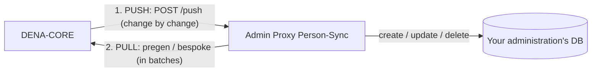
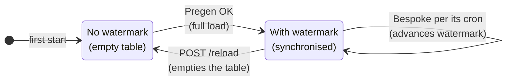

# :material-server-network: Admin Proxy Person-Sync (installation and operation)

The **Admin Proxy Person-Sync** is a component (`.jar` or `.war`) you install in your administration to keep an **always up-to-date local copy of DENA's persons**, without programming the [Person-Sync](../operativas/person-sync.md) integration yourself.

**Download:** [:octicons-download-24: dena-admin-proxy-person-sync-rest · 0.5.25-SNAPSHOT](https://github.com/DENA-Euskadi/dena-admin-proxy-person-sync-rest/releases/tag/0.5.25-SNAPSHOT)

---

## Key concepts

These seven terms appear throughout the page:

| Term | What it is |
|------|------------|
| **Push** | DENA-CORE **calls you** (`POST /push`) every time a person changes. It is immediate |
| **Pull** | Your service **calls DENA-CORE** to download persons in batches. It covers whatever Push did not deliver (outages, network cuts...) |
| **Pregen** | **Full load** Pull job: downloads a dump with **all** persons |
| **Bespoke** | **Incremental** Pull job: downloads only the persons changed since last time |
| **Watermark** | Timestamp stored in your DB: *"I have everything synchronised up to this moment"*. It decides which job works |
| **ShedLock** | DB lock that guarantees only **one replica** runs a Pull job at a time |
| **Scheduler cron** | Expressions that set how often bespoke and pregen run. The values for development and production are in *Recommended scheduler timings*, inside *Minimum configuration* |

The idea in one sentence: **pregen fills the table once, bespoke keeps it up to date and Push applies changes in real time.**

---

## Full data reload (`/reload`)

The `/reload` endpoint **deletes local persons and launches a pregen** that reloads all of them from DENA-CORE. Use it when:

- **In development**, you want to start with clean data or repeat the initial load.
- **In production**, local data has become corrupted or out of sync after a serious failure (DB restore, manual deletions, long outage...).

```bash
curl -X POST "<BASE_URL>/api/admin/proxy/persons/sync/reload"
```

When called, the service:

1. Waits for any running Pull job to finish (up to 60 s, `RELOAD_LOCK_WAIT_FOR`). If it does not finish in time, it answers **`409`** and does nothing: try again later.
2. **Empties the local persons table** and clears the *watermark*, in a single transaction.
3. Answers **`200 OK`** (no body) and launches the pregen in the background, without waiting for it to finish.
4. When the pregen ends, a new *watermark* is set and bespoke carries on by itself from that point.

| HTTP code | Meaning |
|-----------|---------|
| `200 OK` | Table emptied and pregen launched. **It does not mean the load has finished**: follow its progress in the log (`receivedPersonItemsCount`) |
| `409 Conflict` | A pregen or bespoke was running and did not finish within `RELOAD_LOCK_WAIT_FOR`. Nothing has been deleted |
| `500 Internal Server Error` | `DENA_ADMINPROXY_PERSON_SYNC_JOBS_SCHEDULER_REQUESTOR_ADMIN` is missing or emptying the table failed |

---

## Quick start

The component combines two mechanisms. With **Push**, DENA-CORE calls `/push` every time a person changes, and the change is applied immediately in your database. With **Pull**, two scheduled jobs download persons from DENA-CORE in batches: **pregen** does the full load and **bespoke** fetches only what has changed, as often as `DENA_ADMINPROXY_PERSON_SYNC_JOBS_SCHEDULER_BESPOKE_CRON` sets, covering whatever Push did not deliver.

The *watermark*, the timestamp up to which your data is synchronised, decides which job works: without a *watermark* pregen acts, with a *watermark* bespoke acts. On startup, the service launches pregen in the background if there is no *watermark* yet. Pull requires `DENA_ADMINPROXY_PERSON_SYNC_JOBS_SCHEDULER_ENABLED=true`. The details are in *How it works*, at the end of the page.

| # | Step | Detail |
|---|------|--------|
| 1 | **Prepare the database** | Empty MySQL 8 or Oracle schema and a user allowed to create tables (see *Prerequisites*) |
| 2 | **Gather DENA's data** | Your administration's `client-id` and `secret`, your `ID_ADMIN` and DENA-CORE's public Person-Sync URL |
| 3 | **Install the component** | `.jar` (Option A) or `.war` on Tomcat 11 (Option B). See *Installation* |
| 4 | **Set the minimum configuration** | The variables in *Minimum configuration*, with the crons from *Recommended scheduler timings* |
| 5 | **Start and check** | `GET <BASE_URL>/actuator/health` must return `UP` |
| 6 | **Verify the initial load** | In the log, `running pregen pull task on application startup` followed by `receivedPersonItemsCount` |
| 7 | **Open the network for Push** | DENA-CORE must be able to reach `<BASE_URL>/api/admin/proxy/persons/sync/push` (firewall, ingress) |

---

## Prerequisites

| Requirement | Detail |
|-------------|--------|
| **Java** | 21 or later |
| **Database** | MySQL 8.x or Oracle, reachable from the server |
| **Outbound network** | To **Keycloak** (validate incoming tokens and request outgoing ones) and to **DENA-CORE Person-Sync** (Pull) |
| **Inbound network** | To the service port, to receive DENA's Push |
| **Temporary disk** | Write access to `/tmp` or `%TEMP%`: downloaded `.sqlite` dumps are stored there |

**Tables.** With `DENA_DDBB_HBM2DDL_AUTO=update` (default), Hibernate creates the tables at startup. With `validate` or `none`, these must exist beforehand:

- the person tables (with the `DENA_DDBB_TABLES_PREFIX` prefix, default `Z99`),
- the bespoke state table (*watermark* and pending job),
- the `PERSONSYNCJOBSHEDLOCK` lock table (columns `name`, `lock_until`, `locked_at`, `locked_by`).

---

## Installation

**Download:** [:octicons-download-24: dena-admin-proxy-person-sync-rest · 0.5.25-SNAPSHOT](https://github.com/DENA-Euskadi/dena-admin-proxy-person-sync-rest/releases/tag/0.5.25-SNAPSHOT)

It is delivered in two equivalent formats. Choose one:

| Component | When to use it |
|----------|----------------|
| `denaInteropAdminProxyPersonSyncAPP-<version>.jar` | Standalone execution, with an embedded web server. The simplest option |
| `denaInteropAdminProxyPersonSyncAPP-<version>.war` | If your standard is deploying on an external **Apache Tomcat 11.x** (Servlet 6.1) |

### Option A: `.jar` (standalone)

Nothing else is needed: the web server and the `sqlite-jdbc` driver are inside.

```bash
java -jar denaInteropAdminProxyPersonSyncAPP-<version>.jar
```

It starts on port **`8100`** with the context path **`/admin-person-proxy-sync`**.

### Option B: `.war` on Tomcat 11

**Step 1. Install `sqlite-jdbc` in Tomcat's `lib/` (mandatory).**
The service reads DENA-CORE's dumps as SQLite databases. The driver must be in Tomcat's common `ClassLoader` so it registers correctly and redeployments do not leave native libraries loaded:

```bash
curl -L -o "$CATALINA_HOME/lib/sqlite-jdbc-3.51.3.0.jar" \
  https://repo1.maven.org/maven2/org/xerial/sqlite-jdbc/3.51.3.0/sqlite-jdbc-3.51.3.0.jar
```

Use the same `sqlite-jdbc` version shipped with the component. You can check it with `jar tf denaInteropAdminProxyPersonSyncAPP-<version>.war | grep sqlite`.

If your DB is **Oracle**, also check that the `ojdbc` driver is in `$CATALINA_HOME/lib/`.

**Step 2. Copy the `.war` to `webapps/`.** The file name sets the context path:

```bash
cp denaInteropAdminProxyPersonSyncAPP-<version>.war "$CATALINA_HOME/webapps/admin-person-proxy-sync.war"
```

!!! note "On an external Tomcat"
    The **port** is defined by `$CATALINA_HOME/conf/server.xml` and the **context path** by the `.war` name. The `DENA_SERVER_PORT` and `DENA_CONTEXT_PATH` variables are not used.

### Check that it has started

`<BASE_URL>` is the service base URL:

- **JAR**: `http://localhost:8100/admin-person-proxy-sync`
- **WAR** (`admin-person-proxy-sync.war` on a Tomcat on port `8080`): `http://localhost:8080/admin-person-proxy-sync`

```bash
curl <BASE_URL>/actuator/health
```

It must answer `{"status":"UP"...}`.

---

## Configuration

### How it is configured

The component ships a default configuration (`application-war.yml`) where everything is parameterised as `${DENA_...}`. Override what you need **without touching the `.jar` or `.war`**, with any of these methods (lowest to highest priority):

=== "1. Environment variables"

    ```bash
    export DENA_DDBB_URL="jdbc:mysql://localhost:3306/dena_person_proxy?useSSL=false&serverTimezone=UTC&allowPublicKeyRetrieval=true"
    export DENA_DDBB_USER="<db_user>"
    export DENA_DDBB_PASSWORD="<db_password>"
    export DENA_PERSON_SYNC_PROXY_HOST="<dena-core-host>/person-sync"
    export DENA_PERSON_SYNC_PROXY_ORG_ADMIN_ID="<ID_ADMIN>"
    export DENA_PERSON_SYNC_PROXY_SECURITY_CLIENT_ID="<client-id>"
    export DENA_PERSON_SYNC_PROXY_SECURITY_SECRET="<client-secret>"

    java -jar denaInteropAdminProxyPersonSyncAPP-<version>.jar
    ```

=== "2. JVM properties or arguments"

    On **Tomcat** (`setenv.sh` or `CATALINA_OPTS`):

    ```bash
    export CATALINA_OPTS="$CATALINA_OPTS \
      -DDENA_DDBB_HOST=10.0.0.15 \
      -DDENA_DDBB_PORT=3306 \
      -DDENA_DDBB_USER=<db_user> \
      -DDENA_DDBB_PASSWORD=<db_password>"
    ```

    With the **JAR**:

    ```bash
    java -jar denaInteropAdminProxyPersonSyncAPP-<version>.jar \
      --DENA_DDBB_HOST=localhost \
      --DENA_DDBB_USER=<db_user> \
      --DENA_DDBB_PASSWORD=<db_password>
    ```

=== "3. External file"

    ```bash
    java -jar denaInteropAdminProxyPersonSyncAPP-<version>.jar \
      --spring.config.additional-location=optional:file:/etc/dena/application-custom.yml
    ```

    On **Tomcat**:

    ```bash
    export CATALINA_OPTS="$CATALINA_OPTS -Dspring.config.additional-location=optional:file:/etc/dena/application-custom.yml"
    ```

!!! danger "Values you must always change"
    Default values ending in `-change` or `_change` (`db_user_change`, `keycloak-client-id-change`, `ADMIN-change`...) are **placeholders**. The service starts with them, but it **will not work** until you set the real ones.

### Minimum configuration

What you **must** set in a real environment. The rest has a valid default.

| Block | Variables | What to set |
|-------|-----------|-------------|
| Database | `DENA_DDBB_URL` (or `HOST`/`PORT`/`NAME`), `DENA_DDBB_USER`, `DENA_DDBB_PASSWORD` | Your DB's data. For Oracle, also change `DRIVER` and `PLATFORM` |
| Keycloak (inbound Push) | `DENA_KEYCLOAK_URL`, `DENA_KEYCLOAK_REALM_ADMIN`, `DENA_TOKEN_URL_ADMIN`, `DENA_INTROSPECTION_URL_ADMIN`, `DENA_KEYCLOAK_CLIENT_ID_ADMIN`, `DENA_KEYCLOAK_CLIENT_SECRET_ADMIN` | The IdP data DENA gives you. The URLs already point to PRE: in PRE the client ID and secret are enough |
| DENA-CORE (outbound Pull) | `DENA_PERSON_SYNC_PROXY_HOST`, `DENA_PERSON_SYNC_PROXY_PROTOCOL`, `DENA_PERSON_SYNC_PROXY_ORG_ADMIN_ID`, `DENA_PERSON_SYNC_PROXY_SECURITY_CLIENT_ID`, `DENA_PERSON_SYNC_PROXY_SECURITY_SECRET` | DENA-CORE's public URL and your administration's credentials |
| Scheduler | `DENA_ADMINPROXY_PERSON_SYNC_JOBS_SCHEDULER_ENABLED`, `DENA_ADMINPROXY_PERSON_SYNC_JOBS_SCHEDULER_REQUESTOR_ADMIN`, `DENA_ADMINPROXY_PERSON_SYNC_JOBS_SCHEDULER_BESPOKE_CRON`, `DENA_ADMINPROXY_PERSON_SYNC_JOBS_SCHEDULER_PREGEN_CRON` | `ENABLED=true`, your administration and the crons from *Recommended scheduler timings* (right below) |

!!! important "Recommended scheduler timings"
    **Development**

    ```yaml
    DENA_ADMINPROXY_PERSON_SYNC_JOBS_SCHEDULER_BESPOKE_CRON: "0 0/5 * * * *"
    DENA_ADMINPROXY_PERSON_SYNC_JOBS_SCHEDULER_PREGEN_CRON: "0 0 3 * * *"
    ```

    **Production**

    ```yaml
    DENA_ADMINPROXY_PERSON_SYNC_JOBS_SCHEDULER_BESPOKE_CRON: "0 0/5 * * * *"
    DENA_ADMINPROXY_PERSON_SYNC_JOBS_SCHEDULER_PREGEN_CRON: "-"
    ```

    Bespoke runs every 5 minutes in both environments. Pregen runs every day at 03:00 in development and is disabled (`"-"`) in production.

!!! warning "Pull is disabled by default"
    By default `DENA_ADMINPROXY_PERSON_SYNC_JOBS_SCHEDULER_ENABLED=false`. The service then **only receives Push**: no initial load, no bespoke, and `/reload` does not reload. Set it to `true`.

### Full variable reference

#### HTTP server (`.jar` mode only)

| Variable | Default | Description |
|----------|---------|-------------|
| `DENA_SERVER_PORT` | `8100` | HTTP port of the embedded server |
| `DENA_CONTEXT_PATH` | `/admin-person-proxy-sync` | Service base path |

#### Administration database

| Variable | Default | Description |
|----------|---------|-------------|
| `DENA_DDBB_HOST` | `localhost` | DB host or IP |
| `DENA_DDBB_PORT` | `3306` | Port (`3306` MySQL, `1521`/`1530` Oracle) |
| `DENA_DDBB_NAME` | `dena_person_proxy` | DB or schema name |
| `DENA_DDBB_URL` | MySQL JDBC URL | Full JDBC URL. Oracle: `jdbc:oracle:thin:@host:port/SERVICE` |
| `DENA_DDBB_USER` | `db_user_change` | User |
| `DENA_DDBB_PASSWORD` | `db_password_change` | Password |
| `DENA_DDBB_DRIVER` | `com.mysql.cj.jdbc.Driver` | Driver class (`oracle.jdbc.OracleDriver` for Oracle) |
| `DENA_DDBB_PLATFORM` | `dena.core.common.db.mysql.DN01MySQLDenaDialect` | Hibernate dialect (`org.hibernate.dialect.OracleDialect` for Oracle) |
| `DENA_DDBB_HBM2DDL_AUTO` | `update` | Hibernate DDL strategy. `validate` or `none` recommended in production (see *Prerequisites*) |
| `DENA_DDBB_TABLES_PREFIX` | `Z99` | Prefix of the person tables |

#### OAuth2 / Keycloak security (inbound Push)

The defaults point to the **PRE** Keycloak. In any other environment, change all the URLs.

| Variable | Default | Description |
|----------|---------|-------------|
| `DENA_KEYCLOAK_URL` | `https://api.pre.dena.eus/auth` | Keycloak base URL |
| `DENA_KEYCLOAK_REALM_ADMIN` | `DenaAuthAdmins` | Administrations realm |
| `DENA_TOKEN_URL_ADMIN` | `https://api.pre.dena.eus/auth/realms/DenaAuthAdmins/protocol/openid-connect/token` | Token endpoint |
| `DENA_INTROSPECTION_URL_ADMIN` | `https://api.pre.dena.eus/auth/realms/DenaAuthAdmins/protocol/openid-connect/token/introspect` | Introspection endpoint for incoming tokens |
| `DENA_KEYCLOAK_CLIENT_ID_ADMIN` | `keycloak-client-id-change` | Client ID used to introspect `/push` tokens |
| `DENA_KEYCLOAK_CLIENT_SECRET_ADMIN` | `keycloak-client-secret-change` | Introspection Client Secret |

#### REST client to DENA-CORE (outbound Pull)

| Variable | Default | Description |
|----------|---------|-------------|
| `DENA_PERSON_SYNC_PROXY_HOST` | `e80a021k-dena-person-admin-sync-rest-svc:8080/person-sync` | Host, port and path of Person-Sync in DENA-CORE. The default is an internal name in DENA's cluster: use the public URL you are given (for example `api-batera.pre.dena.eus/person-sync` in PRE, with `PROTOCOL=HTTPS`) |
| `DENA_PERSON_SYNC_PROXY_PROTOCOL` | `HTTP` | `HTTP` or `HTTPS` |
| `DENA_PERSON_SYNC_PROXY_ORG_ADMIN_ID` | `SANDBOXCIF` | Administration sent in the `X-DENA-ORG-ADMIN-ID` header |
| `DENA_PERSON_SYNC_PROXY_SECURITY_IDP_ENDPOINT_URL` | `${DENA_TOKEN_URL_ADMIN}` | Token endpoint the service uses to get its token for DENA-CORE |
| `DENA_PERSON_SYNC_PROXY_SECURITY_IDP_ID` | `keycloak-change` | IdP identifier |
| `DENA_PERSON_SYNC_PROXY_SECURITY_CLIENT_ID` | `admin-client-id-change` | Your administration's OAuth2 Client ID |
| `DENA_PERSON_SYNC_PROXY_SECURITY_SECRET` | `admin-client-secret-change` | Your administration's OAuth2 Client Secret |

#### Pull scheduler

| Variable | Default | Description |
|----------|---------|-------------|
| `DENA_ADMINPROXY_PERSON_SYNC_JOBS_SCHEDULER_ENABLED` | **`false`** | Enables Pull: load on startup, pregen, bespoke and `/reload` |
| `DENA_ADMINPROXY_PERSON_SYNC_JOBS_SCHEDULER_BESPOKE_CRON` | `"0 0/5 * * * *"` | Bespoke cron |
| `DENA_ADMINPROXY_PERSON_SYNC_JOBS_SCHEDULER_PREGEN_CRON` | `"0 0 3 * * *"` | Pregen cron. `"-"` disables it (recommended in production) |
| `DENA_ADMINPROXY_PERSON_SYNC_JOBS_SCHEDULER_REQUESTOR_ADMIN` | `"ADMIN-change"` | Your administration: the *watermark* is stored and jobs are requested with it |
| `DENA_ADMINPROXY_PERSON_SYNC_JOBS_SCHEDULER_LOCK_AT_LEAST_FOR` | `"PT30S"` | Minimum time the lock is held (ISO-8601) |
| `DENA_ADMINPROXY_PERSON_SYNC_JOBS_SCHEDULER_LOCK_AT_MOST_FOR` | `"PT15M"` | Maximum lock time if a replica dies mid-job |
| `DENA_ADMINPROXY_PERSON_SYNC_JOBS_SCHEDULER_PENDING_JOB_TIMEOUT` | `PT15M` | Maximum time a pending bespoke export is reused |
| `DENA_ADMINPROXY_PERSON_SYNC_JOBS_SCHEDULER_RELOAD_LOCK_WAIT_FOR` | `PT60S` | Maximum time `/reload` waits for the lock (otherwise `409`) |

`PENDING_JOB_TIMEOUT` and `RELOAD_LOCK_WAIT_FOR` are not in `application-war.yml`: if you do not set them, the code defaults listed above apply.

#### Logs

| Variable | Default | Description |
|----------|---------|-------------|
| `DENA_LOGGING_ROOT` | `INFO` | General level |
| `DENA_LOGGING_WEB` | `INFO` | HTTP requests |
| `DENA_LOGGING_SECURITY` | `WARN` | Security |
| `DENA_LOGGING_SECURITY_OAUTH2` | `WARN` | OAuth2 security (useful to debug tokens) |
| `DENA_LOGGING_HIBERNATE_SQL` | `ERROR` | SQL statements |

---

## Endpoints

| Method | Path | Authentication | Description |
|--------|------|----------------|-------------|
| `POST` | `<BASE_URL>/api/admin/proxy/persons/sync/push` | **Yes** (`Bearer` JWT) | Receives the creation, update or deletion Push |
| `POST` | `<BASE_URL>/api/admin/proxy/persons/sync/reload` | **No** | Deletes local persons and relaunches the full load (see *Full data reload*) |
| `GET` | `<BASE_URL>/actuator/health` | No | Service status |
| `GET` | `<BASE_URL>/v3/api-docs` | No | OpenAPI 3 contract in JSON |
| `GET` | `<BASE_URL>/swagger-ui.html` | No | Swagger UI |

### `/push` responses

The token in the `Authorization` header must be a valid, active JWT from the administrations realm (`DenaAuthAdmins`), with audience `account` and the `dena.admin.oid` and `dena.admin.id` claims.

| HTTP code | Meaning |
|-----------|---------|
| `200 OK` | Change applied: person created, updated or deleted |
| `400 Bad Request` | The message has no `payload` or no reference to the person |
| `401 Unauthorized` | `Authorization` is missing, the token has expired, Keycloak answers `active: false` or the mandatory claims are missing |
| `500 Internal Server Error` | Error saving to the DB or malformed JSON |

Full message specification: [Push Endpoint](../semantica/person-sync/push.md) and [Pull Endpoint](../semantica/person-sync/pull.md).

---

## Common problems

Always start with the log: almost every case is identified by a specific message.

| Symptom or log message | Likely cause | What to do |
|------------------------|--------------|------------|
| `401` on `/push` | Missing or expired token, `active: false` in introspection, or missing `dena.admin.oid` / `dena.admin.id` claims | Check the token and the `DENA_KEYCLOAK_*` and `DENA_INTROSPECTION_URL_ADMIN` variables |
| Nothing arrives by Pull and there are no pregen or bespoke traces | `SCHEDULER_ENABLED=false` (default) | Set it to `true` |
| `Failed to fetch OAuth token` | The token URL is unreachable or the credentials are wrong | Check `DENA_TOKEN_URL_ADMIN`, client ID/secret and outbound network to Keycloak |
| `Watermark is NULL ... skipping bespoke` (continuously) | The initial load has not finished or has failed | Look for the pregen error in the log (`Cannot create received person error`). Fix it and restart the service or call `/reload` |
| `Watermark is already initialized ... skipping pregen execution` | Data is already synchronised | This is normal. To reload from scratch, use `/reload` |
| The initial load failed and is not retried in production | `PREGEN_CRON="-"` disables scheduled retries | Restart the service or call `/reload` |
| `/reload` answers `409` | A Pull job holds the lock longer than `RELOAD_LOCK_WAIT_FOR` | Wait for it to finish and call again |
| `/reload` answers `200` but the table stays empty | `SCHEDULER_ENABLED=false`: nothing launches the pregen | Set `SCHEDULER_ENABLED=true` and restart (the load runs on startup) |
| Driver error when reading the `.sqlite` on Tomcat | `sqlite-jdbc` is missing from `$CATALINA_HOME/lib/` | Install it (Option B, step 1) |
| Pull fails because of DENA-CORE's URL | `DENA_PERSON_SYNC_PROXY_HOST` has the internal default value | Set DENA-CORE's public URL and `PROTOCOL=HTTPS` |

---

## How it works

### Overview



The two mechanisms complement each other: **Push** gives immediacy and **Pull** guarantees nothing is lost.

### Push: real-time changes

When a person registers, changes their data or unsubscribes in DENA:

1. DENA-CORE sends `POST <BASE_URL>/api/admin/proxy/persons/sync/push`.
2. The service validates the `Bearer` token against Keycloak (introspection and JWT verification).
3. It applies the change in your DB according to `payload.syncData.syncEvent`:

| Event | What it does in your DB |
|-------|-------------------------|
| `CREATED` / `UPDATED` | If the person does not exist, it is **created**; if it exists, it is **updated** |
| `DELETED` | If it exists, it is **deleted**. If it did not exist, it still answers OK (idempotent) |

### Pull: batch synchronisation

Two scheduled jobs, coordinated with ShedLock so they never run at the same time (neither across replicas nor with each other: they share the `adminproxy.person.pull` lock).

| Job | What it does | When it works |
|-----|--------------|---------------|
| **Pregen** (full load) | Downloads the `.sqlite` dump with all persons and *upserts* them in batches. When done, it sets the *watermark* | Only when there is **no** *watermark* |
| **Bespoke** (incremental) | Asks DENA-CORE for the persons changed in `[watermark − 5 min, now]`, waits for the export to finish, downloads it, *upserts* and advances the *watermark*. If an export was left pending from the previous run, it reuses it (up to `PENDING_JOB_TIMEOUT`) | Only when there **is** a *watermark* |

The 5-minute margin overlaps each window with the previous one, so changes arriving right at the boundary are not lost.

### Lifecycle: which job works at each moment



| State | Pregen | Bespoke |
|-------|--------|---------|
| No watermark | **Works** | Skipped (log: `Watermark is NULL ... skipping bespoke`) |
| With watermark | Skipped (log: `Watermark is already initialized ... skipping pregen execution`) | **Works** |

One of the two being skipped **is normal**, not an error.

### What happens on startup

With `SCHEDULER_ENABLED=true`, on startup (`ApplicationReadyEvent`) the service launches a pregen **in the background**, without blocking startup:

- If the DB already has a *watermark* → it does nothing and bespoke carries on as usual.
- If it does not (first installation) → it does the full load.
- If the load fails (for example, DENA-CORE does not respond) → it is only retried by the pregen cron. **With `PREGEN_CRON="-"` there is no automatic retry**: restart the service or call `/reload`.

### Deletions (`DELETED`)

Deletions are guaranteed **through Push**. Whether incremental Pull also reflects them depends on the events DENA-CORE includes in the dump; do not rely on it without checking in your environment.

### Outbound calls to DENA-CORE

On every Pull call, the service obtains an OAuth2 token (`client_credentials`) from the configured IdP and adds the `Authorization: Bearer ...` and `X-DENA-ORG-ADMIN-ID` headers.

---

**See also:** [:octicons-arrow-right-24: Person-Sync (Synchronise Persons)](../operativas/person-sync.md)

<!-- DENA-DOC-FOOTER -->
---
<sub>DENA Docs v{{ dena.version }} · {{ dena.date }}</sub>
