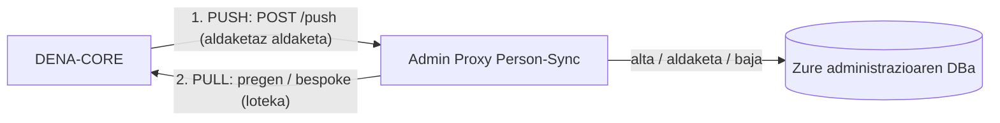
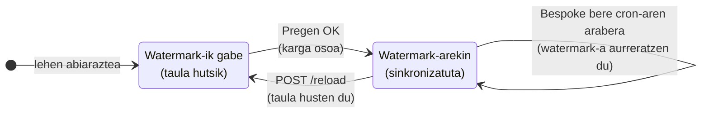

# :material-server-network: Admin Proxy Person-Sync (instalazioa eta funtzionamendua)

**Admin Proxy Person-Sync** zure administrazioan instalatzen den osagai bat da (`.jar` edo `.war`), **DENAko pertsonen kopia lokal bat** beti eguneratuta izateko, [Person-Sync](../operativas/person-sync.md)-en integrazioa zuk zeuk programatu behar izan gabe.

**Deskarga:** [:octicons-download-24: dena-admin-proxy-person-sync-rest · 0.5.25-SNAPSHOT](https://github.com/DENA-Euskadi/dena-admin-proxy-person-sync-rest/releases/tag/0.5.25-SNAPSHOT)

---

## Oinarrizko kontzeptuak

Zazpi termino hauek orri osoan agertzen dira:

| Terminoa | Zer den |
|----------|---------|
| **Push** | DENA-CORE-k **zuri deitzen dizu** (`POST /push`) pertsona bat aldatzen den bakoitzean. Berehalakoa da |
| **Pull** | Zure zerbitzuak **DENA-CORE-ri deitzen dio** pertsonak loteka deskargatzeko. Push-ak entregatu ez duena estaltzen du (etenaldiak, sare-mozketak...) |
| **Pregen** | **Karga osoko** Pull joba: pertsona **guztiak** dituen bolkatu bat deskargatzen du |
| **Bespoke** | Pull job **inkrementala**: azken alditik aldatu diren pertsonak bakarrik deskargatzen ditu |
| **Watermark** | Zure datu-basean gordetako denbora-marka: *"une honetara arte dena sinkronizatuta daukat"*. Zein jobek lan egiten duen erabakitzen du |
| **ShedLock** | Datu-baseko blokeoa, Pull job bat aldi berean **erreplika bakar batek** exekutatzen duela bermatzen duena |
| **Planifikatzailearen cron-a** | Bespoke eta pregen noiz exekutatzen diren finkatzen duten adierazpenak. Garapenerako eta produkziorako balioak *Planifikatzailearen gomendatutako denborak* atalean daude, *Gutxieneko konfigurazioa*-ren barruan |

Ideia esaldi batean: **pregenak taula behin betetzen du, bespoke-k egunean mantentzen du eta Push-ak aldaketak denbora errealean aplikatzen ditu.**

---

## Datuen birkarga osoa (`/reload`)

`/reload` endpoint-ak **pertsona lokalak ezabatzen ditu eta pregen bat abiarazten du**, DENA-CORE-tik guztiak berriro kargatzeko. Erabili:

- **Garapenean**, datu garbiekin hasi edo hasierako karga errepikatu nahi duzunean.
- **Produkzioan**, datu lokalak hondatuta edo desinkronizatuta geratu badira huts larri baten ondoren (datu-basea leheneratzea, eskuzko ezabatzeak, etenaldi luzea...).

```bash
curl -X POST "<BASE_URL>/api/admin/proxy/persons/sync/reload"
```

Deitzean, zerbitzuak:

1. Martxan dagoen Pull jobak amaitu arte itxaroten du (60 s arte, `RELOAD_LOCK_WAIT_FOR`). Garaiz amaitzen ez bada, **`409`** erantzuten du eta ez du ezer egiten: saiatu berriro geroago.
2. **Pertsonen taula lokala husten du** eta *watermark*-a ezabatzen du, transakzio bakarrean.
3. **`200 OK`** erantzuten du (gorputzik gabe) eta pregena atzeko planoan abiarazten du, amaitu arte itxaron gabe.
4. Pregena amaitzean, *watermark* berri bat finkatzen da eta bespoke-k bere kabuz jarraitzen du puntu horretatik.

| HTTP kodea | Esanahia |
|------------|----------|
| `200 OK` | Taula hustu da eta pregena abiarazi da. **Ez du esan nahi karga amaitu denik**: jarraitu aurrerapena log-ean (`receivedPersonItemsCount`) |
| `409 Conflict` | Pregen edo bespoke bat martxan zegoen eta ez zen `RELOAD_LOCK_WAIT_FOR` barruan amaitu. Ez da ezer ezabatu |
| `500 Internal Server Error` | `DENA_ADMINPROXY_PERSON_SYNC_JOBS_SCHEDULER_REQUESTOR_ADMIN` falta da edo taula hustean huts egin du |

---

## Hasiera azkarra

Osagaiak bi mekanismo konbinatzen ditu. **Push** bidez, DENA-CORE-k `/push`-i deitzen dio pertsona bat aldatzen den bakoitzean, eta aldaketa berehala aplikatzen da zure datu-basean. **Pull** bidez, bi job programatuk pertsonak loteka deskargatzen dituzte DENA-CORE-tik: **pregen**-ak karga osoa egiten du eta **bespoke**-k aldatu dena bakarrik ekartzen du, `DENA_ADMINPROXY_PERSON_SYNC_JOBS_SCHEDULER_BESPOKE_CRON`-ek ezartzen duen maiztasunarekin, Push-ak entregatu ez duena estaltzeko.

Zein jobek lan egiten duen *watermark*-ak erabakitzen du, zure datuak sinkronizatuta dauden denbora-markak: *watermark*-ik gabe pregen-ak jarduten du, *watermark*-arekin bespoke-k. Abiaraztean, zerbitzuak pregena atzeko planoan abiarazten du oraindik *watermark*-ik ez badago. Pull-ak `DENA_ADMINPROXY_PERSON_SYNC_JOBS_SCHEDULER_ENABLED=true` behar du. Xehetasunak *Nola funtzionatzen du* atalean daude, orriaren amaieran.

| # | Urratsa | Xehetasuna |
|---|---------|------------|
| 1 | **Prestatu datu-basea** | MySQL 8 edo Oracle eskema huts bat eta taulak sortzeko baimena duen erabiltzaile bat (ikus *Aurrebaldintzak*) |
| 2 | **Bildu DENAren datuak** | Zure administrazioaren `client-id` eta `secret`, zure `ID_ADMIN` eta DENA-CORE-ren Person-Sync URL publikoa |
| 3 | **Instalatu osagaia** | `.jar` (A aukera) edo `.war` Tomcat 11-n (B aukera). Ikus *Instalazioa* |
| 4 | **Ezarri gutxieneko konfigurazioa** | *Gutxieneko konfigurazioa* ataleko aldagaiak, *Planifikatzailearen gomendatutako denborak*-eko cron-ekin |
| 5 | **Abiarazi eta egiaztatu** | `GET <BASE_URL>/actuator/health`-ek `UP` itzuli behar du |
| 6 | **Egiaztatu hasierako karga** | Log-ean, `running pregen pull task on application startup` eta ondoren `receivedPersonItemsCount` |
| 7 | **Ireki sarea Push-erako** | DENA-CORE-k `<BASE_URL>/api/admin/proxy/persons/sync/push` iritsi ahal izan behar du (suebakia, ingress) |

---

## Aurrebaldintzak

| Baldintza | Xehetasuna |
|-----------|------------|
| **Java** | 21 edo berriagoa |
| **Datu-basea** | MySQL 8.x edo Oracle, zerbitzaritik eskuragarri |
| **Irteerako sarea** | **Keycloak**-erantz (sarrerako token-ak balioztatu eta irteerakoak eskatzeko) eta **DENA-CORE Person-Sync**-erantz (Pull) |
| **Sarrerako sarea** | Zerbitzuaren atakara, DENAren Push-a jasotzeko |
| **Aldi baterako diskoa** | `/tmp` edo `%TEMP%`-en idazteko baimena: deskargatutako `.sqlite` bolkatuak bertan gordetzen dira |

**Taulak.** `DENA_DDBB_HBM2DDL_AUTO=update` denean (lehenespena), Hibernate-k taulak sortzen ditu abiaraztean. `validate` edo `none` erabiliz gero, hauek lehendik existitu behar dute:

- pertsonen taulak (`DENA_DDBB_TABLES_PREFIX` aurrizkiarekin, lehenespenez `Z99`),
- bespoke-ren egoera-taula (*watermark*-a eta job zaina),
- `PERSONSYNCJOBSHEDLOCK` blokeo-taula (`name`, `lock_until`, `locked_at`, `locked_by` zutabeak).

---

## Instalazioa

**Deskarga:** [:octicons-download-24: dena-admin-proxy-person-sync-rest · 0.5.25-SNAPSHOT](https://github.com/DENA-Euskadi/dena-admin-proxy-person-sync-rest/releases/tag/0.5.25-SNAPSHOT)

Bi formatu baliokidetan entregatzen da. Aukeratu bat:

| Osagaia | Noiz erabili |
|------------|--------------|
| `denaInteropAdminProxyPersonSyncAPP-<version>.jar` | Exekuzio autonomoa, web zerbitzari txertatuarekin. Aukerarik errazena |
| `denaInteropAdminProxyPersonSyncAPP-<version>.war` | Zure estandarra kanpoko **Apache Tomcat 11.x** batean (Servlet 6.1) instalatzea bada |

### A aukera: `.jar` (standalone)

Ez da ezer gehiago behar: web zerbitzaria eta `sqlite-jdbc` driver-a barruan doaz.

```bash
java -jar denaInteropAdminProxyPersonSyncAPP-<version>.jar
```

**`8100`** atakan abiarazten da, **`/admin-person-proxy-sync`** context-path-arekin.

### B aukera: `.war` Tomcat 11-n

**1. urratsa. Instalatu `sqlite-jdbc` Tomcat-en `lib/`-en (derrigorrezkoa).**
Zerbitzuak DENA-CORE-ren bolkatuak SQLite datu-base gisa irakurtzen ditu. Driver-ak Tomcat-en `ClassLoader` komunean egon behar du, ondo erregistratzeko eta berrinstalazioek liburutegi natiboak kargatuta utz ez ditzaten:

```bash
curl -L -o "$CATALINA_HOME/lib/sqlite-jdbc-3.51.3.0.jar" \
  https://repo1.maven.org/maven2/org/xerial/sqlite-jdbc/3.51.3.0/sqlite-jdbc-3.51.3.0.jar
```

Erabili osagaiak dakarren `sqlite-jdbc` bertsio bera. Honela egiazta dezakezu: `jar tf denaInteropAdminProxyPersonSyncAPP-<version>.war | grep sqlite`.

Zure datu-basea **Oracle** bada, egiaztatu `ojdbc` driver-a ere `$CATALINA_HOME/lib/`-en dagoela.

**2. urratsa. Kopiatu `.war` fitxategia `webapps/`-era.** Fitxategiaren izenak finkatzen du context-path-a:

```bash
cp denaInteropAdminProxyPersonSyncAPP-<version>.war "$CATALINA_HOME/webapps/admin-person-proxy-sync.war"
```

!!! note "Kanpoko Tomcat-en"
    **Ataka** `$CATALINA_HOME/conf/server.xml`-ek definitzen du eta **context-path**-a `.war`-aren izenak. `DENA_SERVER_PORT` eta `DENA_CONTEXT_PATH` aldagaiak ez dira erabiltzen.

### Abiatu dela egiaztatu

`<BASE_URL>` zerbitzuaren oinarrizko URLa da:

- **JAR**: `http://localhost:8100/admin-person-proxy-sync`
- **WAR** (`admin-person-proxy-sync.war`, `8080` atakako Tomcat batean): `http://localhost:8080/admin-person-proxy-sync`

```bash
curl <BASE_URL>/actuator/health
```

`{"status":"UP"...}` erantzun behar du.

---

## Konfigurazioa

### Nola konfiguratzen den

Osagaiak konfigurazio lehenetsi bat dakar (`application-war.yml`), dena `${DENA_...}` gisa parametrizatuta. Gainidatzi behar duzuna **`.jar` edo `.war` ukitu gabe**, metodo hauetako edozeinekin (lehentasun txikienetik handienera):

=== "1. Ingurune-aldagaiak"

    ```bash
    export DENA_DDBB_URL="jdbc:mysql://localhost:3306/dena_person_proxy?useSSL=false&serverTimezone=UTC&allowPublicKeyRetrieval=true"
    export DENA_DDBB_USER="<db_erabiltzailea>"
    export DENA_DDBB_PASSWORD="<db_pasahitza>"
    export DENA_PERSON_SYNC_PROXY_HOST="<dena-core-host>/person-sync"
    export DENA_PERSON_SYNC_PROXY_ORG_ADMIN_ID="<ID_ADMIN>"
    export DENA_PERSON_SYNC_PROXY_SECURITY_CLIENT_ID="<client-id>"
    export DENA_PERSON_SYNC_PROXY_SECURITY_SECRET="<client-secret>"

    java -jar denaInteropAdminProxyPersonSyncAPP-<version>.jar
    ```

=== "2. JVM propietateak edo argumentuak"

    **Tomcat**-en (`setenv.sh` edo `CATALINA_OPTS`):

    ```bash
    export CATALINA_OPTS="$CATALINA_OPTS \
      -DDENA_DDBB_HOST=10.0.0.15 \
      -DDENA_DDBB_PORT=3306 \
      -DDENA_DDBB_USER=<db_erabiltzailea> \
      -DDENA_DDBB_PASSWORD=<db_pasahitza>"
    ```

    **JAR**-arekin:

    ```bash
    java -jar denaInteropAdminProxyPersonSyncAPP-<version>.jar \
      --DENA_DDBB_HOST=localhost \
      --DENA_DDBB_USER=<db_erabiltzailea> \
      --DENA_DDBB_PASSWORD=<db_pasahitza>
    ```

=== "3. Kanpoko fitxategia"

    ```bash
    java -jar denaInteropAdminProxyPersonSyncAPP-<version>.jar \
      --spring.config.additional-location=optional:file:/etc/dena/application-custom.yml
    ```

    **Tomcat**-en:

    ```bash
    export CATALINA_OPTS="$CATALINA_OPTS -Dspring.config.additional-location=optional:file:/etc/dena/application-custom.yml"
    ```

!!! danger "Beti aldatu behar diren balioak"
    `-change` edo `_change` bukaera duten balio lehenetsiak (`db_user_change`, `keycloak-client-id-change`, `ADMIN-change`...) **leku-markak** dira. Zerbitzua haiekin abiatzen da, baina **ez du funtzionatuko** benetakoak jarri arte.

### Gutxieneko konfigurazioa

Benetako ingurune batean **derrigorrez** ezarri behar duzuna. Besteek balio lehenetsi baliozkoa dute.

| Blokea | Aldagaiak | Zer jarri |
|--------|-----------|-----------|
| Datu-basea | `DENA_DDBB_URL` (edo `HOST`/`PORT`/`NAME`), `DENA_DDBB_USER`, `DENA_DDBB_PASSWORD` | Zure datu-basearen datuak. Oracle bada, aldatu `DRIVER` eta `PLATFORM` ere |
| Keycloak (Push sarrerakoa) | `DENA_KEYCLOAK_URL`, `DENA_KEYCLOAK_REALM_ADMIN`, `DENA_TOKEN_URL_ADMIN`, `DENA_INTROSPECTION_URL_ADMIN`, `DENA_KEYCLOAK_CLIENT_ID_ADMIN`, `DENA_KEYCLOAK_CLIENT_SECRET_ADMIN` | DENAk ematen dizun IdPren datuak. URLak PRE-ra seinalatuta datoz: PRE-n nahikoa da client ID eta secret-arekin |
| DENA-CORE (Pull irteerakoa) | `DENA_PERSON_SYNC_PROXY_HOST`, `DENA_PERSON_SYNC_PROXY_PROTOCOL`, `DENA_PERSON_SYNC_PROXY_ORG_ADMIN_ID`, `DENA_PERSON_SYNC_PROXY_SECURITY_CLIENT_ID`, `DENA_PERSON_SYNC_PROXY_SECURITY_SECRET` | DENA-CORE-ren URL publikoa eta zure administrazioaren kredentzialak |
| Planifikatzailea | `DENA_ADMINPROXY_PERSON_SYNC_JOBS_SCHEDULER_ENABLED`, `DENA_ADMINPROXY_PERSON_SYNC_JOBS_SCHEDULER_REQUESTOR_ADMIN`, `DENA_ADMINPROXY_PERSON_SYNC_JOBS_SCHEDULER_BESPOKE_CRON`, `DENA_ADMINPROXY_PERSON_SYNC_JOBS_SCHEDULER_PREGEN_CRON` | `ENABLED=true`, zure administrazioa eta *Planifikatzailearen gomendatutako denborak*-eko cron-ak (jarraian) |

!!! important "Planifikatzailearen gomendatutako denborak"
    **Garapena**

    ```yaml
    DENA_ADMINPROXY_PERSON_SYNC_JOBS_SCHEDULER_BESPOKE_CRON: "0 0/5 * * * *"
    DENA_ADMINPROXY_PERSON_SYNC_JOBS_SCHEDULER_PREGEN_CRON: "0 0 3 * * *"
    ```

    **Produkzioa**

    ```yaml
    DENA_ADMINPROXY_PERSON_SYNC_JOBS_SCHEDULER_BESPOKE_CRON: "0 0/5 * * * *"
    DENA_ADMINPROXY_PERSON_SYNC_JOBS_SCHEDULER_PREGEN_CRON: "-"
    ```

    Bespoke 5 minuturo exekutatzen da bi inguruneetan. Pregena egunero 03:00etan garapenean, eta desgaituta (`"-"`) produkzioan.

!!! warning "Pull desgaituta dator"
    Lehenespenez `DENA_ADMINPROXY_PERSON_SYNC_JOBS_SCHEDULER_ENABLED=false` da. Horrela, zerbitzuak **Push soilik jasotzen du**: ez dago hasierako kargarik, ez bespoke-rik, eta `/reload`-ek ez du birkargatzen. Jarri `true`-ra.

### Aldagaien erreferentzia osoa

#### HTTP zerbitzaria (`.jar` moduan bakarrik)

| Aldagaia | Lehenetsia | Deskribapena |
|----------|------------|--------------|
| `DENA_SERVER_PORT` | `8100` | Zerbitzari txertatuaren HTTP ataka |
| `DENA_CONTEXT_PATH` | `/admin-person-proxy-sync` | Zerbitzuaren oinarrizko bidea |

#### Administrazioaren datu-basea

| Aldagaia | Lehenetsia | Deskribapena |
|----------|------------|--------------|
| `DENA_DDBB_HOST` | `localhost` | Datu-basearen host-a edo IPa |
| `DENA_DDBB_PORT` | `3306` | Ataka (`3306` MySQL, `1521`/`1530` Oracle) |
| `DENA_DDBB_NAME` | `dena_person_proxy` | Datu-basearen edo eskemaren izena |
| `DENA_DDBB_URL` | MySQL JDBC URLa | JDBC URL osoa. Oracle: `jdbc:oracle:thin:@host:ataka/ZERBITZUA` |
| `DENA_DDBB_USER` | `db_user_change` | Erabiltzailea |
| `DENA_DDBB_PASSWORD` | `db_password_change` | Pasahitza |
| `DENA_DDBB_DRIVER` | `com.mysql.cj.jdbc.Driver` | Driver-aren klasea (`oracle.jdbc.OracleDriver` Oraclerako) |
| `DENA_DDBB_PLATFORM` | `dena.core.common.db.mysql.DN01MySQLDenaDialect` | Hibernate dialektoa (`org.hibernate.dialect.OracleDialect` Oraclerako) |
| `DENA_DDBB_HBM2DDL_AUTO` | `update` | Hibernate-ren DDL estrategia. Produkzioan `validate` edo `none` gomendatzen da (ikus *Aurrebaldintzak*) |
| `DENA_DDBB_TABLES_PREFIX` | `Z99` | Pertsonen taulen aurrizkia |

#### OAuth2 / Keycloak segurtasuna (Push sarrerakoa)

Balio lehenetsiek **PRE**-ko Keycloak-era seinalatzen dute. Beste ingurune batean, aldatu URL guztiak.

| Aldagaia | Lehenetsia | Deskribapena |
|----------|------------|--------------|
| `DENA_KEYCLOAK_URL` | `https://api.pre.dena.eus/auth` | Keycloak-en oinarrizko URLa |
| `DENA_KEYCLOAK_REALM_ADMIN` | `DenaAuthAdmins` | Administrazioen realm-a |
| `DENA_TOKEN_URL_ADMIN` | `https://api.pre.dena.eus/auth/realms/DenaAuthAdmins/protocol/openid-connect/token` | Token-a lortzeko endpoint-a |
| `DENA_INTROSPECTION_URL_ADMIN` | `https://api.pre.dena.eus/auth/realms/DenaAuthAdmins/protocol/openid-connect/token/introspect` | Sarrerako token-en introspekzio-endpoint-a |
| `DENA_KEYCLOAK_CLIENT_ID_ADMIN` | `keycloak-client-id-change` | `/push`-eko token-ak introspektatzeko Client ID-a |
| `DENA_KEYCLOAK_CLIENT_SECRET_ADMIN` | `keycloak-client-secret-change` | Introspekzioaren Client Secret-a |

#### DENA-CORE-rako REST bezeroa (Pull irteerakoa)

| Aldagaia | Lehenetsia | Deskribapena |
|----------|------------|--------------|
| `DENA_PERSON_SYNC_PROXY_HOST` | `e80a021k-dena-person-admin-sync-rest-svc:8080/person-sync` | DENA-CORE-ko Person-Sync-en host-a, ataka eta bidea. Lehenetsia DENAren klusterreko barne-izen bat da: erabili eman dizuten URL publikoa (adibidez PRE-n `api-batera.pre.dena.eus/person-sync`, `PROTOCOL=HTTPS`-ekin) |
| `DENA_PERSON_SYNC_PROXY_PROTOCOL` | `HTTP` | `HTTP` edo `HTTPS` |
| `DENA_PERSON_SYNC_PROXY_ORG_ADMIN_ID` | `SANDBOXCIF` | `X-DENA-ORG-ADMIN-ID` goiburuan bidaltzen den administrazioa |
| `DENA_PERSON_SYNC_PROXY_SECURITY_IDP_ENDPOINT_URL` | `${DENA_TOKEN_URL_ADMIN}` | Zerbitzuak DENA-CORE-rako bere token-a eskatzeko erabiltzen duen endpoint-a |
| `DENA_PERSON_SYNC_PROXY_SECURITY_IDP_ID` | `keycloak-change` | IdPren identifikatzailea |
| `DENA_PERSON_SYNC_PROXY_SECURITY_CLIENT_ID` | `admin-client-id-change` | Zure administrazioaren OAuth2 Client ID-a |
| `DENA_PERSON_SYNC_PROXY_SECURITY_SECRET` | `admin-client-secret-change` | Zure administrazioaren OAuth2 Client Secret-a |

#### Pull planifikatzailea

| Aldagaia | Lehenetsia | Deskribapena |
|----------|------------|--------------|
| `DENA_ADMINPROXY_PERSON_SYNC_JOBS_SCHEDULER_ENABLED` | **`false`** | Pull gaitzen du: abiaraztean karga, pregen, bespoke eta `/reload` |
| `DENA_ADMINPROXY_PERSON_SYNC_JOBS_SCHEDULER_BESPOKE_CRON` | `"0 0/5 * * * *"` | Bespoke-ren cron-a |
| `DENA_ADMINPROXY_PERSON_SYNC_JOBS_SCHEDULER_PREGEN_CRON` | `"0 0 3 * * *"` | Pregenaren cron-a. `"-"` balioak desgaitzen du (produkzioan gomendatua) |
| `DENA_ADMINPROXY_PERSON_SYNC_JOBS_SCHEDULER_REQUESTOR_ADMIN` | `"ADMIN-change"` | Zure administrazioa: horrekin gordetzen da *watermark*-a eta eskatzen dira jobak |
| `DENA_ADMINPROXY_PERSON_SYNC_JOBS_SCHEDULER_LOCK_AT_LEAST_FOR` | `"PT30S"` | Blokeoa mantentzen den gutxieneko denbora (ISO-8601) |
| `DENA_ADMINPROXY_PERSON_SYNC_JOBS_SCHEDULER_LOCK_AT_MOST_FOR` | `"PT15M"` | Blokeoaren gehienezko denbora, erreplika bat job baten erdian erortzen bada |
| `DENA_ADMINPROXY_PERSON_SYNC_JOBS_SCHEDULER_PENDING_JOB_TIMEOUT` | `PT15M` | Bespoke esportazio zain bat berrerabiltzeko gehienezko denbora |
| `DENA_ADMINPROXY_PERSON_SYNC_JOBS_SCHEDULER_RELOAD_LOCK_WAIT_FOR` | `PT60S` | `/reload`-ek blokeoa lortzeko itxaroten duen gehienezko denbora (bestela `409`) |

`PENDING_JOB_TIMEOUT` eta `RELOAD_LOCK_WAIT_FOR` ez daude `application-war.yml`-en: definitzen ez badituzu, goiko kodearen balio lehenetsiak aplikatzen dira.

#### Log-ak

| Aldagaia | Lehenetsia | Deskribapena |
|----------|------------|--------------|
| `DENA_LOGGING_ROOT` | `INFO` | Maila orokorra |
| `DENA_LOGGING_WEB` | `INFO` | HTTP eskaerak |
| `DENA_LOGGING_SECURITY` | `WARN` | Segurtasuna |
| `DENA_LOGGING_SECURITY_OAUTH2` | `WARN` | OAuth2 segurtasuna (token-ak arazteko erabilgarria) |
| `DENA_LOGGING_HIBERNATE_SQL` | `ERROR` | SQL sententziak |

---

## Endpoint-ak

| Metodoa | Bidea | Autentifikazioa | Deskribapena |
|---------|-------|-----------------|--------------|
| `POST` | `<BASE_URL>/api/admin/proxy/persons/sync/push` | **Bai** (`Bearer` JWT) | Alta, aldaketa edo baja Push-a jasotzen du |
| `POST` | `<BASE_URL>/api/admin/proxy/persons/sync/reload` | **Ez** | Pertsona lokalak ezabatu eta karga osoa berriro abiarazten du (ikus *Datuen birkarga osoa*) |
| `GET` | `<BASE_URL>/actuator/health` | Ez | Zerbitzuaren egoera |
| `GET` | `<BASE_URL>/v3/api-docs` | Ez | OpenAPI 3 kontratua JSON formatuan |
| `GET` | `<BASE_URL>/swagger-ui.html` | Ez | Swagger UI |

### `/push`-en erantzunak

`Authorization` goiburuko token-ak administrazioen realm-eko (`DenaAuthAdmins`) JWT baliozko eta aktibo bat izan behar du, `account` audientziarekin eta `dena.admin.oid` eta `dena.admin.id` claim-ekin.

| HTTP kodea | Esanahia |
|------------|----------|
| `200 OK` | Aldaketa aplikatu da: pertsona sortu, eguneratu edo ezabatu da |
| `400 Bad Request` | Mezuak ez du `payload`-ik edo ez du pertsonaren erreferentziarik |
| `401 Unauthorized` | `Authorization` falta da, token-a iraungi da, Keycloak-ek `active: false` erantzuten du edo derrigorrezko claim-ak falta dira |
| `500 Internal Server Error` | Errorea datu-basean gordetzean edo JSON gaizki osatua |

Mezuaren zehaztapen osoa: [Push Endpoint-a](../semantica/person-sync/push.md) eta [Pull Endpoint-a](../semantica/person-sync/pull.md).

---

## Ohiko arazoak

Hasi beti log-etik: ia kasu guztiak mezu zehatz batek identifikatzen ditu.

| Sintoma edo log-eko mezua | Arrazoi probablea | Zer egin |
|---------------------------|-------------------|----------|
| `401` `/push`-en | Token-a falta da edo iraungita dago, introspekzioan `active: false` edo `dena.admin.oid` / `dena.admin.id` claim-ik gabe | Berrikusi token-a eta `DENA_KEYCLOAK_*` eta `DENA_INTROSPECTION_URL_ADMIN` aldagaiak |
| Pull bidez ez da ezer iristen eta ez dago pregen edo bespoke arrastorik | `SCHEDULER_ENABLED=false` (lehenespena) | Jarri `true`-ra |
| `Failed to fetch OAuth token` | Token URLa ez da eskuragarri edo kredentzialak okerrak dira | Egiaztatu `DENA_TOKEN_URL_ADMIN`, client ID/secret eta Keycloak-erako irteerako sarea |
| `Watermark is NULL ... skipping bespoke` (etengabe) | Hasierako karga ez da amaitu edo huts egin du | Bilatu pregenaren errorea log-ean (`Cannot create received person error`). Konpondu eta berrabiarazi zerbitzua edo deitu `/reload`-i |
| `Watermark is already initialized ... skipping pregen execution` | Datuak jada sinkronizatuta daude | Normala da. Hutsetik birkargatzeko, erabili `/reload` |
| Hasierako kargak huts egin du eta produkzioan ez da berriro saiatzen | `PREGEN_CRON="-"` balioak programatutako saiakerak desgaitzen ditu | Berrabiarazi zerbitzua edo deitu `/reload`-i |
| `/reload`-ek `409` erantzuten du | Pull job batek blokeoa `RELOAD_LOCK_WAIT_FOR` baino gehiago dauka | Itxaron amaitu arte eta deitu berriro |
| `/reload`-ek `200` erantzuten du baina taula hutsik geratzen da | `SCHEDULER_ENABLED=false`: ezerk ez du pregena abiarazten | Jarri `SCHEDULER_ENABLED=true` eta berrabiarazi (karga abiaraztean egingo da) |
| Driver errorea `.sqlite` irakurtzean Tomcat-en | `sqlite-jdbc` falta da `$CATALINA_HOME/lib/`-en | Instalatu (B aukera, 1. urratsa) |
| Pull-ak huts egiten du DENA-CORE-ren URLagatik | `DENA_PERSON_SYNC_PROXY_HOST`-ek barne-balio lehenetsia du | Jarri DENA-CORE-ren URL publikoa eta `PROTOCOL=HTTPS` |

---

## Nola funtzionatzen du

### Ikuspegi orokorra



Bi mekanismoek elkar osatzen dute: **Push**-ak berehalakotasuna ematen du eta **Pull**-ak ezer ez dela galtzen bermatzen du.

### Push: aldaketak denbora errealean

Pertsona bat DENAn alta ematen duenean, bere datuak aldatzen dituenean edo baja ematen duenean:

1. DENA-CORE-k `POST <BASE_URL>/api/admin/proxy/persons/sync/push` egiten du.
2. Zerbitzuak `Bearer` token-a Keycloak-en aurka balioztatzen du (introspekzioa eta JWTaren egiaztapena).
3. Aldaketa zure datu-basean aplikatzen du, `payload.syncData.syncEvent`-en arabera:

| Gertaera | Zer egiten du zure datu-basean |
|----------|--------------------------------|
| `CREATED` / `UPDATED` | Pertsona ez badago, **sortu** egiten du; badago, **eguneratu** |
| `DELETED` | Badago, **ezabatu** egiten du. Ez bazegoen, OK erantzuten du hala ere (idempotentea) |

### Pull: lotekako sinkronizazioa

Bi job programatu, ShedLock-ekin koordinatuta inoiz aldi berean exekuta ez daitezen (ez errepliken artean, ez beren artean: `adminproxy.person.pull` blokeoa partekatzen dute).

| Joba | Zer egiten du | Noiz egiten du lan |
|------|---------------|--------------------|
| **Pregen** (karga osoa) | Pertsona guztiak dituen `.sqlite` bolkatua deskargatu eta loteka egiten du *upsert*. Amaitzean, *watermark*-a finkatzen du | *Watermark*-ik **ez dagoenean** bakarrik |
| **Bespoke** (inkrementala) | DENA-CORE-ri `[watermark − 5 min, orain]` tartean aldatutako pertsonak eskatzen dizkio, esportazioa amaitu arte itxaron, deskargatu, *upsert* egin eta *watermark*-a aurreratzen du. Aurreko exekuziotik esportazio bat zain geratu bada, berrerabili egiten du (`PENDING_JOB_TIMEOUT` arte) | *Watermark*-a **dagoenean** bakarrik |

5 minutuko tarteak leiho bakoitza aurrekoarekin gainjartzen du, mugan iristen diren aldaketak ez galtzeko.

### Bizi-zikloa: zein jobek egiten du lan une bakoitzean



| Egoera | Pregen | Bespoke |
|--------|--------|---------|
| Watermark-ik gabe | **Lan egiten du** | Saltatzen da (log-ean: `Watermark is NULL ... skipping bespoke`) |
| Watermark-arekin | Saltatzen da (log-ean: `Watermark is already initialized ... skipping pregen execution`) | **Lan egiten du** |

Bietako bat saltatzea **normala da**, ez errore bat.

### Zer gertatzen da abiaraztean

`SCHEDULER_ENABLED=true` denean, abiaraztean (`ApplicationReadyEvent`) zerbitzuak pregen bat abiarazten du **atzeko planoan**, abiaraztea blokeatu gabe:

- Datu-baseak *watermark*-a badu → ez du ezer egiten eta bespoke-k ohi bezala jarraitzen du.
- Ez badu (lehen instalazioa) → karga osoa egiten du.
- Kargak huts egiten badu (adibidez, DENA-CORE-k ez du erantzuten) → pregenaren cron-ak bakarrik saiatzen du berriro. **`PREGEN_CRON="-"` denean ez dago saiakera automatikorik**: berrabiarazi zerbitzua edo deitu `/reload`-i.

### Bajak (`DELETED`)

Bajak **Push bidez** daude bermatuta. Pull inkrementalak ere islatzen dituen ala ez, DENA-CORE-k bolkatuan sartzen dituen gertaeren araberakoa da; ez fidatu zure ingurunean egiaztatu gabe.

### DENA-CORE-rako irteerako deiak

Pull dei bakoitzean, zerbitzuak OAuth2 token bat (`client_credentials`) lortzen du konfiguratutako IdPtik eta `Authorization: Bearer ...` eta `X-DENA-ORG-ADMIN-ID` goiburuak gehitzen ditu.

---

**Ikus, halaber:** [:octicons-arrow-right-24: Person-Sync (Pertsonak sinkronizatu)](../operativas/person-sync.md)

<!-- DENA-DOC-FOOTER -->
---
<sub>DENA Docs v{{ dena.version }} · {{ dena.date }}</sub>
