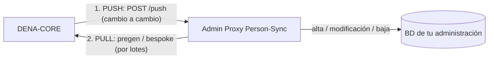
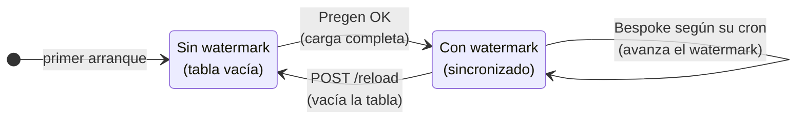

# :material-server-network: Admin Proxy Person-Sync (instalación y funcionamiento)

El **Admin Proxy Person-Sync** es un componente (`.jar` o `.war`) que instalas en tu administración para tener una **copia local de las personas de DENA** siempre actualizada, sin programar tú la integración de [Person-Sync](../operativas/person-sync.md).

**Descarga:** [:octicons-download-24: dena-admin-proxy-person-sync-rest · 0.5.25-SNAPSHOT](https://github.com/DENA-Euskadi/dena-admin-proxy-person-sync-rest/releases/tag/0.5.25-SNAPSHOT)

---

## Conceptos clave

Antes de seguir, estos siete términos aparecen en toda la página:

| Término | Qué es |
|---------|--------|
| **Push** | DENA-CORE **te llama** a ti (`POST /push`) cada vez que una persona cambia. Es inmediato |
| **Pull** | Tu servicio **llama a DENA-CORE** para descargar personas por lotes. Cubre lo que el Push no haya entregado (caídas, cortes de red...) |
| **Pregen** | Job Pull de **carga completa**: descarga un volcado con **todas** las personas |
| **Bespoke** | Job Pull **incremental**: descarga solo las personas que han cambiado desde la última vez |
| **Watermark** | Marca de tiempo guardada en tu BD: *"tengo todo sincronizado hasta este momento"*. Decide qué job trabaja |
| **ShedLock** | Bloqueo en BD que garantiza que solo **una réplica** ejecuta un job Pull a la vez |
| **Cron del planificador** | Expresiones que fijan cada cuánto se ejecutan el bespoke y el pregen. Los valores para desarrollo y producción están en *Tiempos recomendados del planificador*, dentro de *Configuración mínima* |

La idea en una frase: **el pregen llena la tabla una vez, el bespoke la mantiene al día y el Push aplica los cambios en tiempo real.**

---

## Recarga completa de datos (`/reload`)

El endpoint `/reload` **borra las personas locales y lanza un pregen** que vuelve a cargarlas todas desde DENA-CORE. Úsalo cuando:

- **En desarrollo**, quieras empezar con datos limpios o repetir la carga inicial.
- **En producción**, los datos locales hayan quedado corruptos o desincronizados tras un fallo grave (restauración de la BD, borrados manuales, caída prolongada...).

```bash
curl -X POST "<BASE_URL>/api/admin/proxy/persons/sync/reload"
```

Al llamarlo, el servicio:

1. Espera a que termine cualquier job Pull en curso (hasta 60 s, `RELOAD_LOCK_WAIT_FOR`). Si no termina a tiempo, responde **`409`** y no hace nada: vuelve a intentarlo más tarde.
2. **Vacía la tabla local de personas** y borra el *watermark*, en una sola transacción.
3. Responde **`200 OK`** (sin cuerpo) y lanza el pregen en segundo plano, sin esperar a que termine.
4. Al acabar el pregen se fija un *watermark* nuevo y el bespoke continúa solo desde ese punto.

| Código HTTP | Significado |
|-------------|-------------|
| `200 OK` | Tabla vaciada y pregen lanzado. **No significa que la carga haya terminado**: sigue su progreso en el log (`receivedPersonItemsCount`) |
| `409 Conflict` | Había un pregen o bespoke en curso y no terminó dentro de `RELOAD_LOCK_WAIT_FOR`. No se ha borrado nada |
| `500 Internal Server Error` | Falta `DENA_ADMINPROXY_PERSON_SYNC_JOBS_SCHEDULER_REQUESTOR_ADMIN` o ha fallado el vaciado de la tabla |

---

## Inicio rápido

El componente combina dos mecanismos. Por **Push**, DENA-CORE llama a `/push` cada vez que una persona cambia, y el cambio se aplica al momento en tu base de datos. Por **Pull**, dos jobs programados descargan personas de DENA-CORE por lotes: el **pregen** hace la carga completa y el **bespoke** trae solo lo que ha cambiado, con la frecuencia que marque `DENA_ADMINPROXY_PERSON_SYNC_JOBS_SCHEDULER_BESPOKE_CRON`, para cubrir lo que el Push no haya entregado.

Qué job trabaja lo decide el *watermark*, la marca de tiempo hasta la que tienes datos sincronizados: sin *watermark* actúa el pregen, con *watermark* actúa el bespoke. Al arrancar, el servicio lanza el pregen en segundo plano si todavía no hay *watermark*. El Pull requiere `DENA_ADMINPROXY_PERSON_SYNC_JOBS_SCHEDULER_ENABLED=true`. El detalle está en *Cómo funciona*, al final de la página.

| # | Paso | Detalle |
|---|------|---------|
| 1 | **Prepara la base de datos** | Esquema vacío en MySQL 8 u Oracle y usuario con permisos para crear tablas (ver *Requisitos previos*) |
| 2 | **Reúne los datos de DENA** | `client-id` y `secret` de tu administración, tu `ID_ADMIN` y la URL pública de Person-Sync de DENA-CORE |
| 3 | **Instala el componente** | `.jar` (Opción A) o `.war` en Tomcat 11 (Opción B). Ver *Instalación* |
| 4 | **Configura lo mínimo** | Las variables de *Configuración mínima*, con los cron de *Tiempos recomendados del planificador* |
| 5 | **Arranca y comprueba** | `GET <BASE_URL>/actuator/health` debe devolver `UP` |
| 6 | **Verifica la carga inicial** | En el log, `running pregen pull task on application startup` seguido de `receivedPersonItemsCount` |
| 7 | **Abre la red para el Push** | DENA-CORE debe poder alcanzar `<BASE_URL>/api/admin/proxy/persons/sync/push` (firewall, ingress) |

---

## Requisitos previos

| Requisito | Detalle |
|-----------|---------|
| **Java** | 21 o superior |
| **Base de datos** | MySQL 8.x u Oracle, accesible desde el servidor |
| **Red saliente** | Hacia **Keycloak** (validar tokens entrantes y pedir los salientes) y hacia **DENA-CORE Person-Sync** (Pull) |
| **Red entrante** | Al puerto del servicio, para recibir el Push de DENA |
| **Disco temporal** | Escritura en `/tmp` o `%TEMP%`: ahí se guardan los volcados `.sqlite` descargados |

**Tablas.** Con `DENA_DDBB_HBM2DDL_AUTO=update` (valor por defecto) Hibernate crea las tablas al arrancar. Si usas `validate` o `none`, deben existir antes:

- las tablas de personas (con el prefijo `DENA_DDBB_TABLES_PREFIX`, por defecto `Z99`),
- la tabla de estado del bespoke (*watermark* y job pendiente),
- la tabla de bloqueo `PERSONSYNCJOBSHEDLOCK` (columnas `name`, `lock_until`, `locked_at`, `locked_by`).

---

## Instalación

**Descarga:** [:octicons-download-24: dena-admin-proxy-person-sync-rest · 0.5.25-SNAPSHOT](https://github.com/DENA-Euskadi/dena-admin-proxy-person-sync-rest/releases/tag/0.5.25-SNAPSHOT)

Se entrega en dos formatos equivalentes. Elige uno:

| Componente | Cuándo usarlo |
|-----------|---------------|
| `denaInteropAdminProxyPersonSyncAPP-<version>.jar` | Ejecución autónoma, con servidor web embebido. La opción más sencilla |
| `denaInteropAdminProxyPersonSyncAPP-<version>.war` | Si tu estándar es desplegar en un **Apache Tomcat 11.x** externo (Servlet 6.1) |

### Opción A: `.jar` (standalone)

No necesita nada más: el servidor web y el driver `sqlite-jdbc` van dentro.

```bash
java -jar denaInteropAdminProxyPersonSyncAPP-<version>.jar
```

Arranca en el puerto **`8100`** con el context-path **`/admin-person-proxy-sync`**.

### Opción B: `.war` en Tomcat 11

**Paso 1. Instala `sqlite-jdbc` en `lib/` de Tomcat (obligatorio).**
El servicio lee los volcados de DENA-CORE como bases de datos SQLite. El driver debe estar en el `ClassLoader` común de Tomcat para que se registre bien y los redespliegues no dejen librerías nativas cargadas:

```bash
curl -L -o "$CATALINA_HOME/lib/sqlite-jdbc-3.51.3.0.jar" \
  https://repo1.maven.org/maven2/org/xerial/sqlite-jdbc/3.51.3.0/sqlite-jdbc-3.51.3.0.jar
```

Usa la misma versión de `sqlite-jdbc` que trae el componente. Puedes comprobarla con `jar tf denaInteropAdminProxyPersonSyncAPP-<version>.war | grep sqlite`.

Si tu BD es **Oracle**, comprueba también que el driver `ojdbc` está en `$CATALINA_HOME/lib/`.

**Paso 2. Copia el `.war` a `webapps/`.** El nombre del fichero fija el context-path:

```bash
cp denaInteropAdminProxyPersonSyncAPP-<version>.war "$CATALINA_HOME/webapps/admin-person-proxy-sync.war"
```

!!! note "En Tomcat externo"
    El **puerto** lo define `$CATALINA_HOME/conf/server.xml` y el **context-path** el nombre del `.war`. Las variables `DENA_SERVER_PORT` y `DENA_CONTEXT_PATH` no se usan.

### Comprobar que ha arrancado

`<BASE_URL>` es la URL base del servicio:

- **JAR**: `http://localhost:8100/admin-person-proxy-sync`
- **WAR** (`admin-person-proxy-sync.war` en un Tomcat en el puerto `8080`): `http://localhost:8080/admin-person-proxy-sync`

```bash
curl <BASE_URL>/actuator/health
```

Debe responder `{"status":"UP"...}`.

---

## Configuración

### Cómo se configura

El componente trae una configuración por defecto (`application-war.yml`) donde todo está parametrizado como `${DENA_...}`. Sobrescribe lo que necesites **sin tocar el `.jar` ni el `.war`**, con cualquiera de estos métodos (de menor a mayor prioridad):

=== "1. Variables de entorno"

    ```bash
    export DENA_DDBB_URL="jdbc:mysql://localhost:3306/dena_person_proxy?useSSL=false&serverTimezone=UTC&allowPublicKeyRetrieval=true"
    export DENA_DDBB_USER="<usuario_bd>"
    export DENA_DDBB_PASSWORD="<password_bd>"
    export DENA_PERSON_SYNC_PROXY_HOST="<host-dena-core>/person-sync"
    export DENA_PERSON_SYNC_PROXY_ORG_ADMIN_ID="<ID_ADMIN>"
    export DENA_PERSON_SYNC_PROXY_SECURITY_CLIENT_ID="<client-id>"
    export DENA_PERSON_SYNC_PROXY_SECURITY_SECRET="<client-secret>"

    java -jar denaInteropAdminProxyPersonSyncAPP-<version>.jar
    ```

=== "2. Propiedades JVM o argumentos"

    En **Tomcat** (`setenv.sh` o `CATALINA_OPTS`):

    ```bash
    export CATALINA_OPTS="$CATALINA_OPTS \
      -DDENA_DDBB_HOST=10.0.0.15 \
      -DDENA_DDBB_PORT=3306 \
      -DDENA_DDBB_USER=<usuario_bd> \
      -DDENA_DDBB_PASSWORD=<password_bd>"
    ```

    En **JAR**:

    ```bash
    java -jar denaInteropAdminProxyPersonSyncAPP-<version>.jar \
      --DENA_DDBB_HOST=localhost \
      --DENA_DDBB_USER=<usuario_bd> \
      --DENA_DDBB_PASSWORD=<password_bd>
    ```

=== "3. Fichero externo"

    ```bash
    java -jar denaInteropAdminProxyPersonSyncAPP-<version>.jar \
      --spring.config.additional-location=optional:file:/etc/dena/application-custom.yml
    ```

    En **Tomcat**:

    ```bash
    export CATALINA_OPTS="$CATALINA_OPTS -Dspring.config.additional-location=optional:file:/etc/dena/application-custom.yml"
    ```

!!! danger "Valores que siempre hay que cambiar"
    Los valores por defecto que terminan en `-change` o `_change` (`db_user_change`, `keycloak-client-id-change`, `ADMIN-change`...) son **marcadores**. El servicio arranca con ellos, pero **no funcionará** hasta que pongas los reales.

### Configuración mínima

Lo que **tienes** que definir en un entorno real. El resto tiene un valor por defecto válido.

| Bloque | Variables | Qué poner |
|--------|-----------|-----------|
| Base de datos | `DENA_DDBB_URL` (o `HOST`/`PORT`/`NAME`), `DENA_DDBB_USER`, `DENA_DDBB_PASSWORD` | Los datos de tu BD. Para Oracle, cambia también `DRIVER` y `PLATFORM` |
| Keycloak (Push entrante) | `DENA_KEYCLOAK_URL`, `DENA_KEYCLOAK_REALM_ADMIN`, `DENA_TOKEN_URL_ADMIN`, `DENA_INTROSPECTION_URL_ADMIN`, `DENA_KEYCLOAK_CLIENT_ID_ADMIN`, `DENA_KEYCLOAK_CLIENT_SECRET_ADMIN` | Los datos del IdP que te facilite DENA. Las URL vienen ya apuntando a PRE: en PRE basta con el client ID y el secret |
| DENA-CORE (Pull saliente) | `DENA_PERSON_SYNC_PROXY_HOST`, `DENA_PERSON_SYNC_PROXY_PROTOCOL`, `DENA_PERSON_SYNC_PROXY_ORG_ADMIN_ID`, `DENA_PERSON_SYNC_PROXY_SECURITY_CLIENT_ID`, `DENA_PERSON_SYNC_PROXY_SECURITY_SECRET` | URL pública de DENA-CORE y credenciales de tu administración |
| Planificador | `DENA_ADMINPROXY_PERSON_SYNC_JOBS_SCHEDULER_ENABLED`, `DENA_ADMINPROXY_PERSON_SYNC_JOBS_SCHEDULER_REQUESTOR_ADMIN`, `DENA_ADMINPROXY_PERSON_SYNC_JOBS_SCHEDULER_BESPOKE_CRON`, `DENA_ADMINPROXY_PERSON_SYNC_JOBS_SCHEDULER_PREGEN_CRON` | `ENABLED=true`, tu administración y los cron de *Tiempos recomendados del planificador* (justo debajo) |

!!! important "Tiempos recomendados del planificador"
    **Desarrollo**

    ```yaml
    DENA_ADMINPROXY_PERSON_SYNC_JOBS_SCHEDULER_BESPOKE_CRON: "0 0/5 * * * *"
    DENA_ADMINPROXY_PERSON_SYNC_JOBS_SCHEDULER_PREGEN_CRON: "0 0 3 * * *"
    ```

    **Producción**

    ```yaml
    DENA_ADMINPROXY_PERSON_SYNC_JOBS_SCHEDULER_BESPOKE_CRON: "0 0/5 * * * *"
    DENA_ADMINPROXY_PERSON_SYNC_JOBS_SCHEDULER_PREGEN_CRON: "-"
    ```

    El bespoke se ejecuta cada 5 minutos en ambos entornos. El pregen, cada día a las 03:00 en desarrollo y desactivado (`"-"`) en producción.

!!! warning "El Pull viene desactivado"
    Por defecto `DENA_ADMINPROXY_PERSON_SYNC_JOBS_SCHEDULER_ENABLED=false`. Así el servicio **solo recibe Push**: no hay carga inicial, ni bespoke, y `/reload` no recarga. Ponlo a `true`.

### Referencia completa de variables

#### Servidor HTTP (solo modo `.jar`)

| Variable | Por defecto | Descripción |
|----------|-------------|-------------|
| `DENA_SERVER_PORT` | `8100` | Puerto HTTP del servidor embebido |
| `DENA_CONTEXT_PATH` | `/admin-person-proxy-sync` | Ruta base del servicio |

#### Base de datos de la administración

| Variable | Por defecto | Descripción |
|----------|-------------|-------------|
| `DENA_DDBB_HOST` | `localhost` | Host o IP de la BD |
| `DENA_DDBB_PORT` | `3306` | Puerto (`3306` MySQL, `1521`/`1530` Oracle) |
| `DENA_DDBB_NAME` | `dena_person_proxy` | Nombre de la BD o esquema |
| `DENA_DDBB_URL` | URL JDBC de MySQL | URL JDBC completa. Oracle: `jdbc:oracle:thin:@host:puerto/SERVICIO` |
| `DENA_DDBB_USER` | `db_user_change` | Usuario |
| `DENA_DDBB_PASSWORD` | `db_password_change` | Contraseña |
| `DENA_DDBB_DRIVER` | `com.mysql.cj.jdbc.Driver` | Clase del driver (`oracle.jdbc.OracleDriver` para Oracle) |
| `DENA_DDBB_PLATFORM` | `dena.core.common.db.mysql.DN01MySQLDenaDialect` | Dialecto Hibernate (`org.hibernate.dialect.OracleDialect` para Oracle) |
| `DENA_DDBB_HBM2DDL_AUTO` | `update` | Estrategia DDL de Hibernate. En producción se recomienda `validate` o `none` (ver *Requisitos previos*) |
| `DENA_DDBB_TABLES_PREFIX` | `Z99` | Prefijo de las tablas de personas |

#### Seguridad OAuth2 / Keycloak (Push entrante)

Los valores por defecto apuntan al Keycloak de **PRE**. En otro entorno, cambia todas las URL.

| Variable | Por defecto | Descripción |
|----------|-------------|-------------|
| `DENA_KEYCLOAK_URL` | `https://api.pre.dena.eus/auth` | URL base de Keycloak |
| `DENA_KEYCLOAK_REALM_ADMIN` | `DenaAuthAdmins` | Realm de administraciones |
| `DENA_TOKEN_URL_ADMIN` | `https://api.pre.dena.eus/auth/realms/DenaAuthAdmins/protocol/openid-connect/token` | Endpoint de obtención de token |
| `DENA_INTROSPECTION_URL_ADMIN` | `https://api.pre.dena.eus/auth/realms/DenaAuthAdmins/protocol/openid-connect/token/introspect` | Endpoint de introspección de los tokens entrantes |
| `DENA_KEYCLOAK_CLIENT_ID_ADMIN` | `keycloak-client-id-change` | Client ID con el que se introspectan los tokens de `/push` |
| `DENA_KEYCLOAK_CLIENT_SECRET_ADMIN` | `keycloak-client-secret-change` | Client Secret de la introspección |

#### Cliente REST hacia DENA-CORE (Pull saliente)

| Variable | Por defecto | Descripción |
|----------|-------------|-------------|
| `DENA_PERSON_SYNC_PROXY_HOST` | `e80a021k-dena-person-admin-sync-rest-svc:8080/person-sync` | Host, puerto y path de Person-Sync en DENA-CORE. El valor por defecto es un nombre interno del clúster de DENA: usa la URL pública que te faciliten (por ejemplo `api-batera.pre.dena.eus/person-sync` en PRE, con `PROTOCOL=HTTPS`) |
| `DENA_PERSON_SYNC_PROXY_PROTOCOL` | `HTTP` | `HTTP` o `HTTPS` |
| `DENA_PERSON_SYNC_PROXY_ORG_ADMIN_ID` | `SANDBOXCIF` | Administración que se envía en la cabecera `X-DENA-ORG-ADMIN-ID` |
| `DENA_PERSON_SYNC_PROXY_SECURITY_IDP_ENDPOINT_URL` | `${DENA_TOKEN_URL_ADMIN}` | Endpoint de token con el que el servicio pide su token para DENA-CORE |
| `DENA_PERSON_SYNC_PROXY_SECURITY_IDP_ID` | `keycloak-change` | Identificador del IdP |
| `DENA_PERSON_SYNC_PROXY_SECURITY_CLIENT_ID` | `admin-client-id-change` | Client ID OAuth2 de tu administración |
| `DENA_PERSON_SYNC_PROXY_SECURITY_SECRET` | `admin-client-secret-change` | Client Secret OAuth2 de tu administración |

#### Planificador Pull

| Variable | Por defecto | Descripción |
|----------|-------------|-------------|
| `DENA_ADMINPROXY_PERSON_SYNC_JOBS_SCHEDULER_ENABLED` | **`false`** | Activa el Pull: carga al arrancar, pregen, bespoke y `/reload` |
| `DENA_ADMINPROXY_PERSON_SYNC_JOBS_SCHEDULER_BESPOKE_CRON` | `"0 0/5 * * * *"` | Cron del bespoke |
| `DENA_ADMINPROXY_PERSON_SYNC_JOBS_SCHEDULER_PREGEN_CRON` | `"0 0 3 * * *"` | Cron del pregen. `"-"` lo desactiva (recomendado en producción) |
| `DENA_ADMINPROXY_PERSON_SYNC_JOBS_SCHEDULER_REQUESTOR_ADMIN` | `"ADMIN-change"` | Tu administración: con ella se guarda el *watermark* y se piden los jobs |
| `DENA_ADMINPROXY_PERSON_SYNC_JOBS_SCHEDULER_LOCK_AT_LEAST_FOR` | `"PT30S"` | Tiempo mínimo que se mantiene el bloqueo (ISO-8601) |
| `DENA_ADMINPROXY_PERSON_SYNC_JOBS_SCHEDULER_LOCK_AT_MOST_FOR` | `"PT15M"` | Tiempo máximo del bloqueo si una réplica cae a mitad de un job |
| `DENA_ADMINPROXY_PERSON_SYNC_JOBS_SCHEDULER_PENDING_JOB_TIMEOUT` | `PT15M` | Tiempo máximo que se reutiliza un export bespoke pendiente |
| `DENA_ADMINPROXY_PERSON_SYNC_JOBS_SCHEDULER_RELOAD_LOCK_WAIT_FOR` | `PT60S` | Espera máxima de `/reload` para conseguir el bloqueo (si no, `409`) |

`PENDING_JOB_TIMEOUT` y `RELOAD_LOCK_WAIT_FOR` no vienen en `application-war.yml`: si no los defines, se usan los valores por defecto del código indicados arriba.

#### Logs

| Variable | Por defecto | Descripción |
|----------|-------------|-------------|
| `DENA_LOGGING_ROOT` | `INFO` | Nivel general |
| `DENA_LOGGING_WEB` | `INFO` | Peticiones HTTP |
| `DENA_LOGGING_SECURITY` | `WARN` | Seguridad |
| `DENA_LOGGING_SECURITY_OAUTH2` | `WARN` | Seguridad OAuth2 (útil para depurar tokens) |
| `DENA_LOGGING_HIBERNATE_SQL` | `ERROR` | Sentencias SQL |

---

## Endpoints

| Método | Ruta | Autenticación | Descripción |
|--------|------|---------------|-------------|
| `POST` | `<BASE_URL>/api/admin/proxy/persons/sync/push` | **Sí** (`Bearer` JWT) | Recibe el Push de alta, modificación o baja |
| `POST` | `<BASE_URL>/api/admin/proxy/persons/sync/reload` | **No** | Borra las personas locales y relanza la carga completa (ver *Recarga completa de datos*) |
| `GET` | `<BASE_URL>/actuator/health` | No | Estado del servicio |
| `GET` | `<BASE_URL>/v3/api-docs` | No | Contrato OpenAPI 3 en JSON |
| `GET` | `<BASE_URL>/swagger-ui.html` | No | Swagger UI |

### Respuestas de `/push`

El token de la cabecera `Authorization` debe ser un JWT válido y activo del realm de administraciones (`DenaAuthAdmins`), con audiencia `account` y los claims `dena.admin.oid` y `dena.admin.id`.

| Código HTTP | Significado |
|-------------|-------------|
| `200 OK` | Cambio aplicado: persona creada, actualizada o eliminada |
| `400 Bad Request` | El mensaje no trae `payload` o no trae la referencia a la persona |
| `401 Unauthorized` | Falta `Authorization`, el token ha caducado, Keycloak responde `active: false` o faltan los claims obligatorios |
| `500 Internal Server Error` | Error al guardar en la BD o JSON mal formado |

Especificación completa del mensaje: [Endpoint Push](../semantica/person-sync/push.md) y [Endpoint Pull](../semantica/person-sync/pull.md).

---

## Problemas frecuentes

Empieza siempre por el log: casi todos los casos se identifican por un mensaje concreto.

| Síntoma o mensaje en el log | Causa probable | Qué hacer |
|-----------------------------|----------------|-----------|
| `401` en `/push` | Token ausente o caducado, `active: false` en la introspección o sin claims `dena.admin.oid` / `dena.admin.id` | Revisa el token y las variables `DENA_KEYCLOAK_*` y `DENA_INTROSPECTION_URL_ADMIN` |
| No llega nada por Pull y no hay trazas de pregen ni bespoke | `SCHEDULER_ENABLED=false` (valor por defecto) | Ponlo a `true` |
| `Failed to fetch OAuth token` | No se alcanza la URL de token o las credenciales son incorrectas | Revisa `DENA_TOKEN_URL_ADMIN`, client ID/secret y la red saliente a Keycloak |
| `Watermark is NULL ... skipping bespoke` (de forma continuada) | La carga inicial no ha terminado o ha fallado | Busca el error del pregen en el log (`Cannot create received person error`). Corrígelo y reinicia el servicio o llama a `/reload` |
| `Watermark is already initialized ... skipping pregen execution` | Ya hay datos sincronizados | Es lo normal. Para recargar desde cero, usa `/reload` |
| La carga inicial falló y en producción no se reintenta | `PREGEN_CRON="-"` desactiva los reintentos programados | Reinicia el servicio o llama a `/reload` |
| `/reload` responde `409` | Un job Pull tiene el bloqueo más de `RELOAD_LOCK_WAIT_FOR` | Espera a que termine y vuelve a llamar |
| `/reload` responde `200` pero la tabla sigue vacía | `SCHEDULER_ENABLED=false`: nadie lanza el pregen | Pon `SCHEDULER_ENABLED=true`, reinicia (se hará la carga al arrancar) |
| Error de driver al leer el `.sqlite` en Tomcat | Falta `sqlite-jdbc` en `$CATALINA_HOME/lib/` | Instálalo (Opción B, paso 1) |
| El Pull falla por la URL de DENA-CORE | `DENA_PERSON_SYNC_PROXY_HOST` con el valor interno por defecto | Pon la URL pública de DENA-CORE y `PROTOCOL=HTTPS` |

---

## Cómo funciona

### Visión general



Los dos mecanismos se complementan: el **Push** da inmediatez y el **Pull** da garantía de que no se pierde nada.

### Push: cambios en tiempo real

Cuando una persona se da de alta, cambia sus datos o se da de baja en DENA:

1. DENA-CORE hace `POST <BASE_URL>/api/admin/proxy/persons/sync/push`.
2. El servicio valida el token `Bearer` contra Keycloak (introspección y verificación del JWT).
3. Aplica el cambio en tu BD según `payload.syncData.syncEvent`:

| Evento | Qué hace en tu BD |
|--------|-------------------|
| `CREATED` / `UPDATED` | Si la persona no existe, la **crea**; si existe, la **actualiza** |
| `DELETED` | Si existe, la **elimina**. Si no existía, responde OK igualmente (idempotente) |

### Pull: sincronización por lotes

Dos jobs programados, coordinados con ShedLock para que nunca se ejecuten a la vez (ni entre réplicas, ni entre ellos: comparten el bloqueo `adminproxy.person.pull`).

| Job | Qué hace | Cuándo trabaja |
|-----|----------|----------------|
| **Pregen** (carga completa) | Descarga el volcado `.sqlite` con todas las personas y hace *upsert* por lotes. Al terminar, fija el *watermark* | Solo si **no hay** *watermark* |
| **Bespoke** (incremental) | Pide a DENA-CORE las personas cambiadas en `[watermark − 5 min, ahora]`, espera a que el export termine, lo descarga, hace *upsert* y avanza el *watermark*. Si quedó un export pendiente de la ejecución anterior, lo reutiliza (hasta `PENDING_JOB_TIMEOUT`) | Solo si **hay** *watermark* |

Los 5 minutos de margen solapan cada ventana con la anterior, para no perder cambios que lleguen justo en el límite.

### Ciclo de vida: qué job trabaja en cada momento



| Estado | Pregen | Bespoke |
|--------|--------|---------|
| Sin watermark | **Trabaja** | Se omite (en el log: `Watermark is NULL ... skipping bespoke`) |
| Con watermark | Se omite (en el log: `Watermark is already initialized ... skipping pregen execution`) | **Trabaja** |

Que uno de los dos se omita **es lo normal**, no un error.

### Qué pasa al arrancar

Con `SCHEDULER_ENABLED=true`, al arrancar (`ApplicationReadyEvent`) el servicio lanza un pregen **en segundo plano**, sin bloquear el arranque:

- Si la BD ya tiene *watermark* → no hace nada y el bespoke sigue como siempre.
- Si no lo tiene (primera instalación) → hace la carga completa.
- Si la carga falla (por ejemplo, DENA-CORE no responde) → solo se reintenta con el cron del pregen. **Con `PREGEN_CRON="-"` no hay reintento automático**: reinicia el servicio o llama a `/reload`.

### Bajas (`DELETED`)

Las bajas están garantizadas **por Push**. Si el Pull incremental también las refleja depende de los eventos que DENA-CORE incluya en el volcado; no cuentes con ello sin comprobarlo en tu entorno.

### Llamadas salientes a DENA-CORE

En cada llamada Pull, el servicio obtiene un token OAuth2 (`client_credentials`) del IdP configurado y añade las cabeceras `Authorization: Bearer ...` y `X-DENA-ORG-ADMIN-ID`.

---

**Ver también:** [:octicons-arrow-right-24: Person-Sync (Sincronizar Personas)](../operativas/person-sync.md)

<!-- DENA-DOC-FOOTER -->
---
<sub>DENA Docs v{{ dena.version }} · {{ dena.date }}</sub>
