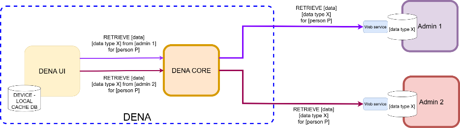
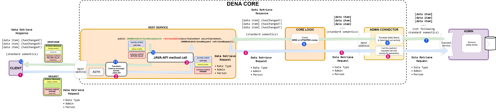

# :material-database-arrow-right: Data-Retrieve (Servir Datos)

## Concepto

Data-Retrieve es la operativa por la cual **DENA llama a tu administración para obtener los datos de una persona**. Tu admin expone un endpoint REST y DENA lo invoca cuando la persona necesita ver sus datos actualizados.



### ¿Cómo funciona?

1. La persona abre la app y DENA detecta que hay datos pendientes de refrescar
2. DENA-CORE invoca tu endpoint a través del conector de tu admin
3. Tu endpoint consulta la BD y devuelve los datos de esa persona
4. DENA-CORE determina qué datos son nuevos/actualizados y los envía a la app



### Puntos clave

- Tu admin devuelve **todos los datos** del tipo de dato solicitado para esa persona
- Cada data item debe incluir un campo **`lastChangedAt`** con el instante del último cambio
- DENA-CORE calcula automáticamente si el dato es nuevo/actualizado (la admin NO necesita indicarlo)
- Los datos **no se almacenan en DENA** — se pasan directamente a la app

---

## Implementación

### Endpoint

Tu admin expone un endpoint que DENA llamará:

```
POST /api/retrieveData
```

El endpoint recibe la persona y el tipo de dato solicitado, y devuelve los data items.

### Ejemplo: tabla de base de datos

Supongamos un tipo de dato "citas de atención ciudadana" con esta estructura:

| PERSON_ID | AT | DURATION_MIN | SUBJECT_ES | SUBJECT_EU | LAST_UPDATED_AT |
|-----------|-----|------|------------|------------|-----------------|
| 48291038Z | 2026-08-17T14:30 | 30 | Cita renovación | Berritze hitzordua | 2026-08-17T09:14:22Z |
| 48291038Z | 2026-09-04T10:15 | 15 | Consulta estado | Egoera kontsulta | 2026-08-17T18:41:03Z |

### Ejemplo: consulta SQL

```sql
SELECT PERSON_ID, AT, DURATION_MIN, SUBJECT_ES, SUBJECT_EU,
       COALESCE(LAST_UPDATED_AT, CREATED_AT) AS LAST_CHANGE_AT
  FROM APPOINTMENTS
 WHERE PERSON_ID = ?
```

### Ejemplo: conversión a modelo DENA

```java
private List<DN00ScheduleItem> _fromDBDataToReturnedDataItems(
        final Collection<DBData> dbData) {
    return dbData.stream()
        .map(item -> {
            DN00ScheduleItem schItem = new DN00ScheduleItem();

            // IMPORTANTE: instante de último cambio
            schItem.setLastChangedAt(item.lastChangedAt());
            schItem.setId(DN00ScheduleItemID.forId(item.id()));
            schItem.setAt(item.at());
            schItem.setDurationMinutes(item.durationMins());

            // Textos multiidioma
            schItem.setSubjectByLanguage(new LanguageTextsMapBacked()
                .add(Language.SPANISH, item.subjectES())
                .add(Language.BASQUE, item.subjectEU()));

            // URLs de detalle en tu web
            schItem.setUrls(UrlCollection.create()
                .addItems(
                    UrlCollectionItem.createFor(
                        Url.from("https://my-admin.eus/citas/" + item.id() + "?lang=eu")),
                        CollectionItemID.forId("main"), Language.BASQUE),
                    UrlCollectionItem.createFor(
                        Url.from("https://my-admin.eus/citas/" + item.id() + "?lang=es")),
                        CollectionItemID.forId("main"), Language.SPANISH)));

            return schItem;
        })
        .toList();
}
```

### Ejemplo: REST Controller

```java
@RestController
@RequestMapping("/dena/retrieve")
public class AdminAppointmentsController {

    @GetMapping("/citizen_care_appointments/{personId}")
    public ResponseEntity<String> getByPerson(
            @PathVariable("personId") String personIdParam) {

        DN00PersonID personId = DN00PersonID.forId(personIdParam);

        // 1. Consultar BD
        List<DBData> dbData = _retrieveDBDataFor(personId);

        // 2. Convertir a modelo DENA
        List<DN00ScheduleItem> items = _fromDBDataToReturnedDataItems(dbData);

        // 3. Serializar y devolver
        String json = _marshaller.forWriting().toJSON(items);
        return ResponseEntity.ok(json);
    }
}
```

### Ejemplo: JSON devuelto

La respuesta completa incluye la estructura del mensaje interop DENA (context + payload). Los data items van dentro de `payload.dataItems`:

```json
{
  "context": {
    "message": {
      "type": "PERSON_FETCH_DATA",
      "correlationId": "550e8400-e29b-41d4-a716-446655440000",
      "interopRouteData": [
        { "denaComponentId": "ADMIN", "timestamp": "2026-08-19T08:07:56.742Z" }
      ]
    },
    "dataType": { "id": "scheduleItem", "oid": "DTYPE-OID-SCHEDULE" },
    "subjectPerson": { "id": "48291038Z", "oid": "PERSON-OID-001" }
  },
  "code": "OK",
  "payload": {
    "dataItems": [
      {
        "data": {
          "id": "appointment123",
          "lastChangedAt": "2026-08-19T08:07:56.742Z",
          "year": "2026",
          "monthOfYear": "8",
          "dayOfMonth": "18",
          "hourOfDay": "13",
          "minuteOfHour": "2",
          "durationMinutes": 30,
          "subject": {
            "SPANISH": "una cita",
            "BASQUE": "hitzordu bat"
          },
          "urls": [
            { "id": "main", "lang": "BASQUE", "value": "https://my-admin.eus/citas/appointment123?lang=eu" },
            { "id": "main", "lang": "SPANISH", "value": "https://my-admin.eus/citas/appointment123?lang=es" }
          ]
        }
      }
    ]
  }
}
```

??? note "Estructura completa del mensaje (con todos los campos de semantica base)"

    En una respuesta real, el mensaje puede incluir campos adicionales de protocolo y trazabilidad que DENA gestiona automaticamente. Tu administracion solo necesita preocuparse del bloque `payload.dataItems`, pero a continuacion se muestra la estructura completa para referencia:

    ```json
    {
      "context": {
        "message": {
          "type": "PERSON_FETCH_DATA",
          "correlationId": "550e8400-e29b-41d4-a716-446655440000",
          "interopRouteData": [
            { "denaComponentId": "DENA_ADMIN_CONNECTOR", "timestamp": "2026-08-19T08:07:55.100Z" },
            { "denaComponentId": "ADMIN", "timestamp": "2026-08-19T08:07:56.742Z" }
          ]
        },
        "originAdmin": { "oid": "ADMIN-OID-001", "id": "MI-ADMIN", "dir3Id": "EA0000001" },
        "userAgent": "MiAdmin/1.0 data-provider/1.0 (soporte@miadmin.eus)",
        "dataType": { "id": "scheduleItem", "oid": "DTYPE-OID-SCHEDULE" },
        "subjectPerson": { "id": "48291038Z", "oid": "PERSON-OID-001" }
      },
      "protocol": {
        "urls": [],
        "timeOut": "30s"
      },
      "code": "OK",
      "payload": {
        "dataItems": [
          {
            "data": {
              "id": "appointment123",
              "lastChangedAt": "2026-08-19T08:07:56.742Z",
              "year": "2026",
              "monthOfYear": "8",
              "dayOfMonth": "18",
              "hourOfDay": "13",
              "minuteOfHour": "2",
              "durationMinutes": 30,
              "subject": {
                "SPANISH": "una cita",
                "BASQUE": "hitzordu bat"
              },
              "urls": [
                { "id": "main", "lang": "BASQUE", "value": "https://my-admin.eus/citas/appointment123?lang=eu" },
                { "id": "main", "lang": "SPANISH", "value": "https://my-admin.eus/citas/appointment123?lang=es" }
              ]
            }
          }
        ]
      }
    }
    ```

    Para la documentacion detallada de cada bloque: [:octicons-arrow-right-24: Semantica Base](../semantica/semantica-base/index.md)

!!! tip "URLs de detalle"
    Incluye siempre URLs donde la persona pueda ver más detalles, modificar o cancelar el elemento en tu web.

---

## Ejemplo real de llamada completa

Los siguientes ejemplos muestran un intercambio real completo de la operativa Data-Retrieve, incluyendo el mensaje de petición y la respuesta.

### Petición (REQUEST)

DENA llama a tu endpoint con este mensaje. El tipo de dato solicitado es `SCHEDULE` para la persona `11189396B` en la administración `SANDBOXCIF`:

```json
{
    "context": {
        "message": {
            "type": "CLIENT_RETRIEVE_REQ",
            "correlationId": "541ECEAE-228B-4588-9504-44D9094322B5",
            "interopRouteData": [{ "denaComponentId": "DENA_ADMIN_CONNECTOR", "timestamp": "2026-11-09T20:37:55.847000900Z" }]
        },
        "destinationAdmin": { "id": "SANDBOXCIF", "oid": "6d9d73d4-3d3d-6d3d-ad3d-3d3d3d3d3011" },
        "subjectPerson": { "id": "11189396B", "oid": "631011F3-9A2F-4D08-9F56-B7F4D6A0749E" },
        "dataType": { "id": "SCHEDULE", "oid": "7e0e84e5-4e4e-7e4e-be4e-4e4e4e4e4006" }
    },
    "payload": {
        "dataType": { "id": "SCHEDULE", "oid": "7e0e84e5-4e4e-7e4e-be4e-4e4e4e4e4006" },
        "admin": { "id": "SANDBOXCIF", "oid": "6d9d73d4-3d3d-6d3d-ad3d-3d3d3d3d3011" },
        "person": { "id": "11189396B", "oid": "631011F3-9A2F-4D08-9F56-B7F4D6A0749E" }
    }
}
```

### Respuesta (RESPONSE)

Tu endpoint devuelve la lista de elementos de tipo `scheduleItem` en `payload.dataItems`:

```json
{
    "context": {
        "message": {
            "type": "CLIENT_RETRIEVE_RESP",
            "correlationId": "541ECEAE-228B-4588-9504-44D9094322B5",
            "interopRouteData": [
                { "denaComponentId": "DENA_ADMIN_CONNECTOR", "timestamp": "2026-11-09T20:37:55.8470009Z" },
                { "denaComponentId": "DENA_ADMIN", "timestamp": "2026-11-10T08:17:46.029Z" }
            ]
        },
        "destinationAdmin": { "id": "SANDBOXCIF", "oid": "6d9d73d4-3d3d-6d3d-ad3d-3d3d3d3d3011" },
        "subjectPerson": { "id": "11189396B", "oid": "631011F3-9A2F-4D08-9F56-B7F4D6A0749E" },
        "dataType": { "id": "SCHEDULE", "oid": "7e0e84e5-4e4e-7e4e-be4e-4e4e4e4e4006" }
    },
    "payload": {
        "dataItems": [
            {
                "data": {
                    "type": "scheduleItem",
                    "dayOfMonth": "20",
                    "details": { "SPANISH": "Título de familia numerosa", "BASQUE": "Título de familia numerosa" },
                    "durationMinutes": 30,
                    "hourOfDay": "10",
                    "id": "SANDBOX-SCHED-1794256626566",
                    "lastChangedAt": "2026-11-09T20:37:06.5668985Z",
                    "minuteOfHour": "0",
                    "monthOfYear": "9",
                    "oid": "D8815353-5B1D-47DE-9B65-57ABB58CEDAB",
                    "priority": "MEDIUM",
                    "subject": { "SPANISH": "Título de familia numerosa", "BASQUE": "Título de familia numerosa" },
                    "urls": [{ "id": "48D2", "tags": ["default"], "value": "https://sandbox.dena.eus/schedules" }],
                    "year": "2040"
                }
            },
            {
                "data": {
                    "type": "scheduleItem",
                    "dayOfMonth": "22",
                    "details": { "SPANISH": "Caducidad BakQ", "BASQUE": "Caducidad BakQ" },
                    "durationMinutes": 30,
                    "hourOfDay": "10",
                    "id": "SANDBOX-SCHED-1794256564175",
                    "lastChangedAt": "2026-11-09T20:36:04.1756730Z",
                    "minuteOfHour": "0",
                    "monthOfYear": "12",
                    "oid": "A03F751D-E58B-4767-A0A6-35A7859B3EAA",
                    "priority": "MEDIUM",
                    "subject": { "SPANISH": "Caducidad BakQ", "BASQUE": "Caducidad BakQ" },
                    "urls": [{ "id": "AA46", "tags": ["default"], "value": "https://sandbox.dena.eus/schedules" }],
                    "year": "2026"
                }
            },
            {
                "data": {
                    "type": "scheduleItem",
                    "dayOfMonth": "12",
                    "details": { "SPANISH": "Cita Osakidetza", "BASQUE": "Cita Osakidetza" },
                    "durationMinutes": 30,
                    "hourOfDay": "10",
                    "id": "SANDBOX-SCHED-1794256666986",
                    "lastChangedAt": "2026-11-09T20:37:46.9870283Z",
                    "minuteOfHour": "0",
                    "monthOfYear": "11",
                    "oid": "31FB5F96-0F9E-491C-B70A-A126F056C12B",
                    "priority": "MEDIUM",
                    "subject": { "SPANISH": "Cita Osakidetza", "BASQUE": "Cita Osakidetza" },
                    "urls": [{ "id": "A754", "tags": ["default"], "value": "https://sandbox.dena.eus/schedules" }],
                    "year": "2026"
                }
            }
        ]
    }
}
```

!!! note "Campo `details` en ejemplos del sandbox"
    Los ejemplos anteriores proceden de una ejecución real del sandbox y contienen el campo `details` en los items de tipo `scheduleItem`. Este campo **no existe en el modelo Java actual** `DN00ScheduleItem` (fue eliminado en una revisión posterior del modelo). Si ves `details` en respuestas reales de un sistema sandbox antiguo, es un campo heredado que el serializador incluye pero que no debe usarse en implementaciones nuevas. El campo correcto para el asunto es `subject`.

!!! info "Estructura del mensaje"
    - **`context.message.type`**: `CLIENT_RETRIEVE_REQ` en la petición / `CLIENT_RETRIEVE_RESP` en la respuesta
    - **`context.destinationAdmin`**: Administración destino (la tuya)
    - **`context.subjectPerson`**: Persona sobre la que se solicitan datos
    - **`context.dataType`**: Tipo de dato solicitado (en este ejemplo: `SCHEDULE`)
    - **`payload.dataItems[]`**: Array de datos devueltos por tu endpoint

---

## Especificacion completa

Para la especificacion detallada de campos, validaciones y errores:

[:octicons-arrow-right-24: Semantica Data-Retrieve](../semantica/data-retrieve/index.md)

---

## Recursos disponibles

| Recurso | Descripción |
|---------|-------------|
| :material-code-json: [JSON Schema de los mensajes REST](../adjuntos/json-schema.md) | Esquema formal y validable de los mensajes de Data-Retrieve (`DN00COREToConnectorDataRetrieveRequest/ResponseMessage`) y de los tipos de dato intercambiados |
| :material-rocket-launch: [Recursos Postman](../adjuntos/index.md) | Colección y environment con requests de ejemplo de Data-Retrieve |
| :material-folder-table: [Recursos Swagger](../adjuntos/swagger.md) | Índice de las Swagger UI de los servicios que publica DENA |

!!! note "Este endpoint lo implementa tu administración"
    A diferencia de Metadata-Sync y Person-Sync, el endpoint de Data-Retrieve lo expone **tu administración** (DENA lo invoca), por lo que **no hay una Swagger UI de DENA** para él. Usa el JSON Schema y los mock factories de abajo como referencia del formato esperado.

---

## Codigo de referencia

Repositorios con tests y codigo de ejemplo para Data-Retrieve y cabeceras de seguridad:

| Recurso | Repositorio |
|---------|-------------|
| Definicion de cabeceras HTTP (constantes) | [DN00InteropHeaders.java]({{ repos.common_interop_api_blob }}/denaCommonInteropAPIModelClasses/src/main/java/dena/api/common/model/interop/DN00InteropHeaders.java) |
| Mock factory para expedientes | [DN99DENATestMockObjFactoryForAdmistrativeServiceProcedureRecord.java]({{ repos.interop_test_blob }}/denaTestCommonDataClasses/src/main/java/dena/test/common/data/services/DN99DENATestMockObjFactoryForAdmistrativeServiceProcedureRecord.java) |
| Mock factory para notificaciones | [DN99DENATestMockObjFactoryForAdministrativeNotice.java]({{ repos.interop_test_blob }}/denaTestCommonDataClasses/src/main/java/dena/test/common/data/notification/DN99DENATestMockObjFactoryForAdministrativeNotice.java) |
| Mock factory para pagos | [DN99DENATestMockObjFactoryForOneOffPaymentSchemaFormat.java]({{ repos.interop_test_blob }}/denaTestCommonDataClasses/src/main/java/dena/test/common/data/payment/DN99DENATestMockObjFactoryForOneOffPaymentSchemaFormat.java) |
| Mock factory para citas | [DN99DENATestMockObjFactoryForScheduleItem.java]({{ repos.interop_test_blob }}/denaTestCommonDataClasses/src/main/java/dena/test/common/data/schedule/DN99DENATestMockObjFactoryForScheduleItem.java) |
| Mock factory para credenciales de persona | [DN99DENATestMockObjFactoryForPersonCredential.java]({{ repos.interop_test_blob }}/denaTestCommonDataClasses/src/main/java/dena/test/common/data/credential/DN99DENATestMockObjFactoryForPersonCredential.java) |
| Mock factory para beneficios económicos | [DN99DENATestMockObjFactoryForEconomicBenefit.java]({{ repos.interop_test_blob }}/denaTestCommonDataClasses/src/main/java/dena/test/common/data/economicbenefit/DN99DENATestMockObjFactoryForEconomicBenefit.java) |
| Mock factory para libro registro | [DN99DENATestMockObjFactoryForAdministrativeLedger.java]({{ repos.interop_test_blob }}/denaTestCommonDataClasses/src/main/java/dena/test/common/data/ledger/DN99DENATestMockObjFactoryForAdministrativeLedger.java) |
| Mock factory para registro de persona | [DN99DENATestMockObjFactoryForAdministrativePersonRegister.java]({{ repos.interop_test_blob }}/denaTestCommonDataClasses/src/main/java/dena/test/common/data/personregister/DN99DENATestMockObjFactoryForAdministrativePersonRegister.java) |
| Mock factory para matrículas | [DN99DENATestMockObjFactoryForPersonEnrollment.java]({{ repos.interop_test_blob }}/denaTestCommonDataClasses/src/main/java/dena/test/common/data/enrollment/DN99DENATestMockObjFactoryForPersonEnrollment.java) |
| Mock factory para datos médicos | [DN99DENATestMockObjFactoryForPersonMedicalData.java]({{ repos.interop_test_blob }}/denaTestCommonDataClasses/src/main/java/dena/test/common/data/persondata/medical/DN99DENATestMockObjFactoryForPersonMedicalData.java) |

!!! tip "Usa los mock factories como referencia"
    Estos tests generan objetos de ejemplo completamente validos. Puedes usarlos para ver el formato exacto esperado por DENA, incluidas las cabeceras de seguridad y la estructura del mensaje interop.

---

**Siguiente:** [:octicons-arrow-right-24: Metadata-Sync](./metadata-sync.md)

<!-- DENA-DOC-FOOTER -->
---
<sub>DENA Docs v{{ dena.version }} · {{ dena.date }}</sub>
