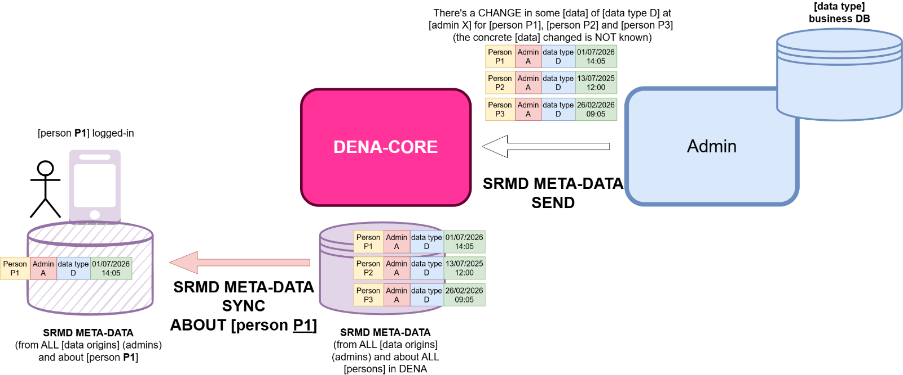
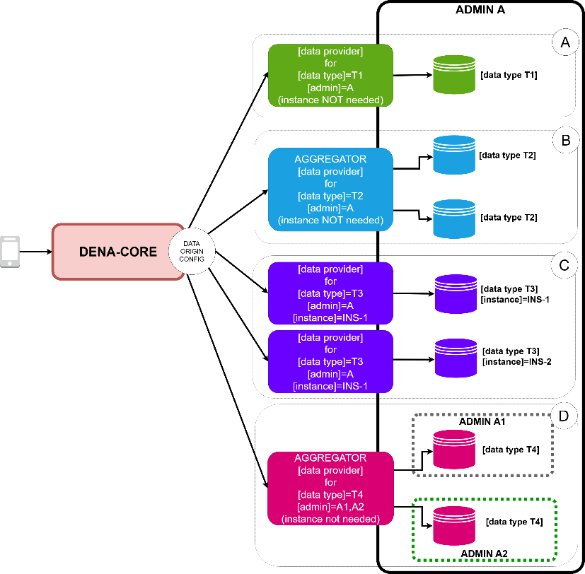

# :material-bell-ring: Metadata-Sync (Notify Changes)

## Concept

Metadata-Sync is the operation by which **your administration notifies DENA that there is new or updated data** for certain persons. Without this, DENA does not know when there are updates and the app cannot notify the person that there is fresh data.



### How does it work?

Your admin **periodically** (as frequently as possible):

1. Queries its DB looking for data that has changed since the last cycle
2. For each change, creates an SRMD record:
    ```
    {person} | {data type} | {admin} | {last update instant}
    ```
3. Sends all SRMDs to DENA-CORE via REST



### Key points

- You only send **meta-data** (what changed and when), NOT the data itself nor who the person specifically is
- You can send SRMDs for **multiple data types** and **multiple persons** in a single call
- If a record is new OR has been modified, it counts as a change
- Deleted records also count as a change
- The ideal frequency is: as often as you can (every minute, every 5 minutes, every hour...)

---

## Implementation

### Step 1: Query changes in your DB

The only information DENA needs is: **what data type was modified?** and **when was the last change?**

```sql
SELECT PERSON_ID,
       MAX(COALESCE(LAST_UPDATED_AT, CREATED_AT)) AS LAST_CHANGE_AT
  FROM MY_TABLE
 WHERE COALESCE(LAST_UPDATED_AT, CREATED_AT) >= ?
 GROUP BY PERSON_ID;
```

!!! note ""
    `COALESCE(LAST_UPDATED_AT, CREATED_AT)` uses the update date if it exists, or the creation date if it has never been updated.

### Step 2: Convert to DENA model

```java
private List<DN00SyncMetaDataFromAdminToCOREItem> _toSRMD(
        final Collection<DBPersonLastChange> dbChanges) {
    return dbChanges.stream()
        .map(dbChange -> new DN00SyncMetaDataFromAdminToCOREItem(
            new DN00OrgAdminRef(DN00OrgAdminID.forId("MY_ADMIN")),
            DN00PersonRef.from(DN00PersonID.forId(dbChange.personId())),
            dbChange.lastChangedAt(),
            new DN00DataTypeRef(DN00DataTypeID.forId("SCHEDULE")),  // ID externo del tipo Cita (DN00DataTypeEnum.SCHEDULE)
            null))  // null = instancia de origen por defecto (DEFAULT)
        .toList();
}
```

### Step 3: Wrap in an interop message and send

```java
// Create the interop context
DN00InteropContext ctx = DN00InteropContextBuilder
    .createMessageOfType(DN00InteropMessageType.ADMIN_SRMD_SYNC_REQ)
    .withGeneratedCorrelationOID()
    .fromAdmin(DN00OrgAdminID.forId("MY_ADMIN"))
    .withSubjectPerson(null)
    .aboutDataType(null)
    .build();

// Create the request message (items passed directly, no wrapper needed)
DN00SyncMetaDataFromAdminRequestMessage reqMsg =
    new DN00SyncMetaDataFromAdminRequestMessage(ctx, srmdItems);

// Serialize to JSON
String json = marshaller.forWriting().toJSON(reqMsg);

// Send via HTTP POST
HttpRequest request = HttpRequest.newBuilder()
    .uri(URI.create("https://api.dena.eus/srmd/"))
    .header("Content-Type", "application/json")
    .header("Accept", "application/json")
    .POST(HttpRequest.BodyPublishers.ofString(json))
    .build();
```

### Example: JSON sent to DENA

```json
[
  {
    "admin": { "id": "EJGV" },
    "aboutPerson": { "id": "40404040H" },
    "someDataWasUpdatedAt": "2026-08-17T15:14:07.0360000Z",
    "ofType": { "id": "ADMIN_NOTICE" },
    "fromDataOriginInstance": "DEFAULT"
  },
  {
    "admin": { "id": "EJGV" },
    "aboutPerson": { "id": "12345678A" },
    "someDataWasUpdatedAt": "2026-08-17T15:14:07.0320000Z",
    "ofType": { "id": "PROCEDURE_RECORD" },
    "fromDataOriginInstance": "DEFAULT"
  }
]
```

!!! tip "IDs vs OIDs"
    - The **person id** is their NIF (e.g.: `12345678A`)
    - The **administration id** is always its NIF/CIF (e.g.: `S4833001C` for EJGV)
    - The **data type id** is the identifier agreed upon with the DENA team (e.g.: `PROCEDURE_RECORD`)
    - The **fromDataOriginInstance** is `DEFAULT` if you only have one data origin. If you have multiple origins, use the identifier previously communicated to the DENA team
    
    You do not need to use DENA's internal OIDs. Business IDs are sufficient.

!!! note "About fromDataOriginInstance"
    If your administration only has one data origin per data type (the most common case), send `"fromDataOriginInstance": "DEFAULT"` and you don't need to worry about anything else.
    
    If you have **multiple origins** for the same data type (e.g.: several case management systems), the `fromDataOriginInstance` field must contain the identifier of the specific origin. This identifier is agreed upon with the DENA team during connector configuration. If you do not communicate it beforehand, the items will fail during processing.

### Example: DENA response

```json
{
  "transactionOid": "20863FFE-0BEB-4079-BFA1-A1EAEEEB58FF",
  "receivedItemsCount": 2,
  "processedOK": [ ... ],
  "processedNOK": [
    {
      "item": { ... },
      "error": "The [data type] with ref=unknown could NOT be validated"
    }
  ]
}
```

DENA returns which items were processed correctly (`processedOK`) and which ones failed (`processedNOK`) with the error reason. A submission can have both valid and invalid items simultaneously: valid ones are processed normally and invalid ones are rejected individually without affecting the rest.

!!! warning "Classic error: data origin not configured"
    The most common failure in `processedNOK` is a `fromDataOriginInstance` that is not registered in the DENA configuration. If you receive validation errors on the data origin, verify with the DENA team that the identifier you are using matches the one configured in the connector.


---

## Real complete call example

### Request (REQUEST) — your admin notifies DENA

Your administration sends a list of detected changes to DENA's SRMD endpoint. In this example, 2 changes of type `PERSON_DATA` are notified for 2 different people from the `SANDBOXCIF` administration:

```json
{
    "context": {
        "message": {
            "type": "ADMIN_SRMD_SYNC_REQ",
            "correlationId": "9cd46653-284c-468d-81f6-53c84bd50794",
            "interopRouteData": [
                {
                    "denaComponentId": "ADMIN",
                    "timestamp": "2026-11-10T08:07:38.934Z"
                }
            ]
        },
        "originAdmin": {
            "id": "SANDBOXCIF"
        }
    },
    "payload": [
        {
            "admin": {
                "id": "SANDBOXCIF"
            },
            "aboutPerson": {
                "id": "11189396B",
                "oid": "631011F3-9A2F-4D08-9F56-B7F4D6A0749E"
            },
            "someDataWasUpdatedAt": "2026-11-09T20:41:39.8825952Z",
            "ofType": {
                "id": "PERSON_DATA"
            }
        },
        {
            "admin": {
                "id": "SANDBOXCIF"
            },
            "aboutPerson": {
                "id": "11111111B",
                "oid": "631011F3-9A2F-4D08-9F56-B7F4D6A0749E"
            },
            "someDataWasUpdatedAt": "2026-11-09T20:41:39.8825952Z",
            "ofType": {
                "id": "PERSON_DATA"
            }
        }
    ]
}
```

### DENA Response (RESPONSE)

```json
{
    "code": "OK",
    "context": {
        "message": {
            "type": "ADMIN_SRMD_SYNC_RESP",
            "correlationId": "9cd46653-284c-468d-81f6-53c84bd50794",
            "interopRouteData": [
                {
                    "denaComponentId": "DENA_INTEROP_ADMIN_SYNC",
                    "timestamp": "2026-11-10T08:07:39.5179823Z"
                },
                {
                    "denaComponentId": "ADMIN",
                    "timestamp": "2026-11-10T08:07:38.934Z"
                }
            ]
        }
    },
    "payload": {
        "transactionOid": "FFCD3371-D351-427E-A890-0C886BCA1275",
        "receivedItemsCount": 2,
        "processedOK": [
            {
                "admin": {
                    "id": "SANDBOXCIF",
                    "oid": "6d9d73d4-3d3d-6d3d-ad3d-3d3d3d3d3011"
                },
                "dataLastUpdatedAt": "2026-11-09T20:41:39.8825952Z",
                "dataOriginInstanceId": "DEFAULT",
                "dataType": {
                    "id": "PERSON_DATA",
                    "oid": "7e0e84e5-4e4e-7e4e-be4e-4e4e4e4e4007"
                },
                "entityVersion": 5,
                "lastTransactionOid": "FFCD3371-D351-427E-A890-0C886BCA1275",
                "numericId": 0,
                "oid": "6485BF2C-5C53-4EC0-ABE3-212DD4403913",
                "person": {
                    "id": "11189396B",
                    "oid": "631011F3-9A2F-4D08-9F56-B7F4D6A0749E"
                },
                "trackingInfo": {
                    "createdAt": "2026-11-04T17:22:41.6877234Z",
                    "lastUpdatedAt": "2026-11-10T08:07:39.4321202Z",
                    "lastUpdaterSecurityPrincipalOid": "6d9d73d4-3d3d-6d3d-ad3d-3d3d3d3d3011"
                }
            }
        ],
        "processedNOK": [
            {
                "item": {
                    "admin": {
                        "id": "SANDBOXCIF",
                        "oid": "6d9d73d4-3d3d-6d3d-ad3d-3d3d3d3d3011"
                    },
                    "aboutPerson": {
                        "oid": "631011F3-9A2F-4D08-9F56-B7F4D6A0749E"
                    },
                    "someDataWasUpdatedAt": "2026-11-09T20:41:39.8825952Z",
                    "ofType": {
                        "id": "PERSON_DATA",
                        "oid": "7e0e84e5-4e4e-7e4e-be4e-4e4e4e4e4007"
                    },
                    "fromDataOriginInstance": "DEFAULT"
                },
                "error": "The [person] with ref=631011F3-9A2F-4D08-9F56-B7F4D6A0749E;null could NOT be validated"
            }
        ]
    }
}
```

!!! info "Message structure"
    - **`context.message.type`**: `ADMIN_SRMD_SYNC_REQ` (request) / `ADMIN_SRMD_SYNC_RESP` (response)
    - **`context.message.correlationId`**: correlation UUID for traceability
    - **`context.message.interopRouteData`**: trace of DENA components the message has passed through
    - **`context.originAdmin`**: origin administration (yours)
    - **`payload[]`** (request): array of SRMD items — each with:
        - `admin.id`: your administration
        - `aboutPerson.id` / `aboutPerson.oid`: the affected person
        - `someDataWasUpdatedAt`: change timestamp in ISO 8601, **7 decimal places** (`yyyy-MM-dd'T'HH:mm:ss.SSSSSSSX`)
        - `ofType.id`: data type (e.g. `PERSON_DATA`)
    - **`payload.transactionOid`** (response): transaction OID assigned by DENA
    - **`payload.receivedItemsCount`** (response): total items received
    - **`payload.processedOK[]`** (response): accepted items — contains `admin`, `person`, `dataType`, `dataLastUpdatedAt`, `entityVersion`, `trackingInfo` (with `createdAt`, `lastUpdatedAt`) and DENA internal metadata
    - **`payload.processedNOK[]`** (response): rejected items — contains `item` (the original item sent) and `error` (reason for failure)

---

## Available resources

| Resource | Description |
|----------|-------------|
| :material-api: [Swagger UI — admin-sync-rest](https://api-batera.pre.dena.eus/sync/swagger-ui/index.html) | Interactive API of the service that receives the SRMD (**PRE** environment). Lets you explore endpoints and try out calls. OpenAPI JSON: [`/sync/v3/api-docs`](https://api-batera.pre.dena.eus/sync/v3/api-docs) |
| :material-code-json: [REST messages JSON Schema](../adjuntos/json-schema.md) | Formal, validatable schema of the messages (includes `DN00SyncMetaDataFromAdminRequest/ResponseMessage`) |
| :material-rocket-launch: [Postman Resources](../adjuntos/index.md) | Collection and environment with sample Metadata-Sync requests |
| :material-folder-table: [All Swagger resources](../adjuntos/swagger.md) | Index of the Swagger UIs and OpenAPI specifications of all services |

!!! info "Reference environment"
    The documentation reflects the **PRE** environment.

---

## Full specification

For the detailed specification of the endpoint, model and errors:

[:octicons-arrow-right-24: Metadata-Sync Semantics](../semantica/metadata-sync/index.md)

---

**Next:** [:octicons-arrow-right-24: Person-Sync](./person-sync.md)

<!-- DENA-DOC-FOOTER -->
---
<sub>DENA Docs v{{ dena.version }} · {{ dena.date }}</sub>
