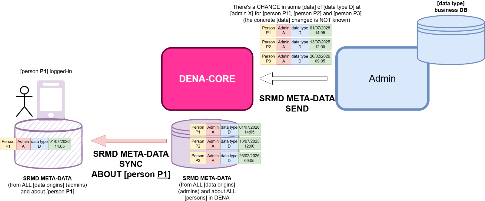
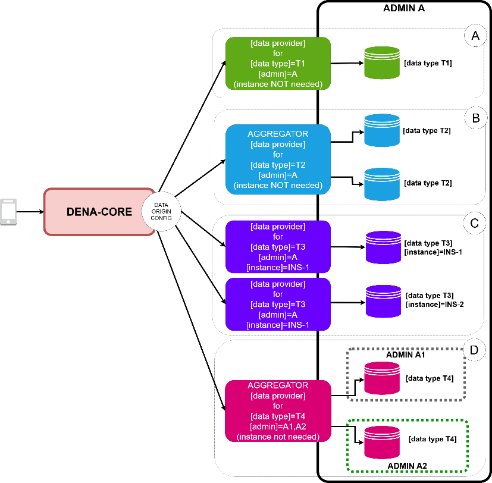

# :material-bell-ring: Metadata-Sync (Aldaketak Jakinarazi)

## Kontzeptua

Metadata-Sync zure **administrazioak DENAri datu berriak edo eguneratuak daudela jakinarazten dion** operatiba da pertsona jakin batzuentzat. Hau gabe, DENAk ez daki noiz dauden berrikuntzak eta aplikazioak ezin dio pertsonari jakinarazi datu berriak daudela.



### Nola funtzionatzen du?

Zure administrazioak **aldizka** (ahal den maiztasunenarekin):

1. Bere DBa kontsultatzen du, azken ziklotik aldatu diren datuak bilatuz
2. Aldaketa bakoitzeko, SRMD erregistro bat sortzen du:
    ```
    {pertsona} | {datu mota} | {admin} | {azken eguneratze unea}
    ```
3. SRMD guztiak DENA-COREra bidaltzen ditu REST bidez



### Puntu nagusiak

- **Meta-datuak** soilik bidaltzen dituzu (zer aldatu den eta noiz), EZ datuak beraiek ezta pertsona zehazki nor den ere
- **Datu mota anitzeko** eta **pertsona anitzeko** SRMDak bidal ditzakezu dei bakar batean
- Datu bat berria bada EDO aldatu bada, aldaketa gisa kontatzen da
- Ezabatutako erregistroak ere aldaketa gisa kontatzen dira
- Maiztasun ideala: ahal duzun bezain maiz (minuturo, 5 minuturo, orduro...)

---

## Inplementazioa

### 1. urratsa: Aldaketak kontsultatu zure DBan

DENAk behar duen informazio bakarra hau da: **zein datu mota aldatu da?** eta **noiz izan zen azken aldaketa?**

```sql
SELECT PERSON_ID,
       MAX(COALESCE(LAST_UPDATED_AT, CREATED_AT)) AS LAST_CHANGE_AT
  FROM MY_TABLE
 WHERE COALESCE(LAST_UPDATED_AT, CREATED_AT) >= ?
 GROUP BY PERSON_ID;
```

!!! note ""
    `COALESCE(LAST_UPDATED_AT, CREATED_AT)` eguneratze-data erabiltzen du existitzen bada, edo sortze-data inoiz eguneratu ez bada.

### 2. urratsa: DENA eredura bihurtu

```java
private List<DN00SyncMetaDataFromAdminToCOREItem> _toSRMD(
        final Collection<DBPersonLastChange> dbChanges) {
    return dbChanges.stream()
        .map(dbChange -> new DN00SyncMetaDataFromAdminToCOREItem(
            new DN00OrgAdminRef(DN00OrgAdminID.forId("MY_ADMIN")),
            DN00PersonRef.from(DN00PersonID.forId(dbChange.personId())),
            dbChange.lastChangedAt(),
            new DN00DataTypeRef(DN00DataTypeID.forId("SCHEDULE")),  // ID externo del tipo Cita (DN00DataTypeEnum.SCHEDULE)
            null))  // null = instancia de origen por defecto (DEFAULT)
        .toList();
}
```

### 3. urratsa: Interop mezu batean bildu eta bidali

```java
// Interop context-a sortu
DN00InteropContext ctx = DN00InteropContextBuilder
    .createMessageOfType(DN00InteropMessageType.ADMIN_SRMD_SYNC_REQ)
    .withGeneratedCorrelationOID()
    .fromAdmin(DN00OrgAdminID.forId("MY_ADMIN"))
    .withSubjectPerson(null)
    .aboutDataType(null)
    .build();

// Eskaeran mezua sortu (itemak zuzenean, bilgarririk gabe)
DN00SyncMetaDataFromAdminRequestMessage reqMsg =
    new DN00SyncMetaDataFromAdminRequestMessage(ctx, srmdItems);

// JSON formatuan serializatu
String json = marshaller.forWriting().toJSON(reqMsg);

// HTTP POST bidez bidali
HttpRequest request = HttpRequest.newBuilder()
    .uri(URI.create("https://api.dena.eus/srmd/"))
    .header("Content-Type", "application/json")
    .header("Accept", "application/json")
    .POST(HttpRequest.BodyPublishers.ofString(json))
    .build();
```

### Adibidea: DENAra bidalitako JSONa

```json
[
  {
    "admin": { "id": "EJGV" },
    "aboutPerson": { "id": "40404040H" },
    "someDataWasUpdatedAt": "2026-08-17T15:14:07.0360000Z",
    "ofType": { "id": "ADMIN_NOTICE" },
    "fromDataOriginInstance": "DEFAULT"
  },
  {
    "admin": { "id": "EJGV" },
    "aboutPerson": { "id": "12345678A" },
    "someDataWasUpdatedAt": "2026-08-17T15:14:07.0320000Z",
    "ofType": { "id": "PROCEDURE_RECORD" },
    "fromDataOriginInstance": "DEFAULT"
  }
]
```

!!! tip "IDak vs OIDak"
    - **Pertsonaren id**-a bere NANa da (adib.: `12345678A`)
    - **Administrazioaren id**-a beti bere IFK/NAN da (adib.: `S4833001C` EJGVrentzat)
    - **Datu motaren id**-a DENA taldearekin adostutako identifikadorea da (adib.: `PROCEDURE_RECORD`)
    - **fromDataOriginInstance** `DEFAULT` da datu-jatorri bakarra baduzu. Jatorri anitz badituzu, erabili aldez aurretik DENA taldeari jakinarazitako identifikadorea
    
    Ez duzu DENAren barneko OIDak erabili behar. Negozio-IDak nahikoak dira.

!!! note "fromDataOriginInstance-i buruz"
    Zure administrazioak datu mota bakoitzeko datu-jatorri bakarra badu (ohikoena dena), bidali `"fromDataOriginInstance": "DEFAULT"` eta ez duzu beste ezertaz kezkatu behar.
    
    Datu mota bererako **jatorri anitz** badituzu (adib.: espediente-kudeatzaile bat baino gehiago), `fromDataOriginInstance` eremuan jatorri zehatza identifikatu behar da. Identifikadore hau DENA taldearekin adosten da konektorearen konfigurazioan. Aldez aurretik jakinarazten ez baduzu, elementuek huts egingo dute prozesamenduan.

### Adibidea: DENAren erantzuna

```json
{
  "transactionOid": "20863FFE-0BEB-4079-BFA1-A1EAEEEB58FF",
  "receivedItemsCount": 2,
  "processedOK": [ ... ],
  "processedNOK": [
    {
      "item": { ... },
      "error": "The [data type] with ref=unknown could NOT be validated"
    }
  ]
}
```

DENAk itzultzen du zein elementu ondo prozesatu diren (`processedOK`) eta zeintzuk huts egin duten (`processedNOK`) errorearen arrazoiarekin. Bidalketa batek elementu baliodunak eta baliogabeak izan ditzake aldi berean: baliodunak normaltasunez prozesatzen dira eta baliogabeak banaka baztertzen dira gainerakoei eragin gabe.

!!! warning "Errore klasikoa: konfiguratu gabeko data origin"
    `processedNOK`-en akatsik ohikoena DENAren konfigurazioan erregistratu gabeko `fromDataOriginInstance` bat da. Datu-jatorriari buruzko balidazio-erroreak jasotzen badituzu, egiaztatu DENA taldearekin erabiltzen duzun identifikadorea konektorean konfiguratutakoarekin bat datorrela.


---

## Benetako deialdiaren adibidea

### Eskaera (REQUEST) — zure admin-ak DENAri jakinarazten dio

Zure administrazioak detektatutako aldaketen zerrenda bidaltzen dio DENAren SRMD endpoint-ari. Adibide honetan, `SANDBOXCIF` administrazioko 2 pertsonen `PERSON_DATA` motako 2 aldaketa jakinarazten dira:

```json
{
    "context": {
        "message": {
            "type": "ADMIN_SRMD_SYNC_REQ",
            "correlationId": "9cd46653-284c-468d-81f6-53c84bd50794",
            "interopRouteData": [
                {
                    "denaComponentId": "ADMIN",
                    "timestamp": "2026-11-10T08:07:38.934Z"
                }
            ]
        },
        "originAdmin": {
            "id": "SANDBOXCIF"
        }
    },
    "payload": [
        {
            "admin": {
                "id": "SANDBOXCIF"
            },
            "aboutPerson": {
                "id": "11189396B",
                "oid": "631011F3-9A2F-4D08-9F56-B7F4D6A0749E"
            },
            "someDataWasUpdatedAt": "2026-11-09T20:41:39.8825952Z",
            "ofType": {
                "id": "PERSON_DATA"
            }
        },
        {
            "admin": {
                "id": "SANDBOXCIF"
            },
            "aboutPerson": {
                "id": "11111111B",
                "oid": "631011F3-9A2F-4D08-9F56-B7F4D6A0749E"
            },
            "someDataWasUpdatedAt": "2026-11-09T20:41:39.8825952Z",
            "ofType": {
                "id": "PERSON_DATA"
            }
        }
    ]
}
```

### DENAren erantzuna (RESPONSE)

```json
{
    "code": "OK",
    "context": {
        "message": {
            "type": "ADMIN_SRMD_SYNC_RESP",
            "correlationId": "9cd46653-284c-468d-81f6-53c84bd50794",
            "interopRouteData": [
                {
                    "denaComponentId": "DENA_INTEROP_ADMIN_SYNC",
                    "timestamp": "2026-11-10T08:07:39.5179823Z"
                },
                {
                    "denaComponentId": "ADMIN",
                    "timestamp": "2026-11-10T08:07:38.934Z"
                }
            ]
        }
    },
    "payload": {
        "transactionOid": "FFCD3371-D351-427E-A890-0C886BCA1275",
        "receivedItemsCount": 2,
        "processedOK": [
            {
                "admin": {
                    "id": "SANDBOXCIF",
                    "oid": "6d9d73d4-3d3d-6d3d-ad3d-3d3d3d3d3011"
                },
                "dataLastUpdatedAt": "2026-11-09T20:41:39.8825952Z",
                "dataOriginInstanceId": "DEFAULT",
                "dataType": {
                    "id": "PERSON_DATA",
                    "oid": "7e0e84e5-4e4e-7e4e-be4e-4e4e4e4e4007"
                },
                "entityVersion": 5,
                "lastTransactionOid": "FFCD3371-D351-427E-A890-0C886BCA1275",
                "numericId": 0,
                "oid": "6485BF2C-5C53-4EC0-ABE3-212DD4403913",
                "person": {
                    "id": "11189396B",
                    "oid": "631011F3-9A2F-4D08-9F56-B7F4D6A0749E"
                },
                "trackingInfo": {
                    "createdAt": "2026-11-04T17:22:41.6877234Z",
                    "lastUpdatedAt": "2026-11-10T08:07:39.4321202Z",
                    "lastUpdaterSecurityPrincipalOid": "6d9d73d4-3d3d-6d3d-ad3d-3d3d3d3d3011"
                }
            }
        ],
        "processedNOK": [
            {
                "item": {
                    "admin": {
                        "id": "SANDBOXCIF",
                        "oid": "6d9d73d4-3d3d-6d3d-ad3d-3d3d3d3d3011"
                    },
                    "aboutPerson": {
                        "oid": "631011F3-9A2F-4D08-9F56-B7F4D6A0749E"
                    },
                    "someDataWasUpdatedAt": "2026-11-09T20:41:39.8825952Z",
                    "ofType": {
                        "id": "PERSON_DATA",
                        "oid": "7e0e84e5-4e4e-7e4e-be4e-4e4e4e4e4007"
                    },
                    "fromDataOriginInstance": "DEFAULT"
                },
                "error": "The [person] with ref=631011F3-9A2F-4D08-9F56-B7F4D6A0749E;null could NOT be validated"
            }
        ]
    }
}
```

!!! info "Mezuaren egitura"
    - **`context.message.type`**: `ADMIN_SRMD_SYNC_REQ` (eskaera) / `ADMIN_SRMD_SYNC_RESP` (erantzuna)
    - **`context.message.correlationId`**: trazabilitate UUID
    - **`context.message.interopRouteData`**: mezuak zeharkatutako DENA osagaien traza
    - **`context.originAdmin`**: jatorri-administrazioa (zurea)
    - **`payload[]`** (eskaera): SRMD item-en array-a — bakoitzak:
        - `admin.id`: zure administrazioa
        - `aboutPerson.id` / `aboutPerson.oid`: aldatutako pertsona
        - `someDataWasUpdatedAt`: aldaketaren unea ISO 8601 formatuan, **7 dezimal** (`yyyy-MM-dd'T'HH:mm:ss.SSSSSSSX`)
        - `ofType.id`: datu mota (adib. `PERSON_DATA`)
    - **`payload.transactionOid`** (erantzuna): DENAk esleitzen duen transakzio OID-a
    - **`payload.receivedItemsCount`** (erantzuna): jasotako item guztien kopurua
    - **`payload.processedOK[]`** (erantzuna): onartutako item-ak — `admin`, `person`, `dataType`, `dataLastUpdatedAt`, `entityVersion`, `trackingInfo` (with `createdAt`, `lastUpdatedAt`) eta DENAren barne-metadatuak ditu
    - **`payload.processedNOK[]`** (erantzuna): baztertutako item-ak — `item` (bidalitako item originala) eta `error` (porrotaren arrazoia) ditu

---

## Baliabide eskuragarriak

| Baliabidea | Deskribapena |
|------------|--------------|
| :material-api: [Swagger UI — admin-sync-rest](https://api-batera.pre.dena.eus/sync/swagger-ui/index.html) | SRMDak jasotzen dituen zerbitzuaren API interaktiboa (**PRE** ingurunea). Endpoint-ak esploratu eta deiak proba ditzakezu. OpenAPI JSON: [`/sync/v3/api-docs`](https://api-batera.pre.dena.eus/sync/v3/api-docs) |
| :material-code-json: [REST mezuen JSON Schema](../adjuntos/json-schema.md) | Mezuen eskema formal eta balidagarria (`DN00SyncMetaDataFromAdminRequest/ResponseMessage` barne) |
| :material-rocket-launch: [Postman Baliabideak](../adjuntos/index.md) | Metadata-Sync-en adibide-eskaerak dituen bilduma eta environment-a |
| :material-folder-table: [Swagger baliabide guztiak](../adjuntos/swagger.md) | Zerbitzu guztien Swagger UIen eta OpenAPI espezifikazioen aurkibidea |

!!! info "Erreferentziako ingurunea"
    Dokumentazioak **PRE** ingurunea islatzen du.

---

## Zehaztapen osoa

Endpoint-aren, ereduaren eta erroreen zehaztapen xehatuetarako:

[:octicons-arrow-right-24: Metadata-Sync Semantika](../semantica/metadata-sync/index.md)

---

**Hurrengoa:** [:octicons-arrow-right-24: Person-Sync](./person-sync.md)

<!-- DENA-DOC-FOOTER -->
---
<sub>DENA Docs v{{ dena.version }} · {{ dena.date }}</sub>
