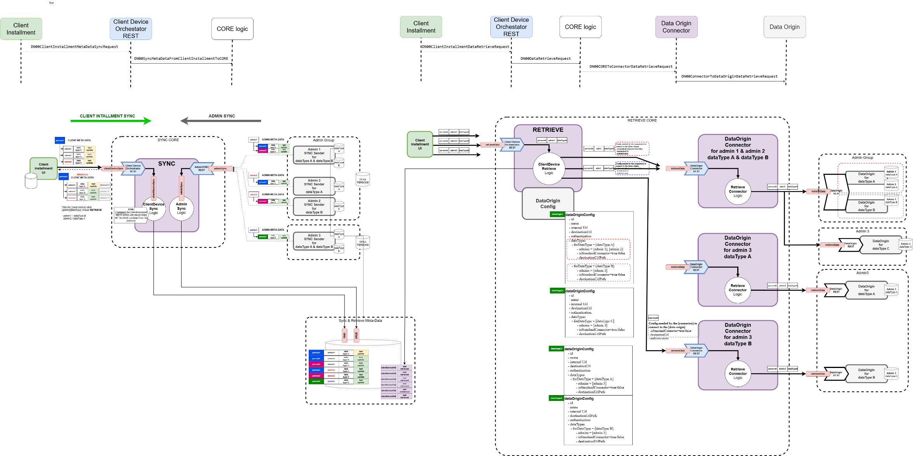
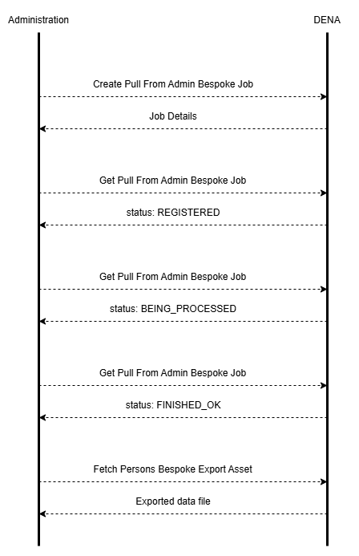

# :material-account-sync: Person-Sync (Synchronize Persons)

## Concept

Person-Sync is the operation that allows your administration to **know which persons are registered in DENA**. This is necessary so that your admin only sends SRMD (change notifications) for persons who actually have a DENA account.

Additionally, DENA shares basic person data with your admin: NIF, first name, last name, contact details.



### Person Data Synchronized

Each person registered in DENA has an account that stores:

- **Person OID**: Unique identifier generated by DENA
- **Person ID**: The NIF
- **Full Name**: name, surname1, surname2
- **Contact Data**: address, phone, email...
- **Preferred Topics**: can be used in proactive services or customize the UI

### What is it for?

- **Know who to send SRMD for**: it only makes sense to notify changes for persons who are in DENA
- **Keep your DB synchronized**: when a person registers or unregisters from DENA, your admin is informed
- **Access basic data**: name, contact, thematic preferences

---

## Available mechanisms

DENA offers two complementary mechanisms:

### Push: DENA notifies you

DENA sends a message to a service in your admin every time:

- A new person registers in DENA
- A person deletes their account
- A person changes their basic data (name, contact...)

Your admin exposes an endpoint that DENA calls automatically when there are changes.

### Pull: your admin queries

Your admin queries DENA whenever it wants, in two ways:

| Modality | Description |
|-----------|-------------|
| **On-line** | Your admin calls a DENA REST service to query persons in real time |
| **Off-line (pre-generated)** | DENA generates periodic files with the list of persons |
| **Off-line (bespoke)** | Your admin requests a custom file that DENA generates on demand |



---

## Which one to choose?

| Situation | Recommendation |
|-----------|---------------|
| You need to know instantly when someone registers | **Push** |
| You have a nightly batch process that synchronizes | **Pull off-line** |
| You want to query persons on demand | **Pull on-line** |
| You want both (recommended) | **Push** + **Pull off-line** as backup |


---

## Real Push call example

DENA sends this message to your endpoint when a person is created or updated:

### Request (REQUEST)

```json
{
    "context": {
        "message": {
            "type": "PERSON_PUSH_TO_ADMIN_REQ",
            "correlationId": "6F65F954-5310-40C9-B674-4AAE10C817FF",
            "interopRouteData": [
                {
                    "denaComponentId": "DENA_CORE",
                    "timestamp": "2026-11-09T18:48:01.1692680Z"
                },
                {
                    "denaComponentId": "DENA_ADMIN_CONNECTOR",
                    "timestamp": "2026-11-09T18:48:01.2682590Z"
                }
            ]
        },
        "destinationAdmin": {
            "id": "SANDBOXCIF",
            "oid": "6d9d73d4-3d3d-6d3d-ad3d-3d3d3d3d3011"
        },
        "subjectPerson": {
            "id": "20202020E",
            "oid": "E0BF74D6-E07A-457F-8F2B-55C4561F33AA"
        }
    },
    "payload": {
        "syncData": {
            "personRef": {
                "id": "20202020E",
                "oid": "E0BF74D6-E07A-457F-8F2B-55C4561F33AA"
            },
            "createDate": "2026-11-09T17:48:01.1630320Z",
            "lastUpdateDate": "2026-11-09T18:48:01.1630770Z",
            "syncEvent": "CREATED"
        },
        "person": {
            "entityVersion": 0,
            "id": "20202020E",
            "lastChangeEvent": "CREATED",
            "name": "John",
            "numericId": 0,
            "oid": "E0BF74D6-E07A-457F-8F2B-55C4561F33AA",
            "surname1": "Doe",
            "surname2": "Smith"
        }
    }
}
```

### Response (RESPONSE)

```json
{
    "context": {
        "message": {
            "type": "PERSON_PUSH_TO_ADMIN_RESP",
            "correlationId": "6F65F954-5310-40C9-B674-4AAE10C817FF",
            "interopRouteData": [
                {
                    "denaComponentId": "DENA_CORE",
                    "timestamp": "2026-11-09T18:48:01.1692680Z"
                },
                {
                    "denaComponentId": "DENA_ADMIN_CONNECTOR",
                    "timestamp": "2026-11-09T18:48:01.2682590Z"
                },
                {
                    "denaComponentId": "ADMIN",
                    "timestamp": "2026-11-09T18:48:01.2682590Z"
                }
            ]
        },
        "destinationAdmin": {
            "id": "SANDBOXCIF",
            "oid": "6d9d73d4-3d3d-6d3d-ad3d-3d3d3d3d3011"
        },
        "subjectPerson": {
            "id": "20202020E",
            "oid": "E0BF74D6-E07A-457F-8F2B-55C4561F33AA"
        }
    },
    "payload": {
        "result": "OK"
    }
}
```

!!! info "Message structure"
    - **`context.message.type`**: `PERSON_PUSH_TO_ADMIN_REQ` (request) / `PERSON_PUSH_TO_ADMIN_RESP` (response)
    - **`context.message.correlationId`**: correlation UUID for traceability
    - **`context.message.interopRouteData`**: component trace — `DENA_CORE` → `DENA_ADMIN_CONNECTOR` in the request; adds `ADMIN` in the response
    - **`context.destinationAdmin`**: destination administration (yours)
    - **`context.subjectPerson`**: person being synchronized
    - **`payload.syncData.personRef`**: person reference (`id` NIF + `oid`)
    - **`payload.syncData.createDate`**: person creation date in DENA
    - **`payload.syncData.lastUpdateDate`**: date of the person's last change
    - **`payload.syncData.syncEvent`**: event type — `CREATED`, `UPDATED` or `DELETED`
    - **`payload.person`**: basic data — `id` (NIF), `oid`, `name`, `surname1`, `surname2`, `lastChangeEvent`, `entityVersion`
    - **`payload.result`** (response): `"OK"` if your endpoint processes correctly

---

## Available resources

| Resource | Description |
|----------|-------------|
| :material-api: [Swagger UI — person-admin-sync-rest](https://api-batera.pre.dena.eus/person-sync/swagger-ui/index.html) | Interactive API of the person Pull (bespoke/pregen jobs). OpenAPI JSON: [`/person-sync/v3/api-docs`](https://api-batera.pre.dena.eus/person-sync/v3/api-docs) |
| :material-api: [Swagger UI — person-admin-rest](https://api-batera.pre.dena.eus/person/swagger-ui/index.html) | Interactive API of the person query (fetch / head / search). OpenAPI JSON: [`/person/v3/api-docs`](https://api-batera.pre.dena.eus/person/v3/api-docs) |
| :material-code-json: [REST messages JSON Schema](../adjuntos/json-schema.md) | Formal, validatable schema of the messages (push, bespoke/pregen pull and person query) |
| :material-rocket-launch: [Postman Resources](../adjuntos/index.md) | Collection and environment with sample Person-Sync requests |
| :material-folder-table: [All Swagger resources](../adjuntos/swagger.md) | Index of the Swagger UIs and OpenAPI specifications of all services |

!!! info "Reference environment"
    The documentation reflects the **PRE** environment.

---

## Full specification

For the detailed specification of endpoints, models, and files:

| Mechanism | Documentation |
|-----------|---------------|
| Push | [:octicons-arrow-right-24: Push Endpoint](../semantica/person-sync/push.md) |
| Pull | [:octicons-arrow-right-24: Pull Endpoint](../semantica/person-sync/pull.md) |
| Overview | [:octicons-arrow-right-24: Person-Sync Semantics](../semantica/person-sync/index.md) |

---

**Next:** [:octicons-arrow-right-24: Semantics (technical data specification)](../semantica/index.md)

<!-- DENA-DOC-FOOTER -->
---
<sub>DENA Docs v{{ dena.version }} · {{ dena.date }}</sub>
