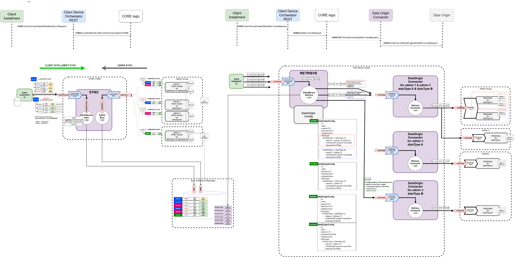
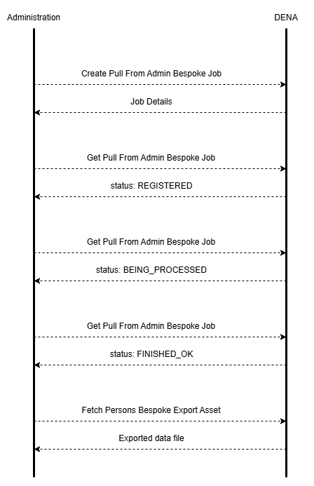

# :material-account-sync: Person-Sync (Sincronizar Personas)

## Concepto

Person-Sync es la operativa que permite a tu administración **saber qué personas están inscritas en DENA**. Esto es necesario para que tu admin solo envíe SRMD (avisos de cambios) para personas que realmente tienen una cuenta DENA.

Además, DENA comparte con tu admin datos básicos de la persona: NIF, nombre, apellidos, datos de contacto.



### Datos de Persona Sincronizados

Cada persona que se registra en DENA tiene una cuenta que almacena:

- **OID de Persona**: Identificador único generado por DENA
- **ID de Persona**: El NIF
- **Nombre Completo**: nombre, apellido1, apellido2
- **Datos de Contacto**: dirección, teléfono, email...
- **Temas Preferidos**: pueden usarse en servicios proactivos o personalizar la UI

### ¿Para qué sirve?

- **Saber para quién enviar SRMD**: solo tiene sentido notificar cambios de personas que están en DENA
- **Mantener tu BD sincronizada**: cuando una persona se inscribe o se da de baja de DENA, tu admin se entera
- **Acceder a datos básicos**: nombre, contacto, preferencias temáticas

---

## Mecanismos disponibles

DENA ofrece dos mecanismos complementarios:

### Push: DENA te notifica

DENA envía un mensaje a un servicio de tu admin cada vez que:

- Una nueva persona se inscribe en DENA
- Una persona elimina su cuenta
- Una persona cambia sus datos básicos (nombre, contacto...)

Tu admin expone un endpoint que DENA llama automáticamente cuando hay cambios.

#### Ejemplo real de llamada Push

DENA envía este mensaje a tu endpoint cuando una persona se crea o actualiza. El mensaje contiene los datos básicos de la persona:

##### Petición (REQUEST)

```json
{
    "context": {
        "message": {
            "type": "PERSON_PUSH_TO_ADMIN_REQ",
            "correlationId": "6F65F954-5310-40C9-B674-4AAE10C817FF",
            "interopRouteData": [
                { "denaComponentId": "DENA_CORE", "timestamp": "2026-11-09T18:48:01.1692680Z" },
                { "denaComponentId": "DENA_ADMIN_CONNECTOR", "timestamp": "2026-11-09T18:48:01.2682590Z" }
            ]
        },
        "destinationAdmin": { "id": "SANDBOXCIF", "oid": "6d9d73d4-3d3d-6d3d-ad3d-3d3d3d3d3011" },
        "subjectPerson": { "id": "20202020E", "oid": "E0BF74D6-E07A-457F-8F2B-55C4561F33AA" }
    },
    "payload": {
        "syncData": {
            "personRef": { "id": "20202020E", "oid": "E0BF74D6-E07A-457F-8F2B-55C4561F33AA" },
            "createDate": "2026-11-09T17:48:01.1630320Z",
            "lastUpdateDate": "2026-11-09T18:48:01.1630770Z",
            "syncEvent": "CREATED"
        },
        "person": {
            "entityVersion": 0,
            "id": "20202020E",
            "lastChangeEvent": "CREATED",
            "name": "John",
            "numericId": 0,
            "oid": "E0BF74D6-E07A-457F-8F2B-55C4561F33AA",
            "surname1": "Doe",
            "surname2": "Smith"
        }
    }
}
```

##### Respuesta (RESPONSE)

Tu endpoint devuelve un resultado simple:

```json
{
    "context": {
        "message": {
            "type": "PERSON_PUSH_TO_ADMIN_RESP",
            "correlationId": "6F65F954-5310-40C9-B674-4AAE10C817FF",
            "interopRouteData": [
                { "denaComponentId": "DENA_CORE", "timestamp": "2026-11-09T18:48:01.1692680Z" },
                { "denaComponentId": "DENA_ADMIN_CONNECTOR", "timestamp": "2026-11-09T18:48:01.2682590Z" },
                { "denaComponentId": "ADMIN", "timestamp": "2026-11-09T18:48:01.2682590Z" }
            ]
        },
        "destinationAdmin": { "id": "SANDBOXCIF", "oid": "6d9d73d4-3d3d-6d3d-ad3d-3d3d3d3d3011" },
        "subjectPerson": { "id": "20202020E", "oid": "E0BF74D6-E07A-457F-8F2B-55C4561F33AA" }
    },
    "payload": { "result": "OK" }
}
```

!!! info "Estructura del mensaje"
    - **`context.message.type`**: `PERSON_PUSH_TO_ADMIN_REQ` / `PERSON_PUSH_TO_ADMIN_RESP`
    - **`payload.syncData`**: metadatos de sincronización (createDate, lastUpdateDate, syncEvent: `CREATED`/`UPDATED`/`DELETED`)
    - **`payload.person`**: datos básicos de la persona (id NIF, oid, name, surname1, surname2)
    - **`payload.result`**: `"OK"` si tu endpoint procesa correctamente

---

### Pull: tu admin consulta

Tu admin consulta a DENA cuando quiere, de dos formas:

| Modalidad | Descripción |
|-----------|-------------|
| **On-line** | Tu admin llama a un REST service de DENA para consultar personas en tiempo real |
| **Off-line (pre-generado)** | DENA genera ficheros periódicos con el listado de personas |
| **Off-line (bespoke)** | Tu admin solicita un fichero personalizado que DENA genera bajo demanda |



---

## ¿Cuál elegir?

| Situación | Recomendación |
| Tienes un proceso batch nocturno que sincroniza | **Pull off-line** |
| Quieres consultar personas bajo demanda | **Pull on-line** |
| Quieres ambos (recomendado) | **Push** + **Pull off-line** como respaldo |

!!! tip "Recomendación"
    Se recomienda implementar **ambos mecanismos**: Push para notificaciones en tiempo real y Pull off-line como respaldo para recuperar posibles perdidos.

---

## Recursos disponibles

| Recurso | Descripción |
|---------|-------------|
| :material-api: [Swagger UI — person-admin-sync-rest](https://api-batera.pre.dena.eus/person-sync/swagger-ui/index.html) | API interactiva del Pull de personas (jobs bespoke/pregen). OpenAPI JSON: [`/person-sync/v3/api-docs`](https://api-batera.pre.dena.eus/person-sync/v3/api-docs) |
| :material-api: [Swagger UI — person-admin-rest](https://api-batera.pre.dena.eus/person/swagger-ui/index.html) | API interactiva de la consulta de personas (fetch / head / search). OpenAPI JSON: [`/person/v3/api-docs`](https://api-batera.pre.dena.eus/person/v3/api-docs) |
| :material-code-json: [JSON Schema de los mensajes REST](../adjuntos/json-schema.md) | Esquema formal y validable de los mensajes (push, pull bespoke/pregen y consulta de personas) |
| :material-rocket-launch: [Recursos Postman](../adjuntos/index.md) | Colección y environment con requests de ejemplo de Person-Sync |
| :material-folder-table: [Todos los recursos Swagger](../adjuntos/swagger.md) | Índice de las Swagger UI y especificaciones OpenAPI de todos los servicios |

!!! info "Entorno de referencia"
    La documentación refleja el entorno **PRE**.

---

## Especificación completa

Para la especificación detallada de endpoints, modelos y ficheros:

| Mecanismo | Documentación |
|-----------|---------------|
| Push | [:octicons-arrow-right-24: Endpoint Push](../semantica/person-sync/push.md) |
| Pull | [:octicons-arrow-right-24: Endpoint Pull](../semantica/person-sync/pull.md) |
| Visión general | [:octicons-arrow-right-24: Semántica Person-Sync](../semantica/person-sync/index.md) |

---

**Siguiente:** [:octicons-arrow-right-24: Semántica (especificación técnica de datos)](../semantica/index.md)

<!-- DENA-DOC-FOOTER -->
---
<sub>DENA Docs v{{ dena.version }} · {{ dena.date }}</sub>
