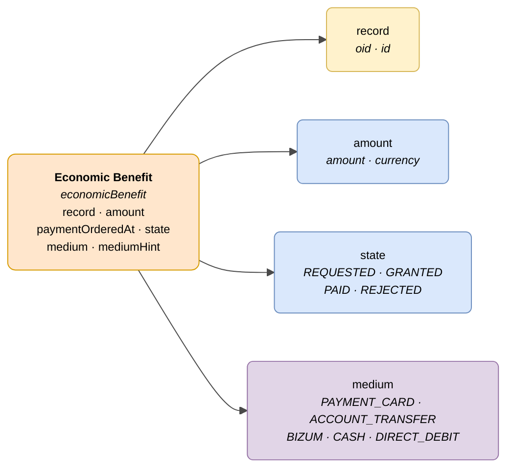

# :material-cash-multiple: Economic Benefit

> - **Version:** `v{{ dena.version }}`
> - **Date:** {{ dena.date }}
> - **Type ID (DataTypeID):** `ECONOMIC_BENEFIT`
> - **Test:** [DN99DENATestMockObjFactoryForEconomicBenefit.java]({{ repos.interop_test_blob }}/denaTestCommonDataClasses/src/main/java/dena/test/common/data/economicbenefit/DN99DENATestMockObjFactoryForEconomicBenefit.java) ⚠️ UNVERIFIED
> - **Code:** [DN00EconomicBenefit.java]({{ repos.common_data_api_blob }}/denaCommonDataAPIEconomicBenefitModelClasses/src/main/java/dena/api/data/model/economicbenefit/DN00EconomicBenefit.java)

## Description

Represents an economic benefit or payment to a person, linked to a record. Covers both one-off payments and recurring benefits: PEV payments, economic allowances, etc.

> See also: [campos-comunes.md](./campos-comunes.md) for inherited fields (`oid`, `id`, `lastChangedAt`, `urls`, `originAdmin`, `aboutPerson`)



| Colour | Meaning |
|-------|-------------|
| 🟠 Orange | Main object (Economic Benefit) |
| 🟡 Yellow | Reference to another object (Record) |
| 🔵 Light blue | Data fields |
| 🟣 Purple | Enums (payment methods) |

---

## 🔗 Source code

| Class | Repository |
|-------|-------------|
| DN00EconomicBenefit | [View code]({{ repos.common_data_api_blob }}/denaCommonDataAPIEconomicBenefitModelClasses/src/main/java/dena/api/data/model/economicbenefit/DN00EconomicBenefit.java) |
| DN00EconomicBenefitState | [View code]({{ repos.common_data_api_blob }}/denaCommonDataAPIEconomicBenefitModelClasses/src/main/java/dena/api/data/model/economicbenefit/DN00EconomicBenefitState.java) |

---

## 🧪 Tests and examples

| Test | Repository |
|------|-------------|
| DN99DENATestMockObjFactoryForEconomicBenefit | [View test]({{ repos.interop_test_blob }}/denaTestCommonDataClasses/src/main/java/dena/test/common/data/economicbenefit/DN99DENATestMockObjFactoryForEconomicBenefit.java) ⚠️ UNVERIFIED |

---

## Attributes

Fields marked with <span class="field-badge--common">common</span> are **inherited** from [`DN00DENADataExchangedObjectBase`]({{ repos.common_data_api_blob }}/denaCommonDataAPIModelClasses/src/main/java/dena/api/data/model/DN00DENADataExchangedObjectBase.java). See [campos-comunes.md](./campos-comunes.md).

| Field | Type | Required | Example | Description |
|-------|------|:--------:|---------|-------------|
| `type` | `String` | ✅ | `"economicBenefit"` | Type discriminator (always `"economicBenefit"`) |
| `oid` <span class="field-badge--common">common</span> | `String` | ✅ | `"BEN-OID-001"` | Unique technical identifier |
| `id` <span class="field-badge--common">common</span> | `String` | ✅ | `"PEV-2024-00001"` | Business identifier |
| `lastChangedAt` <span class="field-badge--common">common</span> | `Instant` | ✅ | `"2026-08-19T08:07:56.742Z"` | Last modification of the data at origin |
| `record` | `Object` | ❌ | `{"oid":"EXP-OID-001","id":"EXP-2024-00123"}` | Reference to the associated record |
| `amount` | `Money` | ✅ | `{"amount":500.00,"currency":"EUR"}` | Benefit amount (see [Money type](#money-type)) |
| `paymentOrderedAt` | `Instant` | ❌ | `"2024-06-01T00:00:00Z"` | Date payment was ordered (null if not yet paid) |
| `state` | `Object` | ✅ | `{"stateCode":"GRANTED"}` | Benefit state |
| `medium` | `String` | ✅ | `"ACCOUNT_TRANSFER"` | Payment method (see [payment methods](#payment-methods-medium)) |
| `mediumHint` | `String` | ❌ | `"ES91 2100 **** **** 0051"` | Payment method hint (e.g. last digits of account) |

---

## Money type

```json
{ "amount": 500.00, "currency": "EUR" }
```

| Field | Type | Description |
|-------|------|-------------|
| `amount` | `Number` | Numeric amount |
| `currency` | `String` | ISO 4217 currency code (usually `"EUR"`) |

!!! warning "Money type: `amount` is an integer in cents"
    The `amount` field is of type `long` and represents the amount in **cents**. In the examples on this page, values like `500.00` should be understood as `50000` cents. The `base` field (`CENTS` | `UNITS`) is optional.
    
    Correct example: `{"amount": 50000, "base": "CENTS", "currency": "EUR"}` (equivalent to 500.00 €)

---

## Benefit states (`state.stateCode`)

| Code | Description |
|------|-------------|
| `REQUESTED` | Benefit requested, pending resolution |
| `GRANTED` | Benefit granted, pending payment |
| `PAID` | Benefit paid |
| `REJECTED` | Benefit rejected |

---

## Payment methods (`medium`)

| Code | Description |
|------|-------------|
| `PAYMENT_CARD` | Credit/debit card |
| `ACCOUNT_TRANSFER` | Bank transfer |
| `BIZUM` | Bizum |
| `CASH` | Cash |
| `DIRECT_DEBIT` | Direct debit |

---

## Example — Granted benefit

<div class="common-highlight" markdown>

```json hl_lines="3 4 5"
{
  "type": "economicBenefit",
  "oid": "BEN-OID-001",
  "id": "PEV-2024-00001",
  "lastChangedAt": "2026-08-19T08:07:56.742Z",
  "record": { "oid": "EXP-OID-001", "id": "EXP-2024-00123" },
  "amount": { "amount": 500.00, "currency": "EUR" },
  "paymentOrderedAt": null,
  "state": { "stateCode": "GRANTED" },
  "medium": "ACCOUNT_TRANSFER",
  "mediumHint": "ES91 2100 **** **** 0051"
}
```

<p class="common-fields-legend"><span class="swatch"></span> Highlighted lines are <strong>common</strong> fields inherited from the base class (see <a href="./campos-comunes.md">campos-comunes.md</a>).</p>

</div>

---

## Important notes

- `record` is optional but recommended whenever the benefit is linked to a record.
- `paymentOrderedAt` only has a value when the benefit is in `PAID` state; in other states it may be `null`.
- `mediumHint` is informational: it may show the last digits of the account or any reference that helps identify the medium without exposing complete data.
- PEV (Housing Economic Benefit) payments are the primary use case for this data type.


---

<!-- DENA-DOC-FOOTER -->
---
<sub>DENA Docs v{{ dena.version }} · {{ dena.date }}</sub>
