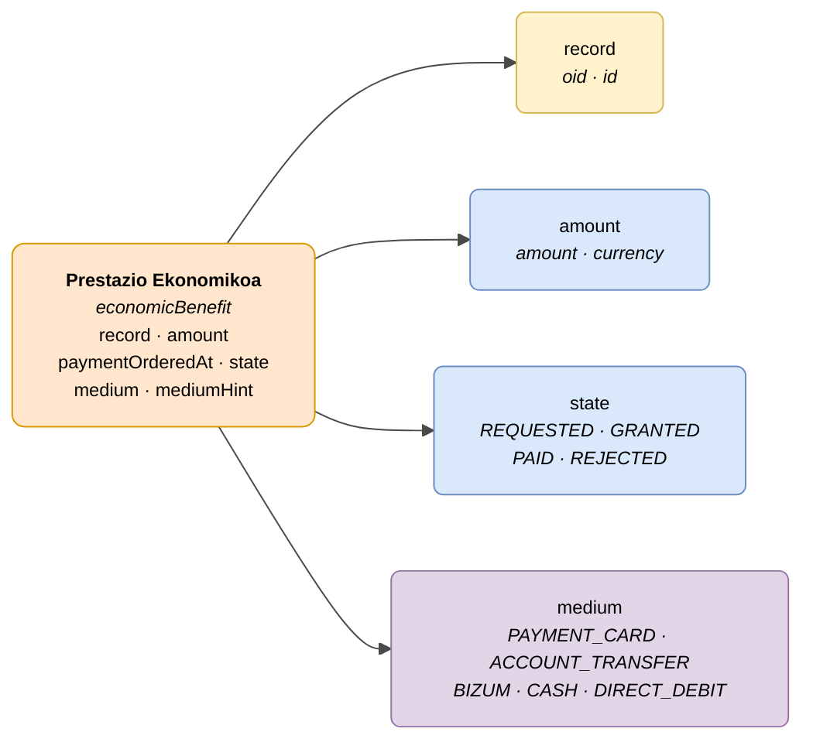

# :material-cash-multiple: Prestazioa (Economic Benefit)

> - **Bertsioa:** `v{{ dena.version }}`
> - **Data:** {{ dena.date }}
> - **Mota ID (DataTypeID):** `ECONOMIC_BENEFIT`
> - **Testa:** [DN99DENATestMockObjFactoryForEconomicBenefit.java]({{ repos.interop_test_blob }}/denaTestCommonDataClasses/src/main/java/dena/test/common/data/economicbenefit/DN99DENATestMockObjFactoryForEconomicBenefit.java) ⚠️ EGIAZTATU GABE
> - **Kodea:** [DN00EconomicBenefit.java]({{ repos.common_data_api_blob }}/denaCommonDataAPIEconomicBenefitModelClasses/src/main/java/dena/api/data/model/economicbenefit/DN00EconomicBenefit.java)

## Deskribapena

Pertsona bati espediente bati lotutako prestazio ekonomiko bat adierazten du. PEV ordainketak, prestazio ekonomikoak, etab. biltzen ditu.

> Ikusi baita ere: [campos-comunes.md](./campos-comunes.md) heredatutako eremuetarako (`oid`, `id`, `lastChangedAt`, `urls`, `originAdmin`, `aboutPerson`)



| Kolorea | Esanahia |
|---------|----------|
| 🟠 Laranja | Objektu nagusia (Prestazio Ekonomikoa) |
| 🟡 Horia | Beste objektu bati erreferentzia (Espedientea) |
| 🔵 Urdin argia | Datu eremuak |
| 🟣 More | Enumerazioak (ordainketa bideak) |

---

## 🔗 Iturburu kodea

| Klasea | Biltegia |
|--------|----------|
| DN00EconomicBenefit | [Ikusi kodea]({{ repos.common_data_api_blob }}/denaCommonDataAPIEconomicBenefitModelClasses/src/main/java/dena/api/data/model/economicbenefit/DN00EconomicBenefit.java) |
| DN00EconomicBenefitState | [Ikusi kodea]({{ repos.common_data_api_blob }}/denaCommonDataAPIEconomicBenefitModelClasses/src/main/java/dena/api/data/model/economicbenefit/DN00EconomicBenefitState.java) |

---

## 🧪 Testak eta adibideak

| Testa | Biltegia |
|-------|----------|
| DN99DENATestMockObjFactoryForEconomicBenefit | [Ikusi testa]({{ repos.interop_test_blob }}/denaTestCommonDataClasses/src/main/java/dena/test/common/data/economicbenefit/DN99DENATestMockObjFactoryForEconomicBenefit.java) ⚠️ EGIAZTATU GABE |

---

## Eremuak

<span class="field-badge--common">komun</span> markarekin izendatutako eremuak [`DN00DENADataExchangedObjectBase`]({{ repos.common_data_api_blob }}/denaCommonDataAPIModelClasses/src/main/java/dena/api/data/model/DN00DENADataExchangedObjectBase.java)-tik **heredatutakoak** dira. Ikusi [campos-comunes.md](./campos-comunes.md).

| Eremua | Mota | Derrigorrezkoa | Adibidea | Deskribapena |
|--------|------|:--------------:|----------|--------------|
| `type` | `String` | ✅ | `"economicBenefit"` | Mota diskriminatzailea (beti `"economicBenefit"`) |
| `oid` <span class="field-badge--common">komun</span> | `String` | ✅ | `"BEN-OID-001"` | Identifikatzaile tekniko bakarra |
| `id` <span class="field-badge--common">komun</span> | `String` | ✅ | `"PEV-2024-00001"` | Negozio identifikatzailea |
| `lastChangedAt` <span class="field-badge--common">komun</span> | `Instant` | ✅ | `"2026-08-19T08:07:56.742Z"` | Jatorrizko datuen azken aldaketa |
| `record` | `Object` | ❌ | `{"oid":"EXP-OID-001","id":"EXP-2024-00123"}` | Espediente erreferentzia |
| `amount` | `Money` | ✅ | `{"amount":500.00,"currency":"EUR"}` | Prestazioaren zenbatekoa |
| `paymentOrderedAt` | `Instant` | ❌ | `"2024-06-01T00:00:00Z"` | Ordainketa agindu zen data (null oraindik ordaindu ez bada) |
| `state` | `Object` | ✅ | `{"stateCode":"GRANTED"}` | Prestazioaren egoera |
| `medium` | `String` | ✅ | `"ACCOUNT_TRANSFER"` | Ordainketa bide |
| `mediumHint` | `String` | ❌ | `"ES91 2100 **** **** 0051"` | Ordainketa bidearen aipua |

---

## `Money` mota

```json
{ "amount": 500.00, "currency": "EUR" }
```

| Eremua | Mota | Deskribapena |
|--------|------|--------------|
| `amount` | `Number` | Zenbateko numerikoa |
| `currency` | `String` | ISO 4217 moneta-kodea (normalean `"EUR"`) |

!!! warning "`Money` mota: `amount` zenbaki osoa da zentimetan"
    `amount` eremua `long` motakoa da eta zenbatekoa **zentimo/zentaboetan** adierazten du. Orrialde honetan `500.00` bezalako balioak `50000` zentimo gisa ulertu behar dira. `base` eremua (`CENTS` | `UNITS`) aukerakoa da.
    
    Adibide zuzena: `{"amount": 50000, "base": "CENTS", "currency": "EUR"}` (500,00 €-ren baliokidea)

---

## Prestazioaren egoerak (`state.stateCode`)

| Kodea | Deskribapena |
|-------|--------------|
| `REQUESTED` | Prestazioaren eskaera, ebazpena zain |
| `GRANTED` | Prestazioaren emakida, ordainketa zain |
| `PAID` | Ordaindutako prestazioaren |
| `REJECTED` | Ukatutako prestazioaren |

---

## Adibidea — Emandako prestazioaren

<div class="common-highlight" markdown>

```json hl_lines="3 4 5"
{
  "type": "economicBenefit",
  "oid": "BEN-OID-001",
  "id": "PEV-2024-00001",
  "lastChangedAt": "2026-08-19T08:07:56.742Z",
  "record": { "oid": "EXP-OID-001", "id": "EXP-2024-00123" },
  "amount": { "amount": 500.00, "currency": "EUR" },
  "paymentOrderedAt": null,
  "state": { "stateCode": "GRANTED" },
  "medium": "ACCOUNT_TRANSFER",
  "mediumHint": "ES91 2100 **** **** 0051"
}
```

<p class="common-fields-legend"><span class="swatch"></span> Nabarmendutako lerroak oinarrizko klasetik <strong>heredatutako eremu komunak</strong> dira (ikusi <a href="./campos-comunes.md">campos-comunes.md</a>).</p>

</div>

---

<!-- DENA-DOC-FOOTER -->
---
<sub>DENA Docs v{{ dena.version }} · {{ dena.date }}</sub>
