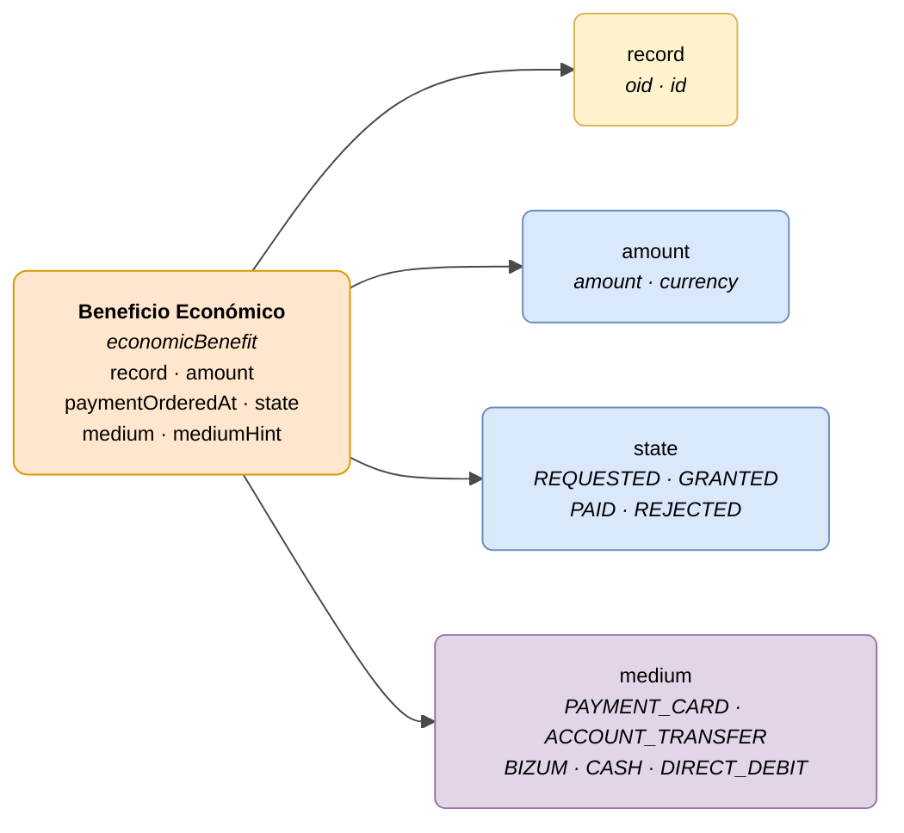

# :material-cash-multiple: Beneficio Económico (Economic Benefit)

> - **Versión:** `v{{ dena.version }}`
> - **Fecha:** {{ dena.date }}
> - **ID de Tipo (DataTypeID):** `ECONOMIC_BENEFIT`
> - **Test:** [DN99DENATestMockObjFactoryForEconomicBenefit.java]({{ repos.interop_test_blob }}/denaTestCommonDataClasses/src/main/java/dena/test/common/data/economicbenefit/DN99DENATestMockObjFactoryForEconomicBenefit.java) ⚠️ SIN VERIFICAR
> - **Código:** [DN00EconomicBenefit.java]({{ repos.common_data_api_blob }}/denaCommonDataAPIEconomicBenefitModelClasses/src/main/java/dena/api/data/model/economicbenefit/DN00EconomicBenefit.java)

## Descripción

Representa una prestación económica o pago a la persona vinculada a un expediente. Cubre tanto pagos únicos como prestaciones recurrentes: pagos PEV, prestaciones económicas, etc.

> Ver también: [campos-comunes.md](./campos-comunes.md) para campos heredados (`oid`, `id`, `lastChangedAt`, `urls`, `originAdmin`, `aboutPerson`)



| Color | Significado |
|-------|-------------|
| 🟠 Naranja | Objeto principal (Beneficio Económico) |
| 🟡 Amarillo | Referencia a otro objeto (Expediente) |
| 🔵 Azul claro | Campos de datos |
| 🟣 Violeta | Enums (medios de pago) |

---

## 🔗 Código fuente

| Clase | Repositorio |
|-------|-------------|
| DN00EconomicBenefit | [Ver código]({{ repos.common_data_api_blob }}/denaCommonDataAPIEconomicBenefitModelClasses/src/main/java/dena/api/data/model/economicbenefit/DN00EconomicBenefit.java) |
| DN00EconomicBenefitState | [Ver código]({{ repos.common_data_api_blob }}/denaCommonDataAPIEconomicBenefitModelClasses/src/main/java/dena/api/data/model/economicbenefit/DN00EconomicBenefitState.java) |

---

## 🧪 Tests y ejemplos

| Test | Repositorio |
|------|-------------|
| DN99DENATestMockObjFactoryForEconomicBenefit | [Ver test]({{ repos.interop_test_blob }}/denaTestCommonDataClasses/src/main/java/dena/test/common/data/economicbenefit/DN99DENATestMockObjFactoryForEconomicBenefit.java) ⚠️ SIN VERIFICAR |

---

## Atributos

Los campos marcados con <span class="field-badge--common">común</span> son **heredados** de [`DN00DENADataExchangedObjectBase`]({{ repos.common_data_api_blob }}/denaCommonDataAPIModelClasses/src/main/java/dena/api/data/model/DN00DENADataExchangedObjectBase.java). Ver [campos-comunes.md](./campos-comunes.md).

| Campo | Tipo | Obligatorio | Ejemplo | Descripción |
|-------|------|:-----------:|---------|-------------|
| `type` | `String` | ✅ | `"economicBenefit"` | Discriminador de tipo (siempre `"economicBenefit"`) |
| `oid` <span class="field-badge--common">común</span> | `String` | ✅ | `"BEN-OID-001"` | Identificador técnico único |
| `id` <span class="field-badge--common">común</span> | `String` | ✅ | `"PEV-2024-00001"` | Identificador de negocio |
| `lastChangedAt` <span class="field-badge--common">común</span> | `Instant` | ✅ | `"2026-08-19T08:07:56.742Z"` | Última modificación del dato en el origen |
| `record` | `Object` | ❌ | `{"oid":"EXP-OID-001","id":"EXP-2024-00123"}` | Referencia al expediente asociado |
| `amount` | `Money` | ✅ | `{"amount":500.00,"currency":"EUR"}` | Importe de la prestación (ver [tipo Money](#tipo-money)) |
| `paymentOrderedAt` | `Instant` | ❌ | `"2024-06-01T00:00:00Z"` | Fecha en que se ordenó el pago (null si aún no pagado) |
| `state` | `Object` | ✅ | `{"stateCode":"GRANTED"}` | Estado de la prestación |
| `medium` | `String` | ✅ | `"ACCOUNT_TRANSFER"` | Medio de pago (ver [medios de pago](#medios-de-pago-medium)) |
| `mediumHint` | `String` | ❌ | `"ES91 2100 **** **** 0051"` | Indicación del medio (ej: últimos dígitos de cuenta) |

---

## Tipo `Money`

```json
{ "amount": 500.00, "currency": "EUR" }
```

| Campo | Tipo | Descripción |
|-------|------|-------------|
| `amount` | `Number` | Importe numérico |
| `currency` | `String` | Código de moneda ISO 4217 (normalmente `"EUR"`) |

!!! warning "Tipo Money: `amount` es entero en centavos"
    El campo `amount` es de tipo `long` y representa el importe en **centavos/céntimos**. En los ejemplos de esta página los valores como `500.00` deben entenderse como `50000` céntimos. El campo `base` (`CENTS` | `UNITS`) es opcional.
    
    Ejemplo correcto: `{"amount": 50000, "base": "CENTS", "currency": "EUR"}` (equivale a 500,00 €)

---

## Estados de la prestación (`state.stateCode`)

| Código | Descripción |
|--------|-------------|
| `REQUESTED` | Prestación solicitada, pendiente de resolución |
| `GRANTED` | Prestación concedida, pendiente de pago |
| `PAID` | Prestación pagada |
| `REJECTED` | Prestación denegada |

---

## Medios de pago (`medium`)

| Código | Descripción |
|--------|-------------|
| `PAYMENT_CARD` | Tarjeta de crédito/débito |
| `ACCOUNT_TRANSFER` | Transferencia bancaria |
| `BIZUM` | Bizum |
| `CASH` | Metálico |
| `DIRECT_DEBIT` | Domiciliación bancaria |

---

## Ejemplo — Prestación concedida

<div class="common-highlight" markdown>

```json hl_lines="3 4 5"
{
  "type": "economicBenefit",
  "oid": "BEN-OID-001",
  "id": "PEV-2024-00001",
  "lastChangedAt": "2026-08-19T08:07:56.742Z",
  "record": { "oid": "EXP-OID-001", "id": "EXP-2024-00123" },
  "amount": { "amount": 500.00, "currency": "EUR" },
  "paymentOrderedAt": null,
  "state": { "stateCode": "GRANTED" },
  "medium": "ACCOUNT_TRANSFER",
  "mediumHint": "ES91 2100 **** **** 0051"
}
```

<p class="common-fields-legend"><span class="swatch"></span> Las líneas resaltadas son los campos <strong>comunes</strong> heredados de la clase base (ver <a href="./campos-comunes.md">campos-comunes.md</a>).</p>

</div>

## Ejemplo — Prestación pagada

<div class="common-highlight" markdown>

```json hl_lines="3 4 5"
{
  "type": "economicBenefit",
  "oid": "BEN-OID-002",
  "id": "PEV-2024-00002",
  "lastChangedAt": "2026-09-15T10:30:00Z",
  "record": { "oid": "EXP-OID-002", "id": "EXP-2024-00124" },
  "amount": { "amount": 1200.00, "currency": "EUR" },
  "paymentOrderedAt": "2024-09-01T00:00:00Z",
  "state": { "stateCode": "PAID" },
  "medium": "ACCOUNT_TRANSFER",
  "mediumHint": "ES91 2100 **** **** 0051"
}
```

<p class="common-fields-legend"><span class="swatch"></span> Las líneas resaltadas son los campos <strong>comunes</strong> heredados de la clase base (ver <a href="./campos-comunes.md">campos-comunes.md</a>).</p>

</div>

---

## Notas importantes

- `record` es opcional pero se recomienda siempre que la prestación esté vinculada a un expediente.
- `paymentOrderedAt` solo tiene valor cuando la prestación está en estado `PAID`; en otros estados puede ser `null`.
- `mediumHint` es informativo: puede mostrar los últimos dígitos de la cuenta o cualquier referencia que ayude a identificar el medio sin exponer datos completos.
- Las prestaciones PEV (Prestación Económica de Vivienda) son el caso de uso principal de este tipo de dato.


---

<!-- DENA-DOC-FOOTER -->
---
<sub>DENA Docs v{{ dena.version }} · {{ dena.date }}</sub>
