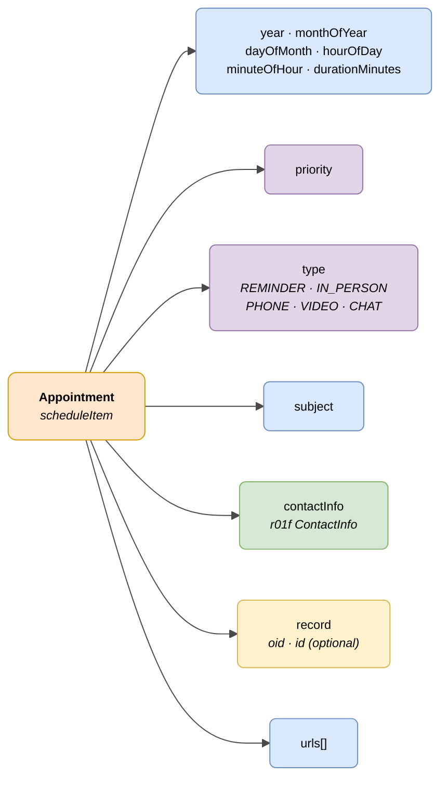

# :material-calendar-clock: Appointment (Schedule Item)

> - **Version:** `v{{ dena.version }}`
> - **Date:** {{ dena.date }}
> - **Type ID (DataTypeID):** `SCHEDULE`
> - **Test:** [DN99DENATestMockObjFactoryForScheduleItem.java]({{ repos.interop_test_blob }}/denaTestCommonDataClasses/src/main/java/dena/test/common/data/schedule/DN99DENATestMockObjFactoryForScheduleItem.java)
> - **Code:** [DN00ScheduleItem.java]({{ repos.common_data_api_blob }}/denaCommonDataAPIScheduleModelClasses/src/main/java/dena/api/data/model/schedule/DN00ScheduleItem.java)

## Description

Represents a schedule item or appointment. It can be an appointment with a duration or a point-in-time milestone (duration = 0).

> **Note:** The `record` field (record/expediente) is **optional** in appointments; unlike notifications and payments, appointments can exist without an associated record.

> See also: [campos-comunes.md](./campos-comunes.md) for inherited fields (`oid`, `id`, `lastChangedAt`, `urls`, `originAdmin`, `aboutPerson`)



| Colour | Meaning |
|-------|-------------|
| 🟠 Orange | Main object (Appointment) |
| 🟣 Purple | Enums (priority, type) |
| 🔵 Light blue | Data fields |
| 🟢 Green | Contact information (contactInfo) |
| 🟡 Yellow | Reference to record (optional) |

---

## 🔗 Source code

| Class | Repository |
|-------|-------------|
| DN00ScheduleItem | [View code]({{ repos.common_data_api_blob }}/denaCommonDataAPIScheduleModelClasses/src/main/java/dena/api/data/model/schedule/DN00ScheduleItem.java) |
| DN00ScheduleItemType | [View code]({{ repos.common_data_api_blob }}/denaCommonDataAPIScheduleModelClasses/src/main/java/dena/api/data/model/schedule/DN00ScheduleItemType.java) |
| DN00ScheduleItemPriority | [View code]({{ repos.common_data_api_blob }}/denaCommonDataAPIScheduleModelClasses/src/main/java/dena/api/data/model/schedule/DN00ScheduleItemPriority.java) |

---

## 🧪 Tests and examples

> Repository: [DENA-Euskadi/dena-interop-common-data-test]({{ repos.interop_test_tree }})

| Mock Factory | Repository |
|--------------|-------------|
| DN99DENATestMockObjFactoryForScheduleItem | [View code]({{ repos.interop_test_blob }}/denaTestCommonDataClasses/src/main/java/dena/test/common/data/schedule/DN99DENATestMockObjFactoryForScheduleItem.java) |
| DN99DENATestMockObjFactoryForScheduleItemPriority | [View code]({{ repos.interop_test_blob }}/denaTestCommonDataClasses/src/main/java/dena/test/common/data/schedule/DN99DENATestMockObjFactoryForScheduleItemPriority.java) |

---

## JSON attributes

Fields marked with <span class="field-badge--common">common</span> are **inherited** from [`DN00DENADataExchangedObjectBase`]({{ repos.common_data_api_blob }}/denaCommonDataAPIModelClasses/src/main/java/dena/api/data/model/DN00DENADataExchangedObjectBase.java) and are present in all data-retrieve types. See [campos-comunes.md](./campos-comunes.md).

| Field | Type | Mandatory | Example | Description |
|-------|------|:-----------:|---------|-------------|
| `type` | `String` | ✅ | `"scheduleItem"` | Polymorphic discriminator |
| `oid` <span class="field-badge--common">common</span> | `String` | ✅ | `"SCHED-OID-001"` | Unique technical identifier |
| `id` <span class="field-badge--common">common</span> | `String` | ✅ | `"CITA-2024-00050"` | Business identifier |
| `lastChangedAt` <span class="field-badge--common">common</span> | `Instant` | ✅ | `"2026-08-19T08:07:56.742Z"` | Last change of the data at the origin. DENA-CORE uses it to compute the NEW/UPDATED/UNCHANGED state |
| `year` | `Number` | ✅ | `2024` | Year |
| `monthOfYear` | `Number` | ✅ | `7` | Month (1-12) |
| `dayOfMonth` | `Number` | ✅ | `15` | Day of month (1-31) |
| `hourOfDay` | `Number` | ✅ | `10` | Hour (0-23) |
| `minuteOfHour` | `Number` | ✅ | `30` | Minute (0-59) |
| `durationMinutes` | `Number` | ✅ | `30` | Duration in minutes (0 = point-in-time milestone) |
| `priority` | `String` | ❌ | `"NORMAL"` | Priority |
| `type` (DN00ScheduleItemType) | `String` | ❌ | `"IN_PERSON_APPOINTMENT"` | Appointment type (see [Types](#types-type)) |
| `subject` | `LanguageTexts` | ✅ | `{"SPANISH":"Cita renovación DNI"}` | Appointment subject |
| `contactInfo` | `Object` | ❌ | *(see note below)* | Contact information of the location/organiser (r01f ContactInfo). May include phone, email, address, URL. ⚠️ Internal structure of r01f type pending documentation. |
| `record` | `Object` | ❌ | `{"oid":"EXP-OID-001","id":"EXP-2024-00123"}` | Record linked to the appointment (optional) |
| `urls` <span class="field-badge--common">common</span> | `Array` | ❌ | *(see [campos-comunes.md](./campos-comunes.md) · [`DN00DENADataExchangedObjectBase`]({{ repos.common_data_api_blob }}/denaCommonDataAPIModelClasses/src/main/java/dena/api/data/model/DN00DENADataExchangedObjectBase.java))* | Access URLs |

---

## Types (`type`)

| Code | Description |
|------|-------------|
| `REMINDER` | Reminder/milestone (no in-person appointment) |
| `IN_PERSON_APPOINTMENT` | In-person appointment |
| `PHONE_CALL_APPOINTMENT` | Phone appointment |
| `VIDEO_CALL_APPOINTMENT` | Video call appointment |
| `CHAT_APPOINTMENT` | Chat appointment |

---

## Priority (`priority`)

| Code | Description |
|--------|-------------|
| `HIGH` | High |
| `MEDIUM` | Medium |
| `NORMAL` | Normal |
| `LOW` | Low |

---

## Contact information (`contactInfo`)

> **Note:** The `contactInfo` field is of r01f type `ContactInfo`. It can contain phones, emails, postal address, web URL, fax. ⚠️ The internal structure of this r01f type is pending documentation with the DENA team.

!!! info "r01f ContactInfo type pending documentation"
    The internal structure of the `contactInfo` field is the r01f `ContactInfo` type. It may contain phones, emails, postal addresses, web URL, etc. Detailed documentation of its structure will be completed in a future version. Consult with the DENA team for the available fields.

---

## JSON example

<div class="common-highlight" markdown>

```json hl_lines="3 4 5 6"
{
  "type": "scheduleItem",
  "oid": "SCHED-OID-001",
  "id": "CITA-2024-00050",
  "lastChangedAt": "2026-08-19T08:07:56.742Z",
  "urls": [
    { "url": "https://sede.miadmin.eus/cita/CITA-2024-00050", "language": "SPANISH", "tags": ["default"] }
  ],
  "year": 2024,
  "monthOfYear": 7,
  "dayOfMonth": 15,
  "hourOfDay": 10,
  "minuteOfHour": 30,
  "durationMinutes": 30,
  "type": "IN_PERSON_APPOINTMENT",
  "priority": "NORMAL",
  "subject": {
    "SPANISH": "Cita previa para renovación de DNI",
    "BASQUE": "NAN berritzeko aurretiko hitzordua"
  },
  "record": { "oid": "EXP-OID-001", "id": "EXP-2024-00123" }
}
```

<p class="common-fields-legend"><span class="swatch"></span> Highlighted lines are <strong>common</strong> fields inherited from the base class (see <a href="./campos-comunes.md">campos-comunes.md</a>).</p>

</div>

---

## Example — Milestone (duration = 0)

<div class="common-highlight" markdown>

```json hl_lines="3 4 5"
{
  "type": "scheduleItem",
  "oid": "SCHED-OID-002",
  "id": "HITO-2024-00010",
  "lastChangedAt": "2026-09-01T06:00:00.000Z",
  "year": 2024,
  "monthOfYear": 9,
  "dayOfMonth": 1,
  "hourOfDay": 0,
  "minuteOfHour": 0,
  "durationMinutes": 0,
  "subject": {
    "SPANISH": "Inicio del plazo de matriculación",
    "BASQUE": "Matrikulazio-epearen hasiera"
  }
}
```

---

## Differences with other objects

| Characteristic | Appointment | Record / Notification / Registry / Payment |
|----------------|------|----------------------------------------------|
| Depends on a record | ❌ Optional (`record`) | ✅ Yes (`record` field) |
| Has state | ❌ No | ✅ Yes |
| Has ISO 8601 date | ❌ (uses separate fields year/month/day/hour/minute) | ✅ Yes |
| Has contact information | ✅ Yes (`contactInfo`) | ❌ No |


---

<!-- DENA-DOC-FOOTER -->
---
<sub>DENA Docs v{{ dena.version }} · {{ dena.date }}</sub>
