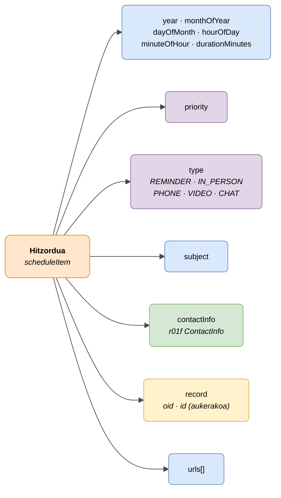

# :material-calendar-clock: Hitzordua (Schedule Item)

> - **Bertsioa:** `v{{ dena.version }}`
> - **Data:** {{ dena.date }}
> - **Mota ID (DataTypeID):** `SCHEDULE`
> - **Testa:** [DN99DENATestMockObjFactoryForScheduleItem.java]({{ repos.interop_test_blob }}/denaTestCommonDataClasses/src/main/java/dena/test/common/data/schedule/DN99DENATestMockObjFactoryForScheduleItem.java)
> - **Kodea:** [DN00ScheduleItem.java]({{ repos.common_data_api_blob }}/denaCommonDataAPIScheduleModelClasses/src/main/java/dena/api/data/model/schedule/DN00ScheduleItem.java)

## Deskribapena

Agenda-elementu bat edo aurretiko hitzordu bat adierazten du. Iraupena duen hitzordu bat edo une puntualeko mugarri bat izan daiteke (iraupena = 0).

> **Oharra:** `record` eremua (espedientea) **aukerakoa** da hitzorduetan; jakinarazpen eta ordainketekin alderatuta, hitzorduek ez dute nahitaez espediente bat.

> Ikusi ere: [campos-comunes.md](./campos-comunes.md) heredatutako eremuetarako (`oid`, `id`, `lastChangedAt`, `urls`, `originAdmin`, `aboutPerson`)



| Kolorea | Esanahia |
|-------|-------------|
| 🟠 Laranja | Objektu nagusia (Hitzordua) |
| 🟣 Morea | Enum-ak (lehentasuna, mota) |
| 🔵 Urdin argia | Datu-eremuak |
| 🟢 Berdea | Kontaktu-informazioa (contactInfo) |
| 🟡 Horia | Espedientearen erreferentzia (aukerakoa) |

---

## 🔗 Iturburu-kodea

| Klasea | Biltegia |
|-------|-------------|
| DN00ScheduleItem | [Ikusi kodea]({{ repos.common_data_api_blob }}/denaCommonDataAPIScheduleModelClasses/src/main/java/dena/api/data/model/schedule/DN00ScheduleItem.java) |
| DN00ScheduleItemType | [Ikusi kodea]({{ repos.common_data_api_blob }}/denaCommonDataAPIScheduleModelClasses/src/main/java/dena/api/data/model/schedule/DN00ScheduleItemType.java) |
| DN00ScheduleItemPriority | [Ikusi kodea]({{ repos.common_data_api_blob }}/denaCommonDataAPIScheduleModelClasses/src/main/java/dena/api/data/model/schedule/DN00ScheduleItemPriority.java) |

---

## 🧪 Testak eta adibideak

> Biltegia: [DENA-Euskadi/dena-interop-common-data-test]({{ repos.interop_test_tree }})

| Mock Factory | Biltegia |
|--------------|-------------|
| DN99DENATestMockObjFactoryForScheduleItem | [Ikusi kodea]({{ repos.interop_test_blob }}/denaTestCommonDataClasses/src/main/java/dena/test/common/data/schedule/DN99DENATestMockObjFactoryForScheduleItem.java) |
| DN99DENATestMockObjFactoryForScheduleItemPriority | [Ikusi kodea]({{ repos.interop_test_blob }}/denaTestCommonDataClasses/src/main/java/dena/test/common/data/schedule/DN99DENATestMockObjFactoryForScheduleItemPriority.java) |

---

## JSON atributuak

<span class="field-badge--common">komuna</span> markarekin adierazitako eremuak [`DN00DENADataExchangedObjectBase`]({{ repos.common_data_api_blob }}/denaCommonDataAPIModelClasses/src/main/java/dena/api/data/model/DN00DENADataExchangedObjectBase.java) oinarri-klasetik **heredatutakoak** dira eta data-retrieve mota guztietan daude. Ikusi [campos-comunes.md](./campos-comunes.md).

| Eremua | Mota | Nahitaezkoa | Adibidea | Deskribapena |
|-------|------|:-----------:|---------|-------------|
| `type` | `String` | ✅ | `"scheduleItem"` | Diskriminatzaile polimorfokoa |
| `oid` <span class="field-badge--common">komuna</span> | `String` | ✅ | `"SCHED-OID-001"` | Identifikatzaile tekniko bakarra |
| `id` <span class="field-badge--common">komuna</span> | `String` | ✅ | `"CITA-2024-00050"` | Negozio-identifikatzailea |
| `lastChangedAt` <span class="field-badge--common">komuna</span> | `Instant` | ✅ | `"2026-08-19T08:07:56.742Z"` | Datuaren azken aldaketa jatorrian. DENA-COREk erabiltzen du UIan NEW/UPDATED/UNCHANGED egoera kalkulatzeko |
| `year` | `Number` | ✅ | `2024` | Urtea |
| `monthOfYear` | `Number` | ✅ | `7` | Hilabetea (1-12) |
| `dayOfMonth` | `Number` | ✅ | `15` | Hilabeteko eguna (1-31) |
| `hourOfDay` | `Number` | ✅ | `10` | Ordua (0-23) |
| `minuteOfHour` | `Number` | ✅ | `30` | Minutua (0-59) |
| `durationMinutes` | `Number` | ✅ | `30` | Iraupena minututan (0 = une puntualeko mugarria) |
| `priority` | `String` | ❌ | `"NORMAL"` | Lehentasuna |
| `type` (DN00ScheduleItemType) | `String` | ❌ | `"IN_PERSON_APPOINTMENT"` | Hitzordu mota (ikusi [Motak](#motak-type)) |
| `subject` | `LanguageTexts` | ✅ | `{"SPANISH":"Cita renovación DNI"}` | Hitzorduaren gaia |
| `contactInfo` | `Object` | ❌ | *(ikusi oharra behean)* | Lekuaren/antolatzailearen kontaktu-informazioa (r01f ContactInfo). Telefonoa, emaila, helbidea, URLa... ⚠️ r01f motaren barne-egitura dokumentatzeko. |
| `record` | `Object` | ❌ | `{"oid":"EXP-OID-001","id":"EXP-2024-00123"}` | Hitzorduari lotutako espedientea (aukerakoa) |
| `urls` <span class="field-badge--common">komuna</span> | `Array` | ❌ | *(ikusi [campos-comunes.md](./campos-comunes.md) · [`DN00DENADataExchangedObjectBase`]({{ repos.common_data_api_blob }}/denaCommonDataAPIModelClasses/src/main/java/dena/api/data/model/DN00DENADataExchangedObjectBase.java))* | Sarbide URLak |

---

## Motak (`type`)

| Kodea | Deskribapena |
|-------|--------------|
| `REMINDER` | Gogorarazlea/mugarria (aurrez aurreko hitzordurik gabe) |
| `IN_PERSON_APPOINTMENT` | Aurrez aurreko hitzordua |
| `PHONE_CALL_APPOINTMENT` | Telefono bidezko hitzordua |
| `VIDEO_CALL_APPOINTMENT` | Bideo-deien hitzordua |
| `CHAT_APPOINTMENT` | Chat bidezko hitzordua |

---

## Lehentasuna (`priority`)

| Kodea | Deskribapena |
|--------|-------------|
| `HIGH` | Altua |
| `MEDIUM` | Ertaina |
| `NORMAL` | Normala |
| `LOW` | Baxua |

---

## Kontaktu-informazioa (`contactInfo`)

> **Oharra:** `contactInfo` eremua r01f `ContactInfo` motakoa da. Telefonoak, emailak, posta-helbidea, web URLa, faxa... eduki ditzake. ⚠️ r01f mota honen barne-egitura DENA taldearekin dokumentatzeko.

!!! info "r01f ContactInfo mota dokumentatzeko"
    `contactInfo` eremuaren barne-egitura r01f `ContactInfo` motakoa da. Telefonoak, emailak, posta-helbideak, web URLa, etab. eduki ditzake. Bere egituraren dokumentazio xehatua hurrengo bertsio batean osatuko da. Eskuragarri dauden eremuetarako, DENA taldearekin harremanetan jarri.

---

## JSON adibidea

<div class="common-highlight" markdown>

```json hl_lines="3 4 5 6"
{
  "type": "scheduleItem",
  "oid": "SCHED-OID-001",
  "id": "CITA-2024-00050",
  "lastChangedAt": "2026-08-19T08:07:56.742Z",
  "urls": [
    { "url": "https://sede.miadmin.eus/cita/CITA-2024-00050", "language": "SPANISH", "tags": ["default"] }
  ],
  "year": 2024,
  "monthOfYear": 7,
  "dayOfMonth": 15,
  "hourOfDay": 10,
  "minuteOfHour": 30,
  "durationMinutes": 30,
  "type": "IN_PERSON_APPOINTMENT",
  "priority": "NORMAL",
  "subject": {
    "SPANISH": "Cita previa para renovación de DNI",
    "BASQUE": "NANa berritzeko aurretiko hitzordua"
  },
  "record": { "oid": "EXP-OID-001", "id": "EXP-2024-00123" }
}
```

<p class="common-fields-legend"><span class="swatch"></span> Nabarmendutako lerroak oinarri-klasetik <strong>heredatutako</strong> eremu <strong>komunak</strong> dira (ikusi <a href="./campos-comunes.md">campos-comunes.md</a>).</p>

</div>

---

## Adibidea — Mugarria (iraupena = 0)

<div class="common-highlight" markdown>

```json hl_lines="3 4 5"
{
  "type": "scheduleItem",
  "oid": "SCHED-OID-002",
  "id": "HITO-2024-00010",
  "lastChangedAt": "2026-09-01T06:00:00.000Z",
  "year": 2024,
  "monthOfYear": 9,
  "dayOfMonth": 1,
  "hourOfDay": 0,
  "minuteOfHour": 0,
  "durationMinutes": 0,
  "subject": {
    "SPANISH": "Inicio del plazo de matriculación",
    "BASQUE": "Matrikulazio-epearen hasiera"
  }
}
```

<p class="common-fields-legend"><span class="swatch"></span> Nabarmendutako lerroak oinarri-klasetik <strong>heredatutako</strong> eremu <strong>komunak</strong> dira (ikusi <a href="./campos-comunes.md">campos-comunes.md</a>).</p>

</div>

---

## Beste objektuekin desberdintasunak

| Ezaugarria | Hitzordua | Espedientea / Jakinarazpena / Erregistroa / Ordainketa |
|----------------|------|----------------------------------------------|
| Espediente baten menpekoa | ❌ Aukerakoa (`record`) | ✅ Bai (`record` eremua) |
| Egoera du | ❌ Ez | ✅ Bai |
| ISO 8601 data du | ❌ (eremu bereiziak erabiltzen ditu year/month/day/hour/minute) | ✅ Bai |
| Kontaktu-informazioa du | ✅ Bai (`contactInfo`) | ❌ Ez |


---

<!-- DENA-DOC-FOOTER -->
---
<sub>DENA Docs v{{ dena.version }} · {{ dena.date }}</sub>
