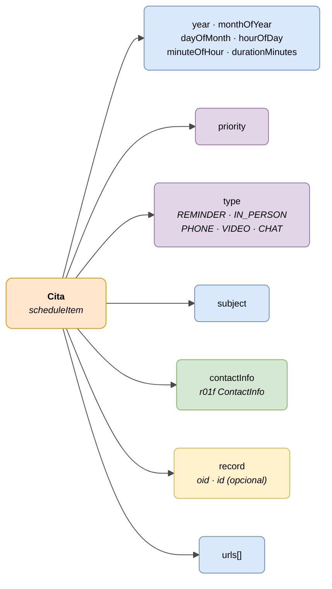

# :material-calendar-clock: Cita (Schedule Item)

> - **Versión:** `v{{ dena.version }}`
> - **Fecha:** {{ dena.date }}
> - **ID de Tipo (DataTypeID):** `SCHEDULE`
> - **Test:** [DN99DENATestMockObjFactoryForScheduleItem.java]({{ repos.interop_test_blob }}/denaTestCommonDataClasses/src/main/java/dena/test/common/data/schedule/DN99DENATestMockObjFactoryForScheduleItem.java)
> - **Código:** [DN00ScheduleItem.java]({{ repos.common_data_api_blob }}/denaCommonDataAPIScheduleModelClasses/src/main/java/dena/api/data/model/schedule/DN00ScheduleItem.java)

## Descripción

Representa un elemento de agenda o cita previa. Puede ser una cita con duración o un hito puntual (duración = 0).

> **Nota:** El campo `record` (expediente) es **opcional** en las citas; a diferencia de notificaciones y pagos, las citas pueden existir sin expediente asociado.

> Ver también: [campos-comunes.md](./campos-comunes.md) para campos heredados (`oid`, `id`, `lastChangedAt`, `urls`, `originAdmin`, `aboutPerson`)



| Color | Significado |
|-------|-------------|
| 🟠 Naranja | Objeto principal (Cita) |
| 🟣 Violeta | Enums (prioridad, tipo) |
| 🔵 Azul claro | Campos de datos |
| 🟢 Verde | Información de contacto (contactInfo) |
| 🟡 Amarillo | Referencia a expediente (opcional) |

---

## 🔗 Código fuente

| Clase | Repositorio |
|-------|-------------|
| DN00ScheduleItem | [Ver código]({{ repos.common_data_api_blob }}/denaCommonDataAPIScheduleModelClasses/src/main/java/dena/api/data/model/schedule/DN00ScheduleItem.java) |
| DN00ScheduleItemType | [Ver código]({{ repos.common_data_api_blob }}/denaCommonDataAPIScheduleModelClasses/src/main/java/dena/api/data/model/schedule/DN00ScheduleItemType.java) |
| DN00ScheduleItemPriority | [Ver código]({{ repos.common_data_api_blob }}/denaCommonDataAPIScheduleModelClasses/src/main/java/dena/api/data/model/schedule/DN00ScheduleItemPriority.java) |

---

## 🧪 Tests y ejemplos

> Repositorio: [DENA-Euskadi/dena-interop-common-data-test]({{ repos.interop_test_tree }})

| Mock Factory | Repositorio |
|--------------|-------------|
| DN99DENATestMockObjFactoryForScheduleItem | [Ver código]({{ repos.interop_test_blob }}/denaTestCommonDataClasses/src/main/java/dena/test/common/data/schedule/DN99DENATestMockObjFactoryForScheduleItem.java) |
| DN99DENATestMockObjFactoryForScheduleItemPriority | [Ver código]({{ repos.interop_test_blob }}/denaTestCommonDataClasses/src/main/java/dena/test/common/data/schedule/DN99DENATestMockObjFactoryForScheduleItemPriority.java) |

---

## Atributos JSON

Los campos marcados con <span class="field-badge--common">común</span> son **heredados** de [`DN00DENADataExchangedObjectBase`]({{ repos.common_data_api_blob }}/denaCommonDataAPIModelClasses/src/main/java/dena/api/data/model/DN00DENADataExchangedObjectBase.java) y están presentes en todos los tipos del data-retrieve. Ver [campos-comunes.md](./campos-comunes.md).

| Campo | Tipo | Obligatorio | Ejemplo | Descripción |
|-------|------|:-----------:|---------|-------------|
| `type` | `String` | ✅ | `"scheduleItem"` | Discriminador polimórfico |
| `oid` <span class="field-badge--common">común</span> | `String` | ✅ | `"SCHED-OID-001"` | Identificador técnico único |
| `id` <span class="field-badge--common">común</span> | `String` | ✅ | `"CITA-2024-00050"` | Identificador de negocio |
| `lastChangedAt` <span class="field-badge--common">común</span> | `Instant` | ✅ | `"2026-08-19T08:07:56.742Z"` | Última modificación del dato en el origen. DENA-CORE lo usa para calcular el estado NEW/UPDATED/UNCHANGED |
| `year` | `Number` | ✅ | `2024` | Año |
| `monthOfYear` | `Number` | ✅ | `7` | Mes (1-12) |
| `dayOfMonth` | `Number` | ✅ | `15` | Día del mes (1-31) |
| `hourOfDay` | `Number` | ✅ | `10` | Hora (0-23) |
| `minuteOfHour` | `Number` | ✅ | `30` | Minuto (0-59) |
| `durationMinutes` | `Number` | ✅ | `30` | Duración en minutos (0 = hito puntual) |
| `priority` | `String` | ❌ | `"NORMAL"` | Prioridad |
| `type` (DN00ScheduleItemType) | `String` | ❌ | `"IN_PERSON_APPOINTMENT"` | Tipo de cita (ver [Tipos](#tipos-type)) |
| `subject` | `LanguageTexts` | ✅ | `{"SPANISH":"Cita renovación DNI"}` | Asunto de la cita |
| `contactInfo` | `Object` | ❌ | *(ver nota abajo)* | Información de contacto del lugar/organizador (r01f ContactInfo). Puede incluir teléfono, email, dirección, URL. ⚠️ Estructura interna del tipo r01f pendiente de documentar. |
| `record` | `Object` | ❌ | `{"oid":"EXP-OID-001","id":"EXP-2024-00123"}` | Expediente al que está vinculada la cita (opcional) |
| `urls` <span class="field-badge--common">común</span> | `Array` | ❌ | *(ver [campos-comunes.md](./campos-comunes.md) · [`DN00DENADataExchangedObjectBase`]({{ repos.common_data_api_blob }}/denaCommonDataAPIModelClasses/src/main/java/dena/api/data/model/DN00DENADataExchangedObjectBase.java))* | URLs de acceso |

---

## Tipos (`type`)

| Código | Descripción |
|--------|-------------|
| `REMINDER` | Recordatorio/hito (sin cita presencial) |
| `IN_PERSON_APPOINTMENT` | Cita presencial |
| `PHONE_CALL_APPOINTMENT` | Cita telefónica |
| `VIDEO_CALL_APPOINTMENT` | Cita por videollamada |
| `CHAT_APPOINTMENT` | Cita por chat |

---

## Prioridad (`priority`)

| Código | Descripción |
|--------|-------------|
| `HIGH` | Alta |
| `MEDIUM` | Media |
| `NORMAL` | Normal |
| `LOW` | Baja |

---

## Información de contacto (`contactInfo`)

> **Nota:** El campo `contactInfo` es de tipo r01f `ContactInfo`. Puede contener teléfonos, emails, dirección postal, URL de web, fax. ⚠️ La estructura interna de este tipo pendiente de documentar con el equipo DENA.

!!! info "Tipo r01f ContactInfo pendiente de documentar"
    La estructura interna del campo `contactInfo` es el tipo r01f `ContactInfo`. Puede contener teléfonos, emails, direcciones postales, URL de web, etc. La documentación detallada de su estructura se completará en una próxima versión. Consulta con el equipo DENA para obtener el detalle de los campos disponibles.

---

## Ejemplo JSON

<div class="common-highlight" markdown>

```json hl_lines="3 4 5 6"
{
  "type": "scheduleItem",
  "oid": "SCHED-OID-001",
  "id": "CITA-2024-00050",
  "lastChangedAt": "2026-08-19T08:07:56.742Z",
  "urls": [
    { "url": "https://sede.miadmin.eus/cita/CITA-2024-00050", "language": "SPANISH", "tags": ["default"] }
  ],
  "year": 2024,
  "monthOfYear": 7,
  "dayOfMonth": 15,
  "hourOfDay": 10,
  "minuteOfHour": 30,
  "durationMinutes": 30,
  "type": "IN_PERSON_APPOINTMENT",
  "priority": "NORMAL",
  "subject": {
    "SPANISH": "Cita previa para renovación de DNI",
    "BASQUE": "NAN berritzeko aurretiko hitzordua"
  },
  "record": { "oid": "EXP-OID-001", "id": "EXP-2024-00123" }
}
```

<p class="common-fields-legend"><span class="swatch"></span> Las líneas resaltadas son los campos <strong>comunes</strong> heredados de la clase base (ver <a href="./campos-comunes.md">campos-comunes.md</a>).</p>

</div>

---

## Ejemplo — Hito (duración = 0)

<div class="common-highlight" markdown>

```json hl_lines="3 4 5"
{
  "type": "scheduleItem",
  "oid": "SCHED-OID-002",
  "id": "HITO-2024-00010",
  "lastChangedAt": "2026-09-01T06:00:00.000Z",
  "year": 2024,
  "monthOfYear": 9,
  "dayOfMonth": 1,
  "hourOfDay": 0,
  "minuteOfHour": 0,
  "durationMinutes": 0,
  "subject": {
    "SPANISH": "Inicio del plazo de matriculación",
    "BASQUE": "Matrikulazio-epearen hasiera"
  }
}
```

<p class="common-fields-legend"><span class="swatch"></span> Las líneas resaltadas son los campos <strong>comunes</strong> heredados de la clase base (ver <a href="./campos-comunes.md">campos-comunes.md</a>).</p>

</div>

---

## Diferencias con otros objetos

| Característica | Cita | Expediente / Notificación / Registro / Pago |
|----------------|------|----------------------------------------------|
| Depende de expediente | ❌ Opcional (`record`) | ✅ Sí (campo `record`) |
| Tiene estado | ❌ No | ✅ Sí |
| Tiene fecha ISO 8601 | ❌ (usa campos separados year/month/day/hour/minute) | ✅ Sí |
| Tiene información de contacto | ✅ Sí (`contactInfo`) | ❌ No |


---

<!-- DENA-DOC-FOOTER -->
---
<sub>DENA Docs v{{ dena.version }} · {{ dena.date }}</sub>
