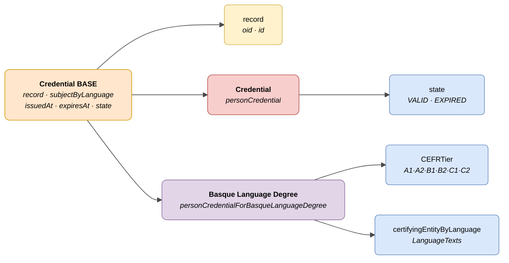

# :material-card-account-details: Person Credential

> - **Version:** `v{{ dena.version }}`
> - **Date:** {{ dena.date }}
> - **Type ID (DataTypeID):** `PERSON_CREDENTIAL` · `PERSON_CREDENTIAL_FOR_BASQUE_LANGUAGE_DEGREE`
> - **Test:** [DN99DENATestMockObjFactoryForPersonCredential.java]({{ repos.interop_test_blob }}/denaTestCommonDataClasses/src/main/java/dena/test/common/data/credential/DN99DENATestMockObjFactoryForPersonCredential.java) ⚠️ UNVERIFIED
> - **Code:**
>   - [DN00PersonCredential.java]({{ repos.common_data_api_blob }}/denaCommonDataAPIPersonCredentialModelClasses/src/main/java/dena/api/data/model/credential/DN00PersonCredential.java)
>   - [DN00PersonCredentialForBasqueLanguageDegree.java]({{ repos.common_data_api_blob }}/denaCommonDataAPIPersonCredentialModelClasses/src/main/java/dena/api/data/model/credential/language/DN00PersonCredentialForBasqueLanguageDegree.java)

## Description

Represents a credential or accreditation associated with a person. Two variants:

- **Base credential** (`personCredential`) — Generic accreditation linked to a record (gazte txartela, fishing licences, etc.)
- **Basque Language Degree** (`personCredentialForBasqueLanguageDegree`) — Specialisation for Basque language certificates with CEFR level

> See also: [campos-comunes.md](./campos-comunes.md) for inherited fields (`oid`, `id`, `lastChangedAt`, `urls`, `originAdmin`, `aboutPerson`)



| Colour | Meaning |
|-------|-------------|
| 🟠 Orange | Common base object (Credential BASE) |
| 🟡 Yellow | Reference to another object (Record) |
| 🔴 Light red | Subtype: Base credential |
| 🟣 Purple | Subtype: Basque Language Degree |
| 🔵 Light blue | Data fields |

---

## 🔗 Source code

| Class | Repository |
|-------|-------------|
| DN00PersonCredential | [View code]({{ repos.common_data_api_blob }}/denaCommonDataAPIPersonCredentialModelClasses/src/main/java/dena/api/data/model/credential/DN00PersonCredential.java) |
| DN00PersonCredentialForBasqueLanguageDegree | [View code]({{ repos.common_data_api_blob }}/denaCommonDataAPIPersonCredentialModelClasses/src/main/java/dena/api/data/model/credential/language/DN00PersonCredentialForBasqueLanguageDegree.java) |
| DN00PersonCredentialState | [View code]({{ repos.common_data_api_blob }}/denaCommonDataAPIPersonCredentialModelClasses/src/main/java/dena/api/data/model/credential/DN00PersonCredentialState.java) |

---

## 🧪 Tests and examples

| Test | Repository |
|------|-------------|
| DN99DENATestMockObjFactoryForPersonCredential | [View test]({{ repos.interop_test_blob }}/denaTestCommonDataClasses/src/main/java/dena/test/common/data/credential/DN99DENATestMockObjFactoryForPersonCredential.java) ⚠️ UNVERIFIED |
| DN99DENATestMockObjFactoryForPersonCredentialForBasqueLanguageDegree | [View test]({{ repos.interop_test_blob }}/denaTestCommonDataClasses/src/main/java/dena/test/common/data/credential/DN99DENATestMockObjFactoryForPersonCredentialForBasqueLanguageDegree.java) ⚠️ UNVERIFIED |

---

## Common attributes

Fields marked with <span class="field-badge--common">common</span> are **inherited** from [`DN00DENADataExchangedObjectBase`]({{ repos.common_data_api_blob }}/denaCommonDataAPIModelClasses/src/main/java/dena/api/data/model/DN00DENADataExchangedObjectBase.java) and are present in all data-retrieve types. See [campos-comunes.md](./campos-comunes.md).

| Field | Type | Required | Example | Description |
|-------|------|:--------:|---------|-------------|
| `type` | `String` | ✅ | `"personCredential"` | Type discriminator: `"personCredential"` or `"personCredentialForBasqueLanguageDegree"` |
| `oid` <span class="field-badge--common">common</span> | `String` | ✅ | `"CRED-OID-001"` | Unique technical identifier |
| `id` <span class="field-badge--common">common</span> | `String` | ✅ | `"CRED-2024-00001"` | Business identifier |
| `lastChangedAt` <span class="field-badge--common">common</span> | `Instant` | ✅ | `"2026-08-19T08:07:56.742Z"` | Last modification of the data at origin |
| `record` | `Object` | ❌ | `{"oid":"EXP-OID-001","id":"EXP-2024-00123"}` | Reference to the associated record |
| `subjectByLanguage` | `LanguageTexts` | ✅ | `{"SPANISH":"Gazte Txartela"}` | Credential description in multiple languages |
| `issuedAt` | `Instant` | ✅ | `"2024-01-15T00:00:00Z"` | Credential issuance date |
| `expiresAt` | `Instant` | ❌ | `"2025-01-15T00:00:00Z"` | Expiry date (null if no expiry) |
| `state` | `Object` | ✅ | `{"stateCode":"VALID"}` | Credential state |

---

## Basque Language Degree — Specific attributes

| Field | Type | Required | Example | Description |
|-------|------|:--------:|---------|-------------|
| `CEFRTier` | `String` | ✅ | `"B2"` | CEFR level of the certificate (see [CEFR levels](#cefr-levels-cefrtier)) |
| `certifyingEntityByLanguage` | `LanguageTexts` | ✅ | `{"SPANISH":"HABE","BASQUE":"HABE"}` | Certifying entity in multiple languages |

---

## Credential states (`state.stateCode`)

| Code | Description |
|------|-------------|
| `VALID` | Valid credential |
| `EXPIRED` | Expired credential |

---

## CEFR levels (`CEFRTier`)

| Code | Description |
|------|-------------|
| `A1` | Breakthrough — basic user |
| `A2` | Waystage — basic user |
| `B1` | Threshold — independent user |
| `B2` | Vantage — independent user |
| `C1` | Effective Operational Proficiency — proficient user |
| `C2` | Mastery — proficient user |

---

## Example — Base credential

<div class="common-highlight" markdown>

```json hl_lines="3 4 5"
{
  "type": "personCredential",
  "oid": "CRED-OID-001",
  "id": "CRED-2024-00001",
  "lastChangedAt": "2026-08-19T08:07:56.742Z",
  "record": { "oid": "EXP-OID-001", "id": "EXP-2024-00123" },
  "subjectByLanguage": { "SPANISH": "Gazte Txartela", "BASQUE": "Gazte Txartela" },
  "issuedAt": "2024-01-15T00:00:00Z",
  "expiresAt": "2025-01-15T00:00:00Z",
  "state": { "stateCode": "VALID" }
}
```

<p class="common-fields-legend"><span class="swatch"></span> Highlighted lines are <strong>common</strong> fields inherited from the base class (see <a href="./campos-comunes.md">campos-comunes.md</a>).</p>

</div>

## Example — Basque Language Degree

<div class="common-highlight" markdown>

```json hl_lines="3 4 5"
{
  "type": "personCredentialForBasqueLanguageDegree",
  "oid": "CRED-OID-002",
  "id": "CRED-EUSKERA-2024-00001",
  "lastChangedAt": "2026-08-19T08:07:56.742Z",
  "record": { "oid": "EXP-OID-002", "id": "EXP-EUSKERA-2024-00001" },
  "subjectByLanguage": { "SPANISH": "Título de Euskera — Nivel B2", "BASQUE": "Euskarako Titulua — B2 Maila" },
  "issuedAt": "2023-06-20T00:00:00Z",
  "expiresAt": null,
  "state": { "stateCode": "VALID" },
  "CEFRTier": "B2",
  "certifyingEntityByLanguage": { "SPANISH": "HABE", "BASQUE": "HABE" }
}
```

<p class="common-fields-legend"><span class="swatch"></span> Highlighted lines are <strong>common</strong> fields inherited from the base class (see <a href="./campos-comunes.md">campos-comunes.md</a>).</p>

</div>

---

## Important notes

- The `record` field is optional. Some credentials are not linked to a specific record.
- `expiresAt` set to `null` means the credential has no expiry date.
- `personCredentialForBasqueLanguageDegree` extends `personCredential` and adds `CEFRTier` and `certifyingEntityByLanguage`.
- Credential OIDs (`...`) are assigned by the administration's own system. ⚠️ UNVERIFIED (OID files not read).
- Basque language degrees are also used for gazte txartela, fishing licences and other EJGV regulatory accreditations.


---

<!-- DENA-DOC-FOOTER -->
---
<sub>DENA Docs v{{ dena.version }} · {{ dena.date }}</sub>
