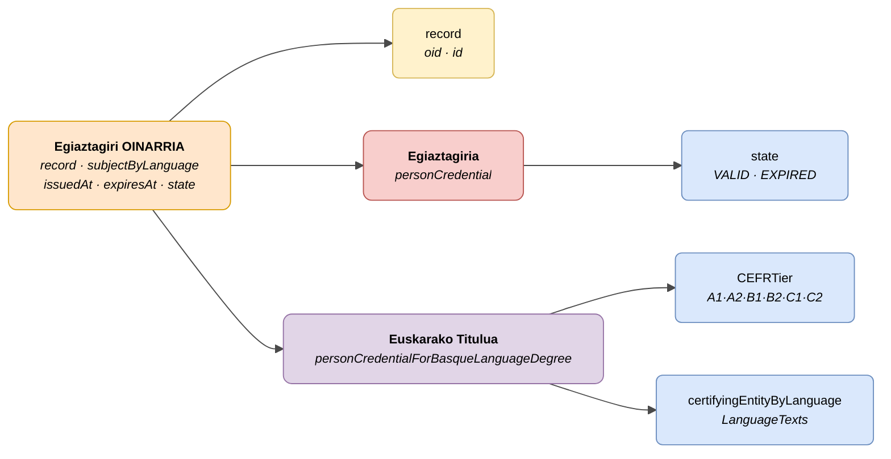

# :material-card-account-details: Pertsonaren Egiaztagiria (Person Credential)

> - **Bertsioa:** `v{{ dena.version }}`
> - **Data:** {{ dena.date }}
> - **Mota ID (DataTypeID):** `PERSON_CREDENTIAL` · `PERSON_CREDENTIAL_FOR_BASQUE_LANGUAGE_DEGREE`
> - **Testa:** [DN99DENATestMockObjFactoryForPersonCredential.java]({{ repos.interop_test_blob }}/denaTestCommonDataClasses/src/main/java/dena/test/common/data/credential/DN99DENATestMockObjFactoryForPersonCredential.java) ⚠️ EGIAZTATU GABE
> - **Kodea:**
>   - [DN00PersonCredential.java]({{ repos.common_data_api_blob }}/denaCommonDataAPIPersonCredentialModelClasses/src/main/java/dena/api/data/model/credential/DN00PersonCredential.java)
>   - [DN00PersonCredentialForBasqueLanguageDegree.java]({{ repos.common_data_api_blob }}/denaCommonDataAPIPersonCredentialModelClasses/src/main/java/dena/api/data/model/credential/language/DN00PersonCredentialForBasqueLanguageDegree.java)

## Deskribapena

Pertsona bati lotutako egiaztagiri bat adierazten du. Bi aldaera:

- **Oinarrizko egiaztagiria** (`personCredential`) — Espediente bati lotutako egiaztagiri generikoa (gazte txartela, arrantza lizentziak, etab.)
- **Euskarako Titulua** (`personCredentialForBasqueLanguageDegree`) — CEFR mailarekin euskarako tituluetarako espezializazioa

> Ikusi baita ere: [campos-comunes.md](./campos-comunes.md) heredatutako eremuetarako (`oid`, `id`, `lastChangedAt`, `urls`, `originAdmin`, `aboutPerson`)



| Kolorea | Esanahia |
|---------|----------|
| 🟠 Laranja | Oinarrizko objektu komuna (Egiaztagiri OINARRIA) |
| 🟡 Horia | Beste objektu bati erreferentzia (Espedientea) |
| 🔴 Gorri argia | Azpimota: Oinarrizko egiaztagiria |
| 🟣 More | Azpimota: Euskarako Titulua |
| 🔵 Urdin argia | Datu eremuak |

---

## 🔗 Iturburu kodea

| Klasea | Biltegia |
|--------|----------|
| DN00PersonCredential | [Ikusi kodea]({{ repos.common_data_api_blob }}/denaCommonDataAPIPersonCredentialModelClasses/src/main/java/dena/api/data/model/credential/DN00PersonCredential.java) |
| DN00PersonCredentialForBasqueLanguageDegree | [Ikusi kodea]({{ repos.common_data_api_blob }}/denaCommonDataAPIPersonCredentialModelClasses/src/main/java/dena/api/data/model/credential/language/DN00PersonCredentialForBasqueLanguageDegree.java) |
| DN00PersonCredentialState | [Ikusi kodea]({{ repos.common_data_api_blob }}/denaCommonDataAPIPersonCredentialModelClasses/src/main/java/dena/api/data/model/credential/DN00PersonCredentialState.java) |

---

## 🧪 Testak eta adibideak

| Testa | Biltegia |
|-------|----------|
| DN99DENATestMockObjFactoryForPersonCredential | [Ikusi testa]({{ repos.interop_test_blob }}/denaTestCommonDataClasses/src/main/java/dena/test/common/data/credential/DN99DENATestMockObjFactoryForPersonCredential.java) ⚠️ EGIAZTATU GABE |
| DN99DENATestMockObjFactoryForPersonCredentialForBasqueLanguageDegree | [Ikusi testa]({{ repos.interop_test_blob }}/denaTestCommonDataClasses/src/main/java/dena/test/common/data/credential/DN99DENATestMockObjFactoryForPersonCredentialForBasqueLanguageDegree.java) ⚠️ EGIAZTATU GABE |

---

## Eremu komunak

<span class="field-badge--common">komun</span> markarekin izendatutako eremuak [`DN00DENADataExchangedObjectBase`]({{ repos.common_data_api_blob }}/denaCommonDataAPIModelClasses/src/main/java/dena/api/data/model/DN00DENADataExchangedObjectBase.java)-tik **heredatutakoak** dira eta data-retrieve mota guztietan daude. Ikusi [campos-comunes.md](./campos-comunes.md).

| Eremua | Mota | Derrigorrezkoa | Adibidea | Deskribapena |
|--------|------|:--------------:|----------|--------------|
| `type` | `String` | ✅ | `"personCredential"` | Mota diskriminatzailea |
| `oid` <span class="field-badge--common">komun</span> | `String` | ✅ | `"CRED-OID-001"` | Identifikatzaile tekniko bakarra |
| `id` <span class="field-badge--common">komun</span> | `String` | ✅ | `"CRED-2024-00001"` | Negozio identifikatzailea |
| `lastChangedAt` <span class="field-badge--common">komun</span> | `Instant` | ✅ | `"2026-08-19T08:07:56.742Z"` | Jatorrizko datuen azken aldaketa |
| `record` | `Object` | ❌ | `{"oid":"EXP-OID-001","id":"EXP-2024-00123"}` | Espediente erreferentzia |
| `subjectByLanguage` | `LanguageTexts` | ✅ | `{"SPANISH":"Gazte Txartela"}` | Egiaztagiriaren deskribapena hainbat hizkuntzatan |
| `issuedAt` | `Instant` | ✅ | `"2024-01-15T00:00:00Z"` | Egiaztagiriaren igorpen data |
| `expiresAt` | `Instant` | ❌ | `"2025-01-15T00:00:00Z"` | Iraungite data (null baldin eta iraungitzen ez bada) |
| `state` | `Object` | ✅ | `{"stateCode":"VALID"}` | Egiaztagiriaren egoera |

---

## Euskarako Titulua — Eremu espezifikoak

| Eremua | Mota | Derrigorrezkoa | Adibidea | Deskribapena |
|--------|------|:--------------:|----------|--------------|
| `CEFRTier` | `String` | ✅ | `"B2"` | Tituluaren CEFR maila |
| `certifyingEntityByLanguage` | `LanguageTexts` | ✅ | `{"SPANISH":"HABE","BASQUE":"HABE"}` | Erakunde egiaztagilea hainbat hizkuntzatan |

---

## Egiaztagiriaren egoerak (`state.stateCode`)

| Kodea | Deskribapena |
|-------|--------------|
| `VALID` | Egiaztagiri balioduna |
| `EXPIRED` | Egiaztagiri iraungitua |

---

## Adibidea — Oinarrizko egiaztagiria

<div class="common-highlight" markdown>

```json hl_lines="3 4 5"
{
  "type": "personCredential",
  "oid": "CRED-OID-001",
  "id": "CRED-2024-00001",
  "lastChangedAt": "2026-08-19T08:07:56.742Z",
  "record": { "oid": "EXP-OID-001", "id": "EXP-2024-00123" },
  "subjectByLanguage": { "SPANISH": "Gazte Txartela", "BASQUE": "Gazte Txartela" },
  "issuedAt": "2024-01-15T00:00:00Z",
  "expiresAt": "2025-01-15T00:00:00Z",
  "state": { "stateCode": "VALID" }
}
```

<p class="common-fields-legend"><span class="swatch"></span> Nabarmendutako lerroak oinarrizko klasetik <strong>heredatutako eremu komunak</strong> dira (ikusi <a href="./campos-comunes.md">campos-comunes.md</a>).</p>

</div>

---

<!-- DENA-DOC-FOOTER -->
---
<sub>DENA Docs v{{ dena.version }} · {{ dena.date }}</sub>
