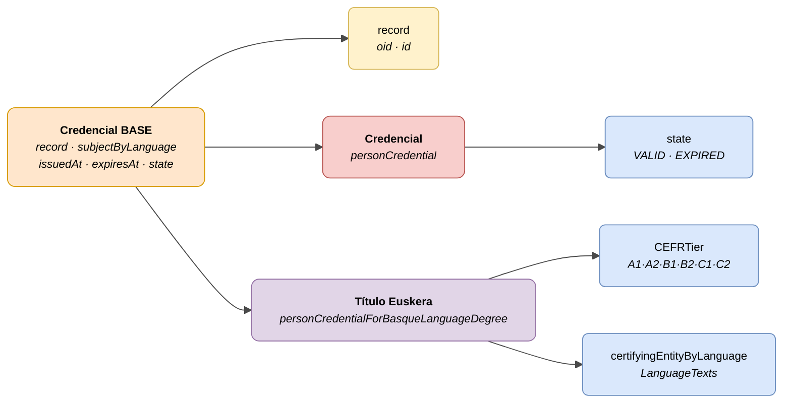

# :material-card-account-details: Credencial de Persona (Person Credential)

> - **Versión:** `v{{ dena.version }}`
> - **Fecha:** {{ dena.date }}
> - **ID de Tipo (DataTypeID):** `PERSON_CREDENTIAL` · `PERSON_CREDENTIAL_FOR_BASQUE_LANGUAGE_DEGREE`
> - **Test:** [DN99DENATestMockObjFactoryForPersonCredential.java]({{ repos.interop_test_blob }}/denaTestCommonDataClasses/src/main/java/dena/test/common/data/credential/DN99DENATestMockObjFactoryForPersonCredential.java) ⚠️ SIN VERIFICAR
> - **Código:**
>   - [DN00PersonCredential.java]({{ repos.common_data_api_blob }}/denaCommonDataAPIPersonCredentialModelClasses/src/main/java/dena/api/data/model/credential/DN00PersonCredential.java)
>   - [DN00PersonCredentialForBasqueLanguageDegree.java]({{ repos.common_data_api_blob }}/denaCommonDataAPIPersonCredentialModelClasses/src/main/java/dena/api/data/model/credential/language/DN00PersonCredentialForBasqueLanguageDegree.java)

## Descripción

Representa una credencial o acreditación asociada a una persona. Dos variantes:

- **Credencial base** (`personCredential`) — Acreditación genérica asociada a un expediente (gazte txartela, licencias de pesca, etc.)
- **Acreditación de Euskera** (`personCredentialForBasqueLanguageDegree`) — Especialización para títulos de euskera con nivel CEFR

> Ver también: [campos-comunes.md](./campos-comunes.md) para campos heredados (`oid`, `id`, `lastChangedAt`, `urls`, `originAdmin`, `aboutPerson`)



| Color | Significado |
|-------|-------------|
| 🟠 Naranja | Objeto base común (Credencial BASE) |
| 🟡 Amarillo | Referencia a otro objeto (Expediente) |
| 🔴 Rojo claro | Subtipo: Credencial base |
| 🟣 Violeta | Subtipo: Título de Euskera |
| 🔵 Azul claro | Campos de datos |

---

## 🔗 Código fuente

| Clase | Repositorio |
|-------|-------------|
| DN00PersonCredential | [Ver código]({{ repos.common_data_api_blob }}/denaCommonDataAPIPersonCredentialModelClasses/src/main/java/dena/api/data/model/credential/DN00PersonCredential.java) |
| DN00PersonCredentialForBasqueLanguageDegree | [Ver código]({{ repos.common_data_api_blob }}/denaCommonDataAPIPersonCredentialModelClasses/src/main/java/dena/api/data/model/credential/language/DN00PersonCredentialForBasqueLanguageDegree.java) |
| DN00PersonCredentialState | [Ver código]({{ repos.common_data_api_blob }}/denaCommonDataAPIPersonCredentialModelClasses/src/main/java/dena/api/data/model/credential/DN00PersonCredentialState.java) |

---

## 🧪 Tests y ejemplos

| Test | Repositorio |
|------|-------------|
| DN99DENATestMockObjFactoryForPersonCredential | [Ver test]({{ repos.interop_test_blob }}/denaTestCommonDataClasses/src/main/java/dena/test/common/data/credential/DN99DENATestMockObjFactoryForPersonCredential.java) ⚠️ SIN VERIFICAR |
| DN99DENATestMockObjFactoryForPersonCredentialForBasqueLanguageDegree | [Ver test]({{ repos.interop_test_blob }}/denaTestCommonDataClasses/src/main/java/dena/test/common/data/credential/DN99DENATestMockObjFactoryForPersonCredentialForBasqueLanguageDegree.java) ⚠️ SIN VERIFICAR |

---

## Atributos comunes

Los campos marcados con <span class="field-badge--common">común</span> son **heredados** de [`DN00DENADataExchangedObjectBase`]({{ repos.common_data_api_blob }}/denaCommonDataAPIModelClasses/src/main/java/dena/api/data/model/DN00DENADataExchangedObjectBase.java) y están presentes en todos los tipos del data-retrieve. Ver [campos-comunes.md](./campos-comunes.md).

| Campo | Tipo | Obligatorio | Ejemplo | Descripción |
|-------|------|:-----------:|---------|-------------|
| `type` | `String` | ✅ | `"personCredential"` | Discriminador del tipo: `"personCredential"` o `"personCredentialForBasqueLanguageDegree"` |
| `oid` <span class="field-badge--common">común</span> | `String` | ✅ | `"CRED-OID-001"` | Identificador técnico único |
| `id` <span class="field-badge--common">común</span> | `String` | ✅ | `"CRED-2024-00001"` | Identificador de negocio |
| `lastChangedAt` <span class="field-badge--common">común</span> | `Instant` | ✅ | `"2026-08-19T08:07:56.742Z"` | Última modificación del dato en el origen |
| `record` | `Object` | ❌ | `{"oid":"EXP-OID-001","id":"EXP-2024-00123"}` | Referencia al expediente asociado |
| `subjectByLanguage` | `LanguageTexts` | ✅ | `{"SPANISH":"Gazte Txartela"}` | Descripción de la credencial en varios idiomas |
| `issuedAt` | `Instant` | ✅ | `"2024-01-15T00:00:00Z"` | Fecha de emisión de la credencial |
| `expiresAt` | `Instant` | ❌ | `"2025-01-15T00:00:00Z"` | Fecha de expiración (null si no caduca) |
| `state` | `Object` | ✅ | `{"stateCode":"VALID"}` | Estado de la credencial |

---

## Título de Euskera — Atributos específicos

| Campo | Tipo | Obligatorio | Ejemplo | Descripción |
|-------|------|:-----------:|---------|-------------|
| `CEFRTier` | `String` | ✅ | `"B2"` | Nivel CEFR del título (ver [niveles CEFR](#niveles-cefr-cefrtier)) |
| `certifyingEntityByLanguage` | `LanguageTexts` | ✅ | `{"SPANISH":"HABE","BASQUE":"HABE"}` | Entidad certificadora en varios idiomas |

---

## Estados de la credencial (`state.stateCode`)

| Código | Descripción |
|--------|-------------|
| `VALID` | Credencial vigente |
| `EXPIRED` | Credencial caducada |

---

## Niveles CEFR (`CEFRTier`)

| Código | Descripción |
|--------|-------------|
| `A1` | Acceso — usuario básico |
| `A2` | Plataforma — usuario básico |
| `B1` | Umbral — usuario independiente |
| `B2` | Avanzado — usuario independiente |
| `C1` | Dominio operativo eficaz — usuario competente |
| `C2` | Maestría — usuario competente |

---

## Ejemplo — Credencial base

<div class="common-highlight" markdown>

```json hl_lines="3 4 5"
{
  "type": "personCredential",
  "oid": "CRED-OID-001",
  "id": "CRED-2024-00001",
  "lastChangedAt": "2026-08-19T08:07:56.742Z",
  "record": { "oid": "EXP-OID-001", "id": "EXP-2024-00123" },
  "subjectByLanguage": { "SPANISH": "Gazte Txartela", "BASQUE": "Gazte Txartela" },
  "issuedAt": "2024-01-15T00:00:00Z",
  "expiresAt": "2025-01-15T00:00:00Z",
  "state": { "stateCode": "VALID" }
}
```

<p class="common-fields-legend"><span class="swatch"></span> Las líneas resaltadas son los campos <strong>comunes</strong> heredados de la clase base (ver <a href="./campos-comunes.md">campos-comunes.md</a>).</p>

</div>

## Ejemplo — Título de Euskera

<div class="common-highlight" markdown>

```json hl_lines="3 4 5"
{
  "type": "personCredentialForBasqueLanguageDegree",
  "oid": "CRED-OID-002",
  "id": "CRED-EUSKERA-2024-00001",
  "lastChangedAt": "2026-08-19T08:07:56.742Z",
  "record": { "oid": "EXP-OID-002", "id": "EXP-EUSKERA-2024-00001" },
  "subjectByLanguage": { "SPANISH": "Título de Euskera — Nivel B2", "BASQUE": "Euskarako Titulua — B2 Maila" },
  "issuedAt": "2023-06-20T00:00:00Z",
  "expiresAt": null,
  "state": { "stateCode": "VALID" },
  "CEFRTier": "B2",
  "certifyingEntityByLanguage": { "SPANISH": "HABE", "BASQUE": "HABE" }
}
```

<p class="common-fields-legend"><span class="swatch"></span> Las líneas resaltadas son los campos <strong>comunes</strong> heredados de la clase base (ver <a href="./campos-comunes.md">campos-comunes.md</a>).</p>

</div>

---

## Notas importantes

- El campo `record` es opcional. Algunas credenciales no están vinculadas a un expediente concreto.
- El campo `expiresAt` a `null` indica que la credencial no tiene fecha de caducidad.
- `personCredentialForBasqueLanguageDegree` extiende `personCredential` y añade los campos `CEFRTier` y `certifyingEntityByLanguage`.
- Los OIDs de credencial (`...`) son asignados por el sistema de la administración. ⚠️ SIN VERIFICAR (ficheros OID no leídos).
- Los títulos de euskera se usan también en gazte txartela, licencias de pesca y otras acreditaciones reglamentarias del EJGV.


---

<!-- DENA-DOC-FOOTER -->
---
<sub>DENA Docs v{{ dena.version }} · {{ dena.date }}</sub>
