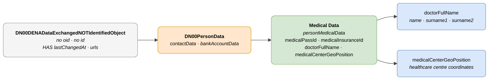

# :material-hospital-box: Medical Data (Person Medical Data)

> - **Version:** `v{{ dena.version }}`
> - **Date:** {{ dena.date }}
> - **Type ID (DataTypeID):** `PERSON_MEDICAL_DATA`
> - **Test:** [DN99DENATestMockObjFactoryForPersonMedicalData.java]({{ repos.interop_test_blob }}/denaTestCommonDataClasses/src/main/java/dena/test/common/data/persondata/medical/DN99DENATestMockObjFactoryForPersonMedicalData.java) ⚠️ UNVERIFIED
> - **Code:** [DN00PersonMedicalData.java]({{ repos.common_data_api_blob }}/denaCommonDataAPIPersonDataModelClasses/src/main/java/dena/api/data/model/persondata/medical/DN00PersonMedicalData.java)

## Description

Represents a person's medical data: health identifiers, assigned doctor and healthcare contact details.

!!! warning "NOT identified object — no oid or id"
    `DN00PersonMedicalData` extends (via `DN00PersonData`) `DN00DENADataExchangedNOTIdentifiedObject`. This object **does NOT have** `oid` or `id`, but **DOES have** `lastChangedAt`, `urls`, `originAdmin` and `aboutPerson`.



| Colour | Meaning |
|--------|---------|
| ⬜ Light grey | Base class without identification (`NOT_IDENTIFIED`) |
| 🟠 Orange | `DN00PersonData` (contact + bank) |
| 🟢 Green | Medical-specific data |
| 🔵 Light blue | Nested data fields |

---

## 🔗 Source code

| Class | Repository |
|-------|-------------|
| DN00PersonMedicalData | [View code]({{ repos.common_data_api_blob }}/denaCommonDataAPIPersonDataModelClasses/src/main/java/dena/api/data/model/persondata/medical/DN00PersonMedicalData.java) |
| DN00PersonData | [View code]({{ repos.common_data_api_blob }}/denaCommonDataAPIPersonDataModelClasses/src/main/java/dena/api/data/model/persondata/DN00PersonData.java) |
| DN00DENADataExchangedNOTIdentifiedObject | [View code]({{ repos.common_data_api_blob }}/denaCommonDataAPIModelClasses/src/main/java/dena/api/data/model/DN00DENADataExchangedNOTIdentifiedObject.java) |

---

## 🧪 Tests and examples

| Test | Repository |
|------|-------------|
| DN99DENATestMockObjFactoryForPersonMedicalData | [View test]({{ repos.interop_test_blob }}/denaTestCommonDataClasses/src/main/java/dena/test/common/data/persondata/medical/DN99DENATestMockObjFactoryForPersonMedicalData.java) ⚠️ UNVERIFIED |

---

## Attributes

Unlike other data-retrieve types, **this object does not inherit the `oid` or `id` fields from the standard base class** as it extends `DN00DENADataExchangedNOTIdentifiedObject`. Medical data are personal data without their own identifier, but they do have `lastChangedAt`.

| Field | Type | Required | Example | Description |
|-------|------|:--------:|---------|-------------|
| `type` | `String` | ✅ | `"personMedicalData"` | Type discriminator (always `"personMedicalData"`) |
| `lastChangedAt` | `Instant` | ✅ | `"2026-08-19T08:07:56.742Z"` | Last change of the data at the origin |
| `medicalPassId` | `String` | ❌ | `"TIS-123456789"` | Individual Health Card (TIS) — health card number |
| `medicalInsuranceId` | `String` | ❌ | `"MUFACE-00123456"` | Complementary health insurance identifier |
| `doctorFullName` | `PersonFullName` | ❌ | `{"name":"Juan","surname1":"García","surname2":"López"}` | Assigned doctor's full name (see [PersonFullName](#personfullname-type)) |
| `medicalCenterGeoPosition` | `Object` | ❌ | `{"latitude":43.2627,"longitude":-2.9253}` | Healthcare centre geolocation |
| `contactData` | `Object` | ❌ | *(inherited from DN00PersonData)* | Contact data |
| `bankAccountData` | `Object` | ❌ | *(inherited from DN00PersonData)* | Bank account data |

---

## `PersonFullName` type

| Field | Type | Description |
|-------|------|-------------|
| `name` | `String` | Given name |
| `surname1` | `String` | First surname |
| `surname2` | `String` | Second surname |

---

## Example

```json
{
  "type": "personMedicalData",
  "lastChangedAt": "2026-08-19T08:07:56.742Z",
  "medicalPassId": "TIS-123456789",
  "medicalInsuranceId": null,
  "doctorFullName": {
    "name": "María",
    "surname1": "Fernández",
    "surname2": "Ruiz"
  },
  "medicalCenterGeoPosition": {
    "latitude": 43.2627,
    "longitude": -2.9253
  }
}
```

!!! info "No oid or id in this type"
    Unlike other data types, this object does not contain `oid` or `id`. It is directly linked to the person in the data-retrieve request context, but does have `lastChangedAt`.

---

## Data categories

Medical data belong to the `MEDICAL_CARE` category. They are **specially protected data** under Art. 9 GDPR. The administration's system must ensure strict access controls for this data type.

---

## Important notes

- `DN00PersonMedicalData` extends `DN00PersonData`, which in turn extends `DN00DENADataExchangedNOTIdentifiedObject`. **This hierarchy is different** from other data-retrieve types that inherit from `DN00DENADataExchangedObjectBase`.
- `medicalPassId` corresponds to the Individual Health Card (TIS) or equivalent (EHIC, European Health Insurance Card) as applicable.
- Medical data are **specially protected data** (special category under GDPR, Art. 9). They should only be transferred when strictly necessary and always with appropriate consent.
- `medicalCenterGeoPosition` allows the assigned healthcare centre to be shown on a map.


---

<!-- DENA-DOC-FOOTER -->
---
<sub>DENA Docs v{{ dena.version }} · {{ dena.date }}</sub>
