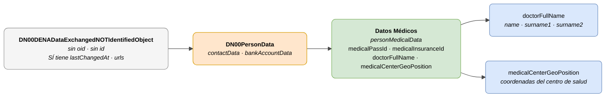

# :material-hospital-box: Datos Médicos (Person Medical Data)

> - **Versión:** `v{{ dena.version }}`
> - **Fecha:** {{ dena.date }}
> - **ID de Tipo (DataTypeID):** `PERSON_MEDICAL_DATA`
> - **Test:** [DN99DENATestMockObjFactoryForPersonMedicalData.java]({{ repos.interop_test_blob }}/denaTestCommonDataClasses/src/main/java/dena/test/common/data/persondata/medical/DN99DENATestMockObjFactoryForPersonMedicalData.java) ⚠️ SIN VERIFICAR
> - **Código:** [DN00PersonMedicalData.java]({{ repos.common_data_api_blob }}/denaCommonDataAPIPersonDataModelClasses/src/main/java/dena/api/data/model/persondata/medical/DN00PersonMedicalData.java)

## Descripción

Representa los datos médicos de una persona: identificadores sanitarios, médico asignado y datos de contacto de salud.

!!! warning "Objeto NO identificado — sin oid ni id"
    `DN00PersonMedicalData` extiende (vía `DN00PersonData`) `DN00DENADataExchangedNOTIdentifiedObject`. Este objeto **NO tiene** `oid` ni `id`, pero **SÍ tiene** `lastChangedAt`, `urls`, `originAdmin` y `aboutPerson`.



| Color | Significado |
|-------|-------------|
| ⬜ Gris claro | Clase base sin identificación (`NOT_IDENTIFIED`) |
| 🟠 Naranja | `DN00PersonData` (contacto + banco) |
| 🟢 Verde | Datos médicos específicos |
| 🔵 Azul claro | Campos de datos anidados |

---

## 🔗 Código fuente

| Clase | Repositorio |
|-------|-------------|
| DN00PersonMedicalData | [Ver código]({{ repos.common_data_api_blob }}/denaCommonDataAPIPersonDataModelClasses/src/main/java/dena/api/data/model/persondata/medical/DN00PersonMedicalData.java) |
| DN00PersonData | [Ver código]({{ repos.common_data_api_blob }}/denaCommonDataAPIPersonDataModelClasses/src/main/java/dena/api/data/model/persondata/DN00PersonData.java) |
| DN00DENADataExchangedNOTIdentifiedObject | [Ver código]({{ repos.common_data_api_blob }}/denaCommonDataAPIModelClasses/src/main/java/dena/api/data/model/DN00DENADataExchangedNOTIdentifiedObject.java) |

---

## 🧪 Tests y ejemplos

| Test | Repositorio |
|------|-------------|
| DN99DENATestMockObjFactoryForPersonMedicalData | [Ver test]({{ repos.interop_test_blob }}/denaTestCommonDataClasses/src/main/java/dena/test/common/data/persondata/medical/DN99DENATestMockObjFactoryForPersonMedicalData.java) ⚠️ SIN VERIFICAR |

---

## Atributos

A diferencia de los demás tipos de dato del data-retrieve, **este objeto no hereda los campos `oid` ni `id` de la clase base estándar** ya que extiende `DN00DENADataExchangedNOTIdentifiedObject`. Los datos médicos son datos personales sin identificador propio, pero sí tienen `lastChangedAt`.

| Campo | Tipo | Obligatorio | Ejemplo | Descripción |
|-------|------|:-----------:|---------|-------------|
| `type` | `String` | ✅ | `"personMedicalData"` | Discriminador de tipo (siempre `"personMedicalData"`) |
| `lastChangedAt` | `Instant` | ✅ | `"2026-08-19T08:07:56.742Z"` | Última modificación del dato en el origen |
| `medicalPassId` | `String` | ❌ | `"TIS-123456789"` | Tarjeta Individual Sanitaria (TIS) — número de la TSE/TIS |
| `medicalInsuranceId` | `String` | ❌ | `"MUFACE-00123456"` | Identificador de seguro médico complementario |
| `doctorFullName` | `PersonFullName` | ❌ | `{"name":"Juan","surname1":"García","surname2":"López"}` | Nombre completo del médico asignado (ver [PersonFullName](#tipo-personfullname)) |
| `medicalCenterGeoPosition` | `Object` | ❌ | `{"latitude":43.2627,"longitude":-2.9253}` | Geolocalización del centro de salud |
| `contactData` | `Object` | ❌ | *(heredado de DN00PersonData)* | Datos de contacto |
| `bankAccountData` | `Object` | ❌ | *(heredado de DN00PersonData)* | Datos bancarios |

---

## Tipo `PersonFullName`

| Campo | Tipo | Descripción |
|-------|------|-------------|
| `name` | `String` | Nombre de pila |
| `surname1` | `String` | Primer apellido |
| `surname2` | `String` | Segundo apellido |

---

## Ejemplo

```json
{
  "type": "personMedicalData",
  "lastChangedAt": "2026-08-19T08:07:56.742Z",
  "medicalPassId": "TIS-123456789",
  "medicalInsuranceId": null,
  "doctorFullName": {
    "name": "María",
    "surname1": "Fernández",
    "surname2": "Ruiz"
  },
  "medicalCenterGeoPosition": {
    "latitude": 43.2627,
    "longitude": -2.9253
  }
}
```

!!! info "Sin oid ni id en este tipo"
    A diferencia del resto de tipos de dato, este objeto no contiene `oid` ni `id`. Está vinculado directamente a la persona del contexto de la petición de data-retrieve, pero sí tiene `lastChangedAt`.

---

## Categorías de datos

Los datos médicos pertenecen a la categoría `MEDICAL_CARE` (datos de atención médica). Son datos **especialmente protegidos** de conformidad con el Art. 9 RGPD. El sistema de la administración debe garantizar controles de acceso estrictos a este tipo de dato.

---

## Notas importantes

- `DN00PersonMedicalData` extiende `DN00PersonData`, que a su vez extiende `DN00DENADataExchangedNOTIdentifiedObject`. **Esta jerarquía es diferente** a la del resto de tipos del data-retrieve que heredan de `DN00DENADataExchangedObjectBase`.
- `medicalPassId` corresponde a la Tarjeta Individual Sanitaria (TIS) o equivalente (TSE, tarjeta sanitaria europea) según el caso.
- Los datos médicos son datos **especialmente protegidos** (categoría especial según RGPD, Art. 9). Solo deben transferirse cuando sea estrictamente necesario y siempre con el consentimiento adecuado.
- `medicalCenterGeoPosition` permite localizar el centro de salud asignado en un mapa.


---

<!-- DENA-DOC-FOOTER -->
---
<sub>DENA Docs v{{ dena.version }} · {{ dena.date }}</sub>
