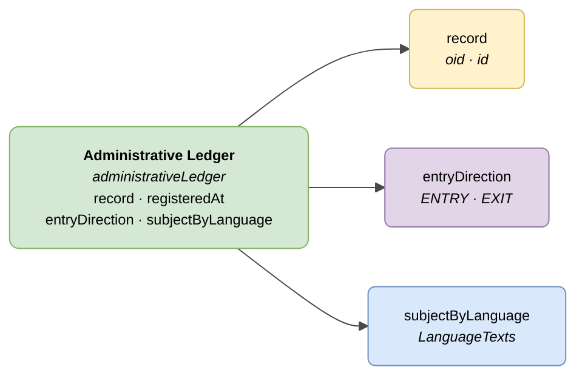

# :material-book-open-page-variant: Administrative Ledger (Entry/Exit)

> - **Version:** `v{{ dena.version }}`
> - **Date:** {{ dena.date }}
> - **Type ID (DataTypeID):** `ADMINISTRATIVE_LEDGER`
> - **Test:** [DN99DENATestMockObjFactoryForAdministrativeLedger.java]({{ repos.interop_test_blob }}/denaTestCommonDataClasses/src/main/java/dena/test/common/data/ledger/DN99DENATestMockObjFactoryForAdministrativeLedger.java) ⚠️ UNVERIFIED
> - **Code:** [DN00AdministrativeLedger.java]({{ repos.common_data_api_blob }}/denaCommonDataAPIAdministrativeLedgerModelClasses/src/main/java/dena/api/data/model/ledger/DN00AdministrativeLedger.java)

## Description

Represents an entry in the administrative Entry/Exit ledger (registro de entradas/salidas). The `id` field corresponds to the registry entry number.

> See also: [campos-comunes.md](./campos-comunes.md) for inherited fields (`oid`, `id`, `lastChangedAt`, `urls`, `originAdmin`, `aboutPerson`)



| Colour | Meaning |
|--------|---------|
| 🟢 Green | Main object (Administrative Ledger) |
| 🟡 Yellow | Reference to another object (Record) |
| 🔵 Light blue | Data fields |
| 🟣 Purple | Enums (entry direction) |

---

## 🔗 Source code

| Class | Repository |
|-------|-------------|
| DN00AdministrativeLedger | [View code]({{ repos.common_data_api_blob }}/denaCommonDataAPIAdministrativeLedgerModelClasses/src/main/java/dena/api/data/model/ledger/DN00AdministrativeLedger.java) |
| DN00AdministrativeLedgerEntryDirection | [View code]({{ repos.common_data_api_blob }}/denaCommonDataAPIAdministrativeLedgerModelClasses/src/main/java/dena/api/data/model/ledger/DN00AdministrativeLedgerEntryDirection.java) |

---

## 🧪 Tests and examples

| Test | Repository |
|------|-------------|
| DN99DENATestMockObjFactoryForAdministrativeLedger | [View test]({{ repos.interop_test_blob }}/denaTestCommonDataClasses/src/main/java/dena/test/common/data/ledger/DN99DENATestMockObjFactoryForAdministrativeLedger.java) ⚠️ UNVERIFIED |

---

## Attributes

Fields marked with <span class="field-badge--common">common</span> are **inherited** from [`DN00DENADataExchangedObjectBase`]({{ repos.common_data_api_blob }}/denaCommonDataAPIModelClasses/src/main/java/dena/api/data/model/DN00DENADataExchangedObjectBase.java). See [campos-comunes.md](./campos-comunes.md).

| Field | Type | Required | Example | Description |
|-------|------|:--------:|---------|-------------|
| `type` | `String` | ✅ | `"administrativeLedger"` | Type discriminator (always `"administrativeLedger"`) |
| `oid` <span class="field-badge--common">common</span> | `String` | ✅ | `"LED-OID-001"` | Unique technical identifier |
| `id` <span class="field-badge--common">common</span> | `String` | ✅ | `"REG-2024-00001"` | Registry entry number |
| `lastChangedAt` <span class="field-badge--common">common</span> | `Instant` | ✅ | `"2026-08-19T08:07:56.742Z"` | Last modification of the data at origin |
| `record` | `Object` | ❌ | `{"oid":"EXP-OID-001","id":"EXP-2024-00123"}` | Reference to the associated record |
| `registeredAt` | `Instant` | ✅ | `"2024-03-15T09:30:00Z"` | Date and time the entry was registered |
| `entryDirection` | `Object` | ✅ | `{"stateCode":"ENTRY"}` | Entry direction: incoming or outgoing |
| `subjectByLanguage` | `LanguageTexts` | ✅ | `{"SPANISH":"Solicitud licencia de obras"}` | Subject of the ledger entry in multiple languages |

---

## Entry direction (`entryDirection.stateCode`)

| Code | Description |
|------|-------------|
| `ENTRY` | Incoming entry (document received by the administration) |
| `EXIT` | Outgoing entry (document sent by the administration) |

---

## Example — Incoming entry

<div class="common-highlight" markdown>

```json hl_lines="3 4 5"
{
  "type": "administrativeLedger",
  "oid": "LED-OID-001",
  "id": "REG-2024-00001",
  "lastChangedAt": "2026-08-19T08:07:56.742Z",
  "record": { "oid": "EXP-OID-001", "id": "EXP-2024-00123" },
  "registeredAt": "2024-03-15T09:30:00Z",
  "entryDirection": { "stateCode": "ENTRY" },
  "subjectByLanguage": {
    "SPANISH": "Solicitud de licencia de obras menores",
    "BASQUE": "Obra txikien lizentzia eskabidea"
  }
}
```

<p class="common-fields-legend"><span class="swatch"></span> Highlighted lines are <strong>common</strong> fields inherited from the base class (see <a href="./campos-comunes.md">campos-comunes.md</a>).</p>

</div>

---

## Important notes

- The `id` field contains the **registry entry number** assigned by the administration's system.
- The `record` field is optional, but recommended when the entry is linked to a specific record.
- `subjectByLanguage` should include at least `SPANISH` and `BASQUE` texts.
- A single record may have multiple ledger entries (incoming and outgoing throughout its lifecycle).


---

<!-- DENA-DOC-FOOTER -->
---
<sub>DENA Docs v{{ dena.version }} · {{ dena.date }}</sub>
