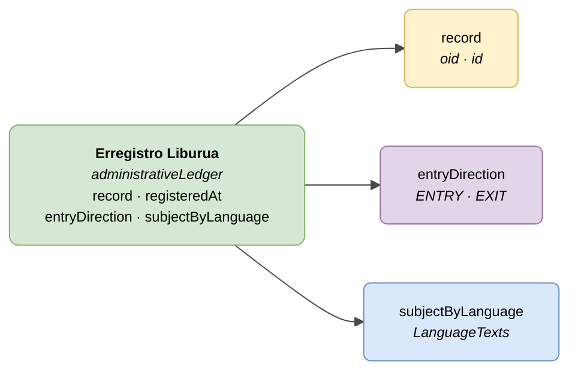

# :material-book-open-page-variant: Erregistro Liburua — Sarrerak/Irteerak (Administrative Ledger)

> - **Bertsioa:** `v{{ dena.version }}`
> - **Data:** {{ dena.date }}
> - **Mota ID (DataTypeID):** `ADMINISTRATIVE_LEDGER`
> - **Testa:** [DN99DENATestMockObjFactoryForAdministrativeLedger.java]({{ repos.interop_test_blob }}/denaTestCommonDataClasses/src/main/java/dena/test/common/data/ledger/DN99DENATestMockObjFactoryForAdministrativeLedger.java) ⚠️ EGIAZTATU GABE
> - **Kodea:** [DN00AdministrativeLedger.java]({{ repos.common_data_api_blob }}/denaCommonDataAPIAdministrativeLedgerModelClasses/src/main/java/dena/api/data/model/ledger/DN00AdministrativeLedger.java)

## Deskribapena

Administrazioaren Sarrera/Irteera Erregistro Liburuaren asientu bat adierazten du. `id` eremua erregistro asientu-zenbakiari dagokio.

> Ikusi baita ere: [campos-comunes.md](./campos-comunes.md) heredatutako eremuetarako (`oid`, `id`, `lastChangedAt`, `urls`, `originAdmin`, `aboutPerson`)



| Kolorea | Esanahia |
|---------|----------|
| 🟢 Berdea | Objektu nagusia (Erregistro Liburua) |
| 🟡 Horia | Beste objektu bati erreferentzia (Espedientea) |
| 🔵 Urdin argia | Datu eremuak |
| 🟣 More | Enumerazioak (asientu norabidea) |

---

## 🔗 Iturburu kodea

| Klasea | Biltegia |
|--------|----------|
| DN00AdministrativeLedger | [Ikusi kodea]({{ repos.common_data_api_blob }}/denaCommonDataAPIAdministrativeLedgerModelClasses/src/main/java/dena/api/data/model/ledger/DN00AdministrativeLedger.java) |
| DN00AdministrativeLedgerEntryDirection | [Ikusi kodea]({{ repos.common_data_api_blob }}/denaCommonDataAPIAdministrativeLedgerModelClasses/src/main/java/dena/api/data/model/ledger/DN00AdministrativeLedgerEntryDirection.java) |

---

## 🧪 Testak eta adibideak

| Testa | Biltegia |
|-------|----------|
| DN99DENATestMockObjFactoryForAdministrativeLedger | [Ikusi testa]({{ repos.interop_test_blob }}/denaTestCommonDataClasses/src/main/java/dena/test/common/data/ledger/DN99DENATestMockObjFactoryForAdministrativeLedger.java) ⚠️ EGIAZTATU GABE |

---

## Eremuak

<span class="field-badge--common">komun</span> markarekin izendatutako eremuak [`DN00DENADataExchangedObjectBase`]({{ repos.common_data_api_blob }}/denaCommonDataAPIModelClasses/src/main/java/dena/api/data/model/DN00DENADataExchangedObjectBase.java)-tik **heredatutakoak** dira. Ikusi [campos-comunes.md](./campos-comunes.md).

| Eremua | Mota | Derrigorrezkoa | Adibidea | Deskribapena |
|--------|------|:--------------:|----------|--------------|
| `type` | `String` | ✅ | `"administrativeLedger"` | Mota diskriminatzailea (beti `"administrativeLedger"`) |
| `oid` <span class="field-badge--common">komun</span> | `String` | ✅ | `"LED-OID-001"` | Identifikatzaile tekniko bakarra |
| `id` <span class="field-badge--common">komun</span> | `String` | ✅ | `"REG-2024-00001"` | Erregistro asientu-zenbakia |
| `lastChangedAt` <span class="field-badge--common">komun</span> | `Instant` | ✅ | `"2026-08-19T08:07:56.742Z"` | Jatorrizko datuen azken aldaketa |
| `record` | `Object` | ❌ | `{"oid":"EXP-OID-001","id":"EXP-2024-00123"}` | Espediente erreferentzia |
| `registeredAt` | `Instant` | ✅ | `"2024-03-15T09:30:00Z"` | Asientua erregistratu zen data eta ordua |
| `entryDirection` | `Object` | ✅ | `{"stateCode":"ENTRY"}` | Asientu norabidea: sarrera edo irteera |
| `subjectByLanguage` | `LanguageTexts` | ✅ | `{"SPANISH":"Solicitud licencia de obras"}` | Erregistro asientuaren gaia hainbat hizkuntzatan |

---

## Asientu norabidea (`entryDirection.stateCode`)

| Kodea | Deskribapena |
|-------|--------------|
| `ENTRY` | Sarrerako asientua (administrazioak jasotako dokumentua) |
| `EXIT` | Irteerako asientua (administrazioak bidalitako dokumentua) |

---

## Adibidea — Sarrerako asientua

<div class="common-highlight" markdown>

```json hl_lines="3 4 5"
{
  "type": "administrativeLedger",
  "oid": "LED-OID-001",
  "id": "REG-2024-00001",
  "lastChangedAt": "2026-08-19T08:07:56.742Z",
  "record": { "oid": "EXP-OID-001", "id": "EXP-2024-00123" },
  "registeredAt": "2024-03-15T09:30:00Z",
  "entryDirection": { "stateCode": "ENTRY" },
  "subjectByLanguage": {
    "SPANISH": "Solicitud de licencia de obras menores",
    "BASQUE": "Obra txikien lizentzia eskabidea"
  }
}
```

<p class="common-fields-legend"><span class="swatch"></span> Nabarmendutako lerroak oinarrizko klasetik <strong>heredatutako eremu komunak</strong> dira (ikusi <a href="./campos-comunes.md">campos-comunes.md</a>).</p>

</div>

---

<!-- DENA-DOC-FOOTER -->
---
<sub>DENA Docs v{{ dena.version }} · {{ dena.date }}</sub>
