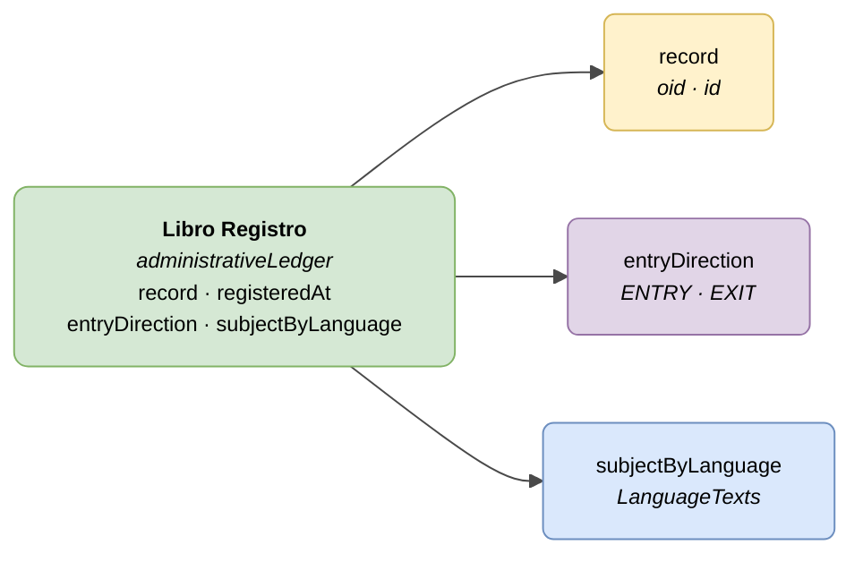

# :material-book-open-page-variant: Libro Registro — Entradas/Salidas (Administrative Ledger)

> - **Versión:** `v{{ dena.version }}`
> - **Fecha:** {{ dena.date }}
> - **ID de Tipo (DataTypeID):** `ADMINISTRATIVE_LEDGER`
> - **Test:** [DN99DENATestMockObjFactoryForAdministrativeLedger.java]({{ repos.interop_test_blob }}/denaTestCommonDataClasses/src/main/java/dena/test/common/data/ledger/DN99DENATestMockObjFactoryForAdministrativeLedger.java) ⚠️ SIN VERIFICAR
> - **Código:** [DN00AdministrativeLedger.java]({{ repos.common_data_api_blob }}/denaCommonDataAPIAdministrativeLedgerModelClasses/src/main/java/dena/api/data/model/ledger/DN00AdministrativeLedger.java)

## Descripción

Representa un asiento en el Registro de Entradas/Salidas (libro registro) de la administración. El campo `id` del objeto corresponde al número de asiento registral.

> Ver también: [campos-comunes.md](./campos-comunes.md) para campos heredados (`oid`, `id`, `lastChangedAt`, `urls`, `originAdmin`, `aboutPerson`)



| Color | Significado |
|-------|-------------|
| 🟢 Verde | Objeto principal (Libro Registro) |
| 🟡 Amarillo | Referencia a otro objeto (Expediente) |
| 🔵 Azul claro | Campos de datos |
| 🟣 Violeta | Enums (dirección del asiento) |

---

## 🔗 Código fuente

| Clase | Repositorio |
|-------|-------------|
| DN00AdministrativeLedger | [Ver código]({{ repos.common_data_api_blob }}/denaCommonDataAPIAdministrativeLedgerModelClasses/src/main/java/dena/api/data/model/ledger/DN00AdministrativeLedger.java) |
| DN00AdministrativeLedgerEntryDirection | [Ver código]({{ repos.common_data_api_blob }}/denaCommonDataAPIAdministrativeLedgerModelClasses/src/main/java/dena/api/data/model/ledger/DN00AdministrativeLedgerEntryDirection.java) |

---

## 🧪 Tests y ejemplos

| Test | Repositorio |
|------|-------------|
| DN99DENATestMockObjFactoryForAdministrativeLedger | [Ver test]({{ repos.interop_test_blob }}/denaTestCommonDataClasses/src/main/java/dena/test/common/data/ledger/DN99DENATestMockObjFactoryForAdministrativeLedger.java) ⚠️ SIN VERIFICAR |

---

## Atributos

Los campos marcados con <span class="field-badge--common">común</span> son **heredados** de [`DN00DENADataExchangedObjectBase`]({{ repos.common_data_api_blob }}/denaCommonDataAPIModelClasses/src/main/java/dena/api/data/model/DN00DENADataExchangedObjectBase.java). Ver [campos-comunes.md](./campos-comunes.md).

| Campo | Tipo | Obligatorio | Ejemplo | Descripción |
|-------|------|:-----------:|---------|-------------|
| `type` | `String` | ✅ | `"administrativeLedger"` | Discriminador de tipo (siempre `"administrativeLedger"`) |
| `oid` <span class="field-badge--common">común</span> | `String` | ✅ | `"LED-OID-001"` | Identificador técnico único |
| `id` <span class="field-badge--common">común</span> | `String` | ✅ | `"REG-2024-00001"` | Número de asiento registral |
| `lastChangedAt` <span class="field-badge--common">común</span> | `Instant` | ✅ | `"2026-08-19T08:07:56.742Z"` | Última modificación del dato en el origen |
| `record` | `Object` | ❌ | `{"oid":"EXP-OID-001","id":"EXP-2024-00123"}` | Referencia al expediente asociado |
| `registeredAt` | `Instant` | ✅ | `"2024-03-15T09:30:00Z"` | Fecha y hora de registro del asiento |
| `entryDirection` | `Object` | ✅ | `{"stateCode":"ENTRY"}` | Dirección del asiento: entrada o salida |
| `subjectByLanguage` | `LanguageTexts` | ✅ | `{"SPANISH":"Solicitud licencia de obras"}` | Asunto del asiento registral en varios idiomas |

---

## Dirección del asiento (`entryDirection.stateCode`)

| Código | Descripción |
|--------|-------------|
| `ENTRY` | Asiento de entrada (documento recibido por la administración) |
| `EXIT` | Asiento de salida (documento enviado por la administración) |

---

## Ejemplo — Asiento de entrada

<div class="common-highlight" markdown>

```json hl_lines="3 4 5"
{
  "type": "administrativeLedger",
  "oid": "LED-OID-001",
  "id": "REG-2024-00001",
  "lastChangedAt": "2026-08-19T08:07:56.742Z",
  "record": { "oid": "EXP-OID-001", "id": "EXP-2024-00123" },
  "registeredAt": "2024-03-15T09:30:00Z",
  "entryDirection": { "stateCode": "ENTRY" },
  "subjectByLanguage": {
    "SPANISH": "Solicitud de licencia de obras menores",
    "BASQUE": "Obra txikien lizentzia eskabidea"
  }
}
```

<p class="common-fields-legend"><span class="swatch"></span> Las líneas resaltadas son los campos <strong>comunes</strong> heredados de la clase base (ver <a href="./campos-comunes.md">campos-comunes.md</a>).</p>

</div>

## Ejemplo — Asiento de salida

<div class="common-highlight" markdown>

```json hl_lines="3 4 5"
{
  "type": "administrativeLedger",
  "oid": "LED-OID-002",
  "id": "REG-2024-00002",
  "lastChangedAt": "2026-08-20T14:00:00Z",
  "record": { "oid": "EXP-OID-001", "id": "EXP-2024-00123" },
  "registeredAt": "2024-03-20T14:00:00Z",
  "entryDirection": { "stateCode": "EXIT" },
  "subjectByLanguage": {
    "SPANISH": "Resolución concesión licencia de obras",
    "BASQUE": "Obra-lizentziaren emakida ebazpena"
  }
}
```

<p class="common-fields-legend"><span class="swatch"></span> Las líneas resaltadas son los campos <strong>comunes</strong> heredados de la clase base (ver <a href="./campos-comunes.md">campos-comunes.md</a>).</p>

</div>

---

## Notas importantes

- El campo `id` contiene el **número de asiento registral** asignado por el sistema de la administración.
- El campo `record` es opcional, aunque es recomendable cuando el asiento está vinculado a un expediente.
- `subjectByLanguage` debe incluir al menos los textos en `SPANISH` y `BASQUE`.
- Un mismo expediente puede tener múltiples asientos (entradas y salidas a lo largo de su tramitación).


---

<!-- DENA-DOC-FOOTER -->
---
<sub>DENA Docs v{{ dena.version }} · {{ dena.date }}</sub>
