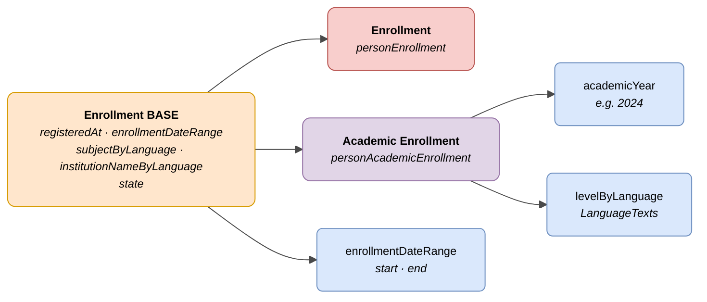

# :material-school: Enrollment (Person Enrollment)

> - **Version:** `v{{ dena.version }}`
> - **Date:** {{ dena.date }}
> - **Type ID (DataTypeID):** `PERSON_ENROLLMENT` · `PERSON_ACADEMIC_ENROLLMENT`
> - **Test:** [DN99DENATestMockObjFactoryForPersonEnrollment.java]({{ repos.interop_test_blob }}/denaTestCommonDataClasses/src/main/java/dena/test/common/data/enrollment/DN99DENATestMockObjFactoryForPersonEnrollment.java)
> - **Code:**
>   - [DN00PersonEnrollmentBase.java]({{ repos.common_data_api_blob }}/denaCommonDataAPIPersonEnrollmentModelClasses/src/main/java/dena/api/data/model/enrollment/DN00PersonEnrollmentBase.java)
>   - [DN00PersonAcademicEnrollment.java]({{ repos.common_data_api_blob }}/denaCommonDataAPIPersonEnrollmentModelClasses/src/main/java/dena/api/data/model/enrollment/academic/DN00PersonAcademicEnrollment.java)

## Description

Represents a person's enrolment in a course, programme or activity. Two variants:

- **Base enrollment** (`personEnrollment`) — Generic enrolment in any activity or programme
- **Academic enrollment** (`personAcademicEnrollment`) — Specialisation with academic year and education level

> See also: [campos-comunes.md](./campos-comunes.md) for inherited fields (`oid`, `id`, `lastChangedAt`, `urls`, `originAdmin`, `aboutPerson`)



---

## 🔗 Source code

| Class | Repository |
|-------|-------------|
| DN00PersonEnrollmentBase | [View code]({{ repos.common_data_api_blob }}/denaCommonDataAPIPersonEnrollmentModelClasses/src/main/java/dena/api/data/model/enrollment/DN00PersonEnrollmentBase.java) |
| DN00PersonAcademicEnrollment | [View code]({{ repos.common_data_api_blob }}/denaCommonDataAPIPersonEnrollmentModelClasses/src/main/java/dena/api/data/model/enrollment/academic/DN00PersonAcademicEnrollment.java) |
| DN00PersonEnrollmentState | [View code]({{ repos.common_data_api_blob }}/denaCommonDataAPIPersonEnrollmentModelClasses/src/main/java/dena/api/data/model/enrollment/DN00PersonEnrollmentState.java) |

---

## 🧪 Tests and examples

| Test | Repository |
|------|-------------|
| DN99DENATestMockObjFactoryForPersonEnrollment | [View test]({{ repos.interop_test_blob }}/denaTestCommonDataClasses/src/main/java/dena/test/common/data/enrollment/DN99DENATestMockObjFactoryForPersonEnrollment.java) |
| DN99DENATestMockObjFactoryForPersonAcademicEnrollment | [View test]({{ repos.interop_test_blob }}/denaTestCommonDataClasses/src/main/java/dena/test/common/data/enrollment/DN99DENATestMockObjFactoryForPersonAcademicEnrollment.java) |

---

## Common attributes

Fields marked with <span class="field-badge--common">common</span> are **inherited** from [`DN00DENADataExchangedObjectBase`]({{ repos.common_data_api_blob }}/denaCommonDataAPIModelClasses/src/main/java/dena/api/data/model/DN00DENADataExchangedObjectBase.java). See [campos-comunes.md](./campos-comunes.md).

| Field | Type | Required | Example | Description |
|-------|------|:--------:|---------|-------------|
| `type` | `String` | ✅ | `"personEnrollment"` | Type discriminator: `"personEnrollment"` or `"personAcademicEnrollment"` |
| `oid` <span class="field-badge--common">common</span> | `String` | ✅ | `"ENR-OID-001"` | Unique technical identifier |
| `id` <span class="field-badge--common">common</span> | `String` | ✅ | `"MAT-2024-00001"` | Business identifier (enrollment number) |
| `lastChangedAt` <span class="field-badge--common">common</span> | `Instant` | ✅ | `"2026-08-19T08:07:56.742Z"` | Last modification of the data at origin |
| `registeredAt` | `Instant` | ✅ | `"2024-09-01T00:00:00Z"` | Date the enrollment was registered |
| `enrollmentDateRange` | `Object` | ✅ | `{"start":"2024-09-01T00:00:00","end":"2025-06-30T00:00:00"}` | Date range of the enrollment period |
| `subjectByLanguage` | `LanguageTexts` | ✅ | `{"SPANISH":"English B2 — Module 3"}` | Course or enrollment name in multiple languages |
| `institutionNameByLanguage` | `LanguageTexts` | ✅ | `{"SPANISH":"IES Zurbaran","BASQUE":"IES Zurbaran"}` | Institution name in multiple languages |
| `state` | `Object` | ✅ | `{"stateCode":"ENROLLED"}` | Enrollment state |

---

## Academic enrollment — Additional attributes

| Field | Type | Required | Example | Description |
|-------|------|:--------:|---------|-------------|
| `academicYear` | `Year` | ✅ | `2024` | Academic year start (e.g. `2024` for 2024-2025) |
| `levelByLanguage` | `LanguageTexts` | ✅ | `{"SPANISH":"Bachillerato","BASQUE":"Batxilergoa"}` | Education level in multiple languages |

---

## Enrollment states (`state.stateCode`)

| Code | Description |
|------|-------------|
| `ENROLLED` | Active enrollment |
| `CANCELLED` | Cancelled enrollment |

---

## Example — Base enrollment

<div class="common-highlight" markdown>

```json hl_lines="3 4 5"
{
  "type": "personEnrollment",
  "oid": "ENR-OID-001",
  "id": "MAT-2024-00001",
  "lastChangedAt": "2026-08-19T08:07:56.742Z",
  "registeredAt": "2024-09-01T00:00:00Z",
  "enrollmentDateRange": {
    "start": "2024-09-01T00:00:00",
    "end": "2025-06-30T00:00:00"
  },
  "subjectByLanguage": { "SPANISH": "Inglés B2 — Módulo 3", "BASQUE": "Ingelesa B2 — 3. modulua" },
  "institutionNameByLanguage": { "SPANISH": "Escuela Oficial de Idiomas Bilbao", "BASQUE": "Bilboko Hizkuntza Eskola Ofiziala" },
  "state": { "stateCode": "ENROLLED" }
}
```

<p class="common-fields-legend"><span class="swatch"></span> Highlighted lines are <strong>common</strong> fields inherited from the base class (see <a href="./campos-comunes.md">campos-comunes.md</a>).</p>

</div>

## Example — Academic enrollment

<div class="common-highlight" markdown>

```json hl_lines="3 4 5"
{
  "type": "personAcademicEnrollment",
  "oid": "ENR-OID-002",
  "id": "MAT-ACAD-2024-00001",
  "lastChangedAt": "2026-09-02T08:00:00Z",
  "registeredAt": "2024-09-02T00:00:00Z",
  "enrollmentDateRange": {
    "start": "2024-09-01T00:00:00",
    "end": "2025-06-30T00:00:00"
  },
  "subjectByLanguage": { "SPANISH": "2º Bachillerato", "BASQUE": "Batxilergoko 2. maila" },
  "institutionNameByLanguage": { "SPANISH": "IES Zabalgana", "BASQUE": "IES Zabalgana" },
  "state": { "stateCode": "ENROLLED" },
  "academicYear": 2024,
  "levelByLanguage": { "SPANISH": "Bachillerato", "BASQUE": "Batxilergoa" }
}
```

<p class="common-fields-legend"><span class="swatch"></span> Highlighted lines are <strong>common</strong> fields inherited from the base class (see <a href="./campos-comunes.md">campos-comunes.md</a>).</p>

</div>

---

## Important notes

- `enrollmentDateRange` uses `LocalDateTime` (without timezone) as enrollment dates are local calendar dates.
- `academicYear` is the start year of the academic year (e.g. `2024` for 2024-2025).
- `personAcademicEnrollment` extends `personEnrollment` and adds `academicYear` and `levelByLanguage`.
- `institutionNameByLanguage` should include at least `SPANISH` and `BASQUE` texts.


---

<!-- DENA-DOC-FOOTER -->
---
<sub>DENA Docs v{{ dena.version }} · {{ dena.date }}</sub>
