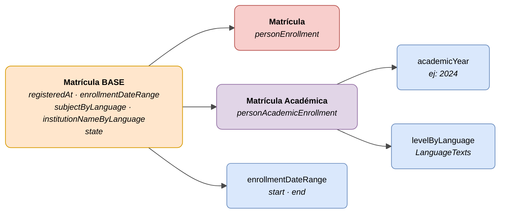

# :material-school: Matrícula (Person Enrollment)

> - **Versión:** `v{{ dena.version }}`
> - **Fecha:** {{ dena.date }}
> - **ID de Tipo (DataTypeID):** `PERSON_ENROLLMENT` · `PERSON_ACADEMIC_ENROLLMENT`
> - **Test:** [DN99DENATestMockObjFactoryForPersonEnrollment.java]({{ repos.interop_test_blob }}/denaTestCommonDataClasses/src/main/java/dena/test/common/data/enrollment/DN99DENATestMockObjFactoryForPersonEnrollment.java)
> - **Código:**
>   - [DN00PersonEnrollmentBase.java]({{ repos.common_data_api_blob }}/denaCommonDataAPIPersonEnrollmentModelClasses/src/main/java/dena/api/data/model/enrollment/DN00PersonEnrollmentBase.java)
>   - [DN00PersonAcademicEnrollment.java]({{ repos.common_data_api_blob }}/denaCommonDataAPIPersonEnrollmentModelClasses/src/main/java/dena/api/data/model/enrollment/academic/DN00PersonAcademicEnrollment.java)

## Descripción

Representa la inscripción o matrícula de una persona en un curso, programa o actividad. Dos variantes:

- **Matrícula base** (`personEnrollment`) — Inscripción genérica en cualquier actividad o programa
- **Matrícula académica** (`personAcademicEnrollment`) — Especialización con año académico y nivel educativo

> Ver también: [campos-comunes.md](./campos-comunes.md) para campos heredados (`oid`, `id`, `lastChangedAt`, `urls`, `originAdmin`, `aboutPerson`)



| Color | Significado |
|-------|-------------|
| 🟠 Naranja | Objeto base (Matrícula BASE) |
| 🔴 Rojo claro | Subtipo: Matrícula base |
| 🟣 Violeta | Subtipo: Matrícula académica |
| 🔵 Azul claro | Campos de datos |

---

## 🔗 Código fuente

| Clase | Repositorio |
|-------|-------------|
| DN00PersonEnrollmentBase | [Ver código]({{ repos.common_data_api_blob }}/denaCommonDataAPIPersonEnrollmentModelClasses/src/main/java/dena/api/data/model/enrollment/DN00PersonEnrollmentBase.java) |
| DN00PersonAcademicEnrollment | [Ver código]({{ repos.common_data_api_blob }}/denaCommonDataAPIPersonEnrollmentModelClasses/src/main/java/dena/api/data/model/enrollment/academic/DN00PersonAcademicEnrollment.java) |
| DN00PersonEnrollmentState | [Ver código]({{ repos.common_data_api_blob }}/denaCommonDataAPIPersonEnrollmentModelClasses/src/main/java/dena/api/data/model/enrollment/DN00PersonEnrollmentState.java) |

---

## 🧪 Tests y ejemplos

| Test | Repositorio |
|------|-------------|
| DN99DENATestMockObjFactoryForPersonEnrollment | [Ver test]({{ repos.interop_test_blob }}/denaTestCommonDataClasses/src/main/java/dena/test/common/data/enrollment/DN99DENATestMockObjFactoryForPersonEnrollment.java) |
| DN99DENATestMockObjFactoryForPersonAcademicEnrollment | [Ver test]({{ repos.interop_test_blob }}/denaTestCommonDataClasses/src/main/java/dena/test/common/data/enrollment/DN99DENATestMockObjFactoryForPersonAcademicEnrollment.java) |

---

## Atributos comunes

Los campos marcados con <span class="field-badge--common">común</span> son **heredados** de [`DN00DENADataExchangedObjectBase`]({{ repos.common_data_api_blob }}/denaCommonDataAPIModelClasses/src/main/java/dena/api/data/model/DN00DENADataExchangedObjectBase.java). Ver [campos-comunes.md](./campos-comunes.md).

| Campo | Tipo | Obligatorio | Ejemplo | Descripción |
|-------|------|:-----------:|---------|-------------|
| `type` | `String` | ✅ | `"personEnrollment"` | Discriminador del tipo: `"personEnrollment"` o `"personAcademicEnrollment"` |
| `oid` <span class="field-badge--common">común</span> | `String` | ✅ | `"ENR-OID-001"` | Identificador técnico único |
| `id` <span class="field-badge--common">común</span> | `String` | ✅ | `"MAT-2024-00001"` | Identificador de negocio (número de matrícula) |
| `lastChangedAt` <span class="field-badge--common">común</span> | `Instant` | ✅ | `"2026-08-19T08:07:56.742Z"` | Última modificación del dato en el origen |
| `registeredAt` | `Instant` | ✅ | `"2024-09-01T00:00:00Z"` | Fecha en que se registró la matrícula |
| `enrollmentDateRange` | `Object` | ✅ | `{"start":"2024-09-01T00:00:00","end":"2025-06-30T00:00:00"}` | Rango de fechas del período de matrícula |
| `subjectByLanguage` | `LanguageTexts` | ✅ | `{"SPANISH":"Inglés B2 — Módulo 3"}` | Nombre del curso o matrícula en varios idiomas |
| `institutionNameByLanguage` | `LanguageTexts` | ✅ | `{"SPANISH":"IES Zurbaran","BASQUE":"IES Zurbaran"}` | Nombre del centro en varios idiomas |
| `state` | `Object` | ✅ | `{"stateCode":"ENROLLED"}` | Estado de la matrícula |

---

## Matrícula académica — Atributos adicionales

| Campo | Tipo | Obligatorio | Ejemplo | Descripción |
|-------|------|:-----------:|---------|-------------|
| `academicYear` | `Year` | ✅ | `2024` | Año académico de inicio (ej: `2024` para el curso 2024-2025) |
| `levelByLanguage` | `LanguageTexts` | ✅ | `{"SPANISH":"Bachillerato","BASQUE":"Batxilergoa"}` | Nivel educativo en varios idiomas |

---

## Estados de la matrícula (`state.stateCode`)

| Código | Descripción |
|--------|-------------|
| `ENROLLED` | Matrícula activa |
| `CANCELLED` | Matrícula cancelada o baja |

---

## Tipo `enrollmentDateRange`

| Campo | Tipo | Descripción |
|-------|------|-------------|
| `start` | `LocalDateTime` | Fecha de inicio del período de matrícula |
| `end` | `LocalDateTime` | Fecha de fin del período de matrícula |

---

## Ejemplo — Matrícula base

<div class="common-highlight" markdown>

```json hl_lines="3 4 5"
{
  "type": "personEnrollment",
  "oid": "ENR-OID-001",
  "id": "MAT-2024-00001",
  "lastChangedAt": "2026-08-19T08:07:56.742Z",
  "registeredAt": "2024-09-01T00:00:00Z",
  "enrollmentDateRange": {
    "start": "2024-09-01T00:00:00",
    "end": "2025-06-30T00:00:00"
  },
  "subjectByLanguage": { "SPANISH": "Inglés B2 — Módulo 3", "BASQUE": "Ingelesa B2 — 3. modulua" },
  "institutionNameByLanguage": { "SPANISH": "Escuela Oficial de Idiomas Bilbao", "BASQUE": "Bilboko Hizkuntza Eskola Ofiziala" },
  "state": { "stateCode": "ENROLLED" }
}
```

<p class="common-fields-legend"><span class="swatch"></span> Las líneas resaltadas son los campos <strong>comunes</strong> heredados de la clase base (ver <a href="./campos-comunes.md">campos-comunes.md</a>).</p>

</div>

## Ejemplo — Matrícula académica

<div class="common-highlight" markdown>

```json hl_lines="3 4 5"
{
  "type": "personAcademicEnrollment",
  "oid": "ENR-OID-002",
  "id": "MAT-ACAD-2024-00001",
  "lastChangedAt": "2026-09-02T08:00:00Z",
  "registeredAt": "2024-09-02T00:00:00Z",
  "enrollmentDateRange": {
    "start": "2024-09-01T00:00:00",
    "end": "2025-06-30T00:00:00"
  },
  "subjectByLanguage": { "SPANISH": "2º Bachillerato", "BASQUE": "Batxilergoko 2. maila" },
  "institutionNameByLanguage": { "SPANISH": "IES Zabalgana", "BASQUE": "IES Zabalgana" },
  "state": { "stateCode": "ENROLLED" },
  "academicYear": 2024,
  "levelByLanguage": { "SPANISH": "Bachillerato", "BASQUE": "Batxilergoa" }
}
```

<p class="common-fields-legend"><span class="swatch"></span> Las líneas resaltadas son los campos <strong>comunes</strong> heredados de la clase base (ver <a href="./campos-comunes.md">campos-comunes.md</a>).</p>

</div>

---

## Notas importantes

- `enrollmentDateRange` utiliza `LocalDateTime` (sin zona horaria), ya que las fechas de matrícula son fechas de calendario local.
- `academicYear` es el año de inicio del curso (ej: `2024` para el curso 2024-2025).
- `personAcademicEnrollment` extiende `personEnrollment` y añade `academicYear` y `levelByLanguage`.
- `institutionNameByLanguage` debe incluir al menos textos en `SPANISH` y `BASQUE`.


---

<!-- DENA-DOC-FOOTER -->
---
<sub>DENA Docs v{{ dena.version }} · {{ dena.date }}</sub>
