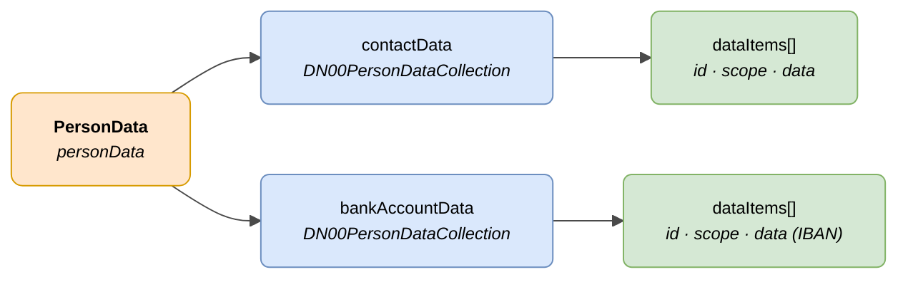

# :material-account-circle: Person (PersonData)

> - **Version:** `v{{ dena.version }}`
> - **Date:** {{ dena.date }}
> - **Type ID (DataTypeID):** `PERSON_DATA`
> - **Test:** [DN99DENATestMockObjFactoryForPersonData.java]({{ repos.interop_test_blob }}/denaTestCommonDataClasses/src/main/java/dena/test/common/data/persondata/DN99DENATestMockObjFactoryForPersonData.java)
> - **Code:** [DN00PersonData.java]({{ repos.common_data_api_blob }}/denaCommonDataAPIPersonDataModelClasses/src/main/java/dena/api/data/model/persondata/DN00PersonData.java)

## Description

The **PersonData** model (`DN00PersonData`) represents the data of a person exchanged between the administration and DENA: contact information and bank account data.

!!! warning "NOT identified object — no oid or id"
    `DN00PersonData` extends `DN00DENADataExchangedNOTIdentifiedObject` instead of `DN00DENADataExchangedObjectBase`. This means this object **does NOT have** the fields `oid` or `id`, but **DOES have** `lastChangedAt`, `urls`, `originAdmin` and `aboutPerson` (inherited from the base class `DN00DENADataExchangedNOTIdentifiedObject`).



| Colour | Meaning |
|--------|---------|
| 🟠 Orange | Main object (PersonData) |
| 🔵 Light blue | Data blocks (collections) |
| 🟢 Light green | Individual items within each collection |

---

## 🔗 Source code

| Class | Repository |
|-------|------------|
| DN00PersonData | [View code]({{ repos.common_data_api_blob }}/denaCommonDataAPIPersonDataModelClasses/src/main/java/dena/api/data/model/persondata/DN00PersonData.java) |
| DN00PersonDataCollection | [View code]({{ repos.common_data_api_blob }}/denaCommonDataAPIPersonDataModelClasses/src/main/java/dena/api/data/model/persondata/DN00PersonDataCollection.java) |
| DN00PersonDataItemBase | [View code]({{ repos.common_data_api_blob }}/denaCommonDataAPIPersonDataModelClasses/src/main/java/dena/api/data/model/persondata/DN00PersonDataItemBase.java) |
| DN00PersonDataItemForContact | [View code]({{ repos.common_data_api_blob }}/denaCommonDataAPIPersonDataModelClasses/src/main/java/dena/api/data/model/persondata/DN00PersonDataItemForContact.java) |
| DN00PersonDataItemForBankAccount | [View code]({{ repos.common_data_api_blob }}/denaCommonDataAPIPersonDataModelClasses/src/main/java/dena/api/data/model/persondata/DN00PersonDataItemForBankAccount.java) |
| DN00PersonDataCategory | [View code]({{ repos.common_data_api_blob }}/denaCommonDataAPIPersonDataModelClasses/src/main/java/dena/api/data/model/persondata/DN00PersonDataCategory.java) |

---

## 🧪 Tests and examples

> Repository: [DENA-Euskadi/dena-interop-common-data-test]({{ repos.interop_test_tree }})

| Mock Factory | Repository |
|--------------|------------|
| DN99DENATestMockObjFactoryForPersonData | [View code]({{ repos.interop_test_blob }}/denaTestCommonDataClasses/src/main/java/dena/test/common/data/persondata/DN99DENATestMockObjFactoryForPersonData.java) |

---

## PersonData — JSON attributes

| Field | Type | Mandatory | Example | Description |
|-------|------|:---------:|---------|-------------|
| `type` | `String` | ✅ | `"personData"` | Polymorphic discriminator |
| ~~`oid`~~ | — | — | — | **Does not exist** in this type |
| ~~`id`~~ | — | — | — | **Does not exist** in this type |
| `lastChangedAt` | `Instant` | ✅ | `"2026-08-19T08:07:56.742Z"` | Last change of the data at the origin. DENA-CORE uses it to compute the NEW/UPDATED/UNCHANGED state |
| `contactData` | `Object` | ❌ | *(see [Contact data](#contact-data-contactdata))* | Contact data collection |
| `contactData.dataCategory` | `String` | ✅ | `"CONTACT"` | Always `"CONTACT"` for contact data |
| `contactData.dataItems` | `Array` | ✅ | — | List of contact items |
| `contactData.dataItems[].id` | `String` | ✅ | `"contact-001"` | Item identifier |
| `contactData.dataItems[].scope` | `String` | ❌ | `"INDIVIDUAL"` | Scope of the contact data |
| `contactData.dataItems[].data` | `Object` | ✅ | *(r01f ContactInfo — see note)* | Contact information ⚠️ Internal structure UNVERIFIED |
| `bankAccountData` | `Object` | ❌ | *(see [Bank data](#bank-data-bankaccountdata))* | Bank account data collection |
| `bankAccountData.dataCategory` | `String` | ✅ | `"BANK_ACCOUNT"` | Always `"BANK_ACCOUNT"` |
| `bankAccountData.dataItems` | `Array` | ✅ | — | List of bank accounts |
| `bankAccountData.dataItems[].id` | `String` | ✅ | `"bank-001"` | Item identifier |
| `bankAccountData.dataItems[].scope` | `String` | ❌ | `"INDIVIDUAL"` | Scope of the bank data |
| `bankAccountData.dataItems[].data` | `String` | ✅ | `"ES9121000418450200051332"` | IBAN or other bank account identifier |

---

## Contact data (`contactData`)

!!! info "r01f ContactInfo type pending documentation"
    The internal structure of the `data` field in each `contactData` item is the r01f `ContactInfo` type. It may contain phones, emails, postal addresses, web URL, etc. Detailed documentation of its structure will be completed in a future version. Consult with the DENA team for the available fields.

---

## Bank data (`bankAccountData`)

The `data` field in each `bankAccountData` item is a `String` containing the IBAN or other bank account identifier (r01f `FinantialIDs.BankAccountID` type).

---

## JSON example

<div class="common-highlight" markdown>

```json
{
  "type": "personData",
  "lastChangedAt": "2026-08-19T08:07:56.742Z",
  "contactData": {
    "dataCategory": "CONTACT",
    "dataItems": [
      {
        "id": "contact-001",
        "scope": "INDIVIDUAL",
        "data": "⚠️ UNVERIFIED — internal structure of r01f ContactInfo type pending documentation with the DENA team"
      }
    ]
  },
  "bankAccountData": {
    "dataCategory": "BANK_ACCOUNT",
    "dataItems": [
      {
        "id": "bank-001",
        "scope": "INDIVIDUAL",
        "data": "ES9121000418450200051332"
      }
    ]
  }
}
```

</div>

---

## Important notes

- `DN00PersonData` extends `DN00DENADataExchangedNOTIdentifiedObject`, **not** the usual base class. For this reason it **does not have** `oid` or `id`, but **does have** `lastChangedAt`, `urls`, `originAdmin` and `aboutPerson`.
- The internal structure of the r01f `ContactInfo` type (`data` field in each `contactData` item) is **pending verification and documentation**. Consult with the DENA team.
- The `data` field in each `bankAccountData` item is directly a `String` containing the account number (IBAN or other format).


---

<!-- DENA-DOC-FOOTER -->
---
<sub>DENA Docs v{{ dena.version }} · {{ dena.date }}</sub>
