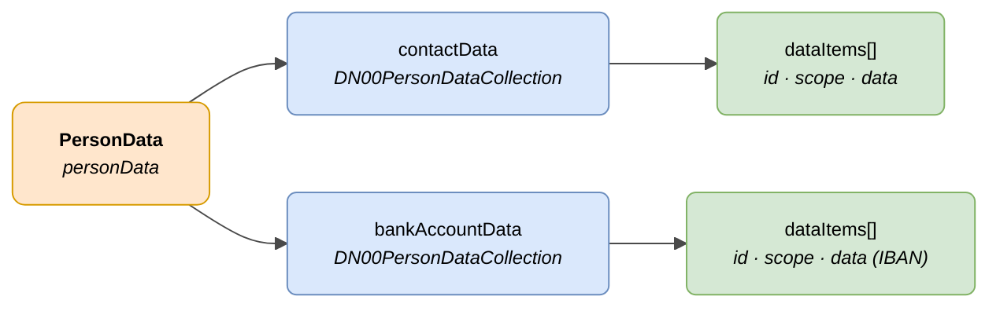

# :material-account-circle: Pertsona (PersonData)

> - **Bertsioa:** `v{{ dena.version }}`
> - **Data:** {{ dena.date }}
> - **Mota ID (DataTypeID):** `PERSON_DATA`
> - **Testa:** [DN99DENATestMockObjFactoryForPersonData.java]({{ repos.interop_test_blob }}/denaTestCommonDataClasses/src/main/java/dena/test/common/data/persondata/DN99DENATestMockObjFactoryForPersonData.java)
> - **Kodea:** [DN00PersonData.java]({{ repos.common_data_api_blob }}/denaCommonDataAPIPersonDataModelClasses/src/main/java/dena/api/data/model/persondata/DN00PersonData.java)

## Deskribapena

**PersonData** ereduak (`DN00PersonData`) administrazioaren eta DENAren artean trukatutako herritarren datuak adierazten ditu: kontaktu-informazioa eta banku-kontuaren datuak.

!!! warning "Identifikatu GABEKO objektua — oid eta id gabe"
    `DN00PersonData`-k `DN00DENADataExchangedNOTIdentifiedObject` hedatzen du `DN00DENADataExchangedObjectBase` erabiliz beharrean. Horrek esan nahi du objektu honek **EZ dituela** `oid` eta `id` eremuak, baina **BAI dituela** `lastChangedAt`, `urls`, `originAdmin` eta `aboutPerson` (`DN00DENADataExchangedNOTIdentifiedObject` oinarrizko klasetik heredatuak).



| Kolorea | Esanahia |
|---------|----------|
| 🟠 Laranja | Objektu nagusia (PersonData) |
| 🔵 Urdin argia | Datu-blokeak (bildumak) |
| 🟢 Berde argia | Bilduma bakoitzeko banako ítems-ak |

---

## 🔗 Iturburu-kodea

| Klasea | Biltegia |
|--------|----------|
| DN00PersonData | [Ikusi kodea]({{ repos.common_data_api_blob }}/denaCommonDataAPIPersonDataModelClasses/src/main/java/dena/api/data/model/persondata/DN00PersonData.java) |
| DN00PersonDataCollection | [Ikusi kodea]({{ repos.common_data_api_blob }}/denaCommonDataAPIPersonDataModelClasses/src/main/java/dena/api/data/model/persondata/DN00PersonDataCollection.java) |
| DN00PersonDataItemBase | [Ikusi kodea]({{ repos.common_data_api_blob }}/denaCommonDataAPIPersonDataModelClasses/src/main/java/dena/api/data/model/persondata/DN00PersonDataItemBase.java) |
| DN00PersonDataItemForContact | [Ikusi kodea]({{ repos.common_data_api_blob }}/denaCommonDataAPIPersonDataModelClasses/src/main/java/dena/api/data/model/persondata/DN00PersonDataItemForContact.java) |
| DN00PersonDataItemForBankAccount | [Ikusi kodea]({{ repos.common_data_api_blob }}/denaCommonDataAPIPersonDataModelClasses/src/main/java/dena/api/data/model/persondata/DN00PersonDataItemForBankAccount.java) |
| DN00PersonDataCategory | [Ikusi kodea]({{ repos.common_data_api_blob }}/denaCommonDataAPIPersonDataModelClasses/src/main/java/dena/api/data/model/persondata/DN00PersonDataCategory.java) |

---

## 🧪 Testak eta adibideak

> Biltegia: [DENA-Euskadi/dena-interop-common-data-test]({{ repos.interop_test_tree }})

| Mock Factory | Biltegia |
|--------------|----------|
| DN99DENATestMockObjFactoryForPersonData | [Ikusi kodea]({{ repos.interop_test_blob }}/denaTestCommonDataClasses/src/main/java/dena/test/common/data/persondata/DN99DENATestMockObjFactoryForPersonData.java) |

---

## PersonData — JSON atributuak

| Eremua | Mota | Derrigorrez | Adibidea | Deskribapena |
|--------|------|:-----------:|----------|--------------|
| `type` | `String` | ✅ | `"personData"` | Diskriminatzaile polimorfiko |
| ~~`oid`~~ | — | — | — | **Ez da existitzen** mota honetan |
| ~~`id`~~ | — | — | — | **Ez da existitzen** mota honetan |
| `lastChangedAt` | `Instant` | ✅ | `"2026-08-19T08:07:56.742Z"` | Datuaren azken aldaketa jatorrian. DENA-COREk erabiltzen du NEW/UPDATED/UNCHANGED egoera kalkulatzeko |
| `contactData` | `Object` | ❌ | *(ikusi [Kontaktu-datuak](#kontaktu-datuak-contactdata))* | Kontaktu-datuen bilduma |
| `contactData.dataCategory` | `String` | ✅ | `"CONTACT"` | Beti `"CONTACT"` kontaktu-datuetarako |
| `contactData.dataItems` | `Array` | ✅ | — | Kontaktu-ítems-en zerrenda |
| `contactData.dataItems[].id` | `String` | ✅ | `"contact-001"` | Ítem-aren identifikatzailea |
| `contactData.dataItems[].scope` | `String` | ❌ | `"INDIVIDUAL"` | Kontaktu-datuaren esparrua |
| `contactData.dataItems[].data` | `Object` | ✅ | *(r01f ContactInfo — ikusi oharra)* | Kontaktu-informazioa ⚠️ Barne-egitura EGIAZTATU GABE |
| `bankAccountData` | `Object` | ❌ | *(ikusi [Banku-datuak](#banku-datuak-bankaccountdata))* | Banku-kontuen datuen bilduma |
| `bankAccountData.dataCategory` | `String` | ✅ | `"BANK_ACCOUNT"` | Beti `"BANK_ACCOUNT"` |
| `bankAccountData.dataItems` | `Array` | ✅ | — | Banku-kontuen zerrenda |
| `bankAccountData.dataItems[].id` | `String` | ✅ | `"bank-001"` | Ítem-aren identifikatzailea |
| `bankAccountData.dataItems[].scope` | `String` | ❌ | `"INDIVIDUAL"` | Banku-datuaren esparrua |
| `bankAccountData.dataItems[].data` | `String` | ✅ | `"ES9121000418450200051332"` | IBAN edo beste banku-kontu identifikatzaile bat |

---

## Kontaktu-datuak (`contactData`)

!!! info "r01f ContactInfo mota dokumentatzeko"
    `contactData`-ko ítem bakoitzaren `data` eremuaren barne-egitura r01f `ContactInfo` motakoa da. Telefonoak, emailak, posta-helbideak, web URLa, etab. eduki ditzake. Bere egituraren dokumentazio xehatua hurrengo bertsio batean osatuko da. Eskuragarri dauden eremuetarako, DENA taldearekin harremanetan jarri.

---

## Banku-datuak (`bankAccountData`)

`bankAccountData`-ko ítem bakoitzaren `data` eremua `String` bat da IBAN edo beste banku-kontu identifikatzaile bat duena (r01f `FinantialIDs.BankAccountID` mota).

---

## JSON adibidea

<div class="common-highlight" markdown>

```json
{
  "type": "personData",
  "lastChangedAt": "2026-08-19T08:07:56.742Z",
  "contactData": {
    "dataCategory": "CONTACT",
    "dataItems": [
      {
        "id": "contact-001",
        "scope": "INDIVIDUAL",
        "data": "⚠️ EGIAZTATU GABE — r01f ContactInfo motaren barne-egitura DENA taldearekin dokumentatzeko"
      }
    ]
  },
  "bankAccountData": {
    "dataCategory": "BANK_ACCOUNT",
    "dataItems": [
      {
        "id": "bank-001",
        "scope": "INDIVIDUAL",
        "data": "ES9121000418450200051332"
      }
    ]
  }
}
```

</div>

---

## Ohar garrantzitsuak

- `DN00PersonData`-k `DN00DENADataExchangedNOTIdentifiedObject` hedatzen du, oinarrizko klase arrunta ez. Hori dela eta **ez ditu** `oid` eta `id`, baina **bai ditu** `lastChangedAt`, `urls`, `originAdmin` eta `aboutPerson`.
- r01f `ContactInfo` motaren barne-egitura (`contactData`-ko ítem bakoitzaren `data` eremua) **egiaztatu eta dokumentatzeko dago**. DENA taldearekin harremanetan jarri.
- `bankAccountData`-ko ítem bakoitzaren `data` eremua zuzenean `String` bat da kontu-zenbakiarekin (IBAN edo beste formatu bat).


---

<!-- DENA-DOC-FOOTER -->
---
<sub>DENA Docs v{{ dena.version }} · {{ dena.date }}</sub>
