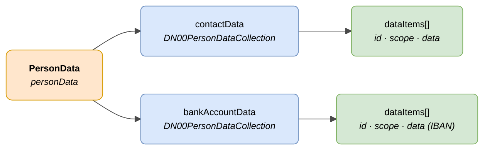

# :material-account-circle: Persona (PersonData)

> - **Versión:** `v{{ dena.version }}`
> - **Fecha:** {{ dena.date }}
> - **ID de Tipo (DataTypeID):** `PERSON_DATA`
> - **Test:** [DN99DENATestMockObjFactoryForPersonData.java]({{ repos.interop_test_blob }}/denaTestCommonDataClasses/src/main/java/dena/test/common/data/persondata/DN99DENATestMockObjFactoryForPersonData.java)
> - **Código:** [DN00PersonData.java]({{ repos.common_data_api_blob }}/denaCommonDataAPIPersonDataModelClasses/src/main/java/dena/api/data/model/persondata/DN00PersonData.java)

## Descripción

El modelo **PersonData** (`DN00PersonData`) representa los datos de una persona ciudadana intercambiados entre la administración y DENA: información de contacto y datos bancarios.

!!! warning "Objeto NO identificado — sin oid ni id"
    `DN00PersonData` extiende `DN00DENADataExchangedNOTIdentifiedObject` en lugar de `DN00DENADataExchangedObjectBase`. Esto significa que este objeto **NO tiene** los campos `oid` ni `id`, pero **SÍ tiene** `lastChangedAt`, `urls`, `originAdmin` y `aboutPerson` (heredados de la clase base `DN00DENADataExchangedNOTIdentifiedObject`).



| Color | Significado |
|-------|-------------|
| 🟠 Naranja | Objeto principal (PersonData) |
| 🔵 Azul claro | Bloques de datos (colecciones) |
| 🟢 Verde claro | Ítems individuales dentro de cada colección |

---

## 🔗 Código fuente

| Clase | Repositorio |
|-------|-------------|
| DN00PersonData | [Ver código]({{ repos.common_data_api_blob }}/denaCommonDataAPIPersonDataModelClasses/src/main/java/dena/api/data/model/persondata/DN00PersonData.java) |
| DN00PersonDataCollection | [Ver código]({{ repos.common_data_api_blob }}/denaCommonDataAPIPersonDataModelClasses/src/main/java/dena/api/data/model/persondata/DN00PersonDataCollection.java) |
| DN00PersonDataItemBase | [Ver código]({{ repos.common_data_api_blob }}/denaCommonDataAPIPersonDataModelClasses/src/main/java/dena/api/data/model/persondata/DN00PersonDataItemBase.java) |
| DN00PersonDataItemForContact | [Ver código]({{ repos.common_data_api_blob }}/denaCommonDataAPIPersonDataModelClasses/src/main/java/dena/api/data/model/persondata/DN00PersonDataItemForContact.java) |
| DN00PersonDataItemForBankAccount | [Ver código]({{ repos.common_data_api_blob }}/denaCommonDataAPIPersonDataModelClasses/src/main/java/dena/api/data/model/persondata/DN00PersonDataItemForBankAccount.java) |
| DN00PersonDataCategory | [Ver código]({{ repos.common_data_api_blob }}/denaCommonDataAPIPersonDataModelClasses/src/main/java/dena/api/data/model/persondata/DN00PersonDataCategory.java) |

---

## 🧪 Tests y ejemplos

> Repositorio: [DENA-Euskadi/dena-interop-common-data-test]({{ repos.interop_test_tree }})

| Mock Factory | Repositorio |
|--------------|-------------|
| DN99DENATestMockObjFactoryForPersonData | [Ver código]({{ repos.interop_test_blob }}/denaTestCommonDataClasses/src/main/java/dena/test/common/data/persondata/DN99DENATestMockObjFactoryForPersonData.java) |

---

## PersonData — Atributos JSON

| Campo | Tipo | Obligatorio | Ejemplo | Descripción |
|-------|------|:-----------:|---------|-------------|
| `type` | `String` | ✅ | `"personData"` | Discriminador polimórfico |
| ~~`oid`~~ | — | — | — | **No existe** en este tipo |
| ~~`id`~~ | — | — | — | **No existe** en este tipo |
| `lastChangedAt` | `Instant` | ✅ | `"2026-08-19T08:07:56.742Z"` | Última modificación del dato en el origen. DENA-CORE lo usa para calcular el estado NEW/UPDATED/UNCHANGED |
| `contactData` | `Object` | ❌ | *(ver [Datos de contacto](#datos-de-contacto-contactdata))* | Colección de datos de contacto |
| `contactData.dataCategory` | `String` | ✅ | `"CONTACT"` | Siempre `"CONTACT"` para datos de contacto |
| `contactData.dataItems` | `Array` | ✅ | — | Lista de ítems de contacto |
| `contactData.dataItems[].id` | `String` | ✅ | `"contact-001"` | Identificador del ítem |
| `contactData.dataItems[].scope` | `String` | ❌ | `"INDIVIDUAL"` | Ámbito del dato de contacto |
| `contactData.dataItems[].data` | `Object` | ✅ | *(r01f ContactInfo — ver nota)* | Información de contacto ⚠️ SIN VERIFICAR estructura interna |
| `bankAccountData` | `Object` | ❌ | *(ver [Datos bancarios](#datos-bancarios-bankaccountdata))* | Colección de datos bancarios |
| `bankAccountData.dataCategory` | `String` | ✅ | `"BANK_ACCOUNT"` | Siempre `"BANK_ACCOUNT"` |
| `bankAccountData.dataItems` | `Array` | ✅ | — | Lista de cuentas bancarias |
| `bankAccountData.dataItems[].id` | `String` | ✅ | `"bank-001"` | Identificador del ítem |
| `bankAccountData.dataItems[].scope` | `String` | ❌ | `"INDIVIDUAL"` | Ámbito del dato bancario |
| `bankAccountData.dataItems[].data` | `String` | ✅ | `"ES9121000418450200051332"` | IBAN u otro identificador de cuenta bancaria |

---

## Datos de contacto (`contactData`)

!!! info "Tipo r01f ContactInfo pendiente de documentar"
    La estructura interna del campo `data` de cada ítem de `contactData` es el tipo r01f `ContactInfo`. Puede contener teléfonos, emails, direcciones postales, URL de web, etc. La documentación detallada de su estructura se completará en una próxima versión. Consulta con el equipo DENA para obtener el detalle de los campos disponibles.

---

## Datos bancarios (`bankAccountData`)

El campo `data` de cada ítem de `bankAccountData` es un `String` con el IBAN u otro identificador de cuenta bancaria (tipo r01f `FinantialIDs.BankAccountID`).

---

## Ejemplo JSON

<div class="common-highlight" markdown>

```json
{
  "type": "personData",
  "lastChangedAt": "2026-08-19T08:07:56.742Z",
  "contactData": {
    "dataCategory": "CONTACT",
    "dataItems": [
      {
        "id": "contact-001",
        "scope": "INDIVIDUAL",
        "data": "⚠️ SIN VERIFICAR — estructura del tipo r01f ContactInfo pendiente de documentar con el equipo DENA"
      }
    ]
  },
  "bankAccountData": {
    "dataCategory": "BANK_ACCOUNT",
    "dataItems": [
      {
        "id": "bank-001",
        "scope": "INDIVIDUAL",
        "data": "ES9121000418450200051332"
      }
    ]
  }
}
```

</div>

---

## Notas importantes

- `DN00PersonData` extiende `DN00DENADataExchangedNOTIdentifiedObject`, **no** la clase base habitual. Por eso **no tiene** `oid` ni `id`, pero **sí tiene** `lastChangedAt`, `urls`, `originAdmin` y `aboutPerson`.
- La estructura interna del tipo r01f `ContactInfo` (campo `data` en cada ítem de `contactData`) está **pendiente de verificar y documentar**. Consulta con el equipo DENA.
- El campo `data` en cada ítem de `bankAccountData` es directamente un `String` con el número de cuenta (IBAN u otro formato).


---

<!-- DENA-DOC-FOOTER -->
---
<sub>DENA Docs v{{ dena.version }} · {{ dena.date }}</sub>
