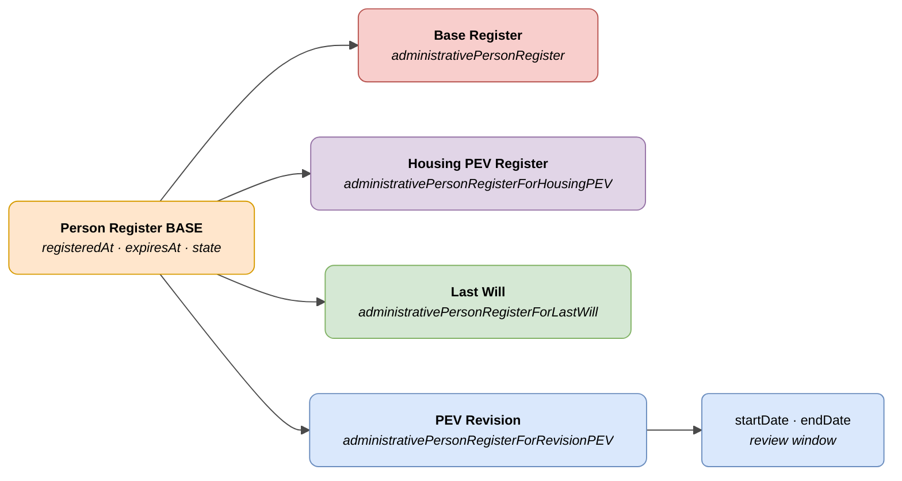

# :material-account-card: Person Register (Administrative Person Register)

> - **Version:** `v{{ dena.version }}`
> - **Date:** {{ dena.date }}
> - **Type ID (DataTypeID):** `ADMINISTRATIVE_PERSON_REGISTER` · `ADMINISTRATIVE_PERSON_REGISTER_FOR_HOUSING_PEV` · `ADMINISTRATIVE_PERSON_REGISTER_FOR_LAST_WILL` · `ADMINISTRATIVE_PERSON_REGISTER_FOR_REVISION_PEV`
> - **Test:** [DN99DENATestMockObjFactoryForAdministrativePersonRegister.java]({{ repos.interop_test_blob }}/denaTestCommonDataClasses/src/main/java/dena/test/common/data/personregister/DN99DENATestMockObjFactoryForAdministrativePersonRegister.java) ⚠️ UNVERIFIED
> - **Code:**
>   - [DN00AdministrativePersonRegisterEntryBase.java]({{ repos.common_data_api_blob }}/denaCommonDataAPIAdministrativePersonRegisterModelClasses/src/main/java/dena/api/data/model/personregister/DN00AdministrativePersonRegisterEntryBase.java)
>   - [DN00AdministrativePersonRegisterForHousingPEV.java]({{ repos.common_data_api_blob }}/denaCommonDataAPIAdministrativePersonRegisterModelClasses/src/main/java/dena/api/data/model/personregister/datatypes/DN00AdministrativePersonRegisterForHousingPEV.java)
>   - [DN00AdministrativePersonRegisterForLastWill.java]({{ repos.common_data_api_blob }}/denaCommonDataAPIAdministrativePersonRegisterModelClasses/src/main/java/dena/api/data/model/personregister/datatypes/DN00AdministrativePersonRegisterForLastWill.java)
>   - [DN00AdministrativePersonRegisterForRevisionPEV.java]({{ repos.common_data_api_blob }}/denaCommonDataAPIAdministrativePersonRegisterModelClasses/src/main/java/dena/api/data/model/personregister/datatypes/DN00AdministrativePersonRegisterForRevisionPEV.java)

## Description

Represents a person's enrolment in an administrative register. The `id` field is the register number. Four variants:

- **Base register** (`administrativePersonRegister`) — Generic register entry
- **Housing PEV register** (`administrativePersonRegisterForHousingPEV`) — Register for Housing Economic Benefit
- **Last Will register** (`administrativePersonRegisterForLastWill`) — Last Will register
- **PEV revision** (`administrativePersonRegisterForRevisionPEV`) — Record of the next PEV revision, with a review window

> See also: [campos-comunes.md](./campos-comunes.md) for inherited fields (`oid`, `id`, `lastChangedAt`, `urls`, `originAdmin`, `aboutPerson`)



---

## 🔗 Source code

| Class | Repository |
|-------|-------------|
| DN00AdministrativePersonRegisterEntryBase | [View code]({{ repos.common_data_api_blob }}/denaCommonDataAPIAdministrativePersonRegisterModelClasses/src/main/java/dena/api/data/model/personregister/DN00AdministrativePersonRegisterEntryBase.java) |
| DN00AdministrativePersonRegisterForHousingPEV | [View code]({{ repos.common_data_api_blob }}/denaCommonDataAPIAdministrativePersonRegisterModelClasses/src/main/java/dena/api/data/model/personregister/datatypes/DN00AdministrativePersonRegisterForHousingPEV.java) |
| DN00AdministrativePersonRegisterForLastWill | [View code]({{ repos.common_data_api_blob }}/denaCommonDataAPIAdministrativePersonRegisterModelClasses/src/main/java/dena/api/data/model/personregister/datatypes/DN00AdministrativePersonRegisterForLastWill.java) |
| DN00AdministrativePersonRegisterForRevisionPEV | [View code]({{ repos.common_data_api_blob }}/denaCommonDataAPIAdministrativePersonRegisterModelClasses/src/main/java/dena/api/data/model/personregister/datatypes/DN00AdministrativePersonRegisterForRevisionPEV.java) |

---

## 🧪 Tests and examples

| Test | Repository |
|------|-------------|
| DN99DENATestMockObjFactoryForAdministrativePersonRegister | [View test]({{ repos.interop_test_blob }}/denaTestCommonDataClasses/src/main/java/dena/test/common/data/personregister/DN99DENATestMockObjFactoryForAdministrativePersonRegister.java) ⚠️ UNVERIFIED |

---

## Common attributes

Fields marked with <span class="field-badge--common">common</span> are **inherited** from [`DN00DENADataExchangedObjectBase`]({{ repos.common_data_api_blob }}/denaCommonDataAPIModelClasses/src/main/java/dena/api/data/model/DN00DENADataExchangedObjectBase.java). See [campos-comunes.md](./campos-comunes.md).

| Field | Type | Required | Example | Description |
|-------|------|:--------:|---------|-------------|
| `type` | `String` | ✅ | `"administrativePersonRegister"` | Type discriminator |
| `oid` <span class="field-badge--common">common</span> | `String` | ✅ | `"REG-OID-001"` | Unique technical identifier |
| `id` <span class="field-badge--common">common</span> | `String` | ✅ | `"REG-2024-00001"` | Register number |
| `lastChangedAt` <span class="field-badge--common">common</span> | `Instant` | ✅ | `"2026-08-19T08:07:56.742Z"` | Last modification of the data at origin |
| `registeredAt` | `Instant` | ✅ | `"2023-09-01T00:00:00Z"` | Registration date |
| `expiresAt` | `Instant` | ❌ | `"2025-09-01T00:00:00Z"` | Expiry date (null if indefinite) |
| `state` | `Object` | ✅ | `{"stateCode":"ACTIVE"}` | Registration state |

---

## PEV Revision — Additional attributes

| Field | Type | Required | Example | Description |
|-------|------|:--------:|---------|-------------|
| `startDate` | `Instant` | ✅ | `"2025-01-01T00:00:00Z"` | Start of the revision window |
| `endDate` | `Instant` | ✅ | `"2025-03-31T00:00:00Z"` | End of the revision window |

---

## Register states (`state.stateCode`)

| Code | Description |
|------|-------------|
| `REGISTERED` | Registered (pending activation) |
| `ACTIVE` | Active and valid registration |
| `EXPIRED` | Expired registration |
| `CANCELLED` | Cancelled registration |

---

## Example — Housing PEV register

<div class="common-highlight" markdown>

```json hl_lines="3 4 5"
{
  "type": "administrativePersonRegisterForHousingPEV",
  "oid": "REG-OID-001",
  "id": "REG-PEV-2024-00001",
  "lastChangedAt": "2026-08-19T08:07:56.742Z",
  "registeredAt": "2023-09-01T00:00:00Z",
  "expiresAt": "2025-09-01T00:00:00Z",
  "state": { "stateCode": "ACTIVE" }
}
```

<p class="common-fields-legend"><span class="swatch"></span> Highlighted lines are <strong>common</strong> fields inherited from the base class (see <a href="./campos-comunes.md">campos-comunes.md</a>).</p>

</div>

## Example — PEV revision

<div class="common-highlight" markdown>

```json hl_lines="3 4 5"
{
  "type": "administrativePersonRegisterForRevisionPEV",
  "oid": "REG-OID-002",
  "id": "REVPEV-2025-00001",
  "lastChangedAt": "2026-08-19T08:07:56.742Z",
  "registeredAt": "2024-09-01T00:00:00Z",
  "expiresAt": null,
  "state": { "stateCode": "ACTIVE" },
  "startDate": "2025-01-01T00:00:00Z",
  "endDate": "2025-03-31T00:00:00Z"
}
```

<p class="common-fields-legend"><span class="swatch"></span> Highlighted lines are <strong>common</strong> fields inherited from the base class (see <a href="./campos-comunes.md">campos-comunes.md</a>).</p>

</div>

---

## Important notes

- The `id` field is the **register number** assigned by the administration's system.
- `administrativePersonRegisterForHousingPEV` and `administrativePersonRegisterForLastWill` have no additional fields compared to the base register.
- `administrativePersonRegisterForRevisionPEV` adds `startDate` and `endDate` to indicate the time window for the next PEV revision.
- A citizen may have registrations of different types active simultaneously.


---

<!-- DENA-DOC-FOOTER -->
---
<sub>DENA Docs v{{ dena.version }} · {{ dena.date }}</sub>
