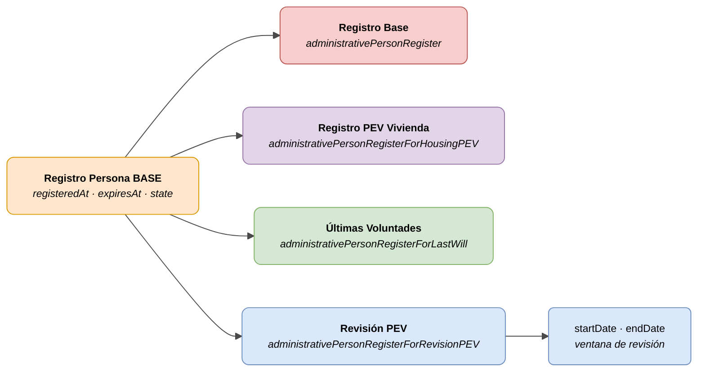

# :material-account-card: Registro de Persona (Administrative Person Register)

> - **Versión:** `v{{ dena.version }}`
> - **Fecha:** {{ dena.date }}
> - **ID de Tipo (DataTypeID):** `ADMINISTRATIVE_PERSON_REGISTER` · `ADMINISTRATIVE_PERSON_REGISTER_FOR_HOUSING_PEV` · `ADMINISTRATIVE_PERSON_REGISTER_FOR_LAST_WILL` · `ADMINISTRATIVE_PERSON_REGISTER_FOR_REVISION_PEV`
> - **Test:** [DN99DENATestMockObjFactoryForAdministrativePersonRegister.java]({{ repos.interop_test_blob }}/denaTestCommonDataClasses/src/main/java/dena/test/common/data/personregister/DN99DENATestMockObjFactoryForAdministrativePersonRegister.java) ⚠️ SIN VERIFICAR
> - **Código:**
>   - [DN00AdministrativePersonRegisterEntryBase.java]({{ repos.common_data_api_blob }}/denaCommonDataAPIAdministrativePersonRegisterModelClasses/src/main/java/dena/api/data/model/personregister/DN00AdministrativePersonRegisterEntryBase.java)
>   - [DN00AdministrativePersonRegisterForHousingPEV.java]({{ repos.common_data_api_blob }}/denaCommonDataAPIAdministrativePersonRegisterModelClasses/src/main/java/dena/api/data/model/personregister/datatypes/DN00AdministrativePersonRegisterForHousingPEV.java)
>   - [DN00AdministrativePersonRegisterForLastWill.java]({{ repos.common_data_api_blob }}/denaCommonDataAPIAdministrativePersonRegisterModelClasses/src/main/java/dena/api/data/model/personregister/datatypes/DN00AdministrativePersonRegisterForLastWill.java)
>   - [DN00AdministrativePersonRegisterForRevisionPEV.java]({{ repos.common_data_api_blob }}/denaCommonDataAPIAdministrativePersonRegisterModelClasses/src/main/java/dena/api/data/model/personregister/datatypes/DN00AdministrativePersonRegisterForRevisionPEV.java)

## Descripción

Representa la inscripción de una persona en un registro administrativo. El campo `id` es el número de registro. Cuatro variantes:

- **Registro base** (`administrativePersonRegister`) — Inscripción genérica en registro
- **Registro PEV de Vivienda** (`administrativePersonRegisterForHousingPEV`) — Registro de Prestación Sujeta a Vivienda
- **Registro de Últimas Voluntades** (`administrativePersonRegisterForLastWill`) — Registro de últimas voluntades
- **Revisión PEV** (`administrativePersonRegisterForRevisionPEV`) — Registro de la próxima revisión de una PEV, con ventana de revisión

> Ver también: [campos-comunes.md](./campos-comunes.md) para campos heredados (`oid`, `id`, `lastChangedAt`, `urls`, `originAdmin`, `aboutPerson`)



| Color | Significado |
|-------|-------------|
| 🟠 Naranja | Objeto base (Registro Persona BASE) |
| 🔴 Rojo claro | Subtipo: Registro Base |
| 🟣 Violeta | Subtipo: Registro PEV Vivienda |
| 🟢 Verde | Subtipo: Últimas Voluntades |
| 🔵 Azul claro | Subtipo: Revisión PEV + campos de ventana de revisión |

---

## 🔗 Código fuente

| Clase | Repositorio |
|-------|-------------|
| DN00AdministrativePersonRegisterEntryBase | [Ver código]({{ repos.common_data_api_blob }}/denaCommonDataAPIAdministrativePersonRegisterModelClasses/src/main/java/dena/api/data/model/personregister/DN00AdministrativePersonRegisterEntryBase.java) |
| DN00AdministrativePersonRegisterForHousingPEV | [Ver código]({{ repos.common_data_api_blob }}/denaCommonDataAPIAdministrativePersonRegisterModelClasses/src/main/java/dena/api/data/model/personregister/datatypes/DN00AdministrativePersonRegisterForHousingPEV.java) |
| DN00AdministrativePersonRegisterForLastWill | [Ver código]({{ repos.common_data_api_blob }}/denaCommonDataAPIAdministrativePersonRegisterModelClasses/src/main/java/dena/api/data/model/personregister/datatypes/DN00AdministrativePersonRegisterForLastWill.java) |
| DN00AdministrativePersonRegisterForRevisionPEV | [Ver código]({{ repos.common_data_api_blob }}/denaCommonDataAPIAdministrativePersonRegisterModelClasses/src/main/java/dena/api/data/model/personregister/datatypes/DN00AdministrativePersonRegisterForRevisionPEV.java) |
| DN00AdministrativePersonRegisterEntryState | [Ver código]({{ repos.common_data_api_blob }}/denaCommonDataAPIAdministrativePersonRegisterModelClasses/src/main/java/dena/api/data/model/personregister/DN00AdministrativePersonRegisterEntryState.java) |

---

## 🧪 Tests y ejemplos

| Test | Repositorio |
|------|-------------|
| DN99DENATestMockObjFactoryForAdministrativePersonRegister | [Ver test]({{ repos.interop_test_blob }}/denaTestCommonDataClasses/src/main/java/dena/test/common/data/personregister/DN99DENATestMockObjFactoryForAdministrativePersonRegister.java) ⚠️ SIN VERIFICAR |

---

## Atributos comunes

Los campos marcados con <span class="field-badge--common">común</span> son **heredados** de [`DN00DENADataExchangedObjectBase`]({{ repos.common_data_api_blob }}/denaCommonDataAPIModelClasses/src/main/java/dena/api/data/model/DN00DENADataExchangedObjectBase.java). Ver [campos-comunes.md](./campos-comunes.md).

| Campo | Tipo | Obligatorio | Ejemplo | Descripción |
|-------|------|:-----------:|---------|-------------|
| `type` | `String` | ✅ | `"administrativePersonRegister"` | Discriminador del tipo |
| `oid` <span class="field-badge--common">común</span> | `String` | ✅ | `"REG-OID-001"` | Identificador técnico único |
| `id` <span class="field-badge--common">común</span> | `String` | ✅ | `"REG-2024-00001"` | Número de registro |
| `lastChangedAt` <span class="field-badge--common">común</span> | `Instant` | ✅ | `"2026-08-19T08:07:56.742Z"` | Última modificación del dato en el origen |
| `registeredAt` | `Instant` | ✅ | `"2023-09-01T00:00:00Z"` | Fecha de inscripción |
| `expiresAt` | `Instant` | ❌ | `"2025-09-01T00:00:00Z"` | Fecha de expiración (null si no caduca) |
| `state` | `Object` | ✅ | `{"stateCode":"ACTIVE"}` | Estado de la inscripción |

---

## Revisión PEV — Atributos adicionales

| Campo | Tipo | Obligatorio | Ejemplo | Descripción |
|-------|------|:-----------:|---------|-------------|
| `startDate` | `Instant` | ✅ | `"2025-01-01T00:00:00Z"` | Inicio de la ventana de revisión |
| `endDate` | `Instant` | ✅ | `"2025-03-31T00:00:00Z"` | Fin de la ventana de revisión |

---

## Estados del registro (`state.stateCode`)

| Código | Descripción |
|--------|-------------|
| `REGISTERED` | Inscrito (pendiente de activación) |
| `ACTIVE` | Inscripción activa y vigente |
| `EXPIRED` | Inscripción caducada |
| `CANCELLED` | Inscripción cancelada |

---

## Tipos de registro (`type`)

| Tipo | DataTypeID | Descripción |
|------|-----------|-------------|
| `administrativePersonRegister` | `ADMINISTRATIVE_PERSON_REGISTER` | Registro genérico de persona |
| `administrativePersonRegisterForHousingPEV` | `ADMINISTRATIVE_PERSON_REGISTER_FOR_HOUSING_PEV` | Registro Prestación Sujeta a Vivienda (PEV) |
| `administrativePersonRegisterForLastWill` | `ADMINISTRATIVE_PERSON_REGISTER_FOR_LAST_WILL` | Registro de Últimas Voluntades |
| `administrativePersonRegisterForRevisionPEV` | `ADMINISTRATIVE_PERSON_REGISTER_FOR_REVISION_PEV` | Próxima revisión PEV (con ventana de revisión) |

---

## Ejemplo — Registro PEV de Vivienda

<div class="common-highlight" markdown>

```json hl_lines="3 4 5"
{
  "type": "administrativePersonRegisterForHousingPEV",
  "oid": "REG-OID-001",
  "id": "REG-PEV-2024-00001",
  "lastChangedAt": "2026-08-19T08:07:56.742Z",
  "registeredAt": "2023-09-01T00:00:00Z",
  "expiresAt": "2025-09-01T00:00:00Z",
  "state": { "stateCode": "ACTIVE" }
}
```

<p class="common-fields-legend"><span class="swatch"></span> Las líneas resaltadas son los campos <strong>comunes</strong> heredados de la clase base (ver <a href="./campos-comunes.md">campos-comunes.md</a>).</p>

</div>

## Ejemplo — Revisión PEV

<div class="common-highlight" markdown>

```json hl_lines="3 4 5"
{
  "type": "administrativePersonRegisterForRevisionPEV",
  "oid": "REG-OID-002",
  "id": "REVPEV-2025-00001",
  "lastChangedAt": "2026-08-19T08:07:56.742Z",
  "registeredAt": "2024-09-01T00:00:00Z",
  "expiresAt": null,
  "state": { "stateCode": "ACTIVE" },
  "startDate": "2025-01-01T00:00:00Z",
  "endDate": "2025-03-31T00:00:00Z"
}
```

<p class="common-fields-legend"><span class="swatch"></span> Las líneas resaltadas son los campos <strong>comunes</strong> heredados de la clase base (ver <a href="./campos-comunes.md">campos-comunes.md</a>).</p>

</div>

## Ejemplo — Registro de Últimas Voluntades

<div class="common-highlight" markdown>

```json hl_lines="3 4 5"
{
  "type": "administrativePersonRegisterForLastWill",
  "oid": "REG-OID-003",
  "id": "ULT-VOLUNTADES-2022-00001",
  "lastChangedAt": "2026-01-10T00:00:00Z",
  "registeredAt": "2022-06-15T00:00:00Z",
  "expiresAt": null,
  "state": { "stateCode": "ACTIVE" }
}
```

<p class="common-fields-legend"><span class="swatch"></span> Las líneas resaltadas son los campos <strong>comunes</strong> heredados de la clase base (ver <a href="./campos-comunes.md">campos-comunes.md</a>).</p>

</div>

---

## Notas importantes

- El campo `id` es el **número de registro** asignado por el sistema de la administración.
- `administrativePersonRegisterForHousingPEV` y `administrativePersonRegisterForLastWill` no tienen campos adicionales respecto al registro base.
- `administrativePersonRegisterForRevisionPEV` añade `startDate` y `endDate` para indicar la ventana de tiempo en que se producirá la próxima revisión de la PEV.
- Un mismo ciudadano puede tener registros de distintos tipos activos simultáneamente.


---

<!-- DENA-DOC-FOOTER -->
---
<sub>DENA Docs v{{ dena.version }} · {{ dena.date }}</sub>
