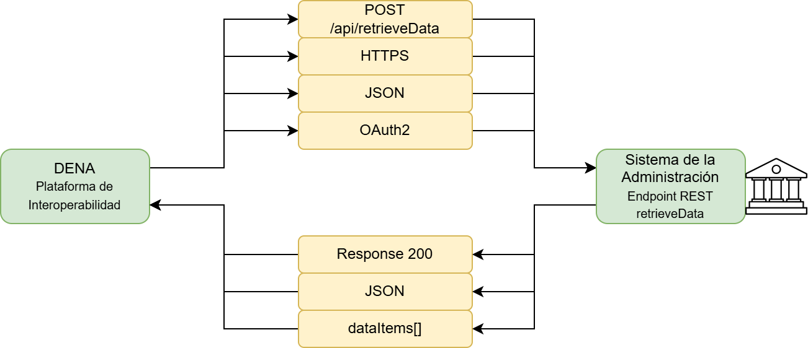
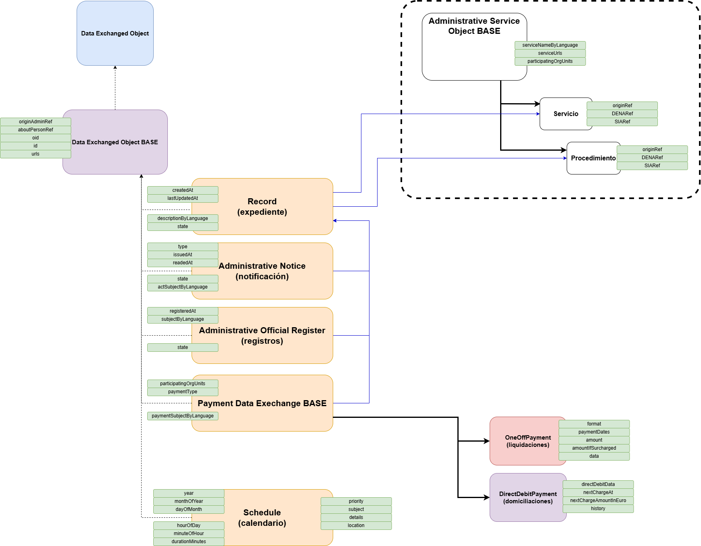
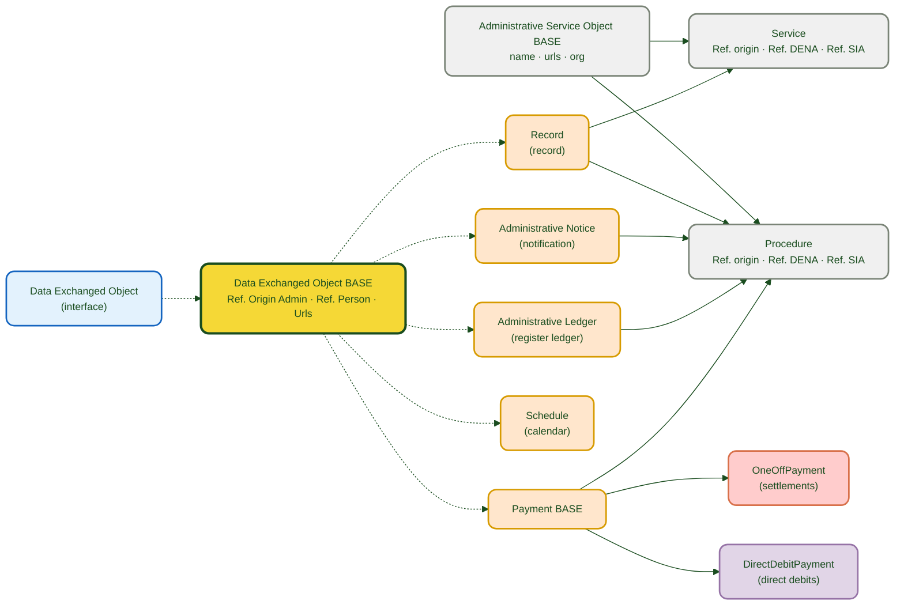
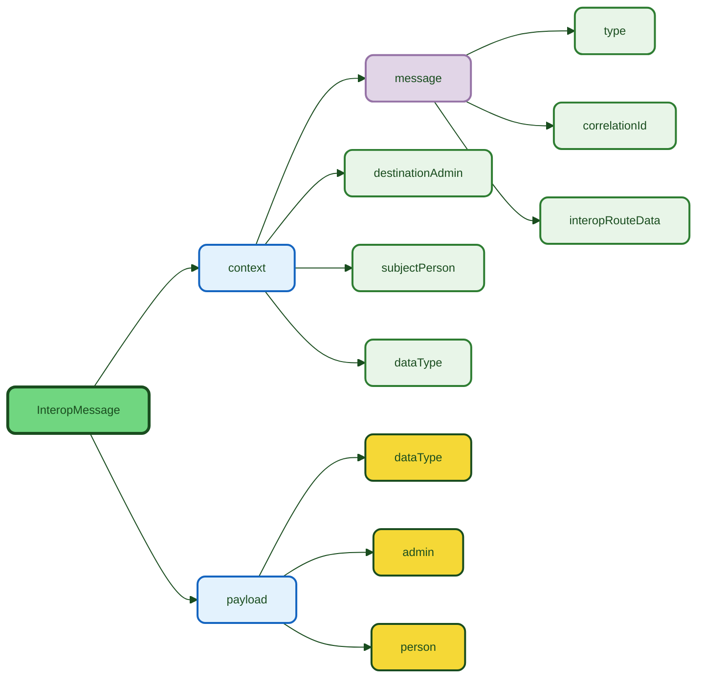
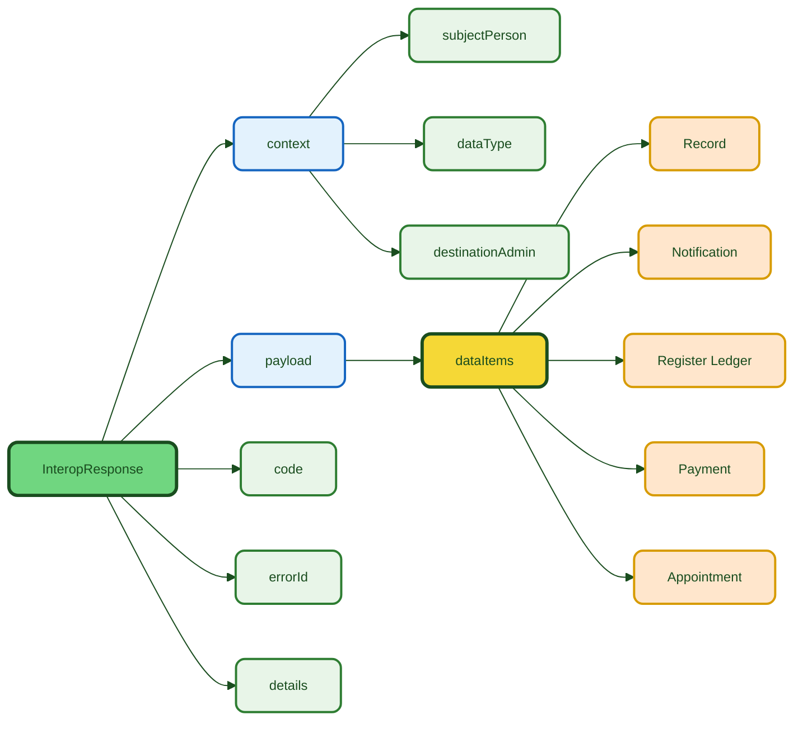

# :material-database-arrow-right: DATA-RETRIEVE

> **Version:** `v{{ dena.version }}` · **Date:** {{ dena.date }}

## What is it?

**Data-Retrieve** is the mechanism through which DENA requests each public administration for a citizen's data. The administration exposes a REST endpoint and returns the data objects in normalized JSON format.

---

## Context diagram



---

## Conceptual Model



---

## Data model



| Color | Meaning |
|-------|-------------|
| 🔵 Light blue | Base interface (contract) |
| 🟣 Violet | Abstract base class |
| 🟠 Orange | Exchanged domain objects |
| 🔴 Light red | One-off payment (OneOffPayment) |
| ⚪ Light gray | Hierarchical context (Service / Procedure) |

| Line | Meaning |
|-------|-------------|
| Dashed | Inheritance ("extends") |
| Solid | Composition / reference |

---

## Documentation

!!! tip "Start here"

    [:octicons-arrow-right-24: **Step-by-step implementation guide**](./guia-implementacion.md) — Everything you need to implement the endpoint in your administration.

### Endpoint

| Document | Content |
|---|---|
| [:octicons-arrow-right-24: Endpoint](./endpoint-data-retrieve.md) | REST contract: request, response, JSON examples and HTTP codes |

### Data objects

??? note "View all data objects"

    | Object | Description | Document |
    |---|---|---|
    | **:material-folder-open: Record** | Administrative record in processing | [expediente.md](./data/expediente.md) |
    | **:material-email-open: Notification** | Official notification or communication | [notificacion.md](./data/notificacion.md) |
    | **:material-credit-card: Payment** | One-off payment or direct debit | [pago.md](./data/pago.md) |
    | **:material-calendar-clock: Appointment** | Prior appointment or agenda item | [cita.md](./data/cita.md) |
    | **:material-account-circle: Person** | Citizen's data | [persona.md](./data/persona.md) |
    | **:material-card-account-details: Person credential** | Cards, degrees and language profiles | [credencial-persona.md](./data/credencial-persona.md) |
    | **:material-cash: Economic benefit** | Grants and subsidies | [beneficio-economico.md](./data/beneficio-economico.md) |
    | **:material-book-open-page-variant: Register Ledger** | Incoming/outgoing register entry | [libro-registro.md](./data/libro-registro.md) |
    | **:material-account-box-multiple: Person register** | Person register (PEV, last will…) | [registro-persona.md](./data/registro-persona.md) |
    | **:material-school: Enrollment** | Enrollments and academic enrollments | [matricula.md](./data/matricula.md) |
    | **:material-medical-bag: Medical data** | Medical data (GDPR special category) | [datos-medicos.md](./data/datos-medicos.md) |
    | **:material-cog: Administrative Service** | Service and procedure | [servicio-administrativo.md](./data/servicio-administrativo.md) |
    | **:material-office-building: Organic Unit** | Participating organizational unit | [unidad-organica.md](./data/unidad-organica.md) |
    | **:material-book-off: Official Register** *(deprecated)* | ⚠️ Replaced by Register Ledger | [registro-oficial.md](./data/registro-oficial.md) |

### Complementary guides

| Document | Content |
|---|---|
| [:material-database-outline: Common fields](./data/campos-comunes.md) | Fields inherited by all objects (OID, ID, URLs, refs) |
| [Validations](./validaciones.md) | Validation rules, formats and constraints |
| [Errors and troubleshooting](./errores-troubleshooting.md) | Guide to common errors and their resolution |
| [Code snippets](./snippets-codigo.md) | Implementation in Java, C#, Python, Node.js and PHP |

---

## Flow summary

1. DENA sends `POST /api/retrieveData` with the person's identifier and the data type
2. The administration identifies the person (`context.subjectPerson`)
3. The administration filters by data type (`context.dataType`)
4. The administration returns the objects in `payload.dataItems[]`

### Data types (`dataType.id`)

The `id` of `dataType` corresponds to the marshallTypeId of each object (enum `DN00DataTypeEnum`):

| `dataType.id` | Expected data |
|--------------|-----------------|
| `ADMINISTRATIVE_RECORD` | Records |
| `ADMINISTRATIVE_NOTICE` | Notifications |
| `PAYMENT_ONE_OFF_PAYMENT` / `PAYMENT_DIRECT_DEBIT_PAYMENT` | Payments |
| `SCHEDULE` | Appointments |
| `PERSON_DATA` | Person data |
| `PERSON_CREDENTIAL` / `PERSON_CREDENTIAL_FOR_BASQUE_LANGUAGE_DEGREE` | Person credentials |
| `ECONOMIC_BENEFIT` | Economic benefits |
| `ADMINISTRATIVE_LEDGER` | Register ledger |
| `ADMINISTRATIVE_PERSON_REGISTER` (+ `…FOR_HOUSING_PEV` / `…FOR_LAST_WILL` / `…FOR_REVISION_PEV`) | Person register |
| `PERSON_ENROLLMENT` / `PERSON_ACADEMIC_ENROLLMENT` | Enrollments |
| `PERSON_MEDICAL_DATA` | Medical data |

> **Note:** The full list (17 types from the `DN00DataTypeEnum` enum) is in [DataTypeRef](../semantica-base/modelo/data-type-ref.md). The `ADMINISTRATIVE_OFFICIAL_REGISTER_RECORD` type is **deprecated**; use `ADMINISTRATIVE_LEDGER`.

---

## Request structure



```json
{
    "context": {
        "message": {
            "type": "CLIENT_RETRIEVE_REQ",
            "correlationId": "541ECEAE-228B-4588-9504-44D9094322B5",
            "interopRouteData": [
                {
                    "denaComponentId": "DENA_ADMIN_CONNECTOR",
                    "timestamp": "2026-11-09T20:37:55.847000900Z"
                }
            ]
        },
        "destinationAdmin": {
            "id": "SANDBOXCIF",
            "oid": "6d9d73d4-3d3d-6d3d-ad3d-3d3d3d3d3011"
        },
        "subjectPerson": {
            "id": "11189396B",
            "oid": "631011F3-9A2F-4D08-9F56-B7F4D6A0749E"
        },
        "dataType": {
            "id": "SCHEDULE",
            "oid": "7e0e84e5-4e4e-7e4e-be4e-4e4e4e4e4006"
        }
    },
    "payload": {
        "dataType": {
            "id": "SCHEDULE",
            "oid": "7e0e84e5-4e4e-7e4e-be4e-4e4e4e4e4006"
        },
        "admin": {
            "id": "SANDBOXCIF",
            "oid": "6d9d73d4-3d3d-6d3d-ad3d-3d3d3d3d3011"
        },
        "person": {
            "id": "11189396B",
            "oid": "631011F3-9A2F-4D08-9F56-B7F4D6A0749E"
        }
    }
}
```

| Field | Required | Description |
|-------|:-----------:|-------------|
| `context.message.type` | ✅ | Message type. See [`DN00InteropMessageType`]({{ repos.common_api_blob }}/denaCommonAPIModelClasses/src/main/java/dena/api/common/interop/context/DN00InteropMessageType.java) |
| `context.message.correlationId` | ✅ | Correlation UUID for traceability. See [`DN00InteropMessageData`]({{ repos.common_api_blob }}/denaCommonAPIModelClasses/src/main/java/dena/api/common/interop/context/DN00InteropMessageData.java) |
| `context.message.interopRouteData` | ❌ | Component trace. See [`DN00IteropRouteDataItem`]({{ repos.common_api_blob }}/denaCommonAPIModelClasses/src/main/java/dena/api/common/interop/context/DN00IteropRouteDataItem.java) |
| `context.dataType` | ✅ | Requested data type. See [`DN00DataTypeEnum`]({{ repos.common_data_api_blob }}/denaCommonDataAPIModelClasses/src/main/java/dena/api/data/model/DN00DataTypeEnum.java) |
| `context.destinationAdmin` | ✅ | Destination administration. See [`DN00InteropContext`]({{ repos.common_api_blob }}/denaCommonAPIModelClasses/src/main/java/dena/api/common/interop/context/DN00InteropContext.java) |
| `context.subjectPerson` | ✅ | Person for whom data is requested. See [`DN00InteropContext`]({{ repos.common_api_blob }}/denaCommonAPIModelClasses/src/main/java/dena/api/common/interop/context/DN00InteropContext.java) |
| `payload.dataType` | ✅ | Data type requested (replica of `context.dataType`). See [`DN00DataTypeEnum`]({{ repos.common_data_api_blob }}/denaCommonDataAPIModelClasses/src/main/java/dena/api/data/model/DN00DataTypeEnum.java) |
| `payload.admin` | ✅ | Destination administration (replica of `context.destinationAdmin`) |
| `payload.person` | ✅ | Person whose data is requested (replica of `context.subjectPerson`) |

### Message types (`message.type`)

| Value | Description |
|-------|-------------|
| `CLIENT_RETRIEVE_REQ` | Data retrieval request — this is the type your endpoint receives |
| `CLIENT_RETRIEVE_RESP` | Response you return with the requested data |

See the full list of values in [Message Types](../semantica-base/modelo/message-types.md).

### Route trace (`interopRouteData`)

Each time the message passes through a DENA component, a trace entry is added:

| Field | Type | Description |
|-------|------|-------------|
| `denaComponentId` | `DN00InteropComponent` | Component identifier (`CLIENT_INSTALLMENT`, `DENA_CORE`, `DENA_ADMIN_CONNECTOR`, `ADMIN`) |
| `timestamp` | `String` (ISO 8601) | Moment when the component processed the message |

---

## Response structure



```json
{
    "context": {
        "message": {
            "type": "CLIENT_RETRIEVE_RESP",
            "correlationId": "541ECEAE-228B-4588-9504-44D9094322B5",
            "interopRouteData": [
                {
                    "denaComponentId": "DENA_ADMIN_CONNECTOR",
                    "timestamp": "2026-11-09T20:37:55.8470009Z"
                },
                {
                    "denaComponentId": "DENA_ADMIN",
                    "timestamp": "2026-11-10T08:17:46.029Z"
                }
            ]
        },
        "destinationAdmin": {
            "id": "SANDBOXCIF",
            "oid": "6d9d73d4-3d3d-6d3d-ad3d-3d3d3d3d3011"
        },
        "subjectPerson": {
            "id": "11189396B",
            "oid": "631011F3-9A2F-4D08-9F56-B7F4D6A0749E"
        },
        "dataType": {
            "id": "SCHEDULE",
            "oid": "7e0e84e5-4e4e-7e4e-be4e-4e4e4e4e4006"
        }
    },
    "payload": {
        "dataItems": [
            {
                "data": {
                    "type": "scheduleItem",
                    "dayOfMonth": "20",

                    "durationMinutes": 30,
                    "hourOfDay": "10",
                    "id": "SANDBOX-SCHED-1794256626566",
                    "lastChangedAt": "2026-11-09T20:37:06.5668985Z",
                    "minuteOfHour": "0",
                    "monthOfYear": "9",
                    "oid": "D8815353-5B1D-47DE-9B65-57ABB58CEDAB",
                    "priority": "MEDIUM",
                    "subject": {
                        "SPANISH": "Título de familia numerosa",
                        "BASQUE": "Título de familia numerosa"
                    },
                    "urls": [
                        {
                            "id": "48D2",
                            "tags": [
                                "default"
                            ],
                            "value": "https://sandbox.dena.eus/schedules"
                        }
                    ],
                    "year": "2040"
                }
            },
            {
                "data": {
                    "type": "scheduleItem",
                    "dayOfMonth": "22",

                    "durationMinutes": 30,
                    "hourOfDay": "10",
                    "id": "SANDBOX-SCHED-1794256564175",
                    "lastChangedAt": "2026-11-09T20:36:04.1756730Z",
                    "minuteOfHour": "0",
                    "monthOfYear": "12",
                    "oid": "A03F751D-E58B-4767-A0A6-35A7859B3EAA",
                    "priority": "MEDIUM",
                    "subject": {
                        "SPANISH": "Caducidad BakQ",
                        "BASQUE": "Caducidad BakQ"
                    },
                    "urls": [
                        {
                            "id": "AA46",
                            "tags": [
                                "default"
                            ],
                            "value": "https://sandbox.dena.eus/schedules"
                        }
                    ],
                    "year": "2026"
                }
            },
            {
                "data": {
                    "type": "scheduleItem",
                    "dayOfMonth": "12",

                    "durationMinutes": 30,
                    "hourOfDay": "10",
                    "id": "SANDBOX-SCHED-1794256666986",
                    "lastChangedAt": "2026-11-09T20:37:46.9870283Z",
                    "minuteOfHour": "0",
                    "monthOfYear": "11",
                    "oid": "31FB5F96-0F9E-491C-B70A-A126F056C12B",
                    "priority": "MEDIUM",
                    "subject": {
                        "SPANISH": "Cita Osakidetza",
                        "BASQUE": "Cita Osakidetza"
                    },
                    "urls": [
                        {
                            "id": "A754",
                            "tags": [
                                "default"
                            ],
                            "value": "https://sandbox.dena.eus/schedules"
                        }
                    ],
                    "year": "2026"
                }
            }
        ]
    }
}
```

| Field | Description |
|-------|-------------|
| `context` | Echo of the received context (the message type indicates the response) |
| `payload.dataItems` | Array of data objects; each wrapped in a `"data"` field |
| `code` | Response status (`DN00InteropResponseStatus`) |
| `errorId` | Specific error code (optional, only on errors) |
| `details` | Descriptive error message (optional) |

> **Important:** Each element in `dataItems` contains the data object wrapped in a `"data"` field. The `data.type` field identifies the concrete object type (e.g. `scheduleItem`). See each data type's documentation for the full structure.

### Status codes (`code`)

| Code | Description |
|--------|-------------|
| `OK` | Message processed correctly |
| `CLIENT_ERR` | Client error (malformed request, invalid data) |
| `SERVER_ERR` | Server error (internal error) |
| `QUEUED` | Message queued for asynchronous processing |

### HTTP codes

| Code | Meaning |
|--------|-------------|
| `200` | Data returned correctly (may be an empty list) |
| `400` | Malformed request |
| `401` | Unauthorized |
| `404` | Person not found |
| `500` | Internal error |

---

## Glossary

| Term | Description |
|---------|-------------|
| OID | Unique technical identifier (assigned by the system) |
| ID | Business identifier (readable, assigned by the administration) |
| DIR3 | Common Directory of Organic Units and Offices of the AGE |
| SIA | Administrative Information System (AGE service catalog) |
| LanguageTexts | Multilanguage object with keys `SPANISH`, `BASQUE`, `ENGLISH` |
| dataItems | Array of domain objects returned by the administration |
| interopRouteData | Trace of DENA components the message has passed through. See [`DN00IteropRouteDataItem`]({{ repos.common_api_blob }}/denaCommonAPIModelClasses/src/main/java/dena/api/common/interop/context/DN00IteropRouteDataItem.java) |
| correlationId | UUID that allows correlating request and response. See [`DN00InteropMessageData`]({{ repos.common_api_blob }}/denaCommonAPIModelClasses/src/main/java/dena/api/common/interop/context/DN00InteropMessageData.java) |


<!-- DENA-DOC-FOOTER -->
---
<sub>DENA Docs v{{ dena.version }} · {{ dena.date }}</sub>
