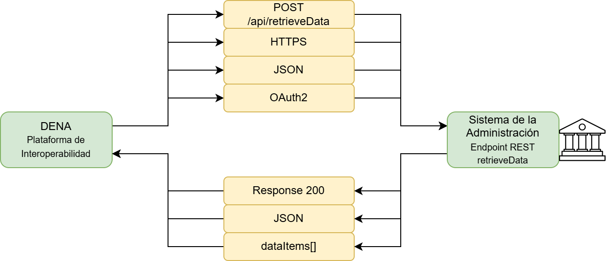
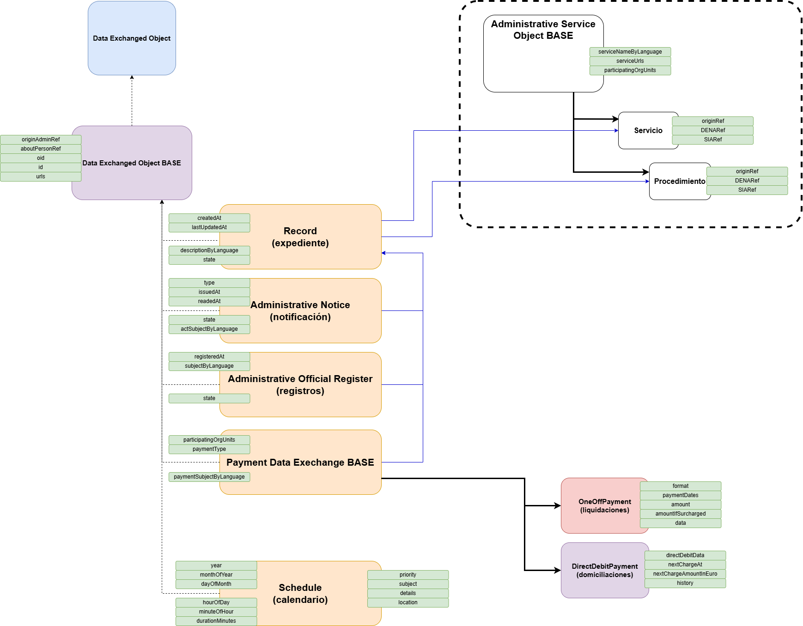
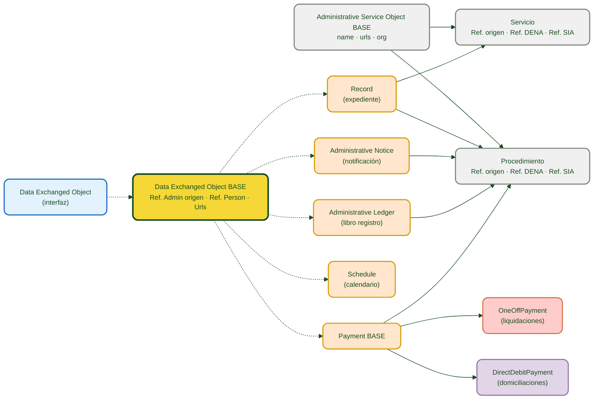
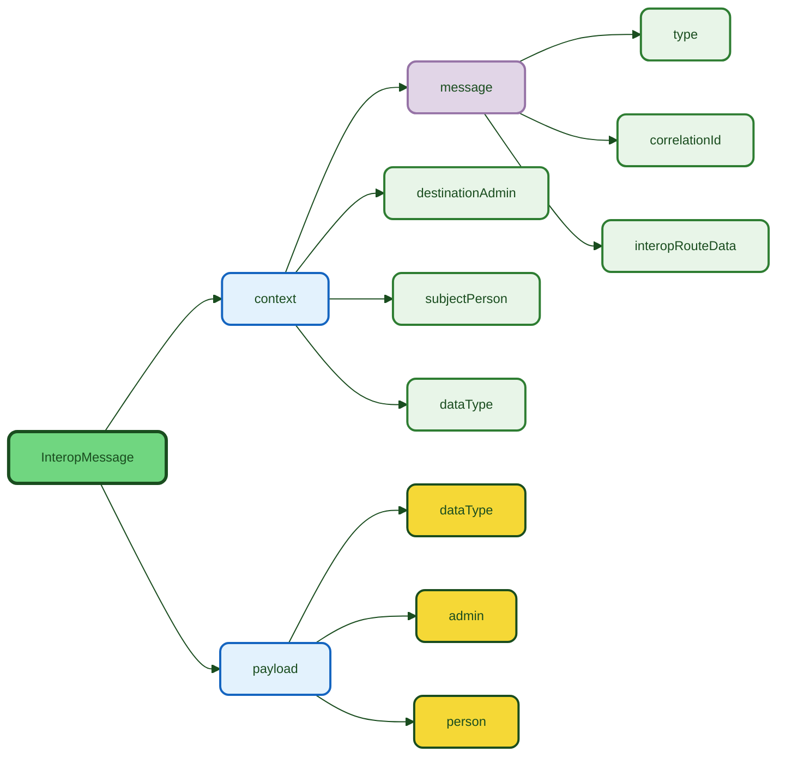
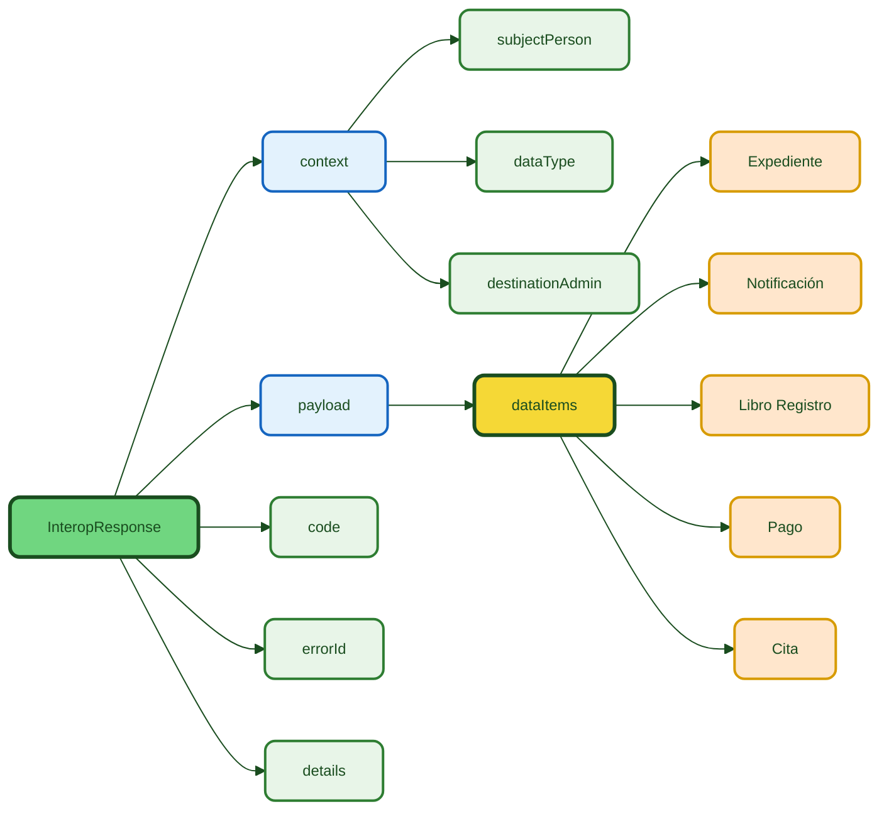

# :material-database-arrow-right: DATA-RETRIEVE

> **Versión:** `v{{ dena.version }}` · **Fecha:** {{ dena.date }}

## ¿Qué es?

**Data-Retrieve** es el mecanismo mediante el cual DENA solicita a cada administración pública los datos de una persona ciudadana. La administración expone un endpoint REST y devuelve los objetos de datos en formato JSON normalizado.

---

## Diagrama de contexto



---

## Modelo Conceptual



---

## Modelo de datos



| Color | Significado |
|-------|-------------|
| 🔵 Azul claro | Interfaz base (contrato) |
| 🟣 Violeta | Clase base abstracta |
| 🟠 Naranja | Objetos de dominio intercambiados |
| 🔴 Rojo claro | Pago único (OneOffPayment) |
| ⚪ Gris claro | Contexto jerárquico (Servicio / Procedimiento) |

| Línea | Significado |
|-------|-------------|
| Discontinua | Herencia ("extiende") |
| Continua | Composición / referencia |

---

## Documentación

!!! tip "Empieza aquí"

    [:octicons-arrow-right-24: **Guía de implementación paso a paso**](./guia-implementacion.md) — Todo lo que necesitas para implementar el endpoint en tu administración.

### Endpoint

| Documento | Contenido |
|---|---|
| [:octicons-arrow-right-24: Endpoint](./endpoint-data-retrieve.md) | Contrato REST: request, response, ejemplos JSON y códigos HTTP |

### Objetos de datos

??? note "Ver todos los objetos de datos"

    | Objeto | Descripción | Documento |
    |---|---|---|
    | **:material-folder-open: Expediente** | Expediente administrativo en tramitación | [expediente.md](./data/expediente.md) |
    | **:material-email-open: Notificación** | Notificación oficial o comunicación | [notificacion.md](./data/notificacion.md) |
    | **:material-credit-card: Pago** | Pago único o domiciliación bancaria | [pago.md](./data/pago.md) |
    | **:material-calendar-clock: Cita** | Cita previa o elemento de agenda | [cita.md](./data/cita.md) |
    | **:material-account-circle: Persona** | Datos de la persona ciudadana | [persona.md](./data/persona.md) |
    | **:material-card-account-details: Credencial de persona** | Carnets, títulos y perfiles lingüísticos | [credencial-persona.md](./data/credencial-persona.md) |
    | **:material-cash: Beneficio económico** | Ayudas y subvenciones | [beneficio-economico.md](./data/beneficio-economico.md) |
    | **:material-book-open-page-variant: Libro Registro** | Asiento registral de entrada/salida | [libro-registro.md](./data/libro-registro.md) |
    | **:material-account-box-multiple: Registro de persona** | Registro de persona (PEV, últimas voluntades…) | [registro-persona.md](./data/registro-persona.md) |
    | **:material-school: Matrícula** | Matrículas y matrículas académicas | [matricula.md](./data/matricula.md) |
    | **:material-medical-bag: Datos médicos** | Datos médicos (categoría especial RGPD) | [datos-medicos.md](./data/datos-medicos.md) |
    | **:material-cog: Servicio Administrativo** | Servicio y procedimiento | [servicio-administrativo.md](./data/servicio-administrativo.md) |
    | **:material-office-building: Unidad Orgánica** | Unidad organizativa participante | [unidad-organica.md](./data/unidad-organica.md) |
    | **:material-book-off: Registro Oficial** *(obsoleto)* | ⚠️ Sustituido por Libro Registro | [registro-oficial.md](./data/registro-oficial.md) |

### Guías complementarias

| Documento | Contenido |
|---|---|
| [:material-database-outline: Campos comunes](./data/campos-comunes.md) | Campos heredados por todos los objetos (OID, ID, URLs, refs) |
| [Validaciones](./validaciones.md) | Reglas de validación, formatos y restricciones |
| [Errores y troubleshooting](./errores-troubleshooting.md) | Guía de errores comunes y resolución |
| [Snippets de código](./snippets-codigo.md) | Implementación en Java, C#, Python, Node.js y PHP |

---

## Resumen del flujo

1. DENA envía `POST /api/retrieveData` con el identificador de la persona y el tipo de dato
2. La administración identifica a la persona (`context.subjectPerson`)
3. La administración filtra por tipo de dato (`context.dataType`)
4. La administración devuelve los objetos en `payload.dataItems[]`

### Tipos de dato (`dataType.id`)

El `id` de `dataType` corresponde al marshallTypeId de cada objeto (enum `DN00DataTypeEnum`):

| `dataType.id` | Datos esperados |
|--------------|-----------------|
| `ADMINISTRATIVE_RECORD` | Expedientes |
| `ADMINISTRATIVE_NOTICE` | Notificaciones |
| `PAYMENT_ONE_OFF_PAYMENT` / `PAYMENT_DIRECT_DEBIT_PAYMENT` | Pagos |
| `SCHEDULE` | Citas |
| `PERSON_DATA` | Datos de persona |
| `PERSON_CREDENTIAL` / `PERSON_CREDENTIAL_FOR_BASQUE_LANGUAGE_DEGREE` | Credenciales de persona |
| `ECONOMIC_BENEFIT` | Beneficios económicos |
| `ADMINISTRATIVE_LEDGER` | Libro registro |
| `ADMINISTRATIVE_PERSON_REGISTER` (+ `…FOR_HOUSING_PEV` / `…FOR_LAST_WILL` / `…FOR_REVISION_PEV`) | Registro de persona |
| `PERSON_ENROLLMENT` / `PERSON_ACADEMIC_ENROLLMENT` | Matrículas |
| `PERSON_MEDICAL_DATA` | Datos médicos |

> **Nota:** La lista completa (17 tipos del enum `DN00DataTypeEnum`) está en [DataTypeRef](../semantica-base/modelo/data-type-ref.md). El tipo `ADMINISTRATIVE_OFFICIAL_REGISTER_RECORD` está **obsoleto**; usa `ADMINISTRATIVE_LEDGER`.

---

## Estructura de la Request



```json
{
    "context": {
        "message": {
            "type": "CLIENT_RETRIEVE_REQ",
            "correlationId": "541ECEAE-228B-4588-9504-44D9094322B5",
            "interopRouteData": [
                {
                    "denaComponentId": "DENA_ADMIN_CONNECTOR",
                    "timestamp": "2026-11-09T20:37:55.847000900Z"
                }
            ]
        },
        "destinationAdmin": {
            "id": "SANDBOXCIF",
            "oid": "6d9d73d4-3d3d-6d3d-ad3d-3d3d3d3d3011"
        },
        "subjectPerson": {
            "id": "11189396B",
            "oid": "631011F3-9A2F-4D08-9F56-B7F4D6A0749E"
        },
        "dataType": {
            "id": "SCHEDULE",
            "oid": "7e0e84e5-4e4e-7e4e-be4e-4e4e4e4e4006"
        }
    },
    "payload": {
        "dataType": {
            "id": "SCHEDULE",
            "oid": "7e0e84e5-4e4e-7e4e-be4e-4e4e4e4e4006"
        },
        "admin": {
            "id": "SANDBOXCIF",
            "oid": "6d9d73d4-3d3d-6d3d-ad3d-3d3d3d3d3011"
        },
        "person": {
            "id": "11189396B",
            "oid": "631011F3-9A2F-4D08-9F56-B7F4D6A0749E"
        }
    }
}
```

| Campo | Obligatorio | Descripción |
|-------|:-----------:|-------------|
| `context.message.type` | ✅ | Tipo de mensaje. Ver [`DN00InteropMessageType`]({{ repos.common_api_blob }}/denaCommonAPIModelClasses/src/main/java/dena/api/common/interop/context/DN00InteropMessageType.java) |
| `context.message.correlationId` | ✅ | UUID de correlación para trazabilidad. Ver [`DN00InteropMessageData`]({{ repos.common_api_blob }}/denaCommonAPIModelClasses/src/main/java/dena/api/common/interop/context/DN00InteropMessageData.java) |
| `context.message.interopRouteData` | ❌ | Traza de componentes. Ver [`DN00IteropRouteDataItem`]({{ repos.common_api_blob }}/denaCommonAPIModelClasses/src/main/java/dena/api/common/interop/context/DN00IteropRouteDataItem.java) |
| `context.dataType` | ✅ | Tipo de dato solicitado. Ver [`DN00DataTypeEnum`]({{ repos.common_data_api_blob }}/denaCommonDataAPIModelClasses/src/main/java/dena/api/data/model/DN00DataTypeEnum.java) |
| `context.destinationAdmin` | ✅ | Administración destino. Ver [`DN00InteropContext`]({{ repos.common_api_blob }}/denaCommonAPIModelClasses/src/main/java/dena/api/common/interop/context/DN00InteropContext.java) |
| `context.subjectPerson` | ✅ | Persona sobre la que se solicitan datos. Ver [`DN00InteropContext`]({{ repos.common_api_blob }}/denaCommonAPIModelClasses/src/main/java/dena/api/common/interop/context/DN00InteropContext.java) |
| `payload.dataType` | ✅ | Tipo de dato solicitado (réplica de `context.dataType`). Ver [`DN00DataTypeEnum`]({{ repos.common_data_api_blob }}/denaCommonDataAPIModelClasses/src/main/java/dena/api/data/model/DN00DataTypeEnum.java) |
| `payload.admin` | ✅ | Administración destino (réplica de `context.destinationAdmin`) |
| `payload.person` | ✅ | Persona sobre la que se solicitan datos (réplica de `context.subjectPerson`) |

### Tipos de mensaje (`message.type`)

| Valor | Descripción |
|-------|-------------|
| `CLIENT_RETRIEVE_REQ` | Petición de recuperación de datos — es el tipo que recibes en tu endpoint |
| `CLIENT_RETRIEVE_RESP` | Respuesta que devuelves con los datos solicitados |

Consulta la lista completa de valores en [Tipos de Mensaje](../semantica-base/modelo/message-types.md).

### Traza de ruta (`interopRouteData`)

Cada vez que el mensaje pasa por un componente DENA, se añade una entrada de traza:

| Campo | Tipo | Descripción |
|-------|------|-------------|
| `denaComponentId` | `DN00InteropComponent` | Identificador del componente (`CLIENT_INSTALLMENT`, `DENA_CORE`, `DENA_ADMIN_CONNECTOR`, `ADMIN`) |
| `timestamp` | `String` (ISO 8601) | Momento en que el componente procesó el mensaje |

---

## Estructura de la Response



```json
{
    "context": {
        "message": {
            "type": "CLIENT_RETRIEVE_RESP",
            "correlationId": "541ECEAE-228B-4588-9504-44D9094322B5",
            "interopRouteData": [
                {
                    "denaComponentId": "DENA_ADMIN_CONNECTOR",
                    "timestamp": "2026-11-09T20:37:55.8470009Z"
                },
                {
                    "denaComponentId": "DENA_ADMIN",
                    "timestamp": "2026-11-10T08:17:46.029Z"
                }
            ]
        },
        "destinationAdmin": {
            "id": "SANDBOXCIF",
            "oid": "6d9d73d4-3d3d-6d3d-ad3d-3d3d3d3d3011"
        },
        "subjectPerson": {
            "id": "11189396B",
            "oid": "631011F3-9A2F-4D08-9F56-B7F4D6A0749E"
        },
        "dataType": {
            "id": "SCHEDULE",
            "oid": "7e0e84e5-4e4e-7e4e-be4e-4e4e4e4e4006"
        }
    },
    "payload": {
        "dataItems": [
            {
                "data": {
                    "type": "scheduleItem",
                    "dayOfMonth": "20",

                    "durationMinutes": 30,
                    "hourOfDay": "10",
                    "id": "SANDBOX-SCHED-1794256626566",
                    "lastChangedAt": "2026-11-09T20:37:06.5668985Z",
                    "minuteOfHour": "0",
                    "monthOfYear": "9",
                    "oid": "D8815353-5B1D-47DE-9B65-57ABB58CEDAB",
                    "priority": "MEDIUM",
                    "subject": {
                        "SPANISH": "Título de familia numerosa",
                        "BASQUE": "Título de familia numerosa"
                    },
                    "urls": [
                        {
                            "id": "48D2",
                            "tags": [
                                "default"
                            ],
                            "value": "https://sandbox.dena.eus/schedules"
                        }
                    ],
                    "year": "2040"
                }
            },
            {
                "data": {
                    "type": "scheduleItem",
                    "dayOfMonth": "22",

                    "durationMinutes": 30,
                    "hourOfDay": "10",
                    "id": "SANDBOX-SCHED-1794256564175",
                    "lastChangedAt": "2026-11-09T20:36:04.1756730Z",
                    "minuteOfHour": "0",
                    "monthOfYear": "12",
                    "oid": "A03F751D-E58B-4767-A0A6-35A7859B3EAA",
                    "priority": "MEDIUM",
                    "subject": {
                        "SPANISH": "Caducidad BakQ",
                        "BASQUE": "Caducidad BakQ"
                    },
                    "urls": [
                        {
                            "id": "AA46",
                            "tags": [
                                "default"
                            ],
                            "value": "https://sandbox.dena.eus/schedules"
                        }
                    ],
                    "year": "2026"
                }
            },
            {
                "data": {
                    "type": "scheduleItem",
                    "dayOfMonth": "12",

                    "durationMinutes": 30,
                    "hourOfDay": "10",
                    "id": "SANDBOX-SCHED-1794256666986",
                    "lastChangedAt": "2026-11-09T20:37:46.9870283Z",
                    "minuteOfHour": "0",
                    "monthOfYear": "11",
                    "oid": "31FB5F96-0F9E-491C-B70A-A126F056C12B",
                    "priority": "MEDIUM",
                    "subject": {
                        "SPANISH": "Cita Osakidetza",
                        "BASQUE": "Cita Osakidetza"
                    },
                    "urls": [
                        {
                            "id": "A754",
                            "tags": [
                                "default"
                            ],
                            "value": "https://sandbox.dena.eus/schedules"
                        }
                    ],
                    "year": "2026"
                }
            }
        ]
    }
}
```

| Campo | Descripción |
|-------|-------------|
| `context` | Eco del contexto recibido (el tipo de mensaje indica la respuesta) |
| `payload.dataItems` | Array de objetos de datos; cada uno envuelto en un campo `"data"` |
| `code` | Estado de la respuesta (`DN00InteropResponseStatus`) |
| `errorId` | Código de error específico (opcional, solo en errores) |
| `details` | Mensaje descriptivo del error (opcional) |

> **Importante:** Cada elemento de `dataItems` contiene el objeto de dato envuelto en un campo `"data"`. El campo `data.type` identifica el tipo concreto de objeto (p.ej. `scheduleItem`). Ver la documentación de cada tipo de dato para la estructura completa.

### Códigos de estado (`code`)

| Código | Descripción |
|--------|-------------|
| `OK` | Mensaje procesado correctamente |
| `CLIENT_ERR` | Error del cliente (petición malformada, datos inválidos) |
| `SERVER_ERR` | Error del servidor (error interno) |
| `QUEUED` | Mensaje encolado para procesamiento asíncrono |

### Códigos HTTP

| Código | Significado |
|--------|-------------|
| `200` | Datos devueltos correctamente (puede ser lista vacía) |
| `400` | Petición malformada |
| `401` | No autorizado |
| `404` | Persona no encontrada |
| `500` | Error interno |

---

## Glosario

| Término | Descripción |
|---------|-------------|
| OID | Identificador técnico único (asignado por el sistema) |
| ID | Identificador de negocio (legible, asignado por la administración) |
| DIR3 | Directorio Común de Unidades Orgánicas y Oficinas de la AGE |
| SIA | Sistema de Información Administrativa (catálogo de servicios AGE) |
| LanguageTexts | Objeto multiidioma con claves `SPANISH`, `BASQUE`, `ENGLISH` |
| dataItems | Array de objetos de dominio devueltos por la administración |
| interopRouteData | Traza de componentes DENA por los que ha pasado el mensaje. Ver [`DN00IteropRouteDataItem`]({{ repos.common_api_blob }}/denaCommonAPIModelClasses/src/main/java/dena/api/common/interop/context/DN00IteropRouteDataItem.java) |
| correlationId | UUID que permite correlacionar request y response. Ver [`DN00InteropMessageData`]({{ repos.common_api_blob }}/denaCommonAPIModelClasses/src/main/java/dena/api/common/interop/context/DN00InteropMessageData.java) |


<!-- DENA-DOC-FOOTER -->
---
<sub>DENA Docs v{{ dena.version }} · {{ dena.date }}</sub>
