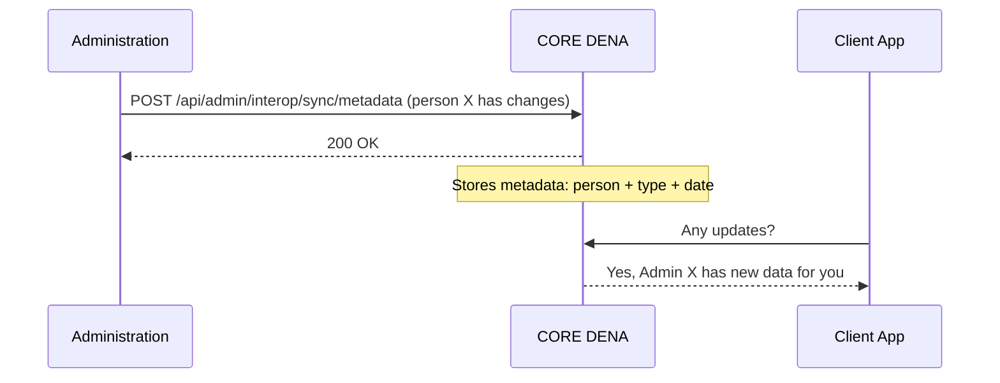
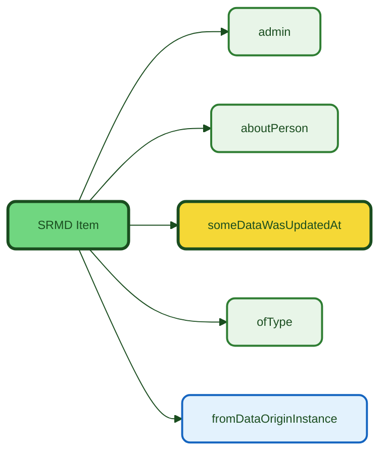
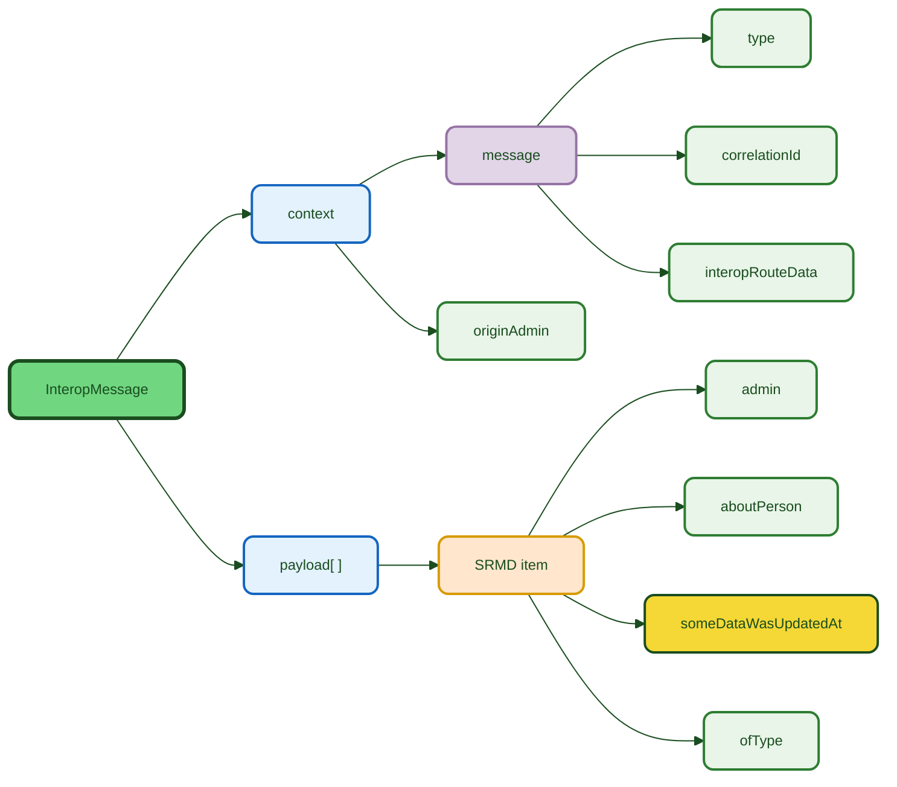
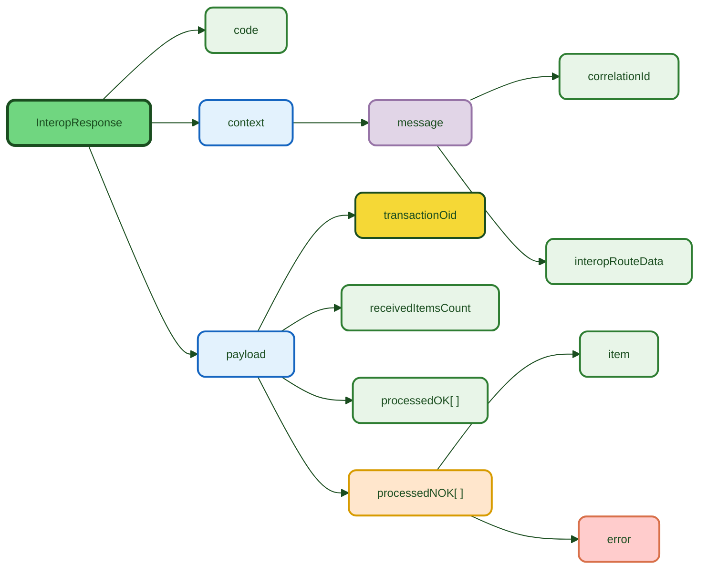

# :material-sync: METADATA-SYNC

> **Version:** `v{{ dena.version }}` · **Date:** {{ dena.date }}

---

## What is it?

**Metadata-Sync** is the mechanism by which administrations notify DENA when changes occur in any data associated with a user.



!!! info "Metadata only"

    DENA **does not store the data itself**, only the date of the last update per combination of:

    - Person
    - Data type
    - Administration

    When the client app needs the actual data, it will request it via [Data-Retrieve](../data-retrieve/index.md).

---

## How to detect changes in your administration

The first thing a data origin has to do to integrate is to **detect what has changed**. For DENA, the only information needed is:

- **Which person** has some modified data (per data type).
- **When** the last change happened.

The **specific data** that changed **does not matter**: only the fact that a change occurred in the data origin and when. An inserted or deleted row also counts as a change.

This is usually a simple SQL query per data type. For example, for a business table with this structure:

| PERSON_ID | PERSON_DATA | CREATED_AT | LAST_UPDATED_AT |
|-----------|-------------|------------|-----------------|
| 48291038Z | … | 2026-08-17T03:22:10Z | 2026-08-17T09:14:22Z |
| 10593847H | … | 2026-08-17T14:05:49Z | 2026-08-17T18:41:03Z |

the query that returns the people with changes after a given date is straightforward:

```sql
SELECT PERSON_ID,
       MAX(COALESCE(LAST_UPDATED_AT, CREATED_AT)) AS LAST_CHANGE_AT
  FROM DB_TABLE
 WHERE COALESCE(LAST_UPDATED_AT, CREATED_AT) >= :from
 GROUP BY PERSON_ID;
```

`COALESCE(LAST_UPDATED_AT, CREATED_AT)` uses `LAST_UPDATED_AT` if present, falling back to `CREATED_AT` if it is `NULL`. The result (person + instant of the last change) is exactly what becomes each SRMD item (`aboutPerson` + `someDataWasUpdatedAt` + `ofType`) sent to DENA.

!!! tip "Centralized collector"

    If your administration has many data origins, instead of one component per origin you can deploy a **centralized changes collector**. See [Integration reference architectures](../../arquitectura/arquitecturas-referencia.md).

---

## Flow summary

1. Your administration detects changes in its database (people with modified data)
2. It builds an array of SRMD items — one per person + data type combination — with the timestamp of the change
3. It sends the array to the DENA SRMD endpoint via `POST`
4. DENA responds indicating which items were processed correctly (`processedOK`) and which failed (`processedNOK`)

---

## SRMD item structure

Each element of `payload[]` describes **a change detected in a person's data**:



| Field | Required | Description |
|---|:---:|---|
| `admin.id` | ✅ | Your administration's identifier |
| `aboutPerson.id` | ✅ | NIF/ID of the affected person |
| `aboutPerson.oid` | ❌ | Internal OID of the person in DENA (if you know it) |
| `someDataWasUpdatedAt` | ✅ | Timestamp of the last change in ISO 8601 with **7 decimal places** (`yyyy-MM-dd'T'HH:mm:ss.SSSSSSSX`) |
| `ofType.id` | ✅ | Data type that changed (e.g. `SCHEDULE`, `PERSON_DATA`). See [catalogue](../semantica-base/modelo/data-type-ref.md) |
| `fromDataOriginInstance` | ❌ | Data origin identifier. Use `"DEFAULT"` if you only have one |

!!! warning "The `someDataWasUpdatedAt` format is critical"
    DENA uses this timestamp to decide whether the data is new or has already been processed. The format must be ISO 8601 with **7 decimal places** for the fractional second: `2026-11-09T20:41:39.8825952Z`

---

## Request structure



```json
{
    "context": {
        "message": {
            "type": "ADMIN_SRMD_SYNC_REQ",
            "correlationId": "9cd46653-284c-468d-81f6-53c84bd50794",
            "interopRouteData": [
                {
                    "denaComponentId": "ADMIN",
                    "timestamp": "2026-11-10T08:07:38.934Z"
                }
            ]
        },
        "originAdmin": {
            "id": "SANDBOXCIF"
        }
    },
    "payload": [
        {
            "admin": {
                "id": "SANDBOXCIF"
            },
            "aboutPerson": {
                "id": "11189396B",
                "oid": "631011F3-9A2F-4D08-9F56-B7F4D6A0749E"
            },
            "someDataWasUpdatedAt": "2026-11-09T20:41:39.8825952Z",
            "ofType": {
                "id": "PERSON_DATA"
            }
        },
        {
            "admin": {
                "id": "SANDBOXCIF"
            },
            "aboutPerson": {
                "id": "11111111B",
                "oid": "631011F3-9A2F-4D08-9F56-B7F4D6A0749E"
            },
            "someDataWasUpdatedAt": "2026-11-09T20:41:39.8825952Z",
            "ofType": {
                "id": "PERSON_DATA"
            }
        }
    ]
}
```

| Field | Required | Description |
|---|:---:|---|
| `context.message.type` | ✅ | Always `ADMIN_SRMD_SYNC_REQ` |
| `context.message.correlationId` | ✅ | Correlation UUID for traceability |
| `context.message.interopRouteData` | ❌ | Component trace (DENA adds it automatically) |
| `context.originAdmin.id` | ✅ | Your administration's identifier |
| `payload[]` | ✅ | Array of SRMD items — at least one |

---

## Response structure



```json
{
    "code": "OK",
    "context": {
        "message": {
            "type": "ADMIN_SRMD_SYNC_RESP",
            "correlationId": "9cd46653-284c-468d-81f6-53c84bd50794",
            "interopRouteData": [
                {
                    "denaComponentId": "DENA_INTEROP_ADMIN_SYNC",
                    "timestamp": "2026-11-10T08:07:39.5179823Z"
                },
                {
                    "denaComponentId": "ADMIN",
                    "timestamp": "2026-11-10T08:07:38.934Z"
                }
            ]
        }
    },
    "payload": {
        "transactionOid": "FFCD3371-D351-427E-A890-0C886BCA1275",
        "receivedItemsCount": 2,
        "processedOK": [
            {
                "admin": { "id": "SANDBOXCIF", "oid": "6d9d73d4-3d3d-6d3d-ad3d-3d3d3d3d3011" },
                "dataLastUpdatedAt": "2026-11-09T20:41:39.8825952Z",
                "dataOriginInstanceId": "DEFAULT",
                "dataType": { "id": "PERSON_DATA", "oid": "7e0e84e5-4e4e-7e4e-be4e-4e4e4e4e4007" },
                "entityVersion": 5,
                "oid": "6485BF2C-5C53-4EC0-ABE3-212DD4403913",
                "person": { "id": "11189396B", "oid": "631011F3-9A2F-4D08-9F56-B7F4D6A0749E" },
                "trackingInfo": {
                    "createdAt": "2026-11-04T17:22:41.6877234Z",
                    "lastUpdatedAt": "2026-11-10T08:07:39.4321202Z"
                }
            }
        ],
        "processedNOK": [
            {
                "item": {
                    "admin": { "id": "SANDBOXCIF", "oid": "6d9d73d4-3d3d-6d3d-ad3d-3d3d3d3d3011" },
                    "aboutPerson": { "oid": "631011F3-9A2F-4D08-9F56-B7F4D6A0749E" },
                    "someDataWasUpdatedAt": "2026-11-09T20:41:39.8825952Z",
                    "ofType": { "id": "PERSON_DATA", "oid": "7e0e84e5-4e4e-7e4e-be4e-4e4e4e4e4007" },
                    "fromDataOriginInstance": "DEFAULT"
                },
                "error": "The [person] with ref=631011F3-9A2F-4D08-9F56-B7F4D6A0749E;null could NOT be validated"
            }
        ]
    }
}
```

| Field | Description |
|---|---|
| `code` | `OK` if the message was processed (even with items in `processedNOK`) |
| `context.message.correlationId` | Echo of the UUID sent in the request |
| `payload.transactionOid` | OID of the transaction assigned by DENA |
| `payload.receivedItemsCount` | Total items received |
| `payload.processedOK[]` | Accepted items with their tracking metadata in DENA |
| `payload.processedNOK[]` | Rejected items — `item` contains the original item and `error` the reason |

> **Note:** `code: "OK"` does not imply all items were accepted. Always check `processedNOK` to detect individual rejections.

### Status codes (`code`)

| Code | Description |
|--------|-------------|
| `OK` | Message processed successfully (may have `processedNOK`) |
| `CLIENT_ERR` | Client error (malformed request) |
| `SERVER_ERR` | Internal DENA error |

### HTTP codes

| Code | Meaning |
|--------|-------------|
| `200` | Processed (check `processedNOK` for individual rejections) |
| `400` | Malformed request |
| `401` | Unauthorized |
| `500` | Internal error |

---

## Documentation

| Document | Content |
|---|---|
| [:octicons-arrow-right-24: Endpoint](./endpoint-sync-metadata.md) | Complete REST contract: request, response, validations and errors |
| [:material-database-outline: SRMD item model](./modelo/sync-metadata-from-admin-to-core-item.md) | Detailed description of each field in the SRMD item |

---

!!! tip "Postman"

    Postman collection and environment available at [`docs/adjuntos/postman/`]({{ repos.docs_tree }}/docs/adjuntos/postman).

<!-- DENA-DOC-FOOTER -->
---
<sub>DENA Docs v{{ dena.version }} · {{ dena.date }}</sub>
