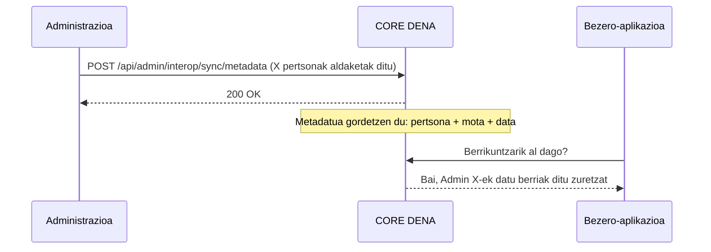
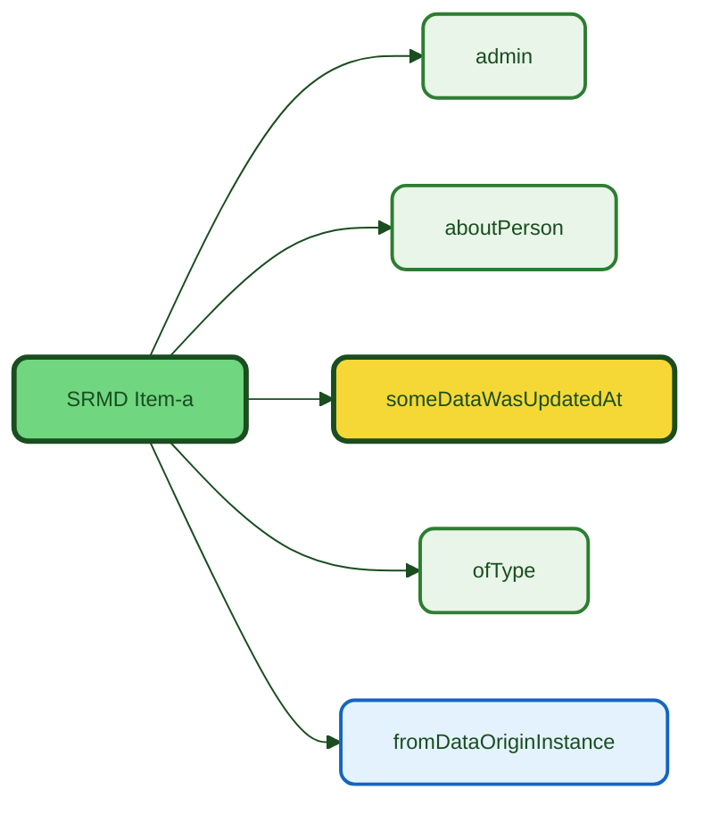
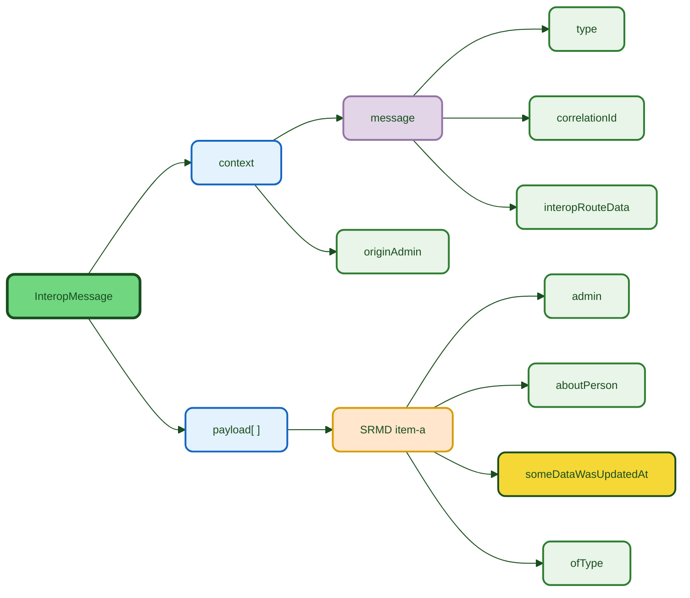
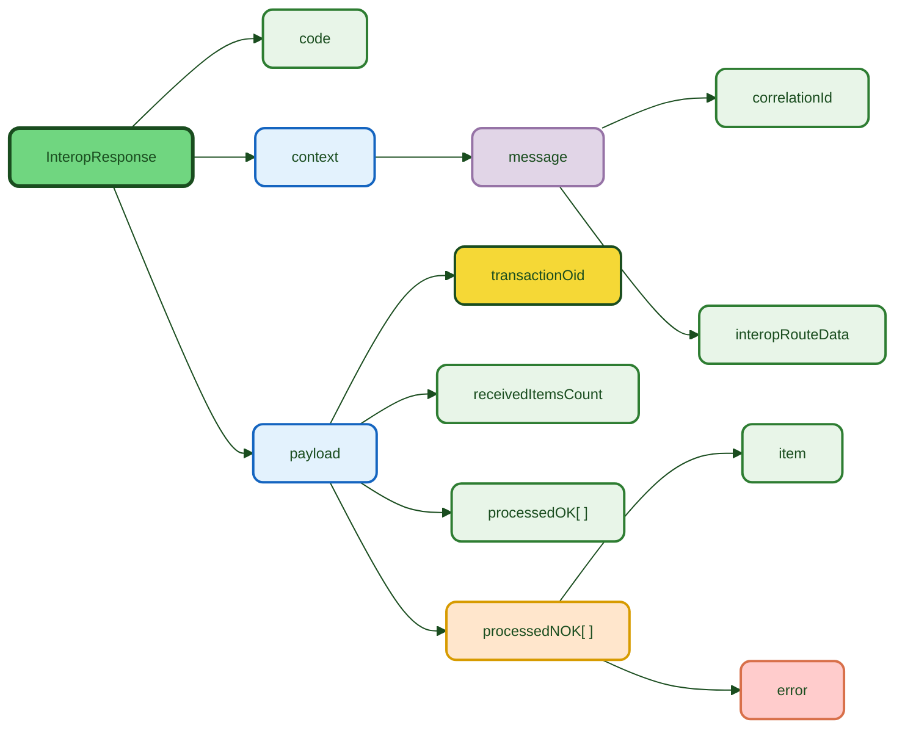

# :material-sync: METADATA-SYNC

> **Bertsioa:** `v{{ dena.version }}` · **Data:** {{ dena.date }}

---

## Zer da?

**Metadata-Sync** administrazioek DENAri jakinarazteko mekanismoa da, erabiltzaile bati lotutako edozein datutan aldaketak gertatzen direnean.



!!! info "Metadatuak soilik"

    DENAk **ez ditu datuak berak gordetzen**, azken eguneratzearen data bakarrik, konbinazio honen arabera:

    - Pertsona
    - Datu mota
    - Administrazioa

    Bezero-aplikazioak benetako datuak behar dituenean, [Data-Retrieve](../data-retrieve/index.md) bidez eskatuko ditu.

---

## Nola detektatu aldaketak zure administrazioan

Datu-jatorri batek integratzeko egin behar duen lehen gauza **zer aldatu den detektatzea** da. DENArentzat, behar den informazio bakarra hau da:

- **Zein pertsonak** duen daturen bat aldatuta (datu-motaka).
- **Noiz** izan zen azken aldaketa.

**Aldatu den datu zehatzak ez du axola**: datu-jatorrian aldaketa bat gertatu dela eta noiz gertatu den soilik axola du. Errenkada bat gehitzea edo ezabatzea ere aldaketatzat hartzen da.

Normalean SQL kontsulta sinple bat da datu-mota bakoitzeko. Adibidez, egitura hau duen negozio-taula baterako:

| PERSON_ID | PERSON_DATA | CREATED_AT | LAST_UPDATED_AT |
|-----------|-------------|------------|-----------------|
| 48291038Z | … | 2026-08-17T03:22:10Z | 2026-08-17T09:14:22Z |
| 10593847H | … | 2026-08-17T14:05:49Z | 2026-08-17T18:41:03Z |

data jakin baten ondorengo aldaketak dituzten pertsonak itzultzen dituen kontsulta zuzena da:

```sql
SELECT PERSON_ID,
       MAX(COALESCE(LAST_UPDATED_AT, CREATED_AT)) AS LAST_CHANGE_AT
  FROM DB_TABLE
 WHERE COALESCE(LAST_UPDATED_AT, CREATED_AT) >= :from
 GROUP BY PERSON_ID;
```

`COALESCE(LAST_UPDATED_AT, CREATED_AT)`-k `LAST_UPDATED_AT` erabiltzen du existitzen bada, eta `CREATED_AT`-ra jotzen du `NULL` bada. Emaitza (pertsona + azken aldaketaren unea) DENAra bidaltzen den SRMD item bakoitza bihurtzen dena da (`aboutPerson` + `someDataWasUpdatedAt` + `ofType`).

!!! tip "Biltzaile zentralizatua"

    Zure administrazioak datu-jatorri asko baditu, jatorri bakoitzeko osagai bat izan beharrean, **aldaketa-biltzaile zentralizatu** bat zabal dezakezu. Ikus [Integrazio-erreferentziako arkitekturak](../../arquitectura/arquitecturas-referencia.md).

---

## Fluxuaren laburpena

1. Zure administrazioak bere datu-basean aldaketak detektatzen ditu (datu aldaketak dituzten pertsonak)
2. SRMD item-en array bat eraikitzen du — pertsona + datu mota konbinazio bakoitzeko bat — aldaketaren unarekin
3. Array-a DENAren SRMD endpoint-era bidaltzen du `POST` bidez
4. DENAk erantzuten du zein item prozesatu diren ondo (`processedOK`) eta zein huts egin duten (`processedNOK`) adieraziz

---

## SRMD item-aren egitura

`payload[]`-ko elementu bakoitzak **pertsona baten datu batean detektatutako aldaketa** bat deskribatzen du:



| Eremua | Derrigorrezkoa | Deskribapena |
|---|:---:|---|
| `admin.id` | ✅ | Zure administrazioaren identifikatzailea |
| `aboutPerson.id` | ✅ | Eragindako pertsonaren NAN/ID |
| `aboutPerson.oid` | ❌ | Pertsonaren barne OIDa DEANn (ezagutzen baduzu) |
| `someDataWasUpdatedAt` | ✅ | Azken aldaketaren unea ISO 8601 formatuan **7 dezimalekin** (`yyyy-MM-dd'T'HH:mm:ss.SSSSSSSX`) |
| `ofType.id` | ✅ | Aldatu den datu mota (adib. `SCHEDULE`, `PERSON_DATA`). Ikus [katalogoa](../semantica-base/modelo/data-type-ref.md) |
| `fromDataOriginInstance` | ❌ | Datu-jatorriaren identifikatzailea. Erabili `"DEFAULT"` bakarra baduzu |

!!! warning "`someDataWasUpdatedAt` formatua kritikoa da"
    DENAk une hori erabiltzen du datua berria ala dagoeneko prozesatua den erabakitzeko. Formatua ISO 8601 izan behar da **7 dezimalekin** segundoaren zatikian: `2026-11-09T20:41:39.8825952Z`

---

## Eskaearen egitura



```json
{
    "context": {
        "message": {
            "type": "ADMIN_SRMD_SYNC_REQ",
            "correlationId": "9cd46653-284c-468d-81f6-53c84bd50794",
            "interopRouteData": [
                {
                    "denaComponentId": "ADMIN",
                    "timestamp": "2026-11-10T08:07:38.934Z"
                }
            ]
        },
        "originAdmin": {
            "id": "SANDBOXCIF"
        }
    },
    "payload": [
        {
            "admin": {
                "id": "SANDBOXCIF"
            },
            "aboutPerson": {
                "id": "11189396B",
                "oid": "631011F3-9A2F-4D08-9F56-B7F4D6A0749E"
            },
            "someDataWasUpdatedAt": "2026-11-09T20:41:39.8825952Z",
            "ofType": {
                "id": "PERSON_DATA"
            }
        },
        {
            "admin": {
                "id": "SANDBOXCIF"
            },
            "aboutPerson": {
                "id": "11111111B",
                "oid": "631011F3-9A2F-4D08-9F56-B7F4D6A0749E"
            },
            "someDataWasUpdatedAt": "2026-11-09T20:41:39.8825952Z",
            "ofType": {
                "id": "PERSON_DATA"
            }
        }
    ]
}
```

| Eremua | Derrigorrezkoa | Deskribapena |
|---|:---:|---|
| `context.message.type` | ✅ | Beti `ADMIN_SRMD_SYNC_REQ` |
| `context.message.correlationId` | ✅ | Trazabilitate-UUID |
| `context.message.interopRouteData` | ❌ | Osagaien arrastoa (DENAk automatikoki gehitzen du) |
| `context.originAdmin.id` | ✅ | Zure administrazioaren identifikatzailea |
| `payload[]` | ✅ | SRMD item-en array-a — gutxienez bat |

---

## Erantzunaren egitura



```json
{
    "code": "OK",
    "context": {
        "message": {
            "type": "ADMIN_SRMD_SYNC_RESP",
            "correlationId": "9cd46653-284c-468d-81f6-53c84bd50794",
            "interopRouteData": [
                {
                    "denaComponentId": "DENA_INTEROP_ADMIN_SYNC",
                    "timestamp": "2026-11-10T08:07:39.5179823Z"
                },
                {
                    "denaComponentId": "ADMIN",
                    "timestamp": "2026-11-10T08:07:38.934Z"
                }
            ]
        }
    },
    "payload": {
        "transactionOid": "FFCD3371-D351-427E-A890-0C886BCA1275",
        "receivedItemsCount": 2,
        "processedOK": [
            {
                "admin": { "id": "SANDBOXCIF", "oid": "6d9d73d4-3d3d-6d3d-ad3d-3d3d3d3d3011" },
                "dataLastUpdatedAt": "2026-11-09T20:41:39.8825952Z",
                "dataOriginInstanceId": "DEFAULT",
                "dataType": { "id": "PERSON_DATA", "oid": "7e0e84e5-4e4e-7e4e-be4e-4e4e4e4e4007" },
                "entityVersion": 5,
                "oid": "6485BF2C-5C53-4EC0-ABE3-212DD4403913",
                "person": { "id": "11189396B", "oid": "631011F3-9A2F-4D08-9F56-B7F4D6A0749E" },
                "trackingInfo": {
                    "createdAt": "2026-11-04T17:22:41.6877234Z",
                    "lastUpdatedAt": "2026-11-10T08:07:39.4321202Z"
                }
            }
        ],
        "processedNOK": [
            {
                "item": {
                    "admin": { "id": "SANDBOXCIF", "oid": "6d9d73d4-3d3d-6d3d-ad3d-3d3d3d3d3011" },
                    "aboutPerson": { "oid": "631011F3-9A2F-4D08-9F56-B7F4D6A0749E" },
                    "someDataWasUpdatedAt": "2026-11-09T20:41:39.8825952Z",
                    "ofType": { "id": "PERSON_DATA", "oid": "7e0e84e5-4e4e-7e4e-be4e-4e4e4e4e4007" },
                    "fromDataOriginInstance": "DEFAULT"
                },
                "error": "The [person] with ref=631011F3-9A2F-4D08-9F56-B7F4D6A0749E;null could NOT be validated"
            }
        ]
    }
}
```

| Eremua | Deskribapena |
|---|---|
| `code` | `OK` mezua prozesatu bada (nahiz eta `processedNOK` elementuak egon) |
| `context.message.correlationId` | Eskaeran bidalitako UUIDaren oihartzuna |
| `payload.transactionOid` | DENAk esleitutako transakzioaren OIDa |
| `payload.receivedItemsCount` | Jasotako item-en kopuru osoa |
| `payload.processedOK[]` | Onartutako item-ak DEANko jarraipen-metadatuekin |
| `payload.processedNOK[]` | Baztertutako item-ak — `item`-ek jatorrizko item-a du eta `error`-ek arrazoia |

> **Oharra:** `code: "OK"` ez du esan nahi item guztiak onartu direnik. Beti egiaztatu `processedNOK` banakako bazterketak detektatzeko.

### Egoera-kodeak (`code`)

| Kodea | Deskribapena |
|--------|-------------|
| `OK` | Mezua ondo prozesatu da (`processedNOK` egon daiteke) |
| `CLIENT_ERR` | Bezeroaren errorea (eskaera gaizki formateatua) |
| `SERVER_ERR` | DEANren barne errorea |

### HTTP kodeak

| Kodea | Esanahia |
|--------|-------------|
| `200` | Prozesatua (egiaztatu `processedNOK` banakako bazterketentzat) |
| `400` | Eskaera gaizki formateatua |
| `401` | Ez baimendua |
| `500` | Barne errorea |

---

## Dokumentazioa

| Dokumentua | Edukia |
|---|---|
| [:octicons-arrow-right-24: Endpoint-a](./endpoint-sync-metadata.md) | REST kontratu osoa: eskaera, erantzuna, baliozkotzeak eta erroreak |
| [:material-database-outline: SRMD item-aren eredua](./modelo/sync-metadata-from-admin-to-core-item.md) | SRMD item-eko eremu bakoitzaren deskribapen xehatua |

---

!!! tip "Postman"

    Postman bilduma eta ingurunea [`docs/adjuntos/postman/`]({{ repos.docs_tree }}/docs/adjuntos/postman)-en eskuragarri.

<!-- DENA-DOC-FOOTER -->
---
<sub>DENA Docs v{{ dena.version }} · {{ dena.date }}</sub>
