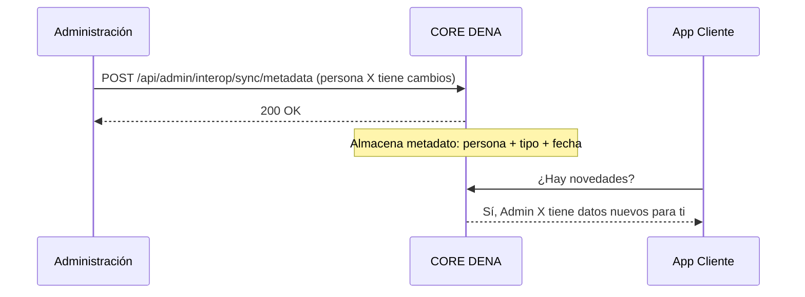
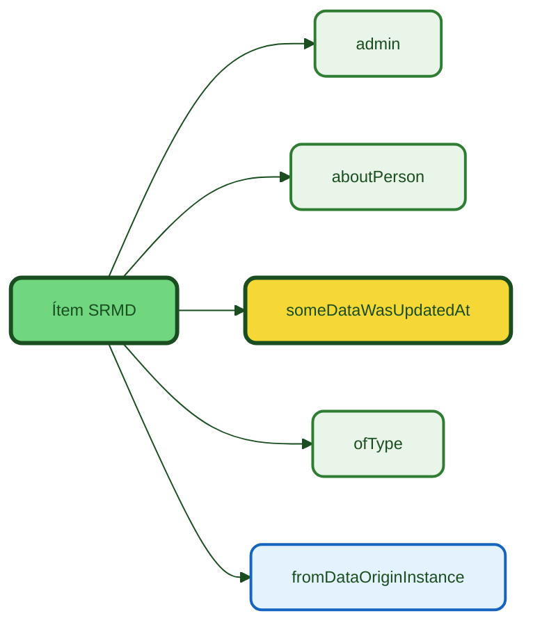
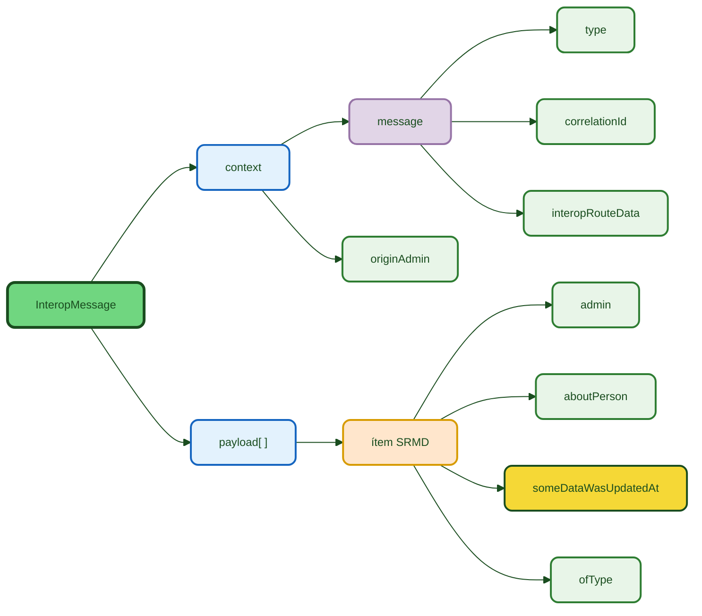
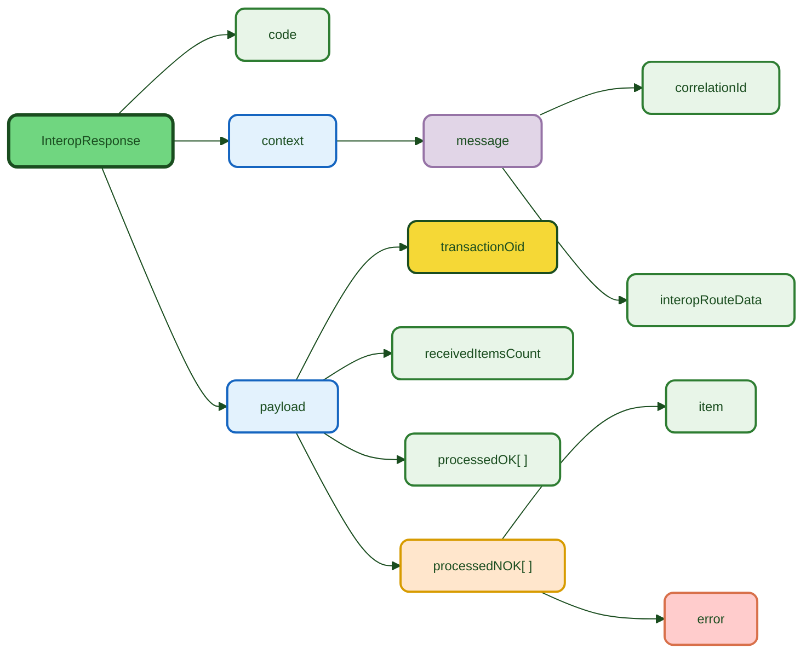

# :material-sync: METADATA-SYNC

> **Versión:** `v{{ dena.version }}` · **Fecha:** {{ dena.date }}

---

## ¿Qué es?

**Metadata-Sync** es el mecanismo mediante el cual las administraciones notifican a DENA cuando se producen cambios en algún dato asociado a una persona usuaria.



!!! info "Solo metadatos"

    DENA **no almacena los datos en sí**, solo la fecha de última actualización por combinación de:

    - Persona
    - Tipo de dato
    - Administración

    Cuando la app cliente necesite los datos reales, los pedirá vía [Data-Retrieve](../data-retrieve/index.md).

---

## Cómo detectar los cambios en tu administración

Lo primero que tiene que hacer un origen de datos para integrarse es **detectar qué ha cambiado**. Para DENA, la única información necesaria es:

- **Qué persona** tiene algún dato modificado (por tipo de dato).
- **Cuándo** fue el último cambio.

El **dato concreto** que ha cambiado **no importa**: solo importa el hecho de que ha habido un cambio en el origen de datos y en qué momento. Un alta o un borrado de fila también cuenta como cambio.

Normalmente esto es una simple consulta SQL por cada tipo de dato. Por ejemplo, para una tabla de negocio con esta estructura:

| PERSON_ID | PERSON_DATA | CREATED_AT | LAST_UPDATED_AT |
|-----------|-------------|------------|-----------------|
| 48291038Z | … | 2026-08-17T03:22:10Z | 2026-08-17T09:14:22Z |
| 10593847H | … | 2026-08-17T14:05:49Z | 2026-08-17T18:41:03Z |

la consulta que devuelve las personas con cambios posteriores a una fecha es directa:

```sql
SELECT PERSON_ID,
       MAX(COALESCE(LAST_UPDATED_AT, CREATED_AT)) AS LAST_CHANGE_AT
  FROM DB_TABLE
 WHERE COALESCE(LAST_UPDATED_AT, CREATED_AT) >= :from
 GROUP BY PERSON_ID;
```

`COALESCE(LAST_UPDATED_AT, CREATED_AT)` usa `LAST_UPDATED_AT` si existe, y recurre a `CREATED_AT` si es `NULL`. El resultado (persona + instante del último cambio) es justo lo que se convierte en cada ítem SRMD (`aboutPerson` + `someDataWasUpdatedAt` + `ofType`) que se envía a DENA.

!!! tip "Colector centralizado"

    Si tu administración tiene muchos orígenes de datos, en lugar de un componente por origen puedes desplegar un **colector de cambios centralizado**. Ver [Arquitecturas de referencia de integración](../../arquitectura/arquitecturas-referencia.md).

---

## Resumen del flujo

1. Tu administración detecta cambios en su base de datos (personas con datos modificados)
2. Construye un array de ítems SRMD — uno por combinación persona + tipo de dato — con el instante del cambio
3. Envía el array al endpoint SRMD de DENA vía `POST`
4. DENA responde indicando qué ítems se procesaron correctamente (`processedOK`) y cuáles fallaron (`processedNOK`)

---

## Estructura del ítem SRMD

Cada elemento del `payload[]` describe **un cambio detectado en un dato de una persona**:



| Campo | Obligatorio | Descripción |
|---|:---:|---|
| `admin.id` | ✅ | Identificador de tu administración |
| `aboutPerson.id` | ✅ | NIF/ID de la persona afectada |
| `aboutPerson.oid` | ❌ | OID interno de la persona en DENA (si lo conoces) |
| `someDataWasUpdatedAt` | ✅ | Instante del último cambio en ISO 8601 con **7 decimales** (`yyyy-MM-dd'T'HH:mm:ss.SSSSSSSX`) |
| `ofType.id` | ✅ | Tipo de dato que cambió (p.ej. `SCHEDULE`, `PERSON_DATA`). Ver [catálogo](../semantica-base/modelo/data-type-ref.md) |
| `fromDataOriginInstance` | ❌ | Identificador del origen de datos. Usa `"DEFAULT"` si solo tienes uno |

!!! warning "El formato de `someDataWasUpdatedAt` es crítico"
    DENA usa este instante para decidir si el dato es nuevo o ya fue procesado. El formato debe ser ISO 8601 con **7 decimales** de fracción de segundo: `2026-11-09T20:41:39.8825952Z`

---

## Estructura de la Petición



```json
{
    "context": {
        "message": {
            "type": "ADMIN_SRMD_SYNC_REQ",
            "correlationId": "9cd46653-284c-468d-81f6-53c84bd50794",
            "interopRouteData": [
                {
                    "denaComponentId": "ADMIN",
                    "timestamp": "2026-11-10T08:07:38.934Z"
                }
            ]
        },
        "originAdmin": {
            "id": "SANDBOXCIF"
        }
    },
    "payload": [
        {
            "admin": {
                "id": "SANDBOXCIF"
            },
            "aboutPerson": {
                "id": "11189396B",
                "oid": "631011F3-9A2F-4D08-9F56-B7F4D6A0749E"
            },
            "someDataWasUpdatedAt": "2026-11-09T20:41:39.8825952Z",
            "ofType": {
                "id": "PERSON_DATA"
            }
        },
        {
            "admin": {
                "id": "SANDBOXCIF"
            },
            "aboutPerson": {
                "id": "11111111B",
                "oid": "631011F3-9A2F-4D08-9F56-B7F4D6A0749E"
            },
            "someDataWasUpdatedAt": "2026-11-09T20:41:39.8825952Z",
            "ofType": {
                "id": "PERSON_DATA"
            }
        }
    ]
}
```

| Campo | Obligatorio | Descripción |
|---|:---:|---|
| `context.message.type` | ✅ | Siempre `ADMIN_SRMD_SYNC_REQ` |
| `context.message.correlationId` | ✅ | UUID de correlación para trazabilidad |
| `context.message.interopRouteData` | ❌ | Traza de componentes (DENA lo añade automáticamente) |
| `context.originAdmin.id` | ✅ | Identificador de tu administración |
| `payload[]` | ✅ | Array de ítems SRMD — al menos uno |

---

## Estructura de la Respuesta



```json
{
    "code": "OK",
    "context": {
        "message": {
            "type": "ADMIN_SRMD_SYNC_RESP",
            "correlationId": "9cd46653-284c-468d-81f6-53c84bd50794",
            "interopRouteData": [
                {
                    "denaComponentId": "DENA_INTEROP_ADMIN_SYNC",
                    "timestamp": "2026-11-10T08:07:39.5179823Z"
                },
                {
                    "denaComponentId": "ADMIN",
                    "timestamp": "2026-11-10T08:07:38.934Z"
                }
            ]
        }
    },
    "payload": {
        "transactionOid": "FFCD3371-D351-427E-A890-0C886BCA1275",
        "receivedItemsCount": 2,
        "processedOK": [
            {
                "admin": { "id": "SANDBOXCIF", "oid": "6d9d73d4-3d3d-6d3d-ad3d-3d3d3d3d3011" },
                "dataLastUpdatedAt": "2026-11-09T20:41:39.8825952Z",
                "dataOriginInstanceId": "DEFAULT",
                "dataType": { "id": "PERSON_DATA", "oid": "7e0e84e5-4e4e-7e4e-be4e-4e4e4e4e4007" },
                "entityVersion": 5,
                "oid": "6485BF2C-5C53-4EC0-ABE3-212DD4403913",
                "person": { "id": "11189396B", "oid": "631011F3-9A2F-4D08-9F56-B7F4D6A0749E" },
                "trackingInfo": {
                    "createdAt": "2026-11-04T17:22:41.6877234Z",
                    "lastUpdatedAt": "2026-11-10T08:07:39.4321202Z"
                }
            }
        ],
        "processedNOK": [
            {
                "item": {
                    "admin": { "id": "SANDBOXCIF", "oid": "6d9d73d4-3d3d-6d3d-ad3d-3d3d3d3d3011" },
                    "aboutPerson": { "oid": "631011F3-9A2F-4D08-9F56-B7F4D6A0749E" },
                    "someDataWasUpdatedAt": "2026-11-09T20:41:39.8825952Z",
                    "ofType": { "id": "PERSON_DATA", "oid": "7e0e84e5-4e4e-7e4e-be4e-4e4e4e4e4007" },
                    "fromDataOriginInstance": "DEFAULT"
                },
                "error": "The [person] with ref=631011F3-9A2F-4D08-9F56-B7F4D6A0749E;null could NOT be validated"
            }
        ]
    }
}
```

| Campo | Descripción |
|---|---|
| `code` | `OK` si el mensaje se procesó (incluso con ítems en `processedNOK`) |
| `context.message.correlationId` | Eco del UUID enviado en la petición |
| `payload.transactionOid` | OID de la transacción asignado por DENA |
| `payload.receivedItemsCount` | Total de ítems recibidos |
| `payload.processedOK[]` | Ítems aceptados con sus metadatos de seguimiento en DENA |
| `payload.processedNOK[]` | Ítems rechazados — `item` contiene el ítem original y `error` el motivo |

> **Nota:** `code: "OK"` no implica que todos los ítems fueron aceptados. Siempre revisa `processedNOK` para detectar rechazos individuales.

### Códigos de estado (`code`)

| Código | Descripción |
|--------|-------------|
| `OK` | Mensaje procesado correctamente (puede haber `processedNOK`) |
| `CLIENT_ERR` | Error del cliente (petición malformada) |
| `SERVER_ERR` | Error interno de DENA |

### Códigos HTTP

| Código | Significado |
|--------|-------------|
| `200` | Procesado (revisa `processedNOK` para rechazos individuales) |
| `400` | Petición malformada |
| `401` | No autorizado |
| `500` | Error interno |

---

## Documentación

| Documento | Contenido |
|---|---|
| [:octicons-arrow-right-24: Endpoint](./endpoint-sync-metadata.md) | Contrato REST completo: request, response, validaciones y errores |
| [:material-database-outline: Modelo del ítem SRMD](./modelo/sync-metadata-from-admin-to-core-item.md) | Descripción detallada de cada campo del ítem SRMD |

---

!!! tip "Postman"

    Colección y environment Postman disponibles en [`docs/adjuntos/postman/`]({{ repos.docs_tree }}/docs/adjuntos/postman).

<!-- DENA-DOC-FOOTER -->
---
<sub>DENA Docs v{{ dena.version }} · {{ dena.date }}</sub>
