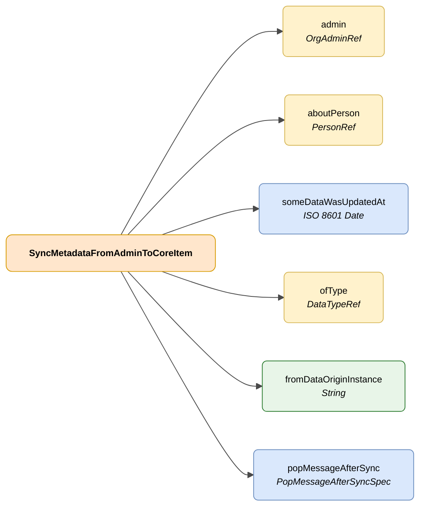

# SyncMetadataFromAdminToCoreItem

## Descripción

Representación de un cambio sobre un dato gestionado por una administración asociado a una persona usuaria de DENA.



| Color | Significado |
|-------|-------------|
| 🟠 Naranja | Objeto principal (SyncMetadataFromAdminToCoreItem) |
| 🟡 Amarillo | Referencia a otro objeto |
| 🔵 Azul claro | Campos de datos |


## Atributos JSON

| Campo    | Tipo     | Obligatorio | Descripción |
|----------|----------|-------------|-------------|
| `admin`  | [OrgAdminRef](../../semantica-base/modelo/org-admin-ref.md) | ✅ | Referencia a la administración donde se ha producido el cambio en el dato |
| `aboutPerson` | [PersonRef](../../semantica-base/modelo/person-ref.md) | ✅ | Referencia a la persona asociada al dato que ha sido modificado |
| `someDataWasUpdatedAt` | `Instant` (ISO 8601, **7 decimales**) | ✅ | Instante en que se produjo el cambio. Formato: `yyyy-MM-dd'T'HH:mm:ss.SSSSSSSX` (ej. `2026-11-09T20:41:39.8825952Z`) |
| `ofType` | [DataTypeRef](../../semantica-base/modelo/data-type-ref.md) | ✅ | Referencia al tipo de dato sobre el que se ha producido el cambio |
| `fromDataOriginInstance` | `String` | ❌ | Instancia origen del dato. Usa `DEFAULT` si solo tienes un origen por tipo de dato |
| `popMessageAfterSync` | [PopMessageAfterSyncSpec](./pop-message-after-sync-spec.md) | ❌ | Mensaje a mostrar a la persona usuaria cuando reciba la información del cambio |

## Ejemplo JSON

```json
{
    "admin": {
        "id": "SANDBOXCIF"
    },
    "aboutPerson": {
        "id": "11189396B",
        "oid": "631011F3-9A2F-4D08-9F56-B7F4D6A0749E"
    },
    "someDataWasUpdatedAt": "2026-11-09T20:41:39.8825952Z",
    "ofType": {
        "id": "PERSON_DATA"
    },
    "fromDataOriginInstance": "DEFAULT"
}
```

<!-- DENA-DOC-FOOTER -->
---
<sub>DENA Docs v{{ dena.version }} · {{ dena.date }}</sub>
