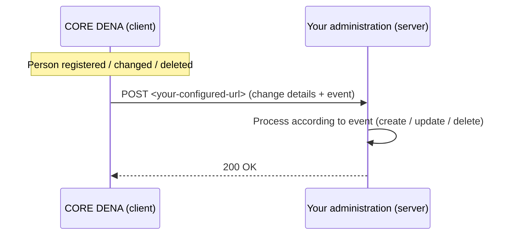
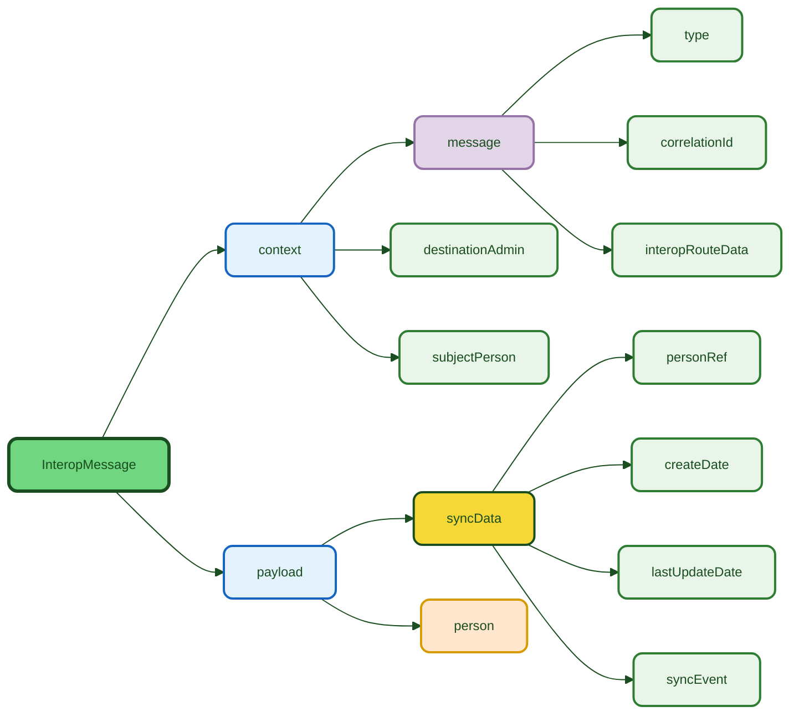

# :material-upload: PERSON-SYNC — PUSH

With the **Push** mechanism, DENA **proactively** notifies your administration whenever a person registers, changes their data, or deletes their account. It is the recommended mechanism when you need to react to changes **in real time**.

---

## How does it work?

In Push, **DENA-CORE is the client** and **your administration is the server**: DENA makes an HTTP `POST` to an endpoint you expose, carrying the change details.



!!! important "DENA does not impose a route"

    There is no predefined path for the push endpoint. Your administration exposes it at **the URL it has configured in DENA** for its connector. DENA will `POST` to that URL. The only requirement is that it accepts `POST` with `application/json` and returns the correct HTTP code.

---

## What must the administration implement?

!!! info "An endpoint that receives the change and acts on the event"

    1. **Expose a `POST` REST endpoint** that receives the notification JSON body.
    2. **Look at the `syncEvent` field** to know what happened and act accordingly:

    | Event | Action |
    |-------|--------|
    | `CREATED` | Create the person in your local copy |
    | `UPDATED` | Update the person's data |
    | `ID_CHANGED` | Update the NIF/NIE (locating the person by `oid`) |
    | `DELETED` | Delete the person **and their associated data** |

    3. **Respond with the HTTP code** reflecting the actual result (`200` if all went well).

---

## Why keep this local copy?

Your administration should only send change notifications ([Metadata-Sync / SRMD](../metadata-sync/index.md)) for people who **actually have a DENA account**. Push keeps your local copy up to date so that you:

- Don't send SRMD for people not in DENA.
- Stop sending SRMD for people who have deleted their account (`DELETED` event).
- Immediately have the basic data (name, contact) of newly registered people.

---

## Push message structure

### Request (DENA → your administration)

DENA sends this message to your endpoint when a person creates, modifies or deletes their account:



```json
{
    "context": {
        "message": {
            "type": "PERSON_PUSH_TO_ADMIN_REQ",
            "correlationId": "6F65F954-5310-40C9-B674-4AAE10C817FF",
            "interopRouteData": [
                { "denaComponentId": "DENA_CORE", "timestamp": "2026-11-09T18:48:01.1692680Z" },
                { "denaComponentId": "DENA_ADMIN_CONNECTOR", "timestamp": "2026-11-09T18:48:01.2682590Z" }
            ]
        },
        "destinationAdmin": { "id": "SANDBOXCIF", "oid": "6d9d73d4-3d3d-6d3d-ad3d-3d3d3d3d3011" },
        "subjectPerson": { "id": "20202020E", "oid": "E0BF74D6-E07A-457F-8F2B-55C4561F33AA" }
    },
    "payload": {
        "syncData": {
            "personRef": { "id": "20202020E", "oid": "E0BF74D6-E07A-457F-8F2B-55C4561F33AA" },
            "createDate": "2026-11-09T17:48:01.1630320Z",
            "lastUpdateDate": "2026-11-09T18:48:01.1630770Z",
            "syncEvent": "CREATED"
        },
        "person": {
            "id": "20202020E",
            "oid": "E0BF74D6-E07A-457F-8F2B-55C4561F33AA",
            "name": "John",
            "surname1": "Doe",
            "surname2": "Smith",
            "lastChangeEvent": "CREATED",
            "entityVersion": 0
        }
    }
}
```

| Field | Description |
|---|---|
| `context.message.type` | Always `PERSON_PUSH_TO_ADMIN_REQ` |
| `context.destinationAdmin` | Your administration (destination) |
| `context.subjectPerson` | The person being synchronized |
| `payload.syncData.personRef` | Person reference (`id` NIF + `oid`) |
| `payload.syncData.createDate` | Person's creation date in DENA |
| `payload.syncData.lastUpdateDate` | Date of the last change |
| `payload.syncData.syncEvent` | Event type: `CREATED`, `UPDATED`, `ID_CHANGED` or `DELETED` |
| `payload.person` | Basic person data (only in `CREATED` and `UPDATED`) |

### Response (your administration → DENA)

Your endpoint returns a simple result:

```json
{
    "context": {
        "message": {
            "type": "PERSON_PUSH_TO_ADMIN_RESP",
            "correlationId": "6F65F954-5310-40C9-B674-4AAE10C817FF",
            "interopRouteData": [
                { "denaComponentId": "DENA_CORE", "timestamp": "2026-11-09T18:48:01.1692680Z" },
                { "denaComponentId": "DENA_ADMIN_CONNECTOR", "timestamp": "2026-11-09T18:48:01.2682590Z" },
                { "denaComponentId": "ADMIN", "timestamp": "2026-11-09T18:48:01.2682590Z" }
            ]
        },
        "destinationAdmin": { "id": "SANDBOXCIF", "oid": "6d9d73d4-3d3d-6d3d-ad3d-3d3d3d3d3011" },
        "subjectPerson": { "id": "20202020E", "oid": "E0BF74D6-E07A-457F-8F2B-55C4561F33AA" }
    },
    "payload": {
        "result": "OK"
    }
}
```

| Field | Description |
|---|---|
| `payload.result` | `"OK"` if your endpoint processed the change correctly |

### HTTP codes

| Code | Meaning |
|---|---|
| `200` | Processed correctly |
| `400` | Malformed request |
| `500` | Internal error in your system |

---

## Endpoint contract

The full specification —request body, per-event processing, response, HTTP codes and implementation checklist— is at:

[:octicons-arrow-right-24: Endpoint Person Push to Admin](./endpoints/push/endpoint-person-push-to-admin.md)

---

!!! tip "When to use Push"

    - When you need to react to person changes **in real time**.
    - When you don't want to depend on periodic files ([Pull](./pull.md)).
    - When your system needs the data immediately to notify changes via Metadata-Sync.

    !!! note "Recommendation: Push + Pull"
        We recommend implementing **both** mechanisms: Push for real time and [off-line Pull](./pull.md) as a fallback to recover any missed notifications.

<!-- DENA-DOC-FOOTER -->
---
<sub>DENA Docs v{{ dena.version }} · {{ dena.date }}</sub>
