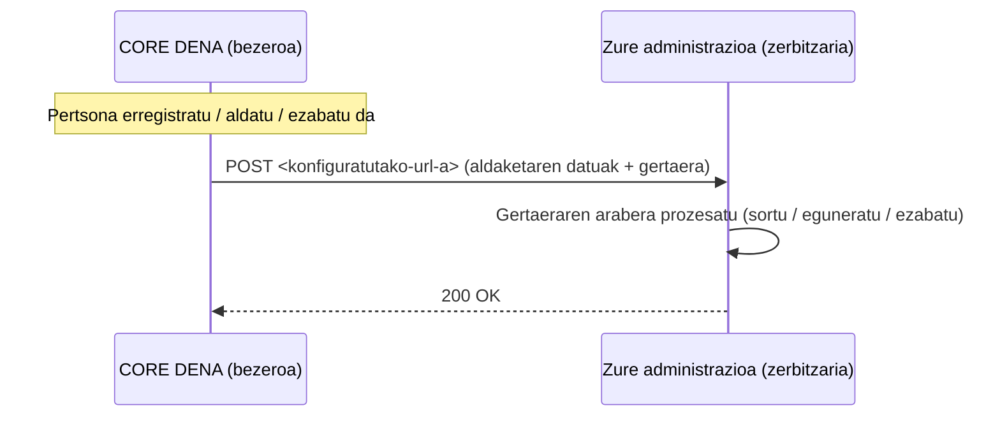
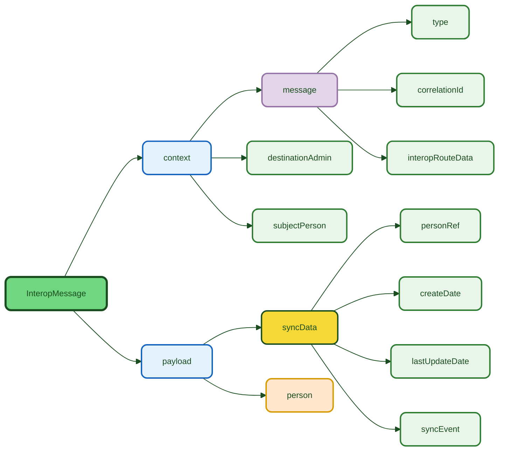

# :material-upload: PERSON-SYNC — PUSH

**Push** mekanismoarekin, DENAk zure administrazioari **proaktiboki** jakinarazten dio pertsona bat erregistratzen den, bere datuak aldatzen dituen edo kontua ezabatzen duen bakoitzean. Aldaketei **denbora errealean** erantzun behar diezunean gomendatzen den mekanismoa da.

---

## Nola funtzionatzen du?

Push-en, **DENA-CORE da bezeroa** eta **zure administrazioa zerbitzaria**: DENAk HTTP `POST` bat egiten dio zuk erakusten duzun endpoint bati, aldaketaren datuekin.



!!! important "DENAk ez du bide finkorik ezartzen"

    Ez dago push endpointerako aurrez definitutako biderik. Zure administrazioak DENAn bere konektorerako **konfiguratu duen URLan** erakusten du. DENAk URL horretara egingo du `POST`. Ezinbestekoa den gauza bakarra da `POST` bat onartzea `application/json`-ekin eta HTTP kode zuzena itzultzea.

---

## Zer inplementatu behar du administrazioak?

!!! info "Aldaketa jaso eta gertaeraren arabera jokatzen duen endpoint bat"

    1. **`POST` REST endpoint bat erakutsi** jakinarazpenaren JSON gorputza jasotzeko.
    2. **`syncEvent` eremua begiratu** zer gertatu den jakiteko eta horren arabera jokatzeko:

    | Gertaera | Ekintza |
    |----------|---------|
    | `CREATED` | Pertsona zure kopia lokalean altan eman |
    | `UPDATED` | Pertsonaren datuak eguneratu |
    | `ID_CHANGED` | NANa/AIZ eguneratu (`oid`-aren bidez kokatuta) |
    | `DELETED` | Pertsona **eta harekin lotutako datuak** ezabatu |

    3. **Emaitza errealari dagokion HTTP kodearekin erantzun** (`200` dena ondo joan bada).

---

## Zergatik da garrantzitsua kopia hori mantentzea?

Zure administrazioak DENAn **benetan kontua duten** pertsonen aldaketa-jakinarazpenak ([Metadata-Sync / SRMD](../metadata-sync/index.md)) baino ez lituzke bidali behar. Push-ek zure kopia lokala egunean mantentzen du, honela:

- Ez dituzu SRMDak bidaltzen DENAn ez dauden pertsonentzat.
- Kontua ezabatu duten pertsonei SRMDak bidaltzeari uzten diozu (`DELETED` gertaera).
- Pertsona berrien oinarrizko datuak (izena, kontaktua) berehala izaten dituzu.

---

## Push mezuaren egitura

### Eskaera (DENA → zure administrazioa)

DENAk mezu hau bidaltzen dio zure endpointari pertsona batek kontua sortzen, aldatzen edo ezabatzen duenean:



```json
{
    "context": {
        "message": {
            "type": "PERSON_PUSH_TO_ADMIN_REQ",
            "correlationId": "6F65F954-5310-40C9-B674-4AAE10C817FF",
            "interopRouteData": [
                { "denaComponentId": "DENA_CORE", "timestamp": "2026-11-09T18:48:01.1692680Z" },
                { "denaComponentId": "DENA_ADMIN_CONNECTOR", "timestamp": "2026-11-09T18:48:01.2682590Z" }
            ]
        },
        "destinationAdmin": { "id": "SANDBOXCIF", "oid": "6d9d73d4-3d3d-6d3d-ad3d-3d3d3d3d3011" },
        "subjectPerson": { "id": "20202020E", "oid": "E0BF74D6-E07A-457F-8F2B-55C4561F33AA" }
    },
    "payload": {
        "syncData": {
            "personRef": { "id": "20202020E", "oid": "E0BF74D6-E07A-457F-8F2B-55C4561F33AA" },
            "createDate": "2026-11-09T17:48:01.1630320Z",
            "lastUpdateDate": "2026-11-09T18:48:01.1630770Z",
            "syncEvent": "CREATED"
        },
        "person": {
            "id": "20202020E",
            "oid": "E0BF74D6-E07A-457F-8F2B-55C4561F33AA",
            "name": "John",
            "surname1": "Doe",
            "surname2": "Smith",
            "lastChangeEvent": "CREATED",
            "entityVersion": 0
        }
    }
}
```

| Eremua | Deskribapena |
|---|---|
| `context.message.type` | Beti `PERSON_PUSH_TO_ADMIN_REQ` |
| `context.destinationAdmin` | Zure administrazioa (helmuga) |
| `context.subjectPerson` | Sinkronizatzen den pertsona |
| `payload.syncData.personRef` | Pertsonaren erreferentzia (`id` IFZ + `oid`) |
| `payload.syncData.createDate` | DENAn pertsonaren sorrera-data |
| `payload.syncData.lastUpdateDate` | Azken aldaketaren data |
| `payload.syncData.syncEvent` | Gertaera mota: `CREATED`, `UPDATED`, `ID_CHANGED` edo `DELETED` |
| `payload.person` | Pertsonaren oinarrizko datuak (soilik `CREATED` eta `UPDATED` gertaeretan) |

### Erantzuna (zure administrazioa → DENA)

Zure endpointak emaitza soil bat itzultzen du:

```json
{
    "context": {
        "message": {
            "type": "PERSON_PUSH_TO_ADMIN_RESP",
            "correlationId": "6F65F954-5310-40C9-B674-4AAE10C817FF",
            "interopRouteData": [
                { "denaComponentId": "DENA_CORE", "timestamp": "2026-11-09T18:48:01.1692680Z" },
                { "denaComponentId": "DENA_ADMIN_CONNECTOR", "timestamp": "2026-11-09T18:48:01.2682590Z" },
                { "denaComponentId": "ADMIN", "timestamp": "2026-11-09T18:48:01.2682590Z" }
            ]
        },
        "destinationAdmin": { "id": "SANDBOXCIF", "oid": "6d9d73d4-3d3d-6d3d-ad3d-3d3d3d3d3011" },
        "subjectPerson": { "id": "20202020E", "oid": "E0BF74D6-E07A-457F-8F2B-55C4561F33AA" }
    },
    "payload": {
        "result": "OK"
    }
}
```

| Eremua | Deskribapena |
|---|---|
| `payload.result` | `"OK"` zure endpointak aldaketa ongi prozesatu badu |

### HTTP kodeak

| Kodea | Esanahia |
|---|---|
| `200` | Ongi prozesatua |
| `400` | Eskaera txarto formateatua |
| `500` | Zure sisteman barne-errorea |

---

## Endpointaren kontratua

Espezifikazio osoa —eskaeraren gorputza, gertaeraka prozesatzea, erantzuna, HTTP kodeak eta inplementazio-egiaztapena— hemen dago:

[:octicons-arrow-right-24: Endpoint Person Push to Admin](./endpoints/push/endpoint-person-push-to-admin.md)

---

!!! tip "Noiz erabili Push"

    - Pertsonen aldaketei **denbora errealean** erantzun behar diezunean.
    - Aldizkako fitxategien mende egon nahi ez duzunean ([Pull](./pull.md)).
    - Zure sistemak datua berehala behar duenean Metadata-Sync bidez aldaketak jakinarazteko.

    !!! note "Gomendioa: Push + Pull"
        **Bi** mekanismoak inplementatzea gomendatzen da: Push denbora errealerako eta [Pull off-line](./pull.md) galdutako jakinarazpenak berreskuratzeko babes gisa.

<!-- DENA-DOC-FOOTER -->
---
<sub>DENA Docs v{{ dena.version }} · {{ dena.date }}</sub>
