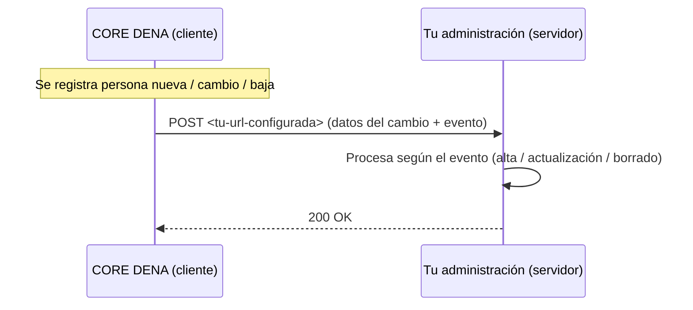
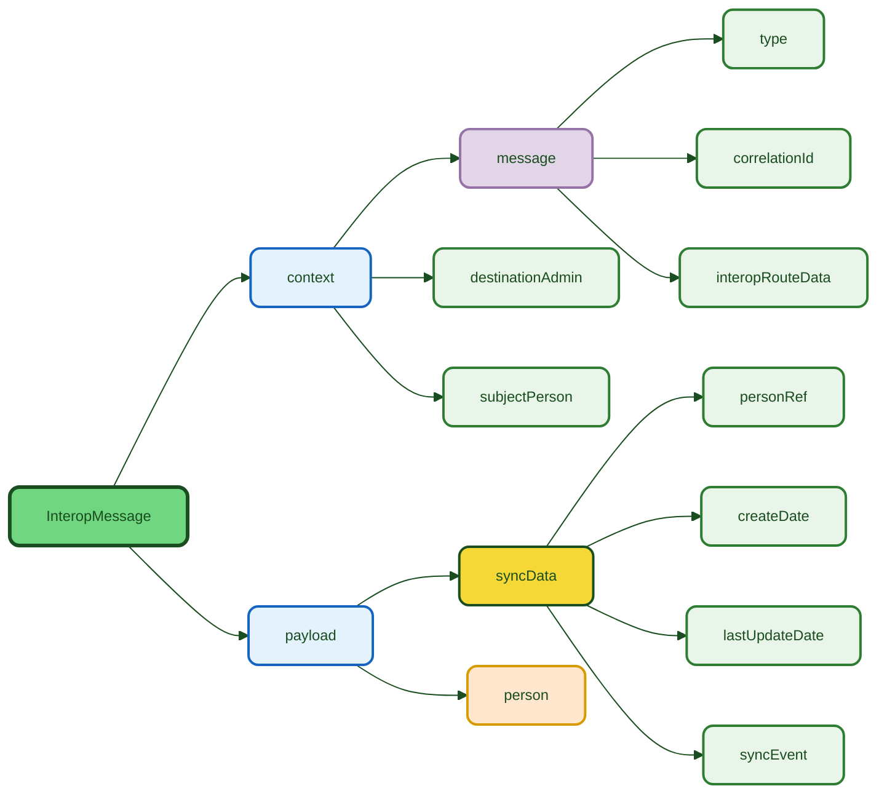

# :material-upload: PERSON-SYNC — PUSH

En el mecanismo **Push**, DENA notifica **proactivamente** a tu administración cada vez que una persona se registra, cambia sus datos o elimina su cuenta. Es el mecanismo recomendado cuando necesitas reaccionar **en tiempo real** a los cambios.

---

## ¿Cómo funciona?

En el Push, **DENA-CORE es el cliente** y **tu administración el servidor**: DENA hace un `POST` HTTP a un endpoint que tú expones, con los datos del cambio.



!!! important "DENA no impone una ruta"

    No existe un path predefinido para el endpoint de push. Tu administración lo expone en **la URL que configure en DENA** para su conector. DENA hará el `POST` contra esa URL. Lo único imprescindible es que acepte `POST` con `application/json` y devuelva el código HTTP correcto.

---

## ¿Qué necesita implementar la administración?

!!! info "Un endpoint que reciba el cambio y actúe según el evento"

    1. **Exponer un endpoint REST `POST`** que reciba el cuerpo JSON de la notificación.
    2. **Mirar el campo `syncEvent`** para saber qué ha pasado y actuar en consecuencia:

    | Evento | Acción |
    |--------|--------|
    | `CREATED` | Alta de la persona en tu copia local |
    | `UPDATED` | Actualización de los datos de la persona |
    | `ID_CHANGED` | Actualización del NIF/NIE (localizando por `oid`) |
    | `DELETED` | Borrado de la persona **y de sus datos asociados** |

    3. **Responder con el código HTTP** que refleje el resultado real (`200` si todo fue bien).

---

## ¿Por qué es importante mantener esta copia?

Tu administración solo debe enviar avisos de cambios ([Metadata-Sync / SRMD](../metadata-sync/index.md)) de personas que **realmente tienen cuenta en DENA**. El Push mantiene tu copia local al día para que:

- No envíes SRMD de personas que no están en DENA.
- Dejes de enviar SRMD de personas que se han dado de baja (evento `DELETED`).
- Dispongas al instante de los datos básicos (nombre, contacto) de las personas nuevas.

---

## Estructura del mensaje Push

### Petición (DENA → tu administración)

DENA envía este mensaje a tu endpoint cuando una persona crea, modifica o elimina su cuenta:



```json
{
    "context": {
        "message": {
            "type": "PERSON_PUSH_TO_ADMIN_REQ",
            "correlationId": "6F65F954-5310-40C9-B674-4AAE10C817FF",
            "interopRouteData": [
                { "denaComponentId": "DENA_CORE", "timestamp": "2026-11-09T18:48:01.1692680Z" },
                { "denaComponentId": "DENA_ADMIN_CONNECTOR", "timestamp": "2026-11-09T18:48:01.2682590Z" }
            ]
        },
        "destinationAdmin": { "id": "SANDBOXCIF", "oid": "6d9d73d4-3d3d-6d3d-ad3d-3d3d3d3d3011" },
        "subjectPerson": { "id": "20202020E", "oid": "E0BF74D6-E07A-457F-8F2B-55C4561F33AA" }
    },
    "payload": {
        "syncData": {
            "personRef": { "id": "20202020E", "oid": "E0BF74D6-E07A-457F-8F2B-55C4561F33AA" },
            "createDate": "2026-11-09T17:48:01.1630320Z",
            "lastUpdateDate": "2026-11-09T18:48:01.1630770Z",
            "syncEvent": "CREATED"
        },
        "person": {
            "id": "20202020E",
            "oid": "E0BF74D6-E07A-457F-8F2B-55C4561F33AA",
            "name": "John",
            "surname1": "Doe",
            "surname2": "Smith",
            "lastChangeEvent": "CREATED",
            "entityVersion": 0
        }
    }
}
```

| Campo | Descripción |
|---|---|
| `context.message.type` | Siempre `PERSON_PUSH_TO_ADMIN_REQ` |
| `context.destinationAdmin` | Tu administración (destino) |
| `context.subjectPerson` | Persona que se sincroniza |
| `payload.syncData.personRef` | Referencia de la persona (`id` NIF + `oid`) |
| `payload.syncData.createDate` | Fecha de creación de la persona en DENA |
| `payload.syncData.lastUpdateDate` | Fecha del último cambio |
| `payload.syncData.syncEvent` | Tipo de evento: `CREATED`, `UPDATED`, `ID_CHANGED` o `DELETED` |
| `payload.person` | Datos básicos de la persona (solo en `CREATED` y `UPDATED`) |

### Respuesta (tu administración → DENA)

Tu endpoint devuelve un resultado simple:

```json
{
    "context": {
        "message": {
            "type": "PERSON_PUSH_TO_ADMIN_RESP",
            "correlationId": "6F65F954-5310-40C9-B674-4AAE10C817FF",
            "interopRouteData": [
                { "denaComponentId": "DENA_CORE", "timestamp": "2026-11-09T18:48:01.1692680Z" },
                { "denaComponentId": "DENA_ADMIN_CONNECTOR", "timestamp": "2026-11-09T18:48:01.2682590Z" },
                { "denaComponentId": "ADMIN", "timestamp": "2026-11-09T18:48:01.2682590Z" }
            ]
        },
        "destinationAdmin": { "id": "SANDBOXCIF", "oid": "6d9d73d4-3d3d-6d3d-ad3d-3d3d3d3d3011" },
        "subjectPerson": { "id": "20202020E", "oid": "E0BF74D6-E07A-457F-8F2B-55C4561F33AA" }
    },
    "payload": {
        "result": "OK"
    }
}
```

| Campo | Descripción |
|---|---|
| `payload.result` | `"OK"` si tu endpoint procesó correctamente el cambio |

### Códigos HTTP

| Código | Significado |
|---|---|
| `200` | Procesado correctamente |
| `400` | Petición malformada |
| `500` | Error interno en tu sistema |

---

## Contrato del endpoint

La especificación completa —cuerpo de la petición, procesamiento por evento, respuesta, códigos HTTP y checklist de implementación— está en:

[:octicons-arrow-right-24: Endpoint Person Push to Admin](./endpoints/push/endpoint-person-push-to-admin.md)

---

!!! tip "Cuándo usar Push"

    - Cuando necesitas reaccionar **en tiempo real** a cambios de personas.
    - Cuando no quieres depender de ficheros periódicos ([Pull](./pull.md)).
    - Cuando tu sistema necesita el dato inmediatamente para poder notificar cambios vía Metadata-Sync.

    !!! note "Recomendación: Push + Pull"
        Se recomienda implementar **ambos** mecanismos: Push para el tiempo real y [Pull off-line](./pull.md) como respaldo para recuperar posibles notificaciones perdidas.

<!-- DENA-DOC-FOOTER -->
---
<sub>DENA Docs v{{ dena.version }} · {{ dena.date }}</sub>
